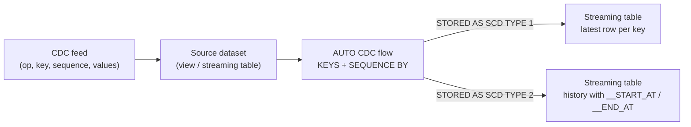

# AUTO CDC API

## Overview

The AUTO CDC APIs apply a change feed (inserts, updates, deletes) to a streaming table in a Lakeflow pipeline. They handle out-of-order events and build SCD Type 1 or Type 2 tables without hand-written `MERGE` logic. `AUTO CDC` reads a CDC feed; `AUTO CDC FROM SNAPSHOT` derives the changes by comparing full snapshots.

> [!note] Platform update (Oct 2026)
> The AUTO CDC APIs **replace the APPLY CHANGES APIs and have the same syntax**. APPLY CHANGES still works, but Databricks recommends AUTO CDC. In Python, `dp.create_auto_cdc_flow()` replaces `apply_changes()` and `dp.create_auto_cdc_from_snapshot_flow()` replaces `apply_changes_from_snapshot()`, each with the same signature. Sources: [The AUTO CDC APIs](https://docs.databricks.com/aws/en/ldp/cdc), [create_auto_cdc_flow](https://docs.databricks.com/aws/en/ldp/developer/ldp-python-ref-apply-changes)

> [!abstract]
>
> - **Target is always a streaming table**, declared first (`CREATE OR REFRESH STREAMING TABLE` / `dp.create_streaming_table()`), then populated by an AUTO CDC flow
> - **Required inputs**: `KEYS` / `keys` (row identity) and `SEQUENCE BY` / `sequence_by` (event order); `STORED AS` / `stored_as_scd_type` is optional and defaults to **SCD Type 1**
> - **SCD Type 2** adds `__START_AT` and `__END_AT`, filled with **sequence values**; the current row has `__END_AT IS NULL`
> - **Lakeflow-only**: AUTO CDC is not part of open-source Apache Spark Declarative Pipelines; it needs serverless or the Pro/Advanced edition

> [!tip] What the Exam Tests
>
> - Implement CDC pipelines using AUTO CDC APIs (formerly APPLY CHANGES) in Lakeflow Pipelines, including SCD Type 1 and Type 2 via `stored_as_scd_type`
> - Configure `keys`, `sequence_by`, `apply_as_deletes`, column selection, and `track_history_column_list` for a scenario
> - Explain how late or out-of-order events are resolved and why `__END_AT IS NULL` identifies current rows
> - Translate older `APPLY CHANGES` / `dlt.apply_changes` code to AUTO CDC

---

## How AUTO CDC Works



| Concept | Meaning in AUTO CDC |
| :--- | :--- |
| Keys | Column(s) that uniquely identify a row; match events to target rows |
| Sequence | Sortable column (or `STRUCT`) giving the logical order of events; must be non-null, with one distinct update per key per sequence value |
| Default action | INSERT and UPDATE events are **upserts**: update the matching row, or insert if none exists |
| Delete | Only when `APPLY AS DELETE WHEN` / `apply_as_deletes` matches |
| Truncate | Only when `APPLY AS TRUNCATE WHEN` / `apply_as_truncates` matches; **SCD Type 1 only** |

Requirements: the pipeline must run on serverless or use the Pro or Advanced edition. The source must be a **streaming** source (read it with `STREAM` in SQL or `spark.readStream` in Python).

## Name Mapping: APPLY CHANGES → AUTO CDC

| Older material | Current |
| :--- | :--- |
| `APPLY CHANGES INTO LIVE.target FROM STREAM(LIVE.src) ...` | `CREATE FLOW f AS AUTO CDC INTO target FROM STREAM(src) ...` |
| `dlt.apply_changes(...)` | `dp.create_auto_cdc_flow(...)` (same arguments) |
| `dlt.apply_changes_from_snapshot(...)` | `dp.create_auto_cdc_from_snapshot_flow(...)` |
| `dlt.create_streaming_table(...)` | `dp.create_streaming_table(...)` (`create_target_table()` and `create_streaming_live_table()` are deprecated) |
| `import dlt` | `from pyspark import pipelines as dp` |

Clauses and arguments (`KEYS`, `SEQUENCE BY`, `APPLY AS DELETE WHEN`, `COLUMNS * EXCEPT`, `STORED AS SCD TYPE`, `TRACK HISTORY ON`, `stored_as_scd_type`, `track_history_column_list`, and so on) are unchanged.

## SQL Syntax

```text
CREATE OR REFRESH STREAMING TABLE table_name;

CREATE FLOW flow_name AS AUTO CDC [ONCE] INTO table_name
FROM source
KEYS (keys)
[IGNORE NULL UPDATES [ON {columnList | * EXCEPT (exceptColumnList)}]]
[APPLY AS DELETE WHEN condition]
[APPLY AS TRUNCATE WHEN condition]
SEQUENCE BY orderByColumn
[SYSTEM SEQUENCE BY systemOrderByColumn]
[COLUMNS {columnList | * EXCEPT (exceptColumnList)}]
[STORED AS {SCD TYPE 1 | SCD TYPE 2 | BITEMPORAL}]
[TRACK HISTORY ON {columnList | * EXCEPT (exceptColumnList)}]
[COLUMNS TO UPDATE columnName]
```

`KEYS` and `SEQUENCE BY` are required; everything else is optional. Expectations on the target use the normal `CONSTRAINT ... EXPECT` clause.

### SCD Type 1 (latest value only)

```sql
CREATE OR REFRESH STREAMING TABLE customers_current;

CREATE FLOW customers_current_cdc AS AUTO CDC INTO customers_current
FROM STREAM(main.cdc.customers_feed)
KEYS (customer_id)
APPLY AS DELETE WHEN operation = 'DELETE'
APPLY AS TRUNCATE WHEN operation = 'TRUNCATE'
SEQUENCE BY sequence_num
COLUMNS * EXCEPT (operation, sequence_num)
STORED AS SCD TYPE 1;
```

### SCD Type 2 (full history)

```sql
CREATE OR REFRESH STREAMING TABLE customers_history;

CREATE FLOW customers_history_cdc AS AUTO CDC INTO customers_history
FROM STREAM(main.cdc.customers_feed)
KEYS (customer_id)
APPLY AS DELETE WHEN operation = 'DELETE'
SEQUENCE BY sequence_num
COLUMNS * EXCEPT (operation, sequence_num)
STORED AS SCD TYPE 2
TRACK HISTORY ON * EXCEPT (last_login_ts);
```

`TRACK HISTORY ON` applies only to SCD Type 2. Without it, a change to **any** output column creates a new version (equivalent to `TRACK HISTORY ON *`). Columns excluded from tracking are updated **in place** on the current version. `APPLY AS TRUNCATE WHEN` is not allowed with SCD Type 2.

### Column selection and partial updates

- `COLUMNS (customer_id, name, city)` keeps only the listed columns; `COLUMNS * EXCEPT (operation, sequence_num)` drops metadata columns. The default includes every source column.
- `COLUMNS` takes column names only. Do casts and renames in the source view, not in `COLUMNS`.
- `IGNORE NULL UPDATES`: a null in an incoming update keeps the existing target value (also for nested columns). Use it when the source sends only changed columns. By default, nulls overwrite.
- `IGNORE NULL UPDATES ON columnList` or `ON * EXCEPT (...)` limits that behavior to some columns, so the others can still apply an explicit null.
- `COLUMNS TO UPDATE colName`: a source column of type `array<string>` lists which columns each record updates, including explicit nulls. It cannot be combined with `IGNORE NULL UPDATES` and is not supported for bitemporal tables.

> [!note]
> `CREATE STREAMING TABLE ... FLOW AUTO CDC ...` (an inline flow on the table definition) is **Beta** (Databricks Runtime 17.3+ and the PREVIEW channel). `CREATE FLOW ... AS AUTO CDC INTO` is the standard form. Bitemporal storage (`STORED AS BITEMPORAL` with `SYSTEM SEQUENCE BY`) is also **Beta**.

## Python Syntax

```python
from pyspark import pipelines as dp

dp.create_auto_cdc_flow(
    target="<target-table>",
    source="<data-source>",
    keys=["key1", "key2"],
    sequence_by="<sequence-column>",
    system_sequence_by=None,                      # bitemporal only (Beta)
    ignore_null_updates=False,
    ignore_null_updates_column_list=None,
    ignore_null_updates_except_column_list=None,
    columns_to_update=None,
    apply_as_deletes=None,
    apply_as_truncates=None,
    column_list=None,
    except_column_list=None,
    stored_as_scd_type="1",                       # 1, 2, or "bitemporal"; default 1
    track_history_column_list=None,
    track_history_except_column_list=None,
    name=None,                                    # flow name; defaults to target
    once=False,                                   # one-time flow (backfill) on a batch source
)
```

| Argument | Type | Notes |
| :--- | :--- | :--- |
| `target` | str | Required. Create it first with `dp.create_streaming_table()` |
| `source` | str | Required. Dataset containing the CDC records |
| `keys` | list | Required. Strings or `col()` without qualifiers (`col("userId")`, not `col("source.userId")`) |
| `sequence_by` | str, `col()`, or `struct()` | Required. Sortable; use `struct("ts", "id")` to break ties |
| `apply_as_deletes` | str or `expr()` | Condition that marks an event as DELETE |
| `apply_as_truncates` | str or `expr()` | Condition that truncates the whole table; SCD Type 1 only |
| `column_list` / `except_column_list` | list | Include or exclude target columns (use one) |
| `stored_as_scd_type` | str or int | `1` (default), `2`, or `"bitemporal"` |
| `track_history_column_list` / `track_history_except_column_list` | list | SCD Type 2: which columns create new versions |
| `ignore_null_updates` | bool | Keep existing values when incoming columns are null; default `False` |

### SCD Type 1 example

```python
from pyspark import pipelines as dp
from pyspark.sql.functions import col, expr

@dp.temporary_view
def customers_feed():
    return spark.readStream.table("main.cdc.customers_feed")

dp.create_streaming_table("customers_current")

dp.create_auto_cdc_flow(
    target="customers_current",
    source="customers_feed",
    keys=["customer_id"],
    sequence_by=col("sequence_num"),
    apply_as_deletes=expr("operation = 'DELETE'"),
    apply_as_truncates=expr("operation = 'TRUNCATE'"),
    except_column_list=["operation", "sequence_num"],
    stored_as_scd_type=1,
)
```

### SCD Type 2 example with selective history

```python
dp.create_streaming_table(
    name="employees_history",
    comment="Employee history (SCD Type 2)",
)

dp.create_auto_cdc_flow(
    target="employees_history",
    source="employees_feed",
    keys=["employee_id"],
    sequence_by=col("event_ts"),
    apply_as_deletes=expr("operation_type = 'D'"),
    except_column_list=["operation_type", "event_ts"],
    stored_as_scd_type=2,
    track_history_column_list=["department_id", "salary", "title"],
)
```

Changes to `department_id`, `salary`, or `title` create a new version; changes to any other column update the current version in place.

## SCD Type 2 Output

`__START_AT` and `__END_AT` hold the **sequence value** of the change that opened or closed each version, and they have the same data type as `sequence_by`. They are timestamps only when you sequence by a timestamp. If you declare the target schema yourself, you must include both columns with that data type.

Docs example: input sequences 1, 2, 5, 6 with a delete of user 123 at sequence 6.

```text
| userId | name     | city        | __START_AT | __END_AT |
|--------|----------|-------------|------------|----------|
| 123    | Isabel   | Monterrey   | 1          | 5        |
| 123    | Isabel   | Chihuahua   | 5          | 6        |  <- closed by the DELETE at 6
| 124    | Raul     | Oaxaca      | 1          | null     |  <- current
| 125    | Mercedes | Tijuana     | 2          | 5        |
| 125    | Mercedes | Mexicali    | 5          | 6        |
| 125    | Mercedes | Guadalajara | 6          | null     |  <- current
| 126    | Lily     | Cancun      | 2          | null     |  <- current
```

With SCD Type 1 on the same feed, the target holds only 124, 125 (Guadalajara), and 126. The update at sequence 5 arrived **after** sequence 6 and is discarded because it is older.

```sql
-- Current rows
SELECT * FROM customers_history WHERE __END_AT IS NULL;

-- Version valid at sequence/time X
SELECT * FROM customers_history
WHERE __START_AT <= :x AND (__END_AT IS NULL OR __END_AT > :x);

-- Friendlier names for downstream users
CREATE VIEW customers_history_v AS
SELECT *, __START_AT AS valid_from, __END_AT AS valid_to FROM customers_history;
```

## Sequencing and Out-of-Order Events

- The sequence column must be sortable and represent the true event order, with **one distinct update per key at each sequence value**. NULL sequence values are not supported.
- Break ties with a struct: `SEQUENCE BY STRUCT(event_ts, event_id)` in SQL, `sequence_by=struct("event_ts", "event_id")` in Python. Ordering uses the first field, then the next on ties.
- Late events with an older sequence never overwrite newer state (SCD Type 1). In SCD Type 2 they are placed in the correct position in history.
- **Deletes and late data**: a deleted row is kept temporarily as a **tombstone** in the underlying Delta table, and a view filters tombstones out. The retention defaults to two days and is set with the table property `pipelines.cdc.tombstoneGCThresholdInSeconds`. Auto Loader does not guarantee file order, so set this above the maximum expected delay of out-of-order deletes.

```python
from pyspark.sql.functions import struct

dp.create_auto_cdc_flow(
    target="orders_current",
    source="orders_feed",
    keys=["order_id"],
    sequence_by=struct("event_ts", "event_id"),
    stored_as_scd_type=1,
)
```

## AUTO CDC FROM SNAPSHOT

Use this when the source has **no change feed**, only periodic full snapshots. The API compares consecutive snapshots: new keys become inserts, changed rows become updates, and keys missing from the new snapshot become **deletes**. It only sees state at snapshot times, so intermediate changes (A → B → C within one day) can appear as A → C.

```python
# Snapshot of a table or view, read on each pipeline update
dp.create_streaming_table("accounts_scd2")

dp.create_auto_cdc_from_snapshot_flow(
    target="accounts_scd2",
    source="accounts_snapshot_view",   # or a function returning (DataFrame, version) or None
    keys=["account_id"],
    stored_as_scd_type=2,
)
```

```sql
CREATE OR REFRESH STREAMING TABLE accounts_scd2;

CREATE FLOW accounts_snapshot_flow AS
AUTO CDC INTO accounts_scd2
FROM SNAPSHOT (SELECT account_id, status, tier FROM main.ops.accounts_snapshot)
WITH VERSION (
  SELECT version FROM main.ops.snapshot_version
  WHERE NOT EXISTS (SELECT 1 FROM last_snapshot_version())
     OR version > (SELECT version FROM last_snapshot_version())
)
KEYS (account_id)
STORED AS SCD TYPE 2;
```

Rules: snapshot versions must increase (a non-increasing version fails the update); there is no `SEQUENCE BY` (ordering comes from `WITH VERSION`); expectations are not supported on a snapshot flow. For SCD Type 1 targets in triggered pipelines, one snapshot flow can share a target with one or more AUTO CDC flows, for example a one-time snapshot backfill (`ONCE`) plus an ongoing CDC feed.

| Source provides | Use |
| :--- | :--- |
| A change feed with operation and sequence (Debezium, GoldenGate, DMS, Delta CDF) | `AUTO CDC` / `create_auto_cdc_flow` |
| Only full table snapshots | `AUTO CDC FROM SNAPSHOT` / `create_auto_cdc_from_snapshot_flow` |
| Initial history then a feed | `AUTO CDC` with a `once` flow for initial hydration, then the continuing feed |

## CDC Source Patterns

```python
from pyspark import pipelines as dp
from pyspark.sql.functions import col, coalesce, expr, from_json

# Debezium envelope from Kafka. For deletes "after" is null, so take the key from "before".
@dp.temporary_view
def customers_debezium():
    return (
        spark.readStream.format("kafka")
        .option("kafka.bootstrap.servers", "broker:9092")
        .option("subscribe", "dbserver1.inventory.customers")
        .load()
        .select(from_json(col("value").cast("string"), debezium_schema).alias("d"))
        .select(
            coalesce(col("d.after.id"), col("d.before.id")).alias("customer_id"),
            col("d.after.name").alias("name"),
            col("d.after.email").alias("email"),
            col("d.op").alias("op"),                 # c / u / d / r
            col("d.ts_ms").alias("event_ts_ms"),
        )
    )

dp.create_streaming_table("customers")

dp.create_auto_cdc_flow(
    target="customers",
    source="customers_debezium",
    keys=["customer_id"],
    sequence_by=col("event_ts_ms"),
    apply_as_deletes=expr("op = 'd'"),
    except_column_list=["op", "event_ts_ms"],
    stored_as_scd_type=1,
)
```

For many tables, generate flows with a **factory function** so each flow captures its own table name (a plain `for` loop that reads the loop variable inside a decorated function binds the last value):

```python
def cdc_table(name, keys):
    @dp.temporary_view(name=f"{name}_feed")
    def feed():
        return spark.readStream.table(f"main.cdc.{name}_feed")

    dp.create_streaming_table(name)
    dp.create_auto_cdc_flow(
        target=name,
        source=f"{name}_feed",
        keys=keys,
        sequence_by="event_ts",
        apply_as_deletes="operation = 'DELETE'",
        except_column_list=["operation", "event_ts"],
        stored_as_scd_type=1,
    )

for table_name, table_keys in [("customers", ["customer_id"]), ("orders", ["order_id"])]:
    cdc_table(table_name, table_keys)
```

## Downstream of an AUTO CDC Target

- **Read the change data feed** of an AUTO CDC target streaming table like any Delta table (`readChangeFeed`, `table_changes`). The table must be published to Unity Catalog and the reader must use Databricks Runtime 15.2+. If a primary key changes (or `__START_AT` changes in SCD Type 2), the feed shows `delete` + `insert` instead of `update_preimage` / `update_postimage`.
- **Do not plain-stream the target**: it receives updates and deletes, so a streaming read of it fails unless you use the change feed (or `skipChangeCommits`, which ignores changes). A materialized view over the target is the simplest option for aggregates.
- **DML on targets**: you can run `INSERT`/`UPDATE`/`DELETE`/`MERGE` against a target published to Unity Catalog, but keep `__START_AT` / `__END_AT` valid and do not evolve the schema with DML.
- **Metrics**: AUTO CDC flows report `num_upserted_rows` and `num_deleted_rows` in the event log (not `num_output_rows`); snapshot flows do not report these.

## Use Cases

- **OLTP mirror for reporting**: SCD Type 1 from a Debezium feed keeps a silver `customers` table equal to the source, with deletes applied, and late events ignored by sequence.
- **Audit history of compensation**: SCD Type 2 with `track_history_column_list=["salary", "department_id"]` keeps a version per change of those columns. Updates to `last_login_ts` overwrite the current row instead of creating noise versions.
- **Legacy system without CDC**: nightly full extracts land as files; `AUTO CDC FROM SNAPSHOT` turns them into an SCD Type 2 dimension, including deletes for keys that disappear.

## Common Issues & Errors

| Symptom | Cause | Fix |
| :--- | :--- | :--- |
| Duplicate or ambiguous results for a key | Two events for one key with the same sequence value | Make the sequence unique per key; use `STRUCT(ts, id)` |
| Errors or unreliable ordering for some keys | NULL values in the sequence column (not supported) | Filter or fill nulls in the source view (`@dp.expect_or_drop("valid_seq", "seq IS NOT NULL")`) |
| Deletes not applied | Delete condition does not match the actual operation values (`'D'` vs `'DELETE'` vs `'d'`) | Inspect distinct values; normalize with `UPPER()` in the source view |
| A deleted key reappears after late, out-of-order events | The delete tombstone was already garbage-collected | Raise `pipelines.cdc.tombstoneGCThresholdInSeconds` above the maximum expected delay |
| Error targeting a managed table with AUTO CDC | `CREATE TABLE ... FLOW` managed tables do not support CDC (`MANAGED_TABLE_DOES_NOT_SUPPORT_CDC`) | Target a streaming table |
| Schema error after declaring the SCD Type 2 schema | `__START_AT` / `__END_AT` missing or wrong type | Add both, typed like `sequence_by` |
| `apply_as_truncates` rejected | Used with SCD Type 2 | Truncate is SCD Type 1 only |
| SCD Type 2 table grows quickly | High-churn columns tracked | Exclude them with `TRACK HISTORY ON * EXCEPT (...)` / `track_history_except_column_list` |
| Cast inside `COLUMNS (...)` fails | `COLUMNS` accepts names only | Transform in the source view |

## Exam Tips

> [!tip]
>
> - **Required**: `KEYS` + `SEQUENCE BY`. **Optional**: `STORED AS` (default **SCD Type 1**), `APPLY AS DELETE WHEN`, `COLUMNS`, `TRACK HISTORY ON`.
> - **`stored_as_scd_type=2`** → history with `__START_AT` / `__END_AT`; **current row = `__END_AT IS NULL`**.
> - **Target must be a streaming table** created before the flow (`dp.create_streaming_table`).
> - **Out-of-order events** are handled by the sequence column, not by watermarks you write.
> - **Truncate is SCD Type 1 only.** Snapshot flows: no `SEQUENCE BY`, no expectations.
> - **Formerly APPLY CHANGES**: same clauses; `dlt.apply_changes` → `dp.create_auto_cdc_flow`.
> - AUTO CDC is a **Lakeflow** feature, not available in open-source Spark Declarative Pipelines.

## Key Takeaways

- **AUTO CDC = APPLY CHANGES renamed**, same syntax; SQL uses `CREATE FLOW ... AS AUTO CDC INTO <streaming table> FROM STREAM(<source>)`, Python uses `dp.create_auto_cdc_flow()`.
- **Keys and sequence** are mandatory; the sequence must be sortable, non-null, and unique per key; use a `STRUCT` to break ties.
- **SCD Type 1** upserts and keeps only the latest row (default). **SCD Type 2** keeps versions with `__START_AT` / `__END_AT` set to sequence values.
- **Deletes** need `APPLY AS DELETE WHEN` / `apply_as_deletes`. They are kept as tombstones (default two days, `pipelines.cdc.tombstoneGCThresholdInSeconds`) to handle late arrivals.
- **Selective history**: `TRACK HISTORY ON` / `track_history_column_list` choose which column changes create versions; other columns update in place.
- **Snapshots only?** Use `AUTO CDC FROM SNAPSHOT` / `create_auto_cdc_from_snapshot_flow`, which infers inserts, updates, and deletes by comparing snapshots.
- **Downstream**: read the target's change data feed (DBR 15.2+, Unity Catalog), or build materialized views on it; do not plain-stream it.

## Related Topics

- [Declarative Pipelines](./06-declarative-pipelines.md) — streaming tables, materialized views, run modes
- [Expectations and Data Quality](../03-data-manipulation/06-expectations-data-quality.md) — validating CDC sources
- [Change Data Capture (CDC) — Part 1](../02-data-ingestion-and-acquisition/04-change-data-capture-part1.md) — Change Data Feed and manual MERGE patterns
- [Change Data Capture (CDC) — Part 2](../02-data-ingestion-and-acquisition/04-change-data-capture-part2.md) — Delta or Iceberg targets, multi-hop CDC
- [SCD Patterns](../09-data-modeling/05-scd-patterns.md) — SCD types in dimensional modeling
- [Lakeflow Event Logs](../04-monitoring-and-alerting/02-lakeflow-event-logs.md) — CDC flow metrics

## Official Documentation

- [The AUTO CDC APIs: Simplify change data capture with pipelines](https://docs.databricks.com/aws/en/ldp/cdc)
- [AUTO CDC INTO (pipelines)](https://docs.databricks.com/aws/en/ldp/developer/ldp-sql-ref-apply-changes-into)
- [CREATE FLOW (pipelines)](https://docs.databricks.com/aws/en/ldp/developer/ldp-sql-ref-create-flow)
- [create_auto_cdc_flow](https://docs.databricks.com/aws/en/ldp/developer/ldp-python-ref-apply-changes)
- [create_auto_cdc_from_snapshot_flow](https://docs.databricks.com/aws/en/ldp/developer/ldp-python-ref-apply-changes-from-snapshot)
- [create_streaming_table](https://docs.databricks.com/aws/en/ldp/developer/ldp-python-ref-streaming-table)
- [Advanced AUTO CDC topics](https://docs.databricks.com/aws/en/ldp/cdc-advanced)
- [Change data capture and snapshots](https://docs.databricks.com/aws/en/data-engineering/what-is-cdc)
- [CREATE TABLE ... FLOW (pipelines)](https://docs.databricks.com/aws/en/ldp/developer/ldp-sql-ref-create-table-flow)

---

**[← Previous: Declarative Pipelines](./06-declarative-pipelines.md) | [↑ Back to Section](./README.md) | [Next: Lakeflow Jobs — Part 1 →](./08-lakeflow-jobs-part1.md)**
