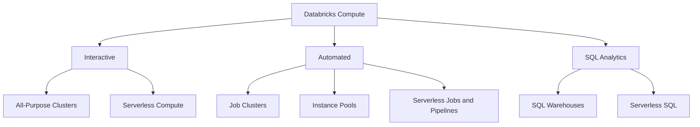
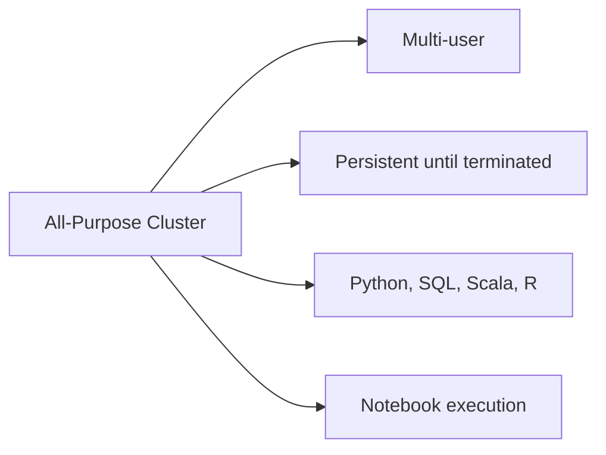
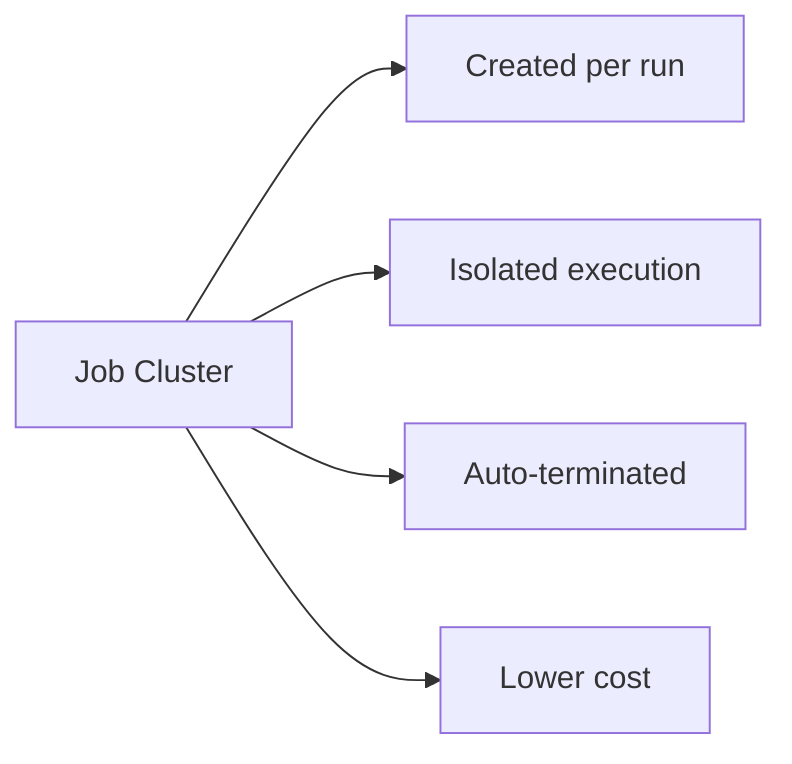
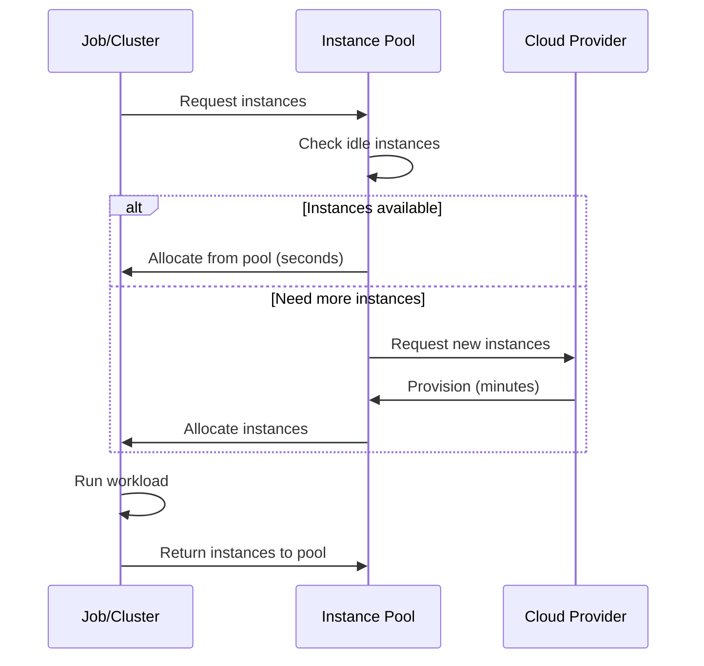
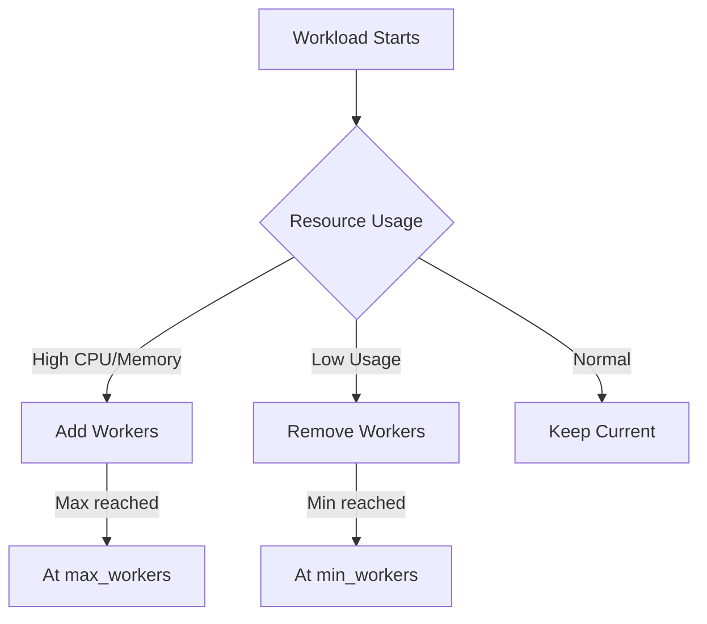

# Databricks Compute — Part 1

Understanding Databricks compute options is essential for building cost-effective, performant data pipelines. This part covers classic compute: all-purpose and job clusters, instance pools, cluster policies, autoscaling, spot instances, and cluster permissions. [Part 2](./09-databricks-compute-part2.md) covers serverless compute (environments, dependencies, performance mode, high memory, auto-optimization), SQL warehouses, and Photon.

## Overview



> [!abstract]
>
> - Classic compute runs in your cloud account: all-purpose clusters for interactive work, job clusters created per run, and instance pools to cut startup time.
> - Cluster policies (`fixed`, `allowlist`, `blocklist`, `range`, `unlimited`) enforce configuration and cost standards.
> - Autoscaling, spot instances with `first_on_demand`, and cluster permissions round out classic configuration.

> [!tip] What the Exam Tests
>
> - "Choose appropriate compute and configuration for environments and dependencies" — know when classic compute is still required and how it is configured.
> - Picking job clusters vs all-purpose clusters, pools, policies, and spot settings for a given cost and reliability constraint.
> - Serverless-specific settings (environments, performance mode, high memory, auto-optimization) are in [Part 2](./09-databricks-compute-part2.md).

## Compute Types Comparison

| Type | Use Case | Cost | Startup Time | Best For |
| :--- | :--- | :--- | :--- | :--- |
| All-Purpose Clusters | Interactive development | Higher | 5-10 minutes | Notebooks, exploration |
| Job Clusters | Production jobs on classic compute | Lower | 5-10 minutes | Scheduled workloads that need classic-only features |
| Serverless Compute | Notebooks, jobs, Lakeflow Pipelines | Pay per use | Seconds (performance-optimized); 4-6 minutes in standard mode | Default for supported job task types |
| Instance Pools | Reduce startup time | Moderate | Seconds | Frequent cluster creation |
| SQL Warehouse | SQL analytics | Per-query | Minutes | BI, dashboards |
| Serverless SQL | SQL analytics | Per-query | Seconds | BI, ad-hoc SQL |

## All-Purpose Clusters

All-purpose clusters are designed for interactive workloads and collaborative development.

### Characteristics



| Feature | Behavior |
| :--- | :--- |
| Persistence | Stays running until manually terminated or auto-terminated |
| Users | Multiple users can attach notebooks |
| Languages | Supports Python, SQL, Scala, R |
| Cost model | Pay while running (even if idle) |
| Auto-termination | Configurable: 10–10,000 minutes of inactivity, or 0 to disable |

### Creating All-Purpose Clusters

```python
# Via SDK

from databricks.sdk import WorkspaceClient

w = WorkspaceClient()

cluster = w.clusters.create(
    cluster_name="dev-cluster",
    spark_version="14.3.x-scala2.12",
    node_type_id="Standard_DS3_v2",
    num_workers=2,
    autotermination_minutes=60,
    spark_conf={
        "spark.speculation": "true",
        "spark.databricks.delta.preview.enabled": "true"
    },
    custom_tags={
        "team": "data-engineering",
        "environment": "development"
    }
).result()

print(f"Cluster ID: {cluster.cluster_id}")
```

```sql
-- Via SQL (for serverless SQL or existing cluster)
-- Clusters are typically created via UI or API, not SQL
```

### Auto-Termination

```python
# Configure auto-termination

w.clusters.edit(
    cluster_id="xxx",
    autotermination_minutes=30  # Terminate after 30 mins idle
)

# Disable auto-termination (not recommended for cost)

w.clusters.edit(
    cluster_id="xxx",
    autotermination_minutes=0  # Never auto-terminate
)
```

| Setting | Behavior |
| :--- | :--- |
| `autotermination_minutes=0` | Never auto-terminate |
| `autotermination_minutes=60` | Terminate after 60 mins idle |
| Not set (Clusters API) | Cluster is not automatically terminated |

## Job Clusters

Job clusters are created for specific job runs and terminated after completion.

### Characteristics



| Feature | Behavior |
| :--- | :--- |
| Lifecycle | Created when job starts, terminated when job ends |
| Isolation | Dedicated to single job run |
| Cost model | Pay only during job execution |
| Configuration | Defined in job specification |
| Reuse | Cannot be reused between runs |

### Job Cluster Configuration

```python
from databricks.sdk import WorkspaceClient
from databricks.sdk.service.jobs import Task, NotebookTask

w = WorkspaceClient()

job = w.jobs.create(
    name="Daily ETL",
    tasks=[
        Task(
            task_key="etl_task",
            notebook_task=NotebookTask(
                notebook_path="/Jobs/etl_pipeline"
            ),
            new_cluster={  # Job cluster definition
                "spark_version": "14.3.x-scala2.12",
                "node_type_id": "Standard_DS3_v2",
                "num_workers": 4,
                "spark_conf": {
                    "spark.sql.shuffle.partitions": "200"
                }
            }
        )
    ]
)
```

### Job Cluster vs Existing Cluster

```python
# Using job cluster (recommended for production)

task_with_new_cluster = Task(
    task_key="task1",
    new_cluster={
        "spark_version": "14.3.x-scala2.12",
        "num_workers": 2,
        "node_type_id": "Standard_DS3_v2"
    },
    notebook_task=NotebookTask(notebook_path="/Jobs/task1")
)

# Using existing all-purpose cluster (for development)

task_with_existing_cluster = Task(
    task_key="task1",
    existing_cluster_id="1234-567890-abc",
    notebook_task=NotebookTask(notebook_path="/Jobs/task1")
)
```

| Approach | Pros | Cons |
| :--- | :--- | :--- |
| Job Cluster | Isolated, cost-effective, consistent | Startup overhead |
| Existing Cluster | Faster start, shared resources | Resource contention, higher cost |

## Instance Pools

Instance pools maintain a set of idle instances ready for quick allocation.

### How Pools Work



### Pool Configuration

```python
from databricks.sdk import WorkspaceClient

w = WorkspaceClient()

pool = w.instance_pools.create(
    instance_pool_name="etl-pool",
    node_type_id="Standard_DS3_v2",
    min_idle_instances=2,  # Always keep 2 instances ready
    max_capacity=10,       # Maximum instances in pool
    idle_instance_autotermination_minutes=30,  # Terminate idle after 30 mins
    preloaded_spark_versions=["14.3.x-scala2.12"]  # Pre-install Spark
)

print(f"Pool ID: {pool.instance_pool_id}")
```

### Using Pools with Clusters

```python
# All-purpose cluster using pool

cluster = w.clusters.create(
    cluster_name="dev-cluster",
    spark_version="14.3.x-scala2.12",
    instance_pool_id="pool-123",  # Use pool for workers
    driver_instance_pool_id="pool-123",  # Use pool for driver
    num_workers=2
)

# Job cluster using pool

job = w.jobs.create(
    name="Pooled Job",
    tasks=[Task(
        task_key="task1",
        new_cluster={
            "spark_version": "14.3.x-scala2.12",
            "instance_pool_id": "pool-123",
            "driver_instance_pool_id": "pool-123",
            "num_workers": 4
        },
        notebook_task=NotebookTask(notebook_path="/Jobs/task1")
    )]
)
```

### Pool Best Practices

| Setting | Recommendation | Reason |
| :--- | :--- | :--- |
| `min_idle_instances` | 1-2 | Balance cost vs startup time |
| `max_capacity` | Based on peak usage | Prevent over-provisioning |
| `idle_instance_autotermination_minutes` | 15-30 | Reduce idle costs |
| `preloaded_spark_versions` | Your common versions | Faster startup |

## Cluster Policies

Cluster policies enforce configuration standards and cost controls.

### Policy Structure

```json
{
  "spark_version": {
    "type": "fixed",
    "value": "14.3.x-scala2.12"
  },
  "node_type_id": {
    "type": "allowlist",
    "values": ["Standard_DS3_v2", "Standard_DS4_v2"]
  },
  "num_workers": {
    "type": "range",
    "minValue": 1,
    "maxValue": 10
  },
  "autotermination_minutes": {
    "type": "fixed",
    "value": 60,
    "hidden": true
  },
  "custom_tags.team": {
    "type": "fixed",
    "value": "data-engineering"
  }
}
```

### Policy Types

| Type | Behavior | Example |
| :--- | :--- | :--- |
| `fixed` | Cannot be changed | Specific Spark version |
| `allowlist` | Must be from list | Approved instance types |
| `blocklist` | Cannot be from list | Expensive instances |
| `range` | Within min/max | 1-10 workers |
| `unlimited` | No restriction | Any value allowed |

### Creating Policies

```python
import json

policy = w.cluster_policies.create(
    name="Standard ETL Policy",
    definition=json.dumps({
        "spark_version": {"type": "fixed", "value": "14.3.x-scala2.12"},
        "node_type_id": {
            "type": "allowlist",
            "values": ["Standard_DS3_v2", "Standard_DS4_v2"]
        },
        "num_workers": {"type": "range", "minValue": 1, "maxValue": 20},
        "autotermination_minutes": {"type": "fixed", "value": 60}
    })
)
```

### Using Policies

```python
# Create cluster with policy

cluster = w.clusters.create(
    cluster_name="policy-cluster",
    policy_id="policy-123",  # Apply policy
    num_workers=4  # Must comply with policy
)
```

## Autoscaling

### Cluster Autoscaling

```python
# Enable autoscaling

cluster = w.clusters.create(
    cluster_name="autoscale-cluster",
    spark_version="14.3.x-scala2.12",
    node_type_id="Standard_DS3_v2",
    autoscale={
        "min_workers": 2,
        "max_workers": 10
    }
)
```

### Autoscaling Behavior



| Metric | Scale Up Trigger | Scale Down Trigger |
| :--- | :--- | :--- |
| Pending tasks | High queue | Empty queue |
| Executor memory | >90% used | <30% used |
| Shuffle | Spilling to disk | Under-utilized |

### Optimized Autoscaling

```python
# Enhanced autoscaling (Databricks-specific)

cluster = w.clusters.create(
    cluster_name="optimized-autoscale",
    spark_version="14.3.x-scala2.12",
    node_type_id="Standard_DS3_v2",
    autoscale={
        "min_workers": 1,
        "max_workers": 8
    },
    spark_conf={
        "spark.databricks.cluster.scaling.optimized.enabled": "true"
    }
)
```

## Spot Instances

Use spot/preemptible instances for cost savings.

### Spot Configuration

```python
# AWS spot instances

cluster = w.clusters.create(
    cluster_name="spot-cluster",
    spark_version="14.3.x-scala2.12",
    node_type_id="m5.xlarge",
    num_workers=4,
    aws_attributes={
        "first_on_demand": 1,  # Driver on-demand
        "availability": "SPOT_WITH_FALLBACK",
        "spot_bid_price_percent": 100
    }
)

# Azure spot instances

cluster = w.clusters.create(
    cluster_name="spot-cluster",
    spark_version="14.3.x-scala2.12",
    node_type_id="Standard_DS3_v2",
    num_workers=4,
    azure_attributes={
        "first_on_demand": 1,
        "availability": "SPOT_WITH_FALLBACK_AZURE",
        "spot_bid_max_price": -1  # Use current price
    }
)
```

### Spot Availability Options

| Option | Behavior | Risk |
| :--- | :--- | :--- |
| `SPOT` | All spot instances | Higher interruption risk |
| `SPOT_WITH_FALLBACK` | Spot preferred, on-demand fallback | Lower risk, higher potential cost |
| `ON_DEMAND` | All on-demand | No interruption, highest cost |

## Cluster Permissions

### Permission Levels

| Permission | Capabilities |
| :--- | :--- |
| No Permission | Cannot see cluster |
| Can Attach To | Attach notebooks |
| Can Restart | Attach + restart cluster |
| Can Manage | Full control |

### Setting Permissions

```python
from databricks.sdk.service.iam import AccessControlList, AccessControlRequest

w.permissions.set(
    object_type="clusters",
    object_id="cluster-id",
    access_control_list=[
        AccessControlRequest(
            user_name="user@company.com",
            permission_level="CAN_ATTACH_TO"
        ),
        AccessControlRequest(
            group_name="data-engineers",
            permission_level="CAN_RESTART"
        )
    ]
)
```

> **Continue reading:** [Part 2 — Serverless Compute, Environments, SQL Warehouses, Photon & Exam Tips](./09-databricks-compute-part2.md)

---

**[Next: Databricks Compute — Part 2 →](./09-databricks-compute-part2.md)**
