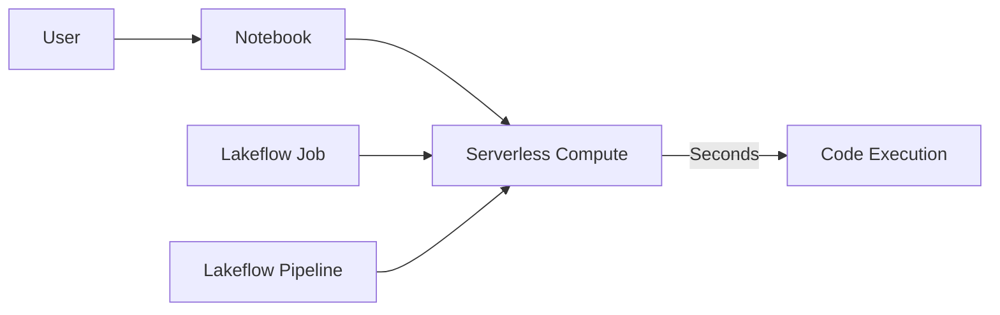
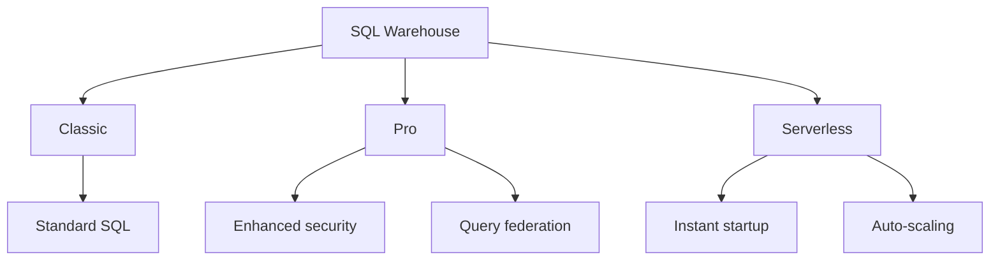
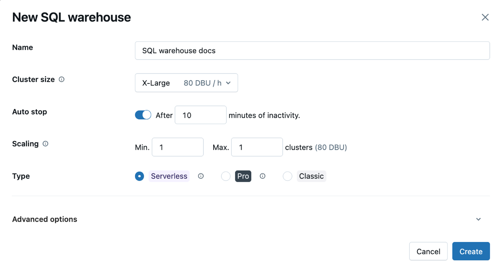
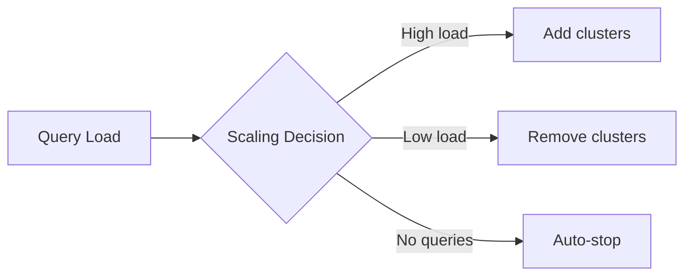
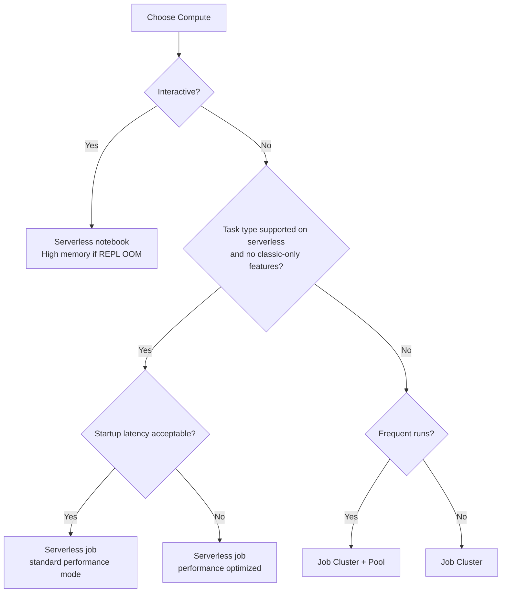

# Databricks Compute — Part 2

This part covers serverless compute for notebooks, jobs, and Lakeflow Pipelines, including how to configure environments and dependencies, performance mode, high-memory notebook tasks, and auto-optimization, plus SQL warehouses and Photon.

> For all-purpose and job clusters, instance pools, cluster policies, autoscaling, spot instances, and cluster permissions, see [Part 1](./09-databricks-compute-part1.md).

## Overview

> [!abstract]
>
> - Serverless compute is Databricks-managed and available by default in Unity Catalog workspaces; Databricks recommends it for all job tasks that support it.
> - Instead of a Databricks Runtime version, serverless workloads pick an **environment version** (Python version + preinstalled packages, supported for three years) and a **base environment**, then add dependencies.
> - **Performance optimized** (default) vs **standard** performance mode trades startup latency (standard: 4–6 minutes) for fewer DBUs on jobs and pipelines.
> - **High memory** (32 GB instead of 16 GB) applies to notebooks and notebook tasks; **serverless auto-optimization** retries failed tasks and can be disabled for at-most-once workloads.

> [!tip] What the Exam Tests
>
> - "Choose appropriate compute and configuration for environments and dependencies — including serverless compute (serverless environments, dependency management, performance mode), high-memory notebook tasks, and auto-optimization settings (e.g., disallowing retries)."
> - Mapping a requirement (lowest cost, fastest start, driver OOM, non-idempotent task, classic-only feature) to the right serverless setting or to classic compute.
> - Knowing which serverless settings exist for notebooks vs jobs vs pipelines.

## Serverless Compute

Serverless compute is a Databricks-managed service for notebooks, Lakeflow Jobs, and Lakeflow Pipelines. Databricks allocates and scales the compute; autoscaling and Photon are enabled automatically for serverless jobs, and Databricks upgrades the underlying runtime without code changes.



| Feature | Behavior |
| :--- | :--- |
| Startup time | Seconds in performance-optimized mode; 4–6 minutes in standard mode (jobs and pipelines) |
| Notebook languages | Python and SQL (Scala and R are not supported in notebooks) |
| Scaling | Automatic, including vertical autoscaling for serverless pipelines |
| Access mode | Standard access mode; requires Unity Catalog |
| Cost | Pay per compute usage; attribute with serverless usage policies |
| Management | No cluster configuration; cluster creation permission not required |

### Enabling serverless

Serverless compute is available by default in most workspaces and needs no enablement; workspaces enabled for Unity Catalog have access automatically. Legacy workspaces without Unity Catalog must upgrade to use it. To use it, select **Serverless** in the notebook compute drop-down, keep serverless as the compute for supported job task types (it's the default), or check **Serverless** in pipeline settings (`serverless: true` in a bundle).

### Serverless limitations

| Supported | Not supported |
| :--- | :--- |
| Python and SQL notebooks | Scala and R in notebooks (R is not supported at all) |
| Notebook, Python script, Python wheel, dbt, and JAR job tasks | JAR libraries in notebooks; Maven coordinates |
| Spark Connect DataFrame and SQL APIs | Spark RDD APIs |
| `Trigger.AvailableNow()` (recommended) and `Trigger.Once()` | `Trigger.ProcessingTime` and `Trigger.Continuous` in notebooks and jobs (`INFINITE_STREAMING_TRIGGER_NOT_SUPPORTED`) |
| Base environments and environment dependencies | Init scripts, compute policies, compute-scoped libraries, instance pools, compute-scoped environment variables |
| Allowlisted Spark configuration properties | Most other Spark configurations |
| Query profile for diagnostics | Spark UI and Spark logs |
| `df.cache()` / `df.persist()` (Public Preview, environment version 5+) | `CACHE TABLE`, `spark.catalog.cacheTable()`, `df.checkpoint()` |
| Unity Catalog volumes and workspace files | DBFS mounts with instance profiles; global temp views |
| Runs up to 7 days | Runs longer than 7 days (terminated and not retried) |

Lakeflow Pipelines aren't bound by the trigger restrictions: serverless pipelines support triggered, continuous, and real-time modes.

## Serverless Environments and Configuration

### Environment versions

An environment version provides a stable client API, based on Spark Connect, so Databricks can upgrade the server independently. Each version fixes a Python version and a set of preinstalled packages, gets security updates for three years, and is used by serverless notebooks and jobs (and by classic compute in the Environments dependency mode, Beta).

| Version | Python | Databricks Connect | Released | End of support |
| :--- | :--- | :--- | :--- | :--- |
| 6 | 3.12.3 | 19 | September 3, 2026 | September 3, 2029 |
| 5 | 3.12.3 | 18 | February 25, 2026 | February 25, 2029 |
| 4 | 3.12.3 | 17.3.2 | August 13, 2025 | August 13, 2028 |
| 3 | 3.12.3 | 16.4.2 | June 13, 2025 | June 13, 2028 |
| 2 | 3.11.10 | 15.4.5 | November 21, 2024 | November 21, 2027 |
| 1 | 3.10.12 | 14.3.7 | March 12, 2024 | March 12, 2027 |

After end of support, a version is no longer selectable for new jobs and notebooks in the UI (still configurable through the API), existing workloads keep running but might start more slowly, and new Unity Catalog UDFs that reference it trigger a warning. Several features need a minimum version: `%uv` commands and Shared Serverless need 5+, and DataFrame caching needs 5+.

### Base environments

| Base environment | What it provides |
| :--- | :--- |
| Standard | Default serverless environment with Databricks-provided libraries |
| ML | Python and system packages from Databricks Runtime for Machine Learning |
| AI | AI-optimized environment for serverless GPU (shown only when an accelerator is selected) |
| Previous versions / Custom | Earlier Standard, ML, or AI versions, or a custom YAML specification |
| Workspace environments | Admin-built, cached YAML environments; load quickly and speed up job startup |

A base environment is a shareable YAML specification. Build one in the Environment side pane and use **Export environment**, or write it directly:

```yaml
environment_version: '5'
dependencies:
  - --index-url https://pypi.org/simple
  - -r "/Workspace/Shared/requirements.txt"
  - my-library==6.1
  - /Workspace/Shared/Path/To/simplejson-3.19.3-py3-none-any.whl
  - git+https://github.com/databricks/databricks-cli
```

Workspace admins register workspace base environments under **Settings → Compute → Base environments for serverless compute**, optionally as the default for new notebooks.

### Configure the environment per workload

| Workload | Where you configure it | Notes |
| :--- | :--- | :--- |
| Serverless notebook | Environment side pane: base environment, dependencies, memory, serverless usage policy | **Apply** installs dependencies and restarts Python; the virtual environment is cached |
| Notebook task | Uses the notebook's own environment by default; can be overridden with a job-level environment | Task libraries aren't supported for serverless notebook tasks |
| Python script / Python wheel task | Job environment referenced by `environment_key` | An environment is required |
| dbt task | Job-level environment | |
| JAR task | Environment version + JAR dependencies | Workspace base environments aren't supported for JAR tasks |
| Serverless pipeline | Pipeline Environment settings (`environment.dependencies`, optional `environment_version`) | Pipeline environment versions are in Public Preview and support versions 3–5 |

The base environment must match the compute type: a GPU environment isn't compatible with CPU compute. Tasks that share the same dependency set within a run reuse the cached environment. If you change a custom package's code, also change its version number so serverless jobs pick up the new implementation.

Dependency formats, private repositories, and troubleshooting are covered in [Python Project Structure and Dependencies](./01-python-project-structure-and-dependencies.md).

### Performance mode

| Mode | Behavior | Use for |
| :--- | :--- | :--- |
| Performance optimized (default) | Faster startup and execution; Databricks keeps warm capacity | Time-sensitive and interactive workloads |
| Standard | Uses less compute; typical startup 4–6 minutes; fewer DBUs on the same SKU (up to 70% lower cost per the best-practices guide) | Scheduled batch jobs and triggered pipelines that tolerate startup latency |

- **Jobs:** toggle **Performance optimized** in the job details page. The job needs at least one serverless task, and the setting affects only its serverless tasks. In the Jobs API and bundles the job field is `performance_target` (`PERFORMANCE_OPTIMIZED` default, or `STANDARD`). It doesn't apply to tasks on serverless GPU compute.
- **Pipelines:** for triggered pipelines, set **Performance optimized** in the pipeline scheduler. For a continuous pipeline in standard mode, run it with a continuous job and clear **Performance optimized** in that schedule.
- **Notebooks:** standard mode isn't available for notebooks.
- Since July 6, 2026, materialized view and streaming table refreshes orchestrated through a SQL task in a job respect the job's Performance optimized setting.

### High memory for notebooks and notebook tasks

> [!note]
> High memory serverless compute is in Public Preview.

| Memory option | Total memory |
| :--- | :--- |
| Standard | 16 GB |
| High | 32 GB |

- Set it in the notebook's Environment side pane (**Memory → High memory → Apply**) when a notebook hits out-of-memory errors.
- It increases the REPL memory used to run the notebook's code, not the memory of the Spark session, and has a higher DBU emission rate than standard memory.
- It's available only for notebook task types. Notebook job tasks that use the notebook's memory preference pick it up, and a change applies from the next job run.
- It's separate from the 1 GB per-UDF memory limit on serverless.

### Auto-optimization and disallowing retries

Serverless auto-optimization automatically optimizes the compute that runs a job and **retries failed tasks**. It's on by default, and Databricks recommends leaving it on so critical workloads run successfully at least once. For workloads that must run **at most once**, such as non-idempotent jobs, turn it off per task:

1. In the task, next to **Retries**, click **Add** (or edit the existing retry policy).
2. In the **Retry Policy** dialog, uncheck **Enable serverless auto-optimization (may include additional retries)**.
3. Click **Confirm**, then **Save task**.

In the Jobs API the task field is `disable_auto_optimization` (default `false`); pair it with `max_retries: 0` (the default) so no explicit retry policy reruns the task.

```json
{
  "name": "nightly_payment_export",
  "performance_target": "STANDARD",
  "environments": [
    {
      "environment_key": "default",
      "spec": {"environment_version": "4", "dependencies": ["simplejson==3.19.*"]}
    }
  ],
  "tasks": [
    {
      "task_key": "export",
      "environment_key": "default",
      "spark_python_task": {"python_file": "/Workspace/Shared/etl/export.py"},
      "max_retries": 0,
      "disable_auto_optimization": true
    }
  ]
}
```

### Choosing compute and configuration

| Requirement | Choose |
| :--- | :--- |
| Supported task type, no classic-only features | Serverless jobs (Databricks' recommended default) |
| Lowest cost for a nightly batch that tolerates a few minutes of startup | Serverless with **standard** performance mode |
| Tight SLA or interactive response | Serverless **performance optimized** |
| Notebook code (the REPL, not Spark) runs out of memory | **High memory** in the notebook Environment side pane |
| Non-idempotent task must run at most once | Uncheck serverless auto-optimization; keep `max_retries` at 0 |
| Reproducible Python packages across runs | Pin the environment version and dependency versions; use a workspace base environment for cached starts |
| Init scripts, Docker containers, R, RDD APIs, Spark UI, instance pools, or a run longer than 7 days | Classic compute (job cluster) |
| Continuous streaming | Serverless pipeline in continuous mode, or `Trigger.AvailableNow()` in a continuous job |

## SQL Warehouses

SQL warehouses are optimized for SQL analytics and BI workloads.

### Warehouse Types



| Type | Features | Best For |
| :--- | :--- | :--- |
| Classic | Standard SQL, Photon | Cost-sensitive workloads |
| Pro | + Query federation, enhanced security | Enterprise features |
| Serverless | Instant start, auto-scale, no management | Ad-hoc queries, variable load |

### Creating SQL Warehouse



*SQL Warehouse creation form showing cluster size, auto-stop, and scaling settings.*

```python
from databricks.sdk import WorkspaceClient
from databricks.sdk.service.sql import EndpointInfo

w = WorkspaceClient()

warehouse = w.warehouses.create(
    name="analytics-warehouse",
    cluster_size="Small",  # 2X-Small, X-Small, Small, Medium, Large, X-Large, 2X-Large, 3X-Large, 4X-Large
    min_num_clusters=1,
    max_num_clusters=4,
    auto_stop_mins=30,
    enable_photon=True,
    warehouse_type="PRO",  # CLASSIC, PRO
    spot_instance_policy="COST_OPTIMIZED"  # COST_OPTIMIZED, RELIABILITY_OPTIMIZED
).result()

print(f"Warehouse ID: {warehouse.id}")
```

### Warehouse Sizing

| Size | Cluster DBU/hour | Use Case |
| :--- | :--- | :--- |
| 2X-Small | 2 | Light queries |
| X-Small | 4 | Development |
| Small | 8 | Small team |
| Medium | 16 | Medium workloads |
| Large | 32 | Heavy analytics |
| X-Large+ | 64+ | Enterprise scale |

### Auto-Scaling

```python
# Configure scaling

warehouse = w.warehouses.edit(
    id="warehouse-id",
    min_num_clusters=1,   # Minimum clusters running
    max_num_clusters=10,  # Maximum concurrent clusters
    auto_stop_mins=15     # Stop after 15 mins idle
)
```



## Photon Engine

Photon is Databricks' native vectorized query engine for accelerated SQL and DataFrame operations.

### Photon Benefits

| Workload | Speedup | Notes |
| :--- | :--- | :--- |
| Aggregations | 2-8x | SIMD vectorization |
| Joins | 2-5x | Optimized hash joins |
| Scans | 2-4x | Columnar processing |
| Filters | 2-5x | Predicate pushdown |

### Enabling Photon

```python
# On clusters

cluster = w.clusters.create(
    cluster_name="photon-cluster",
    spark_version="14.3.x-photon-scala2.12",  # Use Photon runtime
    runtime_engine="PHOTON",  # Explicitly enable
    # ...
)

# On SQL warehouses (enabled by default)

warehouse = w.warehouses.create(
    name="photon-warehouse",
    enable_photon=True,  # Enable Photon
    # ...
)
```

### Photon Limitations

| Accelerated | Not Accelerated |
| :--- | :--- |
| SQL queries | Python UDFs |
| DataFrame operations | Scala UDFs |
| Delta Lake operations | Complex nested types |
| Parquet/ORC reads | Some window functions |

## Use Cases

### Development Workflow

| Stage | Compute Type | Rationale |
| :--- | :--- | :--- |
| Exploration | Serverless notebook or small all-purpose cluster | Quick iteration |
| Development | Serverless notebook (or all-purpose cluster for classic-only features) | Cached environment, no cluster management |
| Testing | Serverless job or job cluster | Isolated, reproducible |
| Production | Serverless job (standard mode for cost, performance optimized for SLAs) or job cluster with pool | Recommended default for supported task types; classic where required |

### Compute Decision Tree



## Common Issues & Errors

### Cluster Startup Timeout

**Scenario:** Classic cluster takes too long to start.

**Fix:** Use instance pools or check cloud quotas, or move the task to serverless.

### Out of Memory

**Scenario:** Executor or driver OOM errors on classic compute.

**Fix:** Increase instance size or add workers:

```python
# Increase driver memory

spark_conf = {
    "spark.driver.memory": "8g"
}
```

### Serverless Notebook Runs Out of Memory

**Scenario:** A serverless notebook or notebook task fails with out-of-memory errors in notebook code.

**Fix:** Select **High memory** (32 GB) in the Environment side pane. For a PySpark UDF hitting `UDF_PYSPARK_USER_CODE_ERROR.MEMORY_LIMIT_SERVERLESS`, reduce the UDF's footprint instead; the 1 GB per-UDF limit is separate.

### Serverless Job Starts Slowly

**Scenario:** A serverless job takes 4–6 minutes to start.

**Fix:** The job runs in standard performance mode. Enable **Performance optimized** (`performance_target: PERFORMANCE_OPTIMIZED`) if the SLA can't absorb the latency.

### Non-Idempotent Task Ran Twice

**Scenario:** A serverless task that sends payments or appends without deduplication ran more than once after a failure.

**Fix:** Serverless auto-optimization retries failed tasks. Uncheck **Enable serverless auto-optimization** in the task's retry policy (`disable_auto_optimization: true`) and keep `max_retries` at 0.

### Unsupported Streaming Trigger on Serverless

**Scenario:** A streaming query in a serverless job fails with `INFINITE_STREAMING_TRIGGER_NOT_SUPPORTED`.

**Fix:** Use `Trigger.AvailableNow()` (or a serverless pipeline in continuous mode). Without an explicit trigger, Spark defaults to `ProcessingTime("0 seconds")`, which serverless notebooks and jobs don't support.

### Spot Instance Interruption

**Scenario:** Spot instances preempted during job.

**Fix:** Use `SPOT_WITH_FALLBACK` or set first_on_demand:

```python
aws_attributes = {
    "first_on_demand": 2,  # Keep driver + 1 worker on-demand
    "availability": "SPOT_WITH_FALLBACK"
}
```

### Policy Violation

**Scenario:** Cluster creation blocked by policy.

**Fix:** Adjust cluster config to comply with policy or request policy change.

### Quota Exceeded

**Scenario:** Cannot create cluster due to cloud quota.

**Fix:** Request quota increase from cloud provider or terminate unused resources.

## Exam Tips

1. **Job vs All-Purpose** - Job clusters are isolated and cost-effective for production on classic compute
2. **Pools** - Reduce classic startup time from minutes to seconds
3. **Serverless first** - Databricks recommends serverless for all job tasks that support it; serverless notebooks are Python and SQL only (no Scala or R)
4. **No classic knobs on serverless** - No init scripts, cluster libraries, compute policies, instance pools, or Spark UI; use environments and the query profile
5. **Environment version** - Pins Python and preinstalled packages for serverless; each version is supported for three years
6. **Performance mode** - Performance optimized (default, fast) vs standard (4–6 min startup, fewer DBUs); jobs and pipelines only, not notebooks
7. **High memory** - 32 GB vs 16 GB; notebooks and notebook tasks only; raises REPL memory, not Spark memory
8. **Auto-optimization** - On by default and retries failed tasks; uncheck it for at-most-once (non-idempotent) tasks
9. **Photon** - Accelerates SQL/DataFrame ops, not UDFs
10. **Auto-termination** - 10–10,000 minutes of inactivity; `0` disables it (not set via the API = never terminates)
11. **Autoscaling** - Based on pending tasks and resource usage
12. **Spot instances** - Use first_on_demand for driver reliability
13. **Cluster permissions** - Can Attach To < Can Restart < Can Manage
14. **Policies** - fixed, allowlist, blocklist, range, unlimited types
15. **SQL Warehouse sizes** - Know Small = 8 DBU/hour baseline

## Key Takeaways

- **Job clusters vs all-purpose clusters**: job clusters are created per run, isolated, and auto-terminated — lower cost for production on classic compute; all-purpose clusters persist and are shared across users — better for interactive development
- **Instance pools** keep a set of pre-provisioned idle instances that reduce cluster startup from minutes to seconds; clusters reference a pool via `instance_pool_id`
- **Serverless compute** is Databricks-managed, available by default with Unity Catalog, and recommended for supported job tasks; serverless notebooks support Python and SQL only, RDD APIs aren't supported, and JAR libraries can't be used in notebooks (JAR tasks in jobs are supported)
- **Environment versions** (1–6) fix the Python version and package set; choose a base environment (Standard, ML, AI, custom YAML, or an admin-built workspace environment) and add pinned dependencies
- **Where to configure serverless dependencies**: notebook Environment side pane; job `environments` + `environment_key` (required for Python script and wheel tasks); pipeline Environment settings
- **Performance mode**: `performance_target` `PERFORMANCE_OPTIMIZED` (default) or `STANDARD`; standard mode saves DBUs at the cost of 4–6 minute startup and isn't available for notebooks
- **High memory**: 32 GB REPL memory (Public Preview) for notebooks and notebook tasks, at a higher DBU rate
- **Auto-optimization** retries failed serverless tasks; disable it (`disable_auto_optimization`) for workloads that must run at most once
- **Photon** accelerates SQL queries and DataFrame operations (joins, aggregations, scans, filters) via vectorized C++ execution but does not accelerate Python or Scala UDFs
- **Auto-termination** accepts 10–10,000 minutes of inactivity; `autotermination_minutes=0` disables it (not recommended for cost management)
- **Cluster policy types**: `fixed` (enforced value), `allowlist` (must be in list), `blocklist` (must not be in list), `range` (min/max), `unlimited` (unrestricted)
- **SQL Warehouse types**: Classic (standard), Pro (query federation, enhanced security), Serverless (instant startup, auto-scale, no management overhead)
- **Spot instance availability**: `SPOT` (all spot, higher interruption risk), `SPOT_WITH_FALLBACK` (spot preferred with on-demand fallback), `ON_DEMAND` (no interruption, highest cost)

## Related Topics

- [Databricks Compute — Part 1](./09-databricks-compute-part1.md) - Classic clusters, pools, policies, spot instances
- [Python Project Structure and Dependencies](./01-python-project-structure-and-dependencies.md) - Dependency formats and troubleshooting
- [UDFs and Unity Catalog Functions](./02-udfs-and-unity-catalog-functions.md) - Serverless UDF limits
- [Lakeflow Jobs — Part 1](./08-lakeflow-jobs-part1.md) - Task types and retries
- [Workspace and Notebooks — Part 2](./10-workspace-and-notebooks-part2.md) - Compute attachment
- [Cost Optimization](../05-cost-and-performance-optimization/10-cost-optimization.md) - Reducing spend

## Official Documentation

- [Connect to serverless compute](https://docs.databricks.com/aws/en/compute/serverless/)
- [Configure the serverless environment](https://docs.databricks.com/aws/en/compute/serverless/dependencies)
- [Serverless environment versions](https://docs.databricks.com/aws/en/release-notes/serverless/environment-version/)
- [Manage workspace base environments](https://docs.databricks.com/aws/en/admin/workspace-settings/base-environment)
- [Run your Lakeflow Jobs with serverless compute for workflows](https://docs.databricks.com/aws/en/jobs/run-serverless-jobs)
- [Configure compute for jobs](https://docs.databricks.com/aws/en/jobs/compute)
- [Configure a serverless pipeline](https://docs.databricks.com/aws/en/ldp/serverless)
- [Configure environment versions for pipelines](https://docs.databricks.com/aws/en/ldp/developer/environment-versions)
- [Best practices for serverless compute](https://docs.databricks.com/aws/en/compute/serverless/best-practices)
- [Serverless compute limitations](https://docs.databricks.com/aws/en/compute/serverless/limitations)
- [Jobs API: create a job (performance_target, disable_auto_optimization)](https://docs.databricks.com/api/workspace/jobs/create)
- [July 2026 release notes (standard performance mode for MV/ST refreshes)](https://docs.databricks.com/aws/en/release-notes/product/2026/july)
- [Compute Overview](https://docs.databricks.com/compute/index.html)
- [Cluster Configuration](https://docs.databricks.com/clusters/configure.html)
- [Manage compute (automatic termination)](https://docs.databricks.com/aws/en/compute/clusters-manage)
- [Instance Pools](https://docs.databricks.com/clusters/instance-pools/index.html)
- [SQL Warehouses](https://docs.databricks.com/sql/admin/sql-endpoints.html)
- [Photon](https://docs.databricks.com/runtime/photon.html)

---

**[← Previous: Databricks Compute — Part 1](./09-databricks-compute-part1.md) | [↑ Back to Section](./README.md) | [Next: Workspace and Notebooks — Part 1 →](./10-workspace-and-notebooks-part1.md)**
