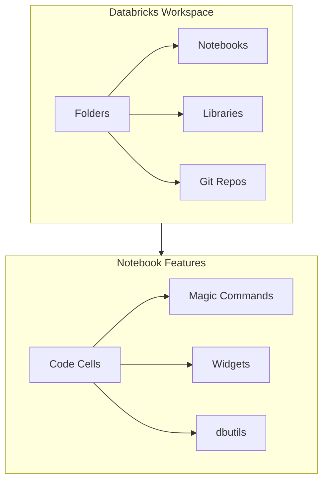
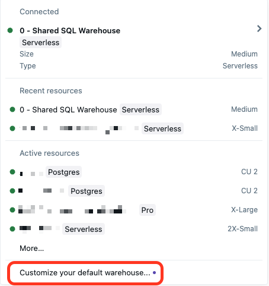
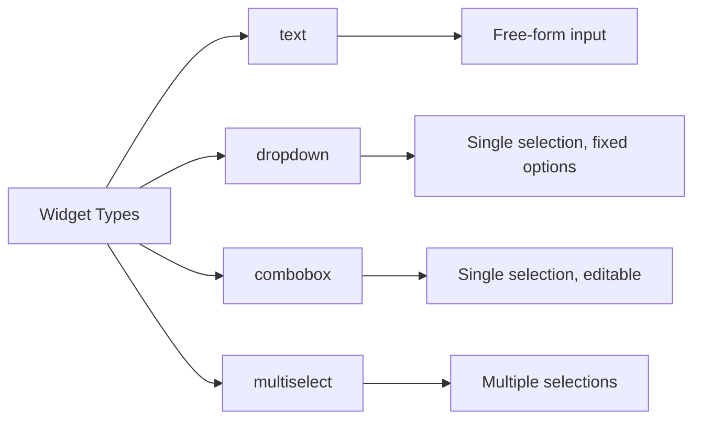

# Workspace and Notebooks — Part 1

Databricks notebooks are the primary interface for interactive data engineering. Understanding notebook features, magic commands, widgets, and dbutils is essential for building production pipelines. This part covers workspace organization, notebook languages and magic commands, and widgets; [Part 2](./10-workspace-and-notebooks-part2.md) covers `dbutils`, notebook permissions, formats, and compute attachment.

## Overview



> [!abstract]
>
> - **Workspace structure**: folders, notebooks, and Git folders; `/Workspace/...` paths for code vs `dbfs:/...` or `/dbfs/...` for DBFS data
> - **Magic commands**: `%sql`, `%python`, and `%scala` switch language; `%fs`, `%pip`, and `%sh`; `%run` runs another notebook in the same context
> - **Widgets** (`text`, `dropdown`, `combobox`, `multiselect`) parameterize notebooks; in job runs, job parameters override widget defaults

> [!tip] What the Exam Tests
>
> - Create and automate ETL workloads using Lakeflow Jobs via the UI, API, and CLI. Notebooks are the most common job task, parameterized through widgets.
> - Choose the widget type for a parameter and know how job parameters override widget defaults
> - Know what `%run` shares with the calling notebook

## Workspace Organization

### Workspace Structure

```text
/Workspace/
├── Users/
│   └── user@company.com/           # Personal user folders
│       ├── notebooks/
│       └── projects/
├── Shared/                         # Shared across organization
│   ├── common_functions/
│   └── templates/
├── Repos/                          # Git-connected repositories
│   └── project-name/
└── Applications/                   # Databricks Apps (if enabled)
```

### Workspace vs DBFS Paths

| Path Type | Format | Access | Use Case |
| :--- | :--- | :--- | :--- |
| Workspace | `/Workspace/Users/...` | Notebooks, files | Code, configs |
| DBFS | `dbfs:/...` or `/dbfs/...` | Data files | Data storage |
| Unity Catalog Volumes | `/Volumes/catalog/schema/volume/` | Governed data | Managed files |

```python
# Read file from workspace

with open("/Workspace/Users/user@company.com/config.json", "r") as f:
    config = json.load(f)

# Read file from DBFS

df = spark.read.format("csv").load("dbfs:/data/input.csv")

# Read from Unity Catalog Volume

df = spark.read.format("parquet").load("/Volumes/main/default/raw_data/")
```

## Notebook Languages

### Default Languages

Notebooks have a default language set at creation:

| Language | Extension | Use Case |
| :--- | :--- | :--- |
| Python | `.py` | General purpose, ML, ETL |
| SQL | `.sql` | Data analysis, queries |
| Scala | `.scala` | Performance-critical code |
| R | `.r` | Statistical analysis |

### Magic Commands

Magic commands allow switching languages within a notebook.

```python
# Default cell runs in notebook's default language

df = spark.read.table("my_table")
```

```sql
%sql
-- Switch to SQL for this cell
SELECT * FROM my_table LIMIT 10
```

```scala
%scala
// Switch to Scala for this cell
val df = spark.read.table("my_table")
```

### Complete Magic Commands Reference

| Command | Purpose | Example |
| :--- | :--- | :--- |
| `%python` | Run Python code | `%python print("Hello")` |
| `%sql` | Run SQL queries | `%sql SELECT * FROM table` |
| `%scala` | Run Scala code | `%scala val x = 1` |
| `%r` | Run R code | `%r print("Hello")` |
| `%md` | Render Markdown | `%md # Header` |
| `%run` | Execute another notebook | `%run ./utils/helpers` |
| `%fs` | DBFS file operations | `%fs ls /data/` |
| `%sh` | Shell commands | `%sh ls -la` |
| `%pip` | Install Python packages | `%pip install pandas` |

### The %run Command

`%run` executes another notebook in the same context, making its variables and functions available.

```python
# In /Workspace/Users/user/utils/helpers

def clean_data(df):
    return df.dropna().dropDuplicates()

ENVIRONMENT = "production"
```

```python
# In main notebook

%run ./utils/helpers

# Now clean_data() and ENVIRONMENT are available

cleaned_df = clean_data(raw_df)
print(ENVIRONMENT)  # "production"
```

**%run Characteristics:**

| Feature | Behavior |
| :--- | :--- |
| Variable scope | Runs in same context - variables are shared |
| Relative paths | Relative to current notebook location |
| Parameters | Use widgets for parameterization (no direct args) |
| Return values | Cannot return values directly |
| Error handling | Errors propagate to calling notebook |

```python
# Pass parameters via widgets

%run ./etl_pipeline

# In etl_pipeline notebook:
# dbutils.widgets.text("date", "2024-01-01")
# date = dbutils.widgets.get("date")

```

### The %fs Command

`%fs` provides quick DBFS operations without Python/Scala code.

```bash
%fs ls /data/bronze/

%fs head /data/sample.csv

%fs cp /source/file.csv /dest/file.csv

%fs rm /data/temp/ --recurse
```

| Operation | Command | Description |
| :--- | :--- | :--- |
| List files | `%fs ls /path/` | List directory contents |
| View file | `%fs head /path/file` | Show first 64KB of file |
| Copy | `%fs cp /src /dest` | Copy file or directory |
| Move | `%fs mv /src /dest` | Move file or directory |
| Remove | `%fs rm /path` | Delete file |
| Remove dir | `%fs rm /path --recurse` | Delete directory recursively |
| Make dir | `%fs mkdirs /path` | Create directory |

## Widgets



*Databricks SQL dashboard with dynamic parameters for interactive filtering.*

Widgets provide parameterization for notebooks, enabling reusable pipelines.

### Widget Types



### Creating Widgets

```python
# Text widget - free-form input

dbutils.widgets.text("start_date", "2024-01-01", "Start Date")

# Dropdown widget - single selection from list

dbutils.widgets.dropdown("environment", "dev", ["dev", "staging", "prod"], "Environment")

# Combobox widget - editable dropdown

dbutils.widgets.combobox("table_name", "customers", ["customers", "orders", "products"], "Table")

# Multiselect widget - multiple selections

dbutils.widgets.multiselect("regions", "US", ["US", "EU", "APAC"], "Regions")
```

### Getting Widget Values

```python
# Get single value

start_date = dbutils.widgets.get("start_date")
environment = dbutils.widgets.get("environment")

# Get multiselect values (returns comma-separated string)

regions = dbutils.widgets.get("regions")  # "US,EU"
region_list = regions.split(",")  # ["US", "EU"]
```

### Managing Widgets

```python
# Remove a specific widget

dbutils.widgets.remove("start_date")

# Remove all widgets from notebook

dbutils.widgets.removeAll()
```

### Widget Scope and Jobs

| Context | Widget Behavior |
|---------|-----------------|
| Interactive | Widget UI appears at top of notebook |
| Job run | Parameters passed via job configuration |
| %run | Widgets inherited from parent notebook |

```python

# When running as job, parameters override widget defaults
# Job configuration:
# {
#   "notebook_task": {
#     "notebook_path": "/path/to/notebook",
#     "base_parameters": {
#       "start_date": "2024-06-01",
#       "environment": "prod"
#     }
#   }
# }

```

### SQL Widgets

Widgets can be used directly in SQL cells:

```sql
-- Create widget in SQL
CREATE WIDGET TEXT start_date DEFAULT '2024-01-01';
CREATE WIDGET DROPDOWN env DEFAULT 'dev' CHOICES ['dev', 'staging', 'prod'];

-- Use widget in query
SELECT * FROM events
WHERE event_date >= '${start_date}'
AND environment = '${env}';
```

```sql
-- Get all widget values
SELECT getArgument('start_date') AS start_date;

-- Remove widgets
REMOVE WIDGET start_date;
```

---

**[Next: Workspace and Notebooks — Part 2 →](./10-workspace-and-notebooks-part2.md)**
