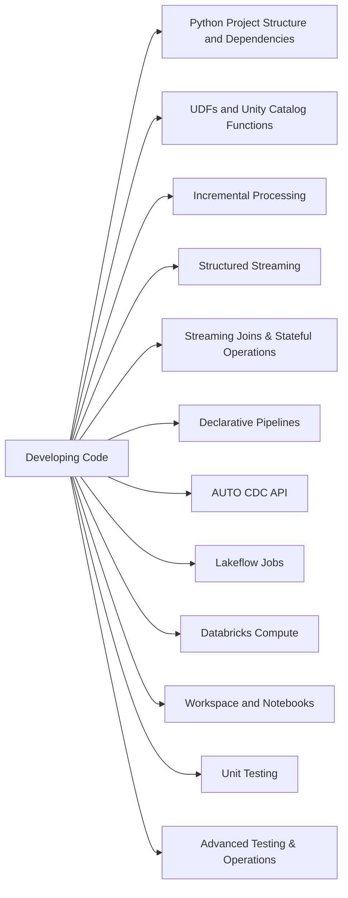

# Section 1: Developing Code for Data Processing using Python and SQL (23 % of Exam)

The highest-weighted domain (23 %). It covers how production code is structured, packaged, tested and run on Databricks: Python project layout for Declarative Automation Bundles, library dependencies, UDFs, Lakeflow Pipelines (streaming tables, materialized views, AUTO CDC), Structured Streaming state semantics, Lakeflow Jobs control flow, and compute choice.

## Topics Overview

## Section Contents

| File | Topic | Priority |
| :--- | :--- | :--- |
| [01-python-project-structure-and-dependencies.md](./01-python-project-structure-and-dependencies.md) | Bundle project layout, wheels, `pyproject.toml`, dependency troubleshooting across serverless / pipelines / bundles | High |
| [02-udfs-and-unity-catalog-functions.md](./02-udfs-and-unity-catalog-functions.md) | Python, pandas and SQL UDFs; Unity Catalog functions; choosing a UDF for a constraint | High |
| [03-incremental-processing.md](./03-incremental-processing.md) | High-water marks, checkpoints, `availableNow`, idempotent incremental loads | Medium |
| [04-structured-streaming-part1.md](./04-structured-streaming-part1.md) | Sources, sinks, triggers, output modes, watermarks, windowed aggregations | High |
| [04-structured-streaming-part2.md](./04-structured-streaming-part2.md) | Stateful operations, state store, `foreachBatch`, checkpoints and exactly-once recovery | High |
| [05-streaming-joins-stateful.md](./05-streaming-joins-stateful.md) | Stream-stream and stream-static joins, advanced watermarking, streaming deduplication | High |
| [06-declarative-pipelines.md](./06-declarative-pipelines.md) | Lakeflow Pipelines: streaming tables vs materialized views, Structured Streaming vs Spark Declarative Pipelines | High |
| [07-auto-cdc-api.md](./07-auto-cdc-api.md) | AUTO CDC APIs (formerly APPLY CHANGES), SCD Type 1 / 2 via `stored_as_scd_type` | High |
| [08-lakeflow-jobs-part1.md](./08-lakeflow-jobs-part1.md) | Tasks, dependencies, task values, If/else conditions, For each loops | High |
| [08-lakeflow-jobs-part2.md](./08-lakeflow-jobs-part2.md) | Triggers, compute, notifications, parameters, UI / API / CLI automation, monitoring | High |
| [09-databricks-compute-part1.md](./09-databricks-compute-part1.md) | Classic compute: all-purpose vs job compute, access modes, pools, policies, autoscaling | Medium |
| [09-databricks-compute-part2.md](./09-databricks-compute-part2.md) | Serverless environments, dependencies, performance mode, high memory, auto-optimization (disallow retries); SQL warehouses | High |
| [10-workspace-and-notebooks.md](./10-workspace-and-notebooks.md) | Workspace layout, widgets, `dbutils`, notebook formats | Low |
| [11-unit-testing-part1.md](./11-unit-testing-part1.md) | pytest, `assertDataFrameEqual`, `assertSchemaEqual`, `DataFrame.transform` | High |
| [11-unit-testing-part2.md](./11-unit-testing-part2.md) | Testing patterns, integration tests, unit testing Lakeflow pipelines, CI integration | High |
| [12-advanced-testing-operations-part1.md](./12-advanced-testing-operations-part1.md) | Integration testing patterns | Medium |
| [12-advanced-testing-operations-part2.md](./12-advanced-testing-operations-part2.md) | Deployment validation, GitOps | Low |

## Exam Skill Coverage

Every skill bullet in Section 1 of the Oct 9, 2026 exam guide, with the files that cover it.

| Exam guide skill | Where it is covered |
| :--- | :--- |
| Implement scalable Python project structures for Declarative Automation Bundles (formerly Databricks Asset Bundles / DABs) to support modular development and CI/CD integration. | [01-python-project-structure-and-dependencies.md](./01-python-project-structure-and-dependencies.md) |
| Apply troubleshooting techniques to dependency conflicts and installation failures for external libraries (PyPI, local wheels, source archives) across serverless, pipeline, and bundle-deployed environments. | [01-python-project-structure-and-dependencies.md](./01-python-project-structure-and-dependencies.md) |
| Develop User-Defined Functions (UDFs) using Pandas, Python, and SQL, including Unity Catalog functions for the given constraints. | [02-udfs-and-unity-catalog-functions.md](./02-udfs-and-unity-catalog-functions.md) |
| Create production-ready data pipelines for streaming data using Lakeflow Pipelines and Auto Loader. | [06-declarative-pipelines.md](./06-declarative-pipelines.md), [01-auto-loader.md](../02-data-ingestion-and-acquisition/01-auto-loader.md) |
| Create and automate ETL workloads using Lakeflow Jobs via the UI, API, and CLI. | [08-lakeflow-jobs-part1.md](./08-lakeflow-jobs-part1.md), [08-lakeflow-jobs-part2.md](./08-lakeflow-jobs-part2.md), [04-databricks-cli-part1.md](../04-monitoring-and-alerting/04-databricks-cli-part1.md), [05-rest-api-part1.md](../04-monitoring-and-alerting/05-rest-api-part1.md) |
| Choose between a streaming table and a materialized view for a given latency, cost, and refresh requirement. | [06-declarative-pipelines.md](./06-declarative-pipelines.md) |
| Implement CDC pipelines using AUTO CDC APIs (formerly APPLY CHANGES) in Lakeflow Pipelines, including SCD Type 1 and Type 2 via stored_as_scd_type. | [07-auto-cdc-api.md](./07-auto-cdc-api.md) |
| Choose between Spark Structured Streaming and Apache Spark™ Declarative Pipelines for scalable ETL given operational constraints. | [06-declarative-pipelines.md](./06-declarative-pipelines.md) |
| Create Lakeflow Jobs that use control-flow operators such as If/Else conditions and For Each loops. | [08-lakeflow-jobs-part1.md](./08-lakeflow-jobs-part1.md) |
| Choose appropriate compute and configuration for environments and dependencies — including serverless compute (serverless environments, dependency management, performance mode), high-memory notebook tasks, and auto-optimization settings (e.g., disallowing retries). | [09-databricks-compute-part1.md](./09-databricks-compute-part1.md), [09-databricks-compute-part2.md](./09-databricks-compute-part2.md) |
| Develop unit and integration tests using assertDataFrameEqual, assertSchemaEqual, DataFrame.transform, and testing frameworks to ensure code correctness. | [11-unit-testing-part1.md](./11-unit-testing-part1.md), [11-unit-testing-part2.md](./11-unit-testing-part2.md), [12-advanced-testing-operations-part1.md](./12-advanced-testing-operations-part1.md) |
| Apply Structured Streaming stateful-processing semantics, including watermarks, output modes, foreachBatch, and checkpoints for fault-tolerant exactly-once state recovery. | [04-structured-streaming-part1.md](./04-structured-streaming-part1.md), [04-structured-streaming-part2.md](./04-structured-streaming-part2.md), [05-streaming-joins-stateful.md](./05-streaming-joins-stateful.md) |

## Key Concepts to Master

| Concept | Why it matters |
| :--- | :--- |
| **Streaming table vs materialized view** | Streaming tables process each appended source row once; materialized views keep a full, refreshable result that reflects late changes |
| **AUTO CDC** | Declarative CDC into SCD Type 1 or 2 tables with `keys`, `sequence_by` and `stored_as_scd_type` — the exam's name for the former `APPLY CHANGES` |
| **Watermark + checkpoint** | The watermark bounds state for late data; the checkpoint restores offsets and state so a restart resumes exactly once |
| **Bundle project layout** | `databricks.yml` + `resources/` + `src/` package + `tests/`, built as a wheel and deployed per target |
| **Lakeflow Jobs control flow** | If/else condition tasks branch on values; For each tasks loop a nested task over a list of inputs |
| **`assertDataFrameEqual`** | PySpark's built-in DataFrame equality assertion for unit tests (`pyspark.testing`) |

## Related Resources

- [Lakeflow Pipelines cheat sheet (shared)](../../../shared/cheat-sheets/lakeflow-declarative-pipelines-quick-ref.md)
- [Streaming quick reference (shared)](../../../shared/cheat-sheets/streaming-quick-ref.md)
- [PySpark API quick reference (shared)](../../../shared/cheat-sheets/pyspark-api-quick-ref.md)

---

**[↑ Back to DE Professional](../README.md) | [Next: Data Ingestion & Acquisition →](../02-data-ingestion-and-acquisition/README.md)**
