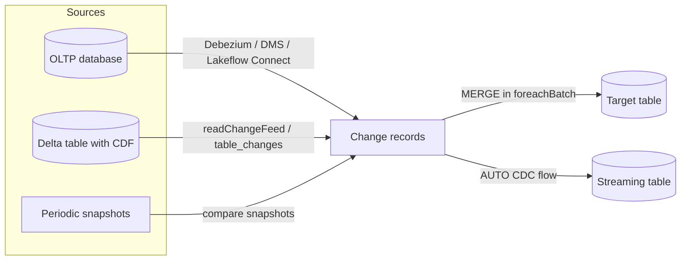
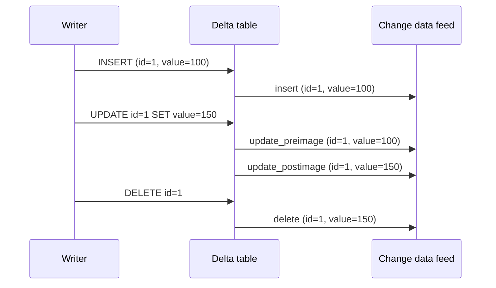
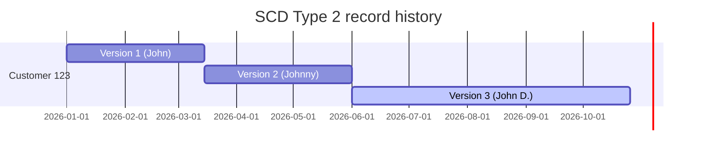

# Change Data Capture (CDC) — Part 1

## Overview

Change data capture (CDC) propagates row-level inserts, updates, and deletes instead of full reloads. This part covers CDC fundamentals, Delta **Change Data Feed (CDF)** (how to turn it on, read it, and how retention limits it), applying changes with `MERGE`, and the declarative alternative, **AUTO CDC**, in Lakeflow Pipelines. [Part 2](./04-change-data-capture-part2.md) covers Delta vs Iceberg targets, multi-hop CDC, and external CDC formats.

> [!note] Platform update (Oct 2026)
> Databricks now documents two CDF approaches. **Legacy change data feed** is the per-table `delta.enableChangeDataFeed = true` property tested on the exam (Delta only). **Automatic change data feed** became generally available on Sep 1, 2026: it computes changes at read time from row tracking (Delta) or row lineage (Iceberg v3), requires Databricks Runtime 19+, needs no per-table property, and uses the same `table_changes()` / `readChangeFeed` APIs. Legacy and automatic CDF can't be used together on one table. Sources: [Use change data feed on Databricks](https://docs.databricks.com/aws/en/tables/features/change-data-feed), [September 2026 release notes](https://docs.databricks.com/aws/en/release-notes/product/2026/september)

> [!abstract]
>
> - **CDF** records row-level changes between table versions with `_change_type` (`insert`, `update_preimage`, `update_postimage`, `delete`), `_commit_version`, and `_commit_timestamp`
> - **Read CDF** in SQL with `table_changes('t', start[, end])` or in PySpark with `.option("readChangeFeed", "true")`, batch or streaming
> - **CDF is not retroactive and not permanent**: only changes after it was enabled are recorded, and only within the table's retention window (`VACUUM` removes old change files)
> - **Applying changes**: hand-written `MERGE` (Structured Streaming + `foreachBatch`) or declarative **AUTO CDC** in Lakeflow Pipelines

> [!tip] What the Exam Tests
>
> - Apply Change Data Feed (CDF) to expose row-level changes (updates/deletes) for efficient incremental downstream processing
> - Configure incremental CDC pipelines using Lakeflow Pipelines with Delta or Iceberg as the target table format
> - Pick the right `_change_type` rows for a downstream task (for example, `update_postimage` for new values, `delete` to propagate removals)
> - Recognize retention limits: a stream or batch read fails when the requested version is no longer in history

---

## CDC Fundamentals



| Approach | Data moved | Volume | Use case |
| :--- | :--- | :--- | :--- |
| Full load | All rows every run | High | Initial load, small tables |
| CDC feed | Changed rows only | Low | Incremental replication, SCD history |
| Snapshot diff | Full snapshots, diffed | High read, low write | Sources without a change feed |

Each CDC record carries the operation (INSERT, UPDATE, DELETE), the row values, and a **sequence number or timestamp** that orders events so that late or out-of-order arrivals apply correctly.

## Delta Change Data Feed (CDF)

CDF tracks row-level changes between versions of a table. Typical uses: incremental ETL that processes only changed rows, audit trails, and replicating changes to downstream tables or external systems.

### Enabling legacy CDF

```sql
-- New table
CREATE TABLE main.sales.orders (
  order_id INT,
  customer_id INT,
  amount DECIMAL(18,2),
  status STRING
)
TBLPROPERTIES (delta.enableChangeDataFeed = true);

-- Existing table: only changes made after this command are recorded
ALTER TABLE main.sales.orders
SET TBLPROPERTIES (delta.enableChangeDataFeed = true);
```

If you turn legacy CDF off for a while and then on again, the interval is not queryable through legacy CDF. Automatic CDF can cover such gaps on supported tables. To migrate a table to automatic CDF, `ALTER TABLE ... UNSET TBLPROPERTIES ('delta.enableChangeDataFeed')`.

### CDF metadata columns

| Column | Type | Values |
| :--- | :--- | :--- |
| `_change_type` | STRING | `insert`, `update_preimage` (value before the update), `update_postimage` (value after), `delete` |
| `_commit_version` | LONG | Table version that contains the change |
| `_commit_timestamp` | TIMESTAMP | When that commit was created |

If the table already has columns with these names, CDF can't be used until you rename them.

### How operations map to change types



`MERGE` on a CDF-enabled table produces the same records: matched updates produce a preimage and postimage pair, matched deletes produce `delete`, and inserts produce `insert`.

### Reading CDF — batch

```sql
-- Versions 1 to 10 (both inclusive)
SELECT * FROM table_changes('main.sales.orders', 1, 10);

-- Timestamp range (strings in yyyy-MM-dd[ HH:mm:ss[.SSS]])
SELECT * FROM table_changes('main.sales.orders', '2026-10-01', '2026-10-15 12:00:00');

-- From version 5 to the latest version
SELECT * FROM table_changes('main.sales.orders', 5);
```

```python
changes_df = (spark.read
    .option("readChangeFeed", "true")
    .option("startingVersion", 1)
    .option("endingVersion", 10)
    .table("main.sales.orders"))

changes_by_time = (spark.read
    .option("readChangeFeed", "true")
    .option("startingTimestamp", "2026-10-01 00:00:00")
    .option("endingTimestamp", "2026-10-15 12:00:00")
    .table("main.sales.orders"))
```

Batch reads **require** a starting version or timestamp. A starting version from before CDF was enabled raises an error. A version past the latest commit raises `timestampGreaterThanLatestCommit`, unless `spark.databricks.delta.changeDataFeed.timestampOutOfRange.enabled = true`, which returns an empty result instead.

### Reading CDF — streaming (recommended for incremental ETL)

```python
changes_stream = (spark.readStream
    .option("readChangeFeed", "true")
    .table("main.sales.orders"))
```

Use Structured Streaming so Databricks tracks processed versions in the checkpoint. Without `startingVersion`, a new stream first returns the **current snapshot of the table as `insert` records**, then the subsequent changes. If the target already contains everything up to version N, start at N + 1 with a new checkpoint (`.option("startingVersion", N + 1)`). Rate limits (`maxFilesPerTrigger`, `maxBytesPerTrigger`) apply to whole commits.

### Retention and VACUUM interplay

CDF is **not a permanent change history**.

- Change records exist only for the table's retention window. Change data files follow the table's data retention and are removed by `VACUUM` (governed by `delta.deletedFileRetentionDuration`, default 7 days). Changes kept in the transaction log follow its checkpoint retention policy; table history is kept for `delta.logRetentionDuration` (default 30 days).
- Some operations (insert-only writes, full-partition deletes) do not write change data files; Databricks computes their changes from the transaction log.
- When a version leaves history, its changes can no longer be read. A stream restarted with a `startingVersion` that is no longer available **fails to start**, and managed tables clean up history automatically.
- For a permanent audit trail, stream the change feed into an archive table (for example, with `trigger(availableNow=True)` on a schedule).
- Never read the change data files directly; always use `table_changes` or `readChangeFeed`.

```python
# Archive every change permanently, processed as a scheduled incremental batch
(spark.readStream
    .option("readChangeFeed", "true")
    .table("main.sales.orders")
    .writeStream
    .option("checkpointLocation", "/Volumes/main/chk/orders_cdf_archive")
    .trigger(availableNow=True)
    .toTable("main.audit.orders_changes"))
```

### Schema changes and limitations

- With column mapping, a CDF read cannot span a version range that contains a **non-additive** schema change (rename or drop a column, change a type or nullability). Split the read into ranges before and after the change.
- Automatic CDF is not supported on tables with row filters or column masks, and external Iceberg readers cannot query it.

## Processing CDF Changes

### Choosing change types

| Downstream need | Filter on `_change_type` |
| :--- | :--- |
| Latest values for upsert | `insert`, `update_postimage` |
| Propagate deletes | `delete` |
| Before/after comparison or audit of what changed | `update_preimage` together with `update_postimage` |
| Count new rows only | `insert` |

```python
from pyspark.sql.functions import col

changes = (spark.read
    .option("readChangeFeed", "true")
    .option("startingVersion", 12)
    .table("main.bronze.orders"))

upserts = changes.filter(col("_change_type").isin("insert", "update_postimage"))
deletes = changes.filter(col("_change_type") == "delete")
```

### Propagate changes with MERGE

A version range can contain **several changes for the same key**. Keep only the latest change per key (by `_commit_version`) before `MERGE`, or the merge fails because multiple source rows match one target row.

```python
from delta.tables import DeltaTable
from pyspark.sql import Window
from pyspark.sql.functions import col, row_number

def apply_changes_to_silver(batch_df, batch_id):
    latest = (batch_df
        .filter(col("_change_type") != "update_preimage")
        .withColumn("rn", row_number().over(
            Window.partitionBy("order_id").orderBy(col("_commit_version").desc())))
        .filter("rn = 1")
        .drop("rn"))

    (DeltaTable.forName(spark, "main.silver.orders").alias("t")
        .merge(latest.alias("s"), "t.order_id = s.order_id")
        .whenMatchedDelete(condition="s._change_type = 'delete'")
        .whenMatchedUpdateAll(condition="s._change_type = 'update_postimage'")
        .whenNotMatchedInsertAll(condition="s._change_type IN ('insert', 'update_postimage')")
        .execute())

(spark.readStream
    .option("readChangeFeed", "true")
    .table("main.bronze.orders")
    .writeStream
    .foreachBatch(apply_changes_to_silver)
    .option("checkpointLocation", "/Volumes/main/chk/bronze_to_silver_orders")
    .start())
```

`foreachBatch` gives **at-least-once** delivery, so the batch function must be idempotent; a keyed `MERGE` on the latest change per key is idempotent.

## AUTO CDC in Lakeflow Pipelines

AUTO CDC (formerly APPLY CHANGES) replaces the windowing, dedup, and `MERGE` code above with a declarative flow into a **streaming table**. It handles out-of-order events with the sequence column and supports SCD Type 1 (default) and Type 2 via `stored_as_scd_type`. Full syntax, arguments, and SCD Type 2 output are in [AUTO CDC API](../01-developing-code-for-data-processing/07-auto-cdc-api.md).

```python
from pyspark import pipelines as dp
from pyspark.sql.functions import col

# Delta CDF of an upstream table as the CDC source
@dp.temporary_view
def orders_changes():
    return (spark.readStream
        .option("readChangeFeed", "true")
        .table("main.bronze.orders")
        .filter(col("_change_type") != "update_preimage"))

dp.create_streaming_table("orders_silver")

dp.create_auto_cdc_flow(
    target="orders_silver",
    source="orders_changes",
    keys=["order_id"],
    sequence_by=col("_commit_version"),
    apply_as_deletes="_change_type = 'delete'",
    except_column_list=["_change_type", "_commit_version", "_commit_timestamp"],
    stored_as_scd_type=1,
)
```

```sql
CREATE OR REFRESH STREAMING TABLE customers_history;

CREATE FLOW customers_history_cdc AS AUTO CDC INTO customers_history
FROM STREAM(main.cdc.customers_feed)
KEYS (customer_id)
APPLY AS DELETE WHEN operation = 'DELETE'
SEQUENCE BY updated_at
COLUMNS * EXCEPT (operation, updated_at)
STORED AS SCD TYPE 2;
```

| Manual Structured Streaming + `MERGE` | AUTO CDC |
| :--- | :--- |
| You dedupe per key, order by sequence, and handle late events | Sequencing and late events handled by the engine |
| You write SCD Type 2 close-and-insert logic | `stored_as_scd_type=2` adds `__START_AT` / `__END_AT` |
| You manage checkpoint and retries in a job | Pipeline manages checkpoints and retries |
| Any target and format, any custom logic | Target must be a pipeline streaming table (Lakeflow-only feature) |

## SCD Patterns with MERGE (without pipelines)

### SCD Type 1 (overwrite)

```sql
MERGE INTO dim_customer AS t
USING stg_customer AS s
ON t.customer_id = s.customer_id
WHEN MATCHED THEN UPDATE SET
  t.name = s.name,
  t.email = s.email,
  t.updated_at = current_timestamp()
WHEN NOT MATCHED THEN INSERT (customer_id, name, email, created_at, updated_at)
  VALUES (s.customer_id, s.name, s.email, current_timestamp(), current_timestamp());
```

### SCD Type 2 (history) in one MERGE

The common single-statement trick unions the staged changes twice: once keyed (to close the current row) and once with a `NULL` merge key (so the new version is always inserted).

```sql
MERGE INTO dim_customer AS t
USING (
  -- Rows that close the current version
  SELECT s.customer_id AS merge_key, s.* FROM stg_customer s
  UNION ALL
  -- Rows inserted as the new current version (NULL key never matches)
  SELECT NULL AS merge_key, s.* FROM stg_customer s
  JOIN dim_customer d
    ON s.customer_id = d.customer_id AND d.is_current = true
  WHERE s.name <> d.name OR s.email <> d.email
) AS src
ON t.customer_id = src.merge_key AND t.is_current = true
WHEN MATCHED AND (t.name <> src.name OR t.email <> src.email) THEN UPDATE SET
  t.is_current = false,
  t.end_date = current_timestamp()
WHEN NOT MATCHED THEN INSERT (customer_id, name, email, start_date, end_date, is_current)
  VALUES (src.customer_id, src.name, src.email, current_timestamp(), NULL, true);
```

New customers arrive through the first branch, find no match, and are inserted. Changed customers close their current row through the first branch and get a new current row through the second. More SCD variants are in [SCD Patterns](../09-data-modeling/05-scd-patterns.md).



> **Continue reading:** [Part 2 — Delta or Iceberg targets, multi-hop CDC, row tracking, external CDC formats, and exam tips](./04-change-data-capture-part2.md)

---

**[Next: Change Data Capture (CDC) — Part 2 →](./04-change-data-capture-part2.md)**
