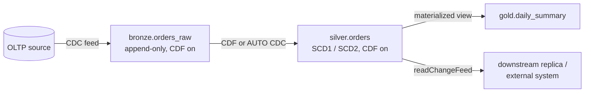

# Change Data Capture (CDC) — Part 2

## Overview

This part covers what "Delta or Iceberg as the target table format" means for Lakeflow pipeline CDC, how to propagate changes through bronze, silver, and gold, row tracking, external CDC formats such as Debezium, and monitoring. For CDF basics, `MERGE` patterns, and the AUTO CDC introduction, see [Part 1](./04-change-data-capture-part1.md).

> [!abstract]
>
> - **Pipeline outputs are Delta tables**: an AUTO CDC target is always a Delta streaming table (`USING DELTA` is the only option for streaming tables)
> - **Iceberg readers** reach a pipeline CDC target through **external data access** with UniForm **Iceberg v3** properties, or through **compatibility mode** (a copy); materialized views can also be created `USING ICEBERG` (Public Preview)
> - **Multi-hop CDC**: CDF (or AUTO CDC) between bronze and silver, and materialized views for gold aggregates
> - **Row tracking** gives stable `_metadata.row_id` values and powers automatic CDF and incremental MV refresh

> [!tip] What the Exam Tests
>
> - Configure incremental CDC pipelines using Lakeflow Pipelines with Delta or Iceberg as the target table format
> - Apply Change Data Feed (CDF) to expose row-level changes (updates/deletes) for efficient incremental downstream processing
> - Choose the right mechanism when a downstream consumer is an external Iceberg engine
> - Keep CDC processing idempotent and ordered across layers

---

## Delta or Iceberg as the CDC Target Format

### What the docs support

| Need | Supported approach | Notes |
| :--- | :--- | :--- |
| CDC target for Databricks and Delta consumers | AUTO CDC flow into a **streaming table** | All tables created by pipelines are Delta tables |
| Same CDC target also readable by external **Iceberg** engines, without a copy | **External data access**: `pipelines.externalMetadata.enabled` + UniForm Iceberg v3 table properties | Iceberg v3 REST catalog clients (or Delta 4.0+ through the UC API); read-only externally |
| Gold aggregate as a managed Iceberg object | `CREATE OR REFRESH MATERIALIZED VIEW ... USING ICEBERG`, then `REPAIR TABLE <mv> SYNC METADATA` | Managed Iceberg MVs are **Public Preview** (enabled by the account team) |
| Older or path-based Delta/Iceberg clients | **Compatibility mode** | Read-only copy in a new location, updated hourly by default |
| Incremental processing **from** an Iceberg source | MVs refresh incrementally from Unity Catalog **managed Iceberg** tables (v2 and v3; v3 recommended) | Foreign Iceberg tables can be read but not incrementally refreshed |

> [!important]
> The docs do not offer an Iceberg storage format for pipeline **streaming tables**, so AUTO CDC never writes Iceberg natively. For streaming tables the only `USING` option is `DELTA`. "Iceberg as the target" in practice means that the Delta target also publishes **Iceberg metadata** for Iceberg readers. Ordinary Delta tables use UniForm **IcebergCompatV2**, but that **cannot be enabled on materialized views or streaming tables**; pipeline datasets use **IcebergCompatV3** through external data access.

### AUTO CDC target readable by Iceberg clients

```sql
-- Pipeline source file (SQL)
CREATE OR REFRESH STREAMING TABLE customers_current
TBLPROPERTIES (
  'delta.columnMapping.mode' = 'name',
  'delta.enableRowTracking' = 'true',
  'delta.enableIcebergCompatV3' = 'true',
  'delta.universalFormat.enabledFormats' = 'iceberg',
  'pipelines.externalMetadata.enabled' = 'true'
);

CREATE FLOW customers_current_cdc AS AUTO CDC INTO customers_current
FROM STREAM(main.cdc.customers_feed)
KEYS (customer_id)
APPLY AS DELETE WHEN operation = 'DELETE'
SEQUENCE BY sequence_num
COLUMNS * EXCEPT (operation, sequence_num)
STORED AS SCD TYPE 1;
```

```python
# Same target in Python
from pyspark import pipelines as dp

dp.create_streaming_table(
    name="customers_current",
    table_properties={
        "delta.columnMapping.mode": "name",
        "delta.enableRowTracking": "true",
        "delta.enableIcebergCompatV3": "true",
        "delta.universalFormat.enabledFormats": "iceberg",
        "pipelines.externalMetadata.enabled": "true",
    },
)

dp.create_auto_cdc_flow(
    target="customers_current",
    source="customers_feed",
    keys=["customer_id"],
    sequence_by="sequence_num",
    apply_as_deletes="operation = 'DELETE'",
    except_column_list=["operation", "sequence_num"],
    stored_as_scd_type=1,
)
```

| Table property | Purpose |
| :--- | :--- |
| `pipelines.externalMetadata.enabled = true` | Publish external-facing metadata. Can be set for the whole pipeline in its configuration; the table-level setting takes precedence |
| `delta.columnMapping.mode = name` | Column mapping is required for Iceberg |
| `delta.enableRowTracking = true` | Required for Iceberg reads |
| `delta.enableIcebergCompatV3 = true` | Iceberg v3 compatibility |
| `delta.universalFormat.enabledFormats = iceberg` | Generate Iceberg metadata |

**Apply it**: run the triggered pipeline once, or stop and restart a continuous pipeline.

**Requirements**: Unity Catalog, Databricks Runtime 17.3+, the default publishing mode, and external data access enabled for the metastore. The reader needs `EXTERNAL USE SCHEMA` on the schema and `SELECT` on the table.

**Limitations**: no external writes, no path-based access, row filters and column masks are not enforced for external reads, no time travel through this path, and catalog commits must be disabled first. If external metadata looks stale, a principal with `MODIFY` can run `REPAIR TABLE <table> SYNC METADATA`.

### Materialized view stored as Iceberg

```sql
CREATE OR REFRESH MATERIALIZED VIEW gold_customer_counts
USING ICEBERG
AS SELECT country, COUNT(*) AS customers
FROM customers_current
GROUP BY country;

-- After creation, for example from the SQL editor
REPAIR TABLE main.sales.gold_customer_counts SYNC METADATA;
```

External Iceberg readers can read this MV but not write to it.

### Iceberg tables as CDC sources

- **Automatic change data feed** (Databricks Runtime 19+) works on Unity Catalog **managed Iceberg v3** tables as well as Delta tables with row tracking. Read it with `readChangeFeed` / `table_changes`. Only Databricks readers can query it, because change data feed is not part of the Iceberg spec.
- **Legacy CDF** (`delta.enableChangeDataFeed`) supports Delta tables only.
- An MV over a managed Iceberg table refreshes incrementally. For the best incremental refresh support the docs recommend Iceberg v3.

## Multi-Hop CDC Propagation



| Hop | Recommended mechanism | Why |
| :--- | :--- | :--- |
| Source → bronze | Append-only streaming table (Auto Loader, Kafka, Lakeflow Connect) | Keep raw history; exactly-once ingestion |
| Bronze → silver | AUTO CDC flow (pipelines) or CDF stream + `MERGE` in `foreachBatch` | Apply inserts, updates, deletes by key and sequence |
| Silver → gold aggregates | **Materialized view** | Aggregates stay correct under updates and deletes |
| Silver → replicas or external systems | Read silver's change feed | Row-level changes only, incremental |

```python
# Gold aggregate over a silver table that receives updates and deletes
from pyspark import pipelines as dp
from pyspark.sql.functions import count, sum, to_date

@dp.materialized_view(name="orders_daily_summary")
def orders_daily_summary():
    return (spark.read.table("main.silver.orders")
        .groupBy(to_date("order_date").alias("order_date"))
        .agg(sum("amount").alias("daily_total"), count("*").alias("order_count")))
```

> [!warning] Don't aggregate CDF rows naively
> Summing `insert` + `update_postimage` rows from a change feed double-counts every updated row and ignores deletes. Use a materialized view over the current-state table, or net the changes (subtract preimages and deletes) yourself.

**CDC amplification**: one source UPDATE becomes two CDF rows (preimage and postimage). A silver `MERGE` can touch many rows. A change in silver can force recomputation of many gold groups. Monitor lag per layer and give every stream its own checkpoint.

## Idempotent and Ordered Processing

```python
from delta.tables import DeltaTable
from pyspark.sql import Window
from pyspark.sql.functions import col, row_number

def process_cdc_idempotent(changes_df, target_table, key="id"):
    """Apply only the latest change per key; MERGE makes replays safe."""
    latest = (changes_df
        .filter(col("_change_type") != "update_preimage")
        .withColumn("rn", row_number().over(
            Window.partitionBy(key).orderBy(col("_commit_version").desc())))
        .filter("rn = 1")
        .drop("rn"))

    (DeltaTable.forName(spark, target_table).alias("t")
        .merge(latest.alias("s"), f"t.{key} = s.{key}")
        .whenMatchedDelete(condition="s._change_type = 'delete'")
        .whenMatchedUpdateAll(condition="s._change_type IN ('insert', 'update_postimage')")
        .whenNotMatchedInsertAll(condition="s._change_type IN ('insert', 'update_postimage')")
        .execute())
```

- **Ordering**: pick the latest event per key by a reliable sequence (`_commit_version` for CDF, LSN or source timestamp for database feeds). With a source timestamp, add a tiebreaker.
- **Idempotency**: `foreachBatch` is at-least-once, so replays must be safe. A keyed `MERGE` of the latest change is idempotent; blind appends are not.
- **Exact duplicates**: `dropDuplicates(["id", "_commit_version"])` removes repeated delivery of the same change.
- **AUTO CDC** does the ordering and dedup for you inside a pipeline.

## Row Tracking

Row tracking (Databricks Runtime 14.0+) assigns every row a stable row ID and a row commit version. All Iceberg v3 tables include row tracking; for Delta you enable it explicitly. Automatic CDF and some incremental MV refresh techniques depend on it.

```sql
CREATE TABLE main.sales.customers (id INT, name STRING)
TBLPROPERTIES (delta.enableRowTracking = true);

-- Existing table: backfills IDs for existing rows (can create several versions and take time)
ALTER TABLE main.sales.customers SET TBLPROPERTIES (delta.enableRowTracking = true);
```

| Hidden field | Meaning |
| :--- | :--- |
| `_metadata.row_id` | Stable unique row identifier; kept across `MERGE` and `UPDATE` |
| `_metadata.row_commit_version` | Table version at which the row was last inserted or updated |

```python
df = spark.table("main.sales.customers")
df.select("*", "_metadata.row_id", "_metadata.row_commit_version").show()

# Rows changed at version 5
df.filter("_metadata.row_commit_version = 5").show()
```

Pause continuous writers (for example, Structured Streaming) before enabling row tracking on an existing table, because the metadata change fails concurrent writes with `MetadataChangedException`. Row IDs and row commit versions **cannot be read while reading the change data feed**. Clones get their own row IDs.

## External CDC Integration

### Debezium envelope

Debezium events carry `before`, `after`, `op` (`c` create, `u` update, `d` delete, `r` snapshot read), and `ts_ms`. For deletes, `after` is null, so take the row (and key) from `before`.

```python
from pyspark.sql.functions import col, from_json, when

parsed = (spark.readStream.format("kafka")
    .option("kafka.bootstrap.servers", "broker:9092")
    .option("subscribe", "dbserver1.inventory.orders")
    .load()
    .select(from_json(col("value").cast("string"), debezium_schema).alias("d"))
    .select(
        col("d.op").alias("op"),
        col("d.ts_ms").alias("source_ts_ms"),
        when(col("d.op") == "d", col("d.before")).otherwise(col("d.after")).alias("row"),
    )
    .select("op", "source_ts_ms", "row.*"))
```

Feed `parsed` to AUTO CDC with `apply_as_deletes="op = 'd'"` and `sequence_by="source_ts_ms"` (add a tiebreaker if two events for a key can share a timestamp), or to a `MERGE` in `foreachBatch`.

### Normalizing custom operation codes

```python
from itertools import chain
from pyspark.sql.functions import coalesce, col, create_map, lit, upper

OP_MAP = {"I": "insert", "INSERT": "insert", "U": "update", "UPDATE": "update",
          "D": "delete", "DELETE": "delete"}
op_lookup = create_map([lit(x) for x in chain(*OP_MAP.items())])

def normalize_ops(df, op_column="operation"):
    return df.withColumn("op_normalized",
                         coalesce(op_lookup[upper(col(op_column))], lit("unknown")))
```

For relational sources (SQL Server, MySQL, PostgreSQL), managed **Lakeflow Connect** connectors handle CDC extraction for you and write to streaming tables, so you don't hand-parse logs.

## Monitoring CDC

- **AUTO CDC flows** report `num_upserted_rows` and `num_deleted_rows` as processing metrics in the pipeline event log.
- **Version lag** for CDF consumers: compare the last processed `_commit_version` (store it per batch in `foreachBatch`) with the latest version from `DESCRIBE HISTORY <table> LIMIT 1`.
- **Retention headroom**: alert when lag approaches the table's history retention, because a consumer that falls behind it cannot restart from its last version.

```sql
-- Per-batch metrics table written from foreachBatch
CREATE TABLE IF NOT EXISTS main.ops.cdc_metrics (
  table_name STRING,
  batch_id BIGINT,
  last_commit_version BIGINT,
  inserts BIGINT,
  updates BIGINT,
  deletes BIGINT,
  processed_at TIMESTAMP
);
```

## Use Cases

| Scenario | Pattern | Why |
| :--- | :--- | :--- |
| Silver customer table must also be queryable from an external Iceberg engine | AUTO CDC into a streaming table with external data access + Iceberg v3 properties | No copy; read-after-write for Iceberg v3 REST clients |
| Audit compliance | SCD Type 2 (AUTO CDC `stored_as_scd_type=2`) or CDF archived to a table | Full history; CDF alone expires with retention |
| Delete propagation downstream | CDF `delete` rows + `MERGE ... WHEN MATCHED ... DELETE`, or AUTO CDC `apply_as_deletes` | Plain streaming reads fail or skip on deletes |
| Gold metrics over changing silver | Materialized view | Correct under updates and deletes; incremental on serverless |
| Debugging when a row changed | Row tracking + `DESCRIBE HISTORY` | `row_commit_version` shows the last change |

## Common Issues & Errors

| Symptom | Cause | Fix |
| :--- | :--- | :--- |
| Empty or partial CDF history | CDF enabled after the changes happened | CDF is not retroactive; backfill from the source |
| Stream from CDF fails to restart | Requested `startingVersion` no longer in history (VACUUM / log cleanup) | Restart from an available version with a new checkpoint; lengthen retention or archive changes |
| Duplicate downstream rows after a retry | Non-idempotent writes in `foreachBatch` | Keyed `MERGE` on the latest change per key |
| Updates show old values downstream | Filtering on `update_preimage` | Use `update_postimage` for new values |
| Iceberg client can't see the pipeline table | External metadata not enabled, IcebergCompatV2 used, catalog commits on, or client lacks Iceberg v3 / `EXTERNAL USE SCHEMA` | Set the v3 properties and `pipelines.externalMetadata.enabled`, rerun the pipeline, grant privileges |
| Iceberg readers see stale data | Metadata generation behind | `REPAIR TABLE <t> SYNC METADATA` |
| CDF read fails across a column rename | Non-additive schema change in the range (column mapping) | Split the read into ranges before and after the change |

## Best Practices

- Enable CDF (or rely on automatic CDF with row tracking) on every table that feeds incremental consumers.
- Prefer AUTO CDC inside pipelines over hand-written `MERGE` for SCD Type 1 and Type 2.
- Use materialized views, not change-feed aggregation, for gold metrics.
- Keep one checkpoint per stream; never share checkpoints across queries.
- Archive the change feed if you need history longer than the table's retention.
- For Iceberg consumers of pipeline tables, use external data access (Iceberg v3) when clients support the REST catalog; otherwise use compatibility mode.

## Exam Tips

> [!tip]
>
> - **`delta.enableChangeDataFeed = true`** turns on (legacy) CDF; it is **not retroactive**.
> - **`_change_type`**: `insert`, `update_preimage`, `update_postimage`, `delete`. Use **postimage** for new values.
> - **SQL** `table_changes('t', start[, end])`; **PySpark** `.option("readChangeFeed", "true")`; start/end are inclusive.
> - **VACUUM and log retention limit CDF**: old versions' changes disappear.
> - **AUTO CDC target = Delta streaming table**. For Iceberg readers: **external data access + IcebergCompatV3**, or compatibility mode; MVs support `USING ICEBERG` (Preview). IcebergCompatV2 can't be enabled on STs or MVs.
> - **Gold aggregates over changing data → materialized view.**

## Key Takeaways

- **CDF exposes row-level changes** with `_change_type`, `_commit_version`, `_commit_timestamp`; read them with `table_changes` or `readChangeFeed`, preferably as a stream.
- **Retention bounds CDF**: `VACUUM` removes change data files, and table history expires; archive the feed for a permanent record.
- **Pipeline CDC targets are Delta streaming tables.** Iceberg access is through Iceberg v3 metadata (external data access) or a compatibility copy; only materialized views have a `USING ICEBERG` option, and it is in Public Preview.
- **Iceberg as a source**: automatic CDF covers managed Iceberg v3 tables (DBR 19+, Databricks readers), and MVs refresh incrementally from managed Iceberg tables.
- **Multi-hop**: AUTO CDC or CDF + `MERGE` for bronze → silver, and materialized views for gold.
- **Idempotency and ordering**: latest change per key by sequence, applied with a keyed `MERGE` (or AUTO CDC).
- **Row tracking** (DBR 14.0+) provides `_metadata.row_id` / `_metadata.row_commit_version` and underpins automatic CDF.

## Related Topics

- [Change Data Capture (CDC) — Part 1](./04-change-data-capture-part1.md) — CDF basics, MERGE patterns
- [AUTO CDC API](../01-developing-code-for-data-processing/07-auto-cdc-api.md) — SCD Type 1 and 2 in pipelines
- [Declarative Pipelines](../01-developing-code-for-data-processing/06-declarative-pipelines.md) — streaming tables vs materialized views
- [Delta Lake Operations — Part 1](../03-data-manipulation/02-delta-lake-operations-part1.md) — MERGE details
- [Data Deduplication](../03-data-manipulation/03-data-deduplication.md) — dedup before applying changes
- [OpenSharing](./06-opensharing.md) — sharing tables, including CDF, with recipients

## Official Documentation

- [Use change data feed on Databricks](https://docs.databricks.com/aws/en/tables/features/change-data-feed)
- [Access materialized views and streaming tables using external systems](https://docs.databricks.com/aws/en/ldp/external-access)
- [Enable external data access to streaming tables and materialized views](https://docs.databricks.com/aws/en/external-access/external-for-pipelines)
- [Read Delta Lake tables with Iceberg clients](https://docs.databricks.com/aws/en/delta/uniform)
- [What is Apache Iceberg in Databricks?](https://docs.databricks.com/aws/en/iceberg/)
- [CREATE MATERIALIZED VIEW (pipelines)](https://docs.databricks.com/aws/en/ldp/developer/ldp-sql-ref-create-materialized-view)
- [CREATE STREAMING TABLE (pipelines)](https://docs.databricks.com/aws/en/ldp/developer/ldp-sql-ref-create-streaming-table)
- [Incremental refresh for materialized views](https://docs.databricks.com/aws/en/ldp/incremental-refresh)
- [Advanced AUTO CDC topics](https://docs.databricks.com/aws/en/ldp/cdc-advanced)
- [Row tracking in Databricks](https://docs.databricks.com/aws/en/tables/features/row-tracking)
- [Pipeline concepts](https://docs.databricks.com/aws/en/ldp/concepts/)

---

**[← Previous: Change Data Capture (CDC) — Part 1](./04-change-data-capture-part1.md) | [↑ Back to Section](./README.md) | [Next: Lakeflow Connect Database CDC →](./05-lakeflow-connect-database-cdc.md)**
