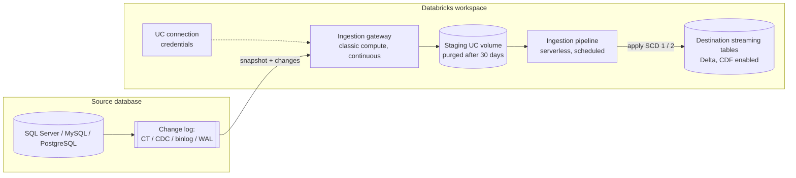

# Lakeflow Connect Database CDC

## Overview

**Lakeflow Connect** managed database connectors replicate inserts, updates, and deletes from relational databases — **SQL Server, MySQL, and PostgreSQL** on this exam — into Unity Catalog streaming tables with no custom CDC code. The connector reads the database's own change log (SQL Server change tracking / CDC, the MySQL binary log, PostgreSQL logical replication), stages the changes, and applies them incrementally through a managed Lakeflow pipeline that is governed by Unity Catalog.

> [!abstract]
>
> - **Two architectures**: the standard *gateway-based* design (an always-on **ingestion gateway** on classic compute + a scheduled **ingestion pipeline** on serverless) and the newer single *integrated CDC pipeline* (SQL Server, MySQL)
> - **Source prerequisites differ per engine**: SQL Server change tracking or CDC, MySQL `binlog_format=ROW` + `binlog_row_image=FULL`, PostgreSQL `wal_level=logical` + publication + `pgoutput` replication slot
> - **History tracking** is a per-table setting: `SCD_TYPE_1` (overwrite, default) or `SCD_TYPE_2` (keep history with `__START_AT` / `__END_AT`)
> - **Credentials live in a Unity Catalog connection**; users need `USE CONNECTION` plus catalog/schema privileges to build pipelines

> [!tip] What the Exam Tests
>
> - "Configure CDC ingestion pipelines from relational database sources, including SQL Server, MySQL, and PostgreSQL, using Lakeflow Connect" — pick the managed connector over JDBC full reloads, file exports, OpenSharing, or federation when the requirement is *continuous insert/update/delete replication with minimal code*
> - Know each source's prerequisite (change tracking vs CDC, binlog settings, logical replication slot) and why the gateway must run continuously
> - Choose SCD type 1 vs type 2, and know which schema changes evolve automatically and which force a **full refresh**
> - Know the governance pieces: UC connection, `CREATE CONNECTION` / `USE CONNECTION`, staging volume, destination streaming tables

---

## Where Database Connectors Fit in Lakeflow Connect

Lakeflow Connect groups managed connectors by source type. Only the first two rows below are database ingestion; the others appear here because exam distractors mix them up.

| Connector type | What it does | Change capture |
| :--- | :--- | :--- |
| **Database connectors (CDC)** | MySQL, PostgreSQL, SQL Server, Oracle | Reads the source's change log; gateway + staging (or integrated pipeline) |
| **Query-based connectors** | Oracle, Teradata, SQL Server, MySQL, MariaDB, PostgreSQL (and all Lakehouse Federation sources via foreign catalogs) | Cursor column (high-water mark); no gateway, no staging volume, scheduled only |
| SaaS connectors | Salesforce, Workday, HubSpot, Jira, ... | API-based |
| File source connectors | SharePoint, Google Drive, ... | File-based |
| Streaming connectors | Kafka (Beta), RabbitMQ (Beta) | Message bus |

### Release status (as stated on the docs pages, Oct 2026)

| Connector | Status | Notes |
| :--- | :--- | :--- |
| Microsoft SQL Server | No preview label on the connector pages | Standard (gateway) CDC and integrated CDC pipeline |
| MySQL | **Public Preview** ("Contact your Databricks account team to request access") | Integrated CDC pipeline: Beta Jul 1, 2026 → **GA Oct 15, 2026** per release notes |
| PostgreSQL | **Public Preview** ("Reach out to your Databricks account team to enroll") | Gateway-based architecture |
| Oracle (integrated CDC, LogMiner) | **Beta** | Not named in the exam bullet |

> [!note] Platform update (Oct 2026)
> The integrated CDC pipeline for MySQL entered Beta on July 1, 2026 and became generally available on October 15, 2026; it "requires no separate ingestion gateway". Source: [Databricks release notes, October 2026](https://docs.databricks.com/aws/en/release-notes/product/2026/october)

---

## Architecture: Gateway-Based CDC



| Component | Role | Key facts |
| :--- | :--- | :--- |
| **Connection** | UC securable storing source credentials | Created once by an admin; reused by non-admins via `USE CONNECTION` |
| **Ingestion gateway** | Extracts snapshots, change logs, and metadata | Runs on **classic compute**, **continuously**, so changes are captured before the source truncates its logs; billed even when the ingestion pipeline is idle |
| **Staging storage** | UC volume holding extracted data | Created automatically when the gateway is deployed; you choose the catalog/schema; data auto-purged after **30 days**; decouples capture from apply and helps failure recovery |
| **Ingestion pipeline** | Moves staged data into destination tables | Runs on **serverless**; runs on your schedule; continuous mode is not supported for the gateway-based ingestion pipeline |
| **Destination tables** | Streaming tables (Delta) | Change data feed is enabled on all target tables |

**Orchestration**: every schedule you add creates a Lakeflow Job with the ingestion pipeline as a task; the gateway runs in its own job as a continuous task.

> [!warning]
> Do not manually stop the ingestion gateway. If it stops, changes can be dropped by the source's log retention and affected tables need a full refresh. Gateways need classic compute, so they can't run in a serverless-only workspace.

### Integrated CDC pipeline (single pipeline)

For SQL Server and MySQL you can instead create one pipeline that both extracts and applies changes.

| Feature | Standard CDC (gateway-based) | Integrated CDC |
| :--- | :--- | :--- |
| Pipelines | Two (gateway + ingestion pipeline) | One |
| Connection reference | `ingestion_gateway_id` | `connection_name` |
| Connector type | Implicit | Explicit `connector_type: CDC` |
| Staging volume | Managed by the gateway | Auto-created in the destination schema, or set with `data_staging_options` |
| Mode | Gateway continuous, pipeline scheduled | Triggered (scheduled); continuous mode is in Beta |
| Compute | Classic gateway + serverless pipeline | Classic or serverless |
| Auto full refresh (MySQL) | Not supported for existing gateway-based MySQL flows | Supported |

Each integrated update extracts (initial snapshot on the first run or a full refresh, then binlog/CT/CDC changes), writes to the staging volume, applies the changes with merge semantics on the primary keys and SCD type, and **stops once it has caught up**. Docs note that each extraction stage runs for at least 10 minutes, so a **60-minute or longer** schedule is a good starting point.

---

## Source Prerequisites per Database

| Requirement | SQL Server | MySQL | PostgreSQL |
| :--- | :--- | :--- | :--- |
| Change mechanism | **Change tracking** (needs a primary key; lightweight) or **CDC** (no PK needed; heavier) — if both are enabled, the connector uses change tracking | **Binary log** replication | **Logical replication** (publication + slot) |
| Versions | CT: SQL Server 2012+; CDC: 2012 SP1 CU3+ (Enterprise Edition before 2016) | RDS / Azure / EC2 / Cloud SQL 5.7.44+; Aurora 5.7.mysql_aurora.2.12.2+ | PostgreSQL 13+ |
| Server settings | Enable CT or CDC (utility objects script) | `binlog_format=ROW`, `binlog_row_image=FULL`, `binlog_row_value_options` empty (`PARTIAL_JSON` unsupported) | `wal_level=logical` (RDS/Aurora: `rds.logical_replication=1`); size `max_replication_slots`, `max_wal_senders`, `max_slot_wal_keep_size` |
| Ingestion user | Dedicated user meeting the privilege requirements | `REPLICATION SLAVE`, `REPLICATION CLIENT`, `SELECT(plugin, user)` on `mysql.user`, `SELECT` on target tables | User with `REPLICATION`, `CONNECT`, `USAGE`, `SELECT`; tables need a replica identity |
| Replicas | Primary only — CT/CDC not supported on read replicas or secondaries | Read replicas supported (RDS, Azure, EC2) but **not Aurora** read replicas | — |
| Retention gotcha | Expired CT/CDC retention needs full refresh | Docs recommend **7 days** of binlog retention; a purged binlog means full refresh of all tables | Slot holds WAL until consumed; drop the slot manually when you delete the pipeline |

### PostgreSQL source setup (run as admin / table owner)

```sql
-- Replication user (its credentials go into the UC connection)
CREATE USER databricks_replication WITH PASSWORD 'your_secure_password';
GRANT CONNECT ON DATABASE your_database TO databricks_replication;
GRANT USAGE ON SCHEMA schema_name TO databricks_replication;
GRANT SELECT ON TABLE schema_name.table_name TO databricks_replication;
ALTER USER databricks_replication WITH REPLICATION;

-- Publication first, then the slot (one of each per replicated database)
CREATE PUBLICATION databricks_publication FOR TABLE schema_name.table1, schema_name.table2;

SET ROLE databricks_replication;
-- Databricks supports only the pgoutput plugin
SELECT pg_create_logical_replication_slot('databricks_slot', 'pgoutput');
RESET ROLE;
```

### MySQL replication user

```sql
-- MySQL 8.x (5.7.x uses sha256_password)
CREATE USER 'lakeflow_connect_user'@'%' IDENTIFIED WITH caching_sha2_password BY '<password>';
GRANT REPLICATION SLAVE, REPLICATION CLIENT ON *.* TO 'lakeflow_connect_user'@'%';
```

Also grant `SELECT(plugin, user)` on `mysql.user` and `SELECT` on the databases/tables you ingest.

---

## UC Connection and Permissions

A **connection** is the Unity Catalog securable that stores the source host and credentials; the pipeline definition never contains passwords.

| Task | Privileges required |
| :--- | :--- |
| Create a new connection | `CREATE CONNECTION` on the metastore |
| Build a pipeline on an existing connection | `USE CONNECTION` (or `ALL PRIVILEGES`) on the connection |
| Write destination tables | `USE CATALOG` on the target catalog; `USE SCHEMA`, `CREATE TABLE`, `CREATE VOLUME` on the schema (or `CREATE SCHEMA` on the catalog) |
| Staging volume | `CREATE VOLUME` on the destination schema, or on the schema in `data_staging_options` |

- **Personas**: in a *multi-user* setup an admin configures the source and creates the connection in Catalog Explorer; non-admins then create gateway-pipeline pairs with any interface. API/CLI/bundle authoring always needs an existing connection.
- **Creating connections programmatically**: database connectors use API-only authentication, so you can create the connection with the Connections REST API or `databricks connections create --json ...` (for example from a bundle pre-deploy step). The SQL `CREATE CONNECTION` command is documented for Lakehouse Federation connections, not managed ingestion connections.
- **Authentication**: SQL Server supports OAuth U2M/M2M with Microsoft Entra ID and username/password; MySQL and PostgreSQL support username/password only.

---

## Setting Up a Pipeline: UI, API, Bundles

**UI wizard** (Data Ingestion → *SQL Server*/*MySQL*/*PostgreSQL*): choose or create the connection → name the ingestion pipeline and event-log location → optionally turn on **Auto full refresh for all tables** → name the gateway and pick the **staging location** → select tables (optional destination name and **History tracking**) → choose destination catalog/schema → **Validate** the database setup → add a schedule and notifications.

**Declarative Automation Bundles** (formerly Databricks Asset Bundles) — gateway-based SQL Server, abridged from the docs example:

```yaml
resources:
  pipelines:
    gw_pipeline:
      name: 'lfc-sqlserver-gateway-${bundle.target}'
      continuous: true                      # gateway pipelines must be continuous
      catalog: ${var.staging_catalog}
      schema: ${var.staging_schema}
      gateway_definition:
        connection_name: ${var.connection_name}
        gateway_storage_catalog: ${var.staging_catalog}
        gateway_storage_schema: ${var.staging_schema}
    mi_pipeline:
      name: 'lfc-sqlserver-ingestion-${bundle.target}'
      continuous: false                     # trigger with a scheduled job
      serverless: true                      # ingestion pipeline is serverless only
      catalog: ${var.dest_catalog}
      schema: ${var.dest_schema}
      ingestion_definition:
        ingestion_gateway_id: ${resources.pipelines.gw_pipeline.id}
        table_configuration:
          scd_type: 'SCD_TYPE_1'
        objects:
          - schema:                         # whole schema; new tables picked up automatically
              source_catalog: ${var.source_database}
              source_schema: ${var.source_schema}
              destination_catalog: ${var.dest_catalog}
              destination_schema: ${var.dest_schema}
  jobs:
    mi_schedule:
      name: 'lfc-sqlserver-ingestion-schedule-${bundle.target}'
      schedule:
        quartz_cron_expression: '0 */30 * * * ?'
        timezone_id: 'UTC'
      tasks:
        - task_key: 'run_ingestion'
          pipeline_task:
            pipeline_id: ${resources.pipelines.mi_pipeline.id}
```

PostgreSQL pipelines add `source_type: POSTGRESQL` and a `source_configurations` block naming the slot and publication:

```yaml
source_configurations:
  - catalog:
      source_catalog: your_database
      postgres:
        slot_config:
          slot_name: databricks_slot
          publication_name: databricks_publication
```

**Integrated CDC pipeline** (MySQL shown) — one pipeline, referenced by connection:

```yaml
resources:
  pipelines:
    integrated_cdc_pipeline:
      name: ${var.pipeline_name}
      catalog: ${var.dest_catalog}
      schema: ${var.dest_schema}
      ingestion_definition:
        connection_name: ${var.connection_name}
        connector_type: CDC
        objects:
          - table:
              source_schema: 'my_database'
              source_table: 'customers'
              destination_catalog: ${var.dest_catalog}
              destination_schema: ${var.dest_schema}
              table_configuration:
                scd_type: 'SCD_TYPE_1'
```

```bash
databricks bundle deploy
databricks bundle run integrated_cdc_job
```

Other per-table options in `table_configuration`: `include_columns` / `exclude_columns` (column selection), `primary_keys` (override), `sequence_by`, and `auto_full_refresh_policy`. API-based row filtering is **not supported** for the three database connectors.

---

## History Tracking: SCD Type 1 vs Type 2

| | `SCD_TYPE_1` (history off, default) | `SCD_TYPE_2` (history on) |
| :--- | :--- | :--- |
| Update in source | Row overwritten in place | Old row kept and marked inactive; new row added |
| Metadata | None | `__START_AT` / `__END_AT` spans driven by the sequence column |
| Typical use | Current-state replica for BI | Audit / point-in-time dimension history |

- Set it in the UI (**History tracking** on the Source page) or with `scd_type` at pipeline, schema, or table level.
- SQL Server: **change tracking does not support `SCD_TYPE_2`** — SCD type 2 requires CDC on the source table.
- Deleting a table or column in the source never deletes it from the destination, even with SCD type 1 (it is marked inactive).
- A full refresh **erases SCD type 2 history**.

These managed SCD semantics match what you would build yourself with the AUTO CDC APIs (formerly APPLY CHANGES); see [AUTO CDC API](../01-developing-code-for-data-processing/07-auto-cdc-api.md).

---

## Schema Evolution and Full Refresh

### Feature availability (connector overview pages)

| Behavior | SQL Server | MySQL | PostgreSQL |
| :--- | :--- | :--- | :--- |
| New and deleted columns | Automatic | Automatic | Automatic |
| Data type changes | Not supported | Not supported | Not supported |
| Column renames | Not supported — requires full refresh | Supported — treated as new column + deleted column | Not supported — requires full refresh |
| New tables | Automatic if you ingest the whole schema | Automatic if you ingest the whole schema | Automatic if you ingest the whole schema |
| SCD type 2 | Supported (CDC tables) | Supported | Supported |
| Max tables per pipeline | 250 | 250 | 250 |

New columns are ingested on the next run (earlier rows get nulls) unless you pinned an explicit column list. Deleted columns become "inactive"; if a new column later reuses the name, the pipeline fails until you full-refresh or drop the inactive column.

### Full refresh behavior for database connectors

1. **Snapshot request** — the gateway starts a fresh snapshot of the table.
2. **Continued availability** — the destination table keeps serving its existing data; no changes are applied meanwhile.
3. **Atomic refresh** — when the snapshot completes, snapshot data plus CDC records accumulated since the request are applied in one update.

| Setting | Purpose | Defaults |
| :--- | :--- | :--- |
| `full_refresh_window` | Restrict when snapshot work for full refreshes runs (start hour, days, time zone) | Not set |
| `auto_full_refresh_policy` | Automatically full-refresh on table truncate, incompatible schema changes (e.g. type changes), column renames, column additions with default values | `enabled: false`, `min_interval_hours: 24` |

Table-level `auto_full_refresh_policy` overrides the pipeline-level setting. You can also trigger a full refresh manually from the pipeline UI, the Pipelines API (`POST /api/2.0/pipelines/{pipeline_id}/updates`), or `databricks pipelines start-update`.

---

## Monitoring and Cost

- **Gateway event log**: the gateway emits `flow_progress` (row/byte counters, CDC latency) and `operation_progress` (snapshot percentage and ETA) events every 5 minutes per table.

  ```sql
  SELECT
    timestamp,
    CONCAT(origin.catalog_name, '.', origin.schema_name, '.', origin.dataset_name) AS table_name,
    details:flow_progress:metrics:num_upserted_rows::bigint AS rows_upserted,
    COALESCE(details:flow_progress:metrics:num_deleted_rows::bigint, 0) AS rows_deleted
  FROM event_log('<gateway-pipeline-id>')
  WHERE event_type = 'flow_progress'
    AND level = 'METRICS'
    AND origin.pipeline_type = 'INGESTION_GATEWAY'
  ORDER BY timestamp DESC;
  ```

- **Cost**: query `system.billing.usage` where `billing_origin_product = 'LAKEFLOW_CONNECT'`, joining `usage_metadata.dlt_pipeline_id` to `system.lakeflow.pipelines` (the `pipelines` and `pipeline_update_timeline` system tables went GA on Oct 21, 2026). Expect both classic (gateway) and serverless (ingestion pipeline) DBUs.
- **Failure recovery**: connectors retry with exponential backoff and store the last cursor position so the next run resumes; credential expiry needs intervention.
- **Overlapping runs**: if update N is still running when N+1 is due, N+1 is skipped.

## Networking

The gateway (or integrated pipeline on classic compute) runs in your workspace VPC/VNet and must reach the database: VPC/VNet peering, Private Link, VPN, AWS Direct Connect, Azure ExpressRoute, or public endpoints all work, and cross-cloud ingestion is supported. Integrated pipelines on serverless need serverless network connectivity configured to the source.

---

## Choosing an Approach

The exam guide's sample Question 3 asks how to "continuously replicate insert, update, and delete change events from an operational PostgreSQL database ... with minimal custom code" — the answer is the Lakeflow Connect managed connector.

| Requirement | Best fit | Why the others lose |
| :--- | :--- | :--- |
| Continuous insert/update/delete replication, minimal code | **Lakeflow Connect database (CDC) connector** | Captures every change from the log, handles snapshots, schema evolution, retries |
| Recurring incremental loads but no CDC/binlog access on the source | **Lakeflow Connect query-based connector** | Cursor column; misses intermediate states and hard deletes unless configured |
| One-off or custom load, need writes or native SQL on the source | **Spark JDBC / bundled connector** (`spark.read.format("jdbc")` or `"sqlserver"`, optionally with a JDBC UC connection) | Nightly full reloads are expensive and do not capture deletes between runs |
| Ad hoc / proof-of-concept queries without copying data | **Lakehouse Federation** | Live, read-only, no history; Databricks recommends Lakeflow Connect for higher volumes and lower latency |
| Source already exports files to cloud storage | **Auto Loader** | Exported snapshots/CSVs lose change semantics unless the export contains CDC records |
| Share data with another organization | **OpenSharing** | Sharing protocol for Delta/Iceberg tables, not a database CDC tool |

---

## Use Cases

- **Operational database → bronze/silver replica** for analytics with SCD type 1 streaming tables
- **Dimension history** (customer, product) with SCD type 2 directly from source CDC
- **Migrating off a nightly JDBC dump** to continuous change capture with lower source load (change tracking / binlog instead of full scans)
- **Multi-database estates** (SQL Server + MySQL + PostgreSQL) governed by one set of UC connections and deployed per environment with bundles

## Common Issues & Errors

| Symptom | Likely cause | Fix |
| :--- | :--- | :--- |
| Tables need a full refresh after an outage | Gateway stopped or lagged past log retention (CT/CDC retention, binlog purge, WAL limit) | Keep the gateway running; size retention (7 days of binlog recommended for MySQL); enable `auto_full_refresh_policy` |
| PostgreSQL disk fills with WAL | Inactive or lagging replication slot; slot left behind after deleting the pipeline | Set a finite `max_slot_wal_keep_size`; drop orphaned slots |
| MySQL table skipped (`...PARTIAL_JSON`) | `binlog_row_value_options=PARTIAL_JSON` | Clear the setting globally and per session, then full-refresh the table |
| SCD type 2 rejected for a SQL Server table | Table uses change tracking | Enable CDC on that table |
| Pipeline fails after a column rename (SQL Server / PostgreSQL) | Rename isn't evolved automatically | Full refresh (or auto full refresh) |
| Initial snapshot fails | Gateway compute undersized | Docs recommend at least 8 cores on the driver for extraction |
| Ingesting from a SQL Server secondary | CT/CDC unsupported on replicas | Point the connection at the primary |

## Best Practices

- Use **change tracking** for SQL Server tables with primary keys (lighter); use **CDC** for tables without a PK or when you need SCD type 2.
- Create a **dedicated replication user** and give non-admins `USE CONNECTION` rather than sharing credentials.
- Deploy gateway, pipeline, and schedule together with **Declarative Automation Bundles** for dev/staging/prod.
- Prefer the **integrated CDC pipeline** (SQL Server, MySQL) when scheduled ingestion is enough and you want one pipeline and no always-on gateway.
- Watch the gateway event log and `system.billing.usage`; the gateway costs money even when the ingestion pipeline is idle.

## Exam Tips

> [!tip]
>
> - "Continuously replicate inserts, updates, **and deletes** from SQL Server / MySQL / PostgreSQL with minimal code" → **Lakeflow Connect managed database connector**, not nightly JDBC, not Auto Loader on CSV exports, not OpenSharing.
> - **Gateway = classic compute, always on; ingestion pipeline = serverless, scheduled.** Staging is a UC volume purged after 30 days.
> - Source prerequisites: SQL Server **change tracking or CDC** (CT preferred with a PK, CT can't do SCD 2), MySQL **binlog ROW + FULL**, PostgreSQL **logical replication + publication + `pgoutput` slot**.
> - `SCD_TYPE_1` is the default; `SCD_TYPE_2` adds `__START_AT` / `__END_AT`; a full refresh wipes SCD 2 history.
> - Data type changes always need a full refresh; column renames need one on SQL Server and PostgreSQL but not MySQL.
> - Credentials belong in a **UC connection**; `USE CONNECTION` lets non-admins build pipelines.

## Key Takeaways

- Lakeflow Connect database connectors turn a source change log into Unity Catalog streaming tables with managed snapshot, CDC apply, retries, and schema evolution.
- The standard design splits capture (continuous gateway on classic compute) from apply (scheduled serverless pipeline) through a staging volume; the integrated CDC pipeline merges them for SQL Server and MySQL.
- Each engine has its own prerequisites: SQL Server CT/CDC, MySQL binlog `ROW`/`FULL`, PostgreSQL `wal_level=logical` with a publication and slot.
- SQL Server has no preview label in the docs, MySQL and PostgreSQL connectors are Public Preview, and the MySQL integrated CDC pipeline went GA on Oct 15, 2026.
- Full refresh for database connectors is snapshot-then-atomic-swap, and `auto_full_refresh_policy` automates recovery from truncates and incompatible DDL.

## Related Topics

- [Change Data Capture (CDC) — Part 1](./04-change-data-capture-part1.md) — CDF, MERGE, and SCD fundamentals
- [AUTO CDC API](../01-developing-code-for-data-processing/07-auto-cdc-api.md) — hand-built CDC in Lakeflow Pipelines
- [Lakehouse Federation](./08-lakehouse-federation.md) — query the same databases without ingesting
- [Auto Loader](./01-auto-loader.md) — file-based ingestion
- [SCD Patterns](../09-data-modeling/05-scd-patterns.md) — SCD type 1 vs type 2 modeling
- [Declarative Automation Bundles — Part 1](../08-debugging-and-deploying/03-declarative-automation-bundles-part1.md) — deploying pipelines as code

## Official Documentation

- [Lakeflow Connect connector concepts](https://docs.databricks.com/aws/en/ingestion/lakeflow-connect/)
- [Managed database connectors](https://docs.databricks.com/aws/en/ingestion/lakeflow-connect/cdc-overview)
- [Microsoft SQL Server ingestion connector](https://docs.databricks.com/aws/en/ingestion/lakeflow-connect/sql-server-overview)
- [Configure Microsoft SQL Server for ingestion](https://docs.databricks.com/aws/en/ingestion/lakeflow-connect/sql-server-source-setup)
- [Ingest data from SQL Server](https://docs.databricks.com/aws/en/ingestion/lakeflow-connect/sql-server-pipeline)
- [Create an integrated CDC pipeline for MySQL](https://docs.databricks.com/aws/en/ingestion/lakeflow-connect/mysql-integrated-pipeline)
- [Configure MySQL for ingestion](https://docs.databricks.com/aws/en/ingestion/lakeflow-connect/mysql-source-setup)
- [Configure PostgreSQL for ingestion](https://docs.databricks.com/aws/en/ingestion/lakeflow-connect/postgresql-source-setup)
- [Ingest data from PostgreSQL](https://docs.databricks.com/aws/en/ingestion/lakeflow-connect/postgresql-pipeline)
- [Enable history tracking (SCD type 2)](https://docs.databricks.com/aws/en/ingestion/lakeflow-connect/scd)
- [Fully refresh target tables](https://docs.databricks.com/aws/en/ingestion/lakeflow-connect/full-refresh)
- [Managed connector FAQs](https://docs.databricks.com/aws/en/ingestion/lakeflow-connect/faq)
- [Query-based connectors](https://docs.databricks.com/aws/en/ingestion/lakeflow-connect/query-based-overview)
- [Monitor ingestion gateway progress with event logs](https://docs.databricks.com/aws/en/ingestion/lakeflow-connect/gateway-event-logs)
- [Monitor managed ingestion pipeline cost](https://docs.databricks.com/aws/en/ingestion/lakeflow-connect/monitor-costs)
- [Connect to managed ingestion sources](https://docs.databricks.com/aws/en/connect/managed-ingestion)
- [Release notes — July 2026](https://docs.databricks.com/aws/en/release-notes/product/2026/july) and [October 2026](https://docs.databricks.com/aws/en/release-notes/product/2026/october)

---

**[← Previous: Change Data Capture (CDC) — Part 2](./04-change-data-capture-part2.md) | [↑ Back to Section](./README.md) | [Next: OpenSharing →](./06-opensharing.md)**
