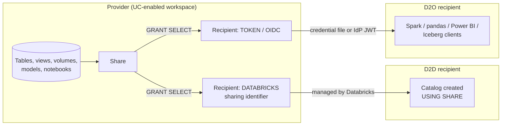

# OpenSharing

## Overview

**OpenSharing** (formerly Delta Sharing) is the secure data sharing platform in Databricks for sharing data and AI assets with users outside your organization, whether or not they use Databricks. Data is shared live without replication; the provider governs access with Unity Catalog securables (**shares** and **recipients**), and the recipient reads through either the **Databricks-to-Databricks (D2D)** protocol or the **Databricks-to-Open (D2O)** protocol. OpenSharing is also the foundation of Databricks Marketplace and Clean Rooms.

> [!note] Platform update (Oct 2026)
> "Delta Sharing is now OpenSharing" (June 10, 2026). The docs moved to `/opensharing/`, but SQL keywords (`CREATE SHARE`, `CREATE RECIPIENT`), the `deltaSharing` Spark format, the `delta-sharing` Python package, and `deltaSharing*` audit events keep their old names. Source: [Databricks release notes, June 2026](https://docs.databricks.com/aws/en/release-notes/product/2026/june)

> [!abstract]
>
> - **Share** = read-only collection of assets from one metastore; **recipient** = the organization allowed to read it; **provider** = the sharing organization
> - **D2D**: recipient has a Unity Catalog-enabled workspace; identified by a **sharing identifier**; no tokens to manage; supports notebooks, volumes, models, metric views
> - **D2O** ("open sharing"): any platform; authenticates with a **bearer-token credential file** or **OIDC federation**; tabular data only
> - `WITH HISTORY` enables time travel, streaming reads, and (with CDF enabled) `table_changes()` for recipients

> [!tip] What the Exam Tests
>
> - "Implement OpenSharing (D2D and Databricks-to-Open) ... for privacy-preserving collaboration" — choose the protocol from the recipient's platform and the assets you need to share
> - The provider DDL: `CREATE SHARE`, `ALTER SHARE ... ADD TABLE | VIEW | VOLUME | MODEL`, `CREATE RECIPIENT [USING ID ...]`, `GRANT SELECT ON SHARE ... TO RECIPIENT ...`
> - Restricting what a recipient sees: partition specs, recipient properties with `CURRENT_RECIPIENT()`, dynamic views, aliases
> - The recipient side: `CREATE CATALOG ... USING SHARE provider.share`, credential files, `deltaSharing` streaming reads, and audit via `system.access.audit`

---

## How OpenSharing Works



Ways to share with OpenSharing:

1. **Databricks-to-Databricks protocol** — share data and AI assets with users who have a Unity Catalog-enabled workspace (another account, another cloud, or another metastore in your own account).
2. **Databricks-to-Open protocol** — share tabular data managed in Unity Catalog with users on any computing platform.
3. **Customer-managed open-source OpenSharing server** — share from any platform to any platform (not covered by Databricks docs).
4. **SAP BDC Connector** — zero-copy sharing with SAP Business Data Cloud.

> [!important]
> There is no need for OpenSharing between workspaces attached to the **same** Unity Catalog metastore — use normal Unity Catalog grants. D2D sharing between metastores in the same account is enabled by default; sharing outside the account requires an account admin to enable OpenSharing on the metastore.

### D2D vs D2O at a glance

| Aspect | Databricks-to-Databricks (D2D) | Databricks-to-Open (D2O) |
| :--- | :--- | :--- |
| Recipient platform | Unity Catalog-enabled Databricks workspace | Any (Databricks, Apache Spark, pandas, Power BI, Tableau, Iceberg clients such as Snowflake, Trino, Flink) |
| Recipient identity | **Sharing identifier** `<cloud>:<region>:<uuid>` of the recipient metastore | Recipient object with authentication type `TOKEN`, or an OIDC federation policy |
| Credentials | None for the recipient to manage — Databricks handles authentication | **Bearer token** in a credential file (download once, max lifetime 1 year) or short-lived OAuth tokens via **OIDC federation** with the recipient's IdP |
| Shareable assets | Tables, streaming tables, managed/foreign Iceberg tables, views and dynamic views, materialized views, **metric views, volumes, models, notebook files** | Tabular data (tables, views, MVs; streaming tables as current snapshot only) |
| Recipient governance | Recipient grants access to the mounted catalog with Unity Catalog | Managed in the recipient's own tool |
| Audit/usage tracking | Both provider and recipient | Provider side |
| SQL creation | `CREATE RECIPIENT ... USING ID '<sharing-identifier>'` | `CREATE RECIPIENT name` (no `USING ID`) → returns activation link |

---

## Provider Setup and Privileges

| Privilege | Scope | Used for |
| :--- | :--- | :--- |
| `CREATE SHARE` | Metastore | Create shares |
| `CREATE RECIPIENT` | Metastore | Create recipients |
| `USE SHARE` + `SET SHARE PERMISSION` (or share owner) | Share | Delegated grant management |
| `USE RECIPIENT` (or recipient owner) | Recipient | View recipients/grants; needed with the above to grant |
| `SELECT` / `READ VOLUME` / `EXECUTE` | Each shared table/view, volume, model | The share owner must keep these for as long as the asset is shared |
| `CREATE PROVIDER`, `USE PROVIDER` | Recipient metastore | Recipient side: see providers and mount shares |

Account admins enable OpenSharing on the metastore (for sharing outside the account), set the **default recipient token lifetime** (Databricks recommends tokens expire), and set an **organization name** that recipients see. Databricks recommends a **group** as share owner.

---

## Creating Shares

```sql
CREATE SHARE IF NOT EXISTS customer_data_share
COMMENT 'Curated customer data for partners';

-- Table, with an alias the recipient must use, and full history
ALTER SHARE customer_data_share
ADD TABLE prod.gold.customers
COMMENT 'Customer master'
AS shared.customers
WITH HISTORY;

-- Whole schema: current and future tables/views/volumes/models (no alias or partition allowed)
ALTER SHARE customer_data_share ADD SCHEMA prod.gold;

-- Views, materialized views, volumes, models
ALTER SHARE customer_data_share ADD VIEW prod.gold.customer_summary_v;
ALTER SHARE customer_data_share ADD MATERIALIZED VIEW prod.gold.daily_sales_mv;
ALTER SHARE customer_data_share ADD VOLUME prod.raw.contracts AS shared.contracts;  -- D2D only
ALTER SHARE customer_data_share ADD MODEL prod.ml.churn_model;                      -- D2D only

-- Inspect and maintain
SHOW SHARES;
DESCRIBE SHARE customer_data_share;
SHOW ALL IN SHARE customer_data_share;
ALTER SHARE customer_data_share REMOVE TABLE shared.customers;
```

- **`WITH HISTORY` / `WITHOUT HISTORY`** (DBR 12.2 LTS+): `WITH HISTORY` lets recipients run time travel (`VERSION AS OF`, `TIMESTAMP AS OF`), streaming reads, and transactions; for D2D it also shares the Delta log for better read performance. It is the **default on Databricks SQL and DBR 16.2+** (and always for schema sharing); `WITHOUT HISTORY` is the default on DBR 16.1 and below. `WITH CHANGE DATA FEED` is deprecated.
- To let recipients query **CDF** with `table_changes()`, **enable CDF on the table before** sharing it `WITH HISTORY`.
- **Notebook files** are added through Catalog Explorer (*Manage assets → Add notebook file*), D2D only.
- Streaming tables are added with `ADD TABLE`; D2O recipients can read only their **current snapshot** (no time travel, streaming, or CDF).

### What you cannot share

- Tables with **row filters or column masks** (share a dynamic view instead), tables with **collations**, `SHALLOW CLONE` tables, tables using **liquid clustering with partition filtering**, R2 tables with V2 checkpoint
- Metric views, volumes, models, and notebooks over D2O
- Assets from more than one metastore in a single share

### Limiting what a recipient sees

```sql
-- Static partition spec: syntax is PARTITION (...), not WITH PARTITION
ALTER SHARE regional_share
ADD TABLE prod.gold.sales
PARTITION (region = 'US');

-- Several partitions in one spec
ALTER SHARE eu_share
ADD TABLE prod.gold.customers
PARTITION (country = 'DE'), (country = 'FR'), (country = 'GB');

-- One share, many recipients: partition by a recipient property (DBR 12.2 LTS+)
CREATE RECIPIENT acme USING ID 'aws:us-west-2:19a84bee-54bc-43a2-87de-023d0ec16016'
PROPERTIES ('country' = 'US');

ALTER SHARE global_share
ADD TABLE prod.gold.sales
PARTITION (country = CURRENT_RECIPIENT().country);
```

```sql
-- Dynamic view with row-level filtering per recipient (DBR 14.2+)
CREATE VIEW prod.gold.sales_by_recipient AS
SELECT * FROM prod.gold.sales
WHERE country = CURRENT_RECIPIENT('country');

-- Column-level redaction
CREATE VIEW prod.gold.customers_masked AS
SELECT
  customer_id,
  CASE WHEN CURRENT_RECIPIENT('country') = 'US' THEN email ELSE 'REDACTED' END AS email
FROM prod.gold.customers;

ALTER SHARE global_share ADD VIEW prod.gold.sales_by_recipient;
```

A provider can't query a `CURRENT_RECIPIENT()` view directly; to test it, share it with yourself and query as a recipient. Shareable views must be defined on Delta tables, foreign tables, other shareable views, or local materialized views and streaming tables.

---

## Managing Recipients

### Databricks-to-Databricks recipient

The recipient finds their sharing identifier (the output of `current_metastore()` on their side, format `<cloud>:<region>:<uuid>`) and sends it to the provider.

```sql
CREATE RECIPIENT IF NOT EXISTS partner_analytics
USING ID 'aws:eu-west-1:g0c979c8-3e68-4cdf-94af-d05c120ed1ef'
COMMENT 'Partner analytics metastore';
-- authentication_type = DATABRICKS
```

### Databricks-to-Open recipient (bearer token)

```sql
CREATE RECIPIENT IF NOT EXISTS external_partner
COMMENT 'Non-Databricks partner';
-- authentication_type = TOKEN

DESCRIBE RECIPIENT external_partner;
-- returns activation_link until the credential file is downloaded
```

- Send the **activation link** over a secure channel; the recipient downloads the credential file **only once**.
- Token lifetime defaults to the metastore setting; tokens are valid for a **maximum of one year**.
- **Rotate** with Catalog Explorer or the CLI — there is no SQL `ROTATE` clause:

  ```bash
  databricks recipients rotate-token <recipient-name> <existing-token-expire-in-seconds>
  ```

  A recipient has at most two tokens (active + rotated); `0` expires the old token immediately (use it if the token is compromised).
- Optionally restrict D2O recipients with **IP access lists**.

### Databricks-to-Open recipient (OIDC federation)

Instead of a long-lived token, the provider creates a recipient with an **OIDC token federation policy** (issuer URL of the recipient's IdP such as Microsoft Entra ID or Okta, plus allowed users, groups, service principals, or apps). Recipients authenticate with their own IdP — **U2M** (for example Power BI, Tableau) or **M2M** (OpenSharing Python/Spark clients) — and Databricks exchanges the IdP's JWT for short-lived OAuth tokens. MFA and token lifetime are enforced by the IdP; email invitations don't support OIDC.

### Grants and recipient maintenance

```sql
GRANT SELECT ON SHARE customer_data_share TO RECIPIENT partner_analytics;  -- SELECT is the only share privilege
SHOW GRANT ON SHARE customer_data_share;
SHOW GRANTS TO RECIPIENT partner_analytics;
REVOKE SELECT ON SHARE customer_data_share FROM RECIPIENT partner_analytics;

ALTER RECIPIENT partner_analytics SET PROPERTIES ('country' = 'DE');
ALTER RECIPIENT partner_analytics OWNER TO `data-sharing-admins`;
DROP RECIPIENT partner_analytics;  -- loses access to every share
DROP SHARE customer_data_share;    -- every recipient loses access
```

**OpenSharing by email** (Beta): invite a recipient by email address and choose Databricks, open sharing, or either; granting the share sends the activation link. Not supported for OIDC, groups, or service principals, or via the `CREATE RECIPIENT` SQL command.

---

## Consuming Shared Data

### D2D recipient

```sql
-- Requires metastore admin, or CREATE CATALOG + USE PROVIDER (or provider ownership)
SHOW PROVIDERS;
CREATE CATALOG IF NOT EXISTS partner_shared
USING SHARE acme_provider.customer_data_share;

GRANT USE CATALOG ON CATALOG partner_shared TO `analysts`;
SELECT * FROM partner_shared.shared.customers;

-- Shared WITH HISTORY (+ CDF enabled by provider)
SELECT * FROM partner_shared.shared.customers VERSION AS OF 3;
SELECT * FROM table_changes('partner_shared.shared.customers', 0, 3);
```

Objects in a shared catalog are **read-only**; recipients can be granted only read access. Shared notebooks live at the catalog level and can be cloned by anyone with `USE CATALOG`. New shares and share updates are cached for about a minute before they appear.

### D2O recipient (credential file)

```python
# pip install delta-sharing
import delta_sharing

profile = "/Volumes/main/sharing/creds/config.share"
client = delta_sharing.SharingClient(profile)
print(client.list_all_tables())

pdf = delta_sharing.load_as_pandas(f"{profile}#customer_data_share.shared.customers")
sdf = delta_sharing.load_as_spark(f"{profile}#customer_data_share.shared.customers")
```

The credential (profile) file is JSON with `shareCredentialsVersion`, `endpoint`, `bearerToken`, and optional `expirationTime`; Databricks-issued files also carry an `icebergEndpoint` for Iceberg REST Catalog clients. Power BI Desktop uses the **OpenSharing** connector with the endpoint URL and bearer token from the file.

### Streaming and CDF reads

A table shared **with history** (or a streaming table, for D2D) can be a Structured Streaming source with the `deltaSharing` format:

```python
d2d_stream = (spark.readStream
    .format("deltaSharing")
    .option("startingVersion", 0)
    .option("ignoreDeletes", "true")
    .option("maxFilesPerTrigger", 10)
    .table("partner_shared.shared.customers"))

d2o_cdf = (spark.readStream
    .format("deltaSharing")
    .option("readChangeFeed", "true")
    .load("/Volumes/main/sharing/creds/config.share#customer_data_share.shared.customers"))
```

Supported source options include `startingVersion`, `startingTimestamp`, `ignoreDeletes`, `ignoreChanges`, `maxFilesPerTrigger`, `maxBytesPerTrigger`, and `readChangeFeed`. Tables with deletion vectors or column mapping need `responseFormat=delta` for streaming and CDF reads, and you can't change `responseFormat` on a running stream.

> [!note] Platform update (Oct 2026)
> `Trigger.AvailableNow` on OpenSharing streaming sources became GA on July 14, 2026: it captures the shared table's version at start, processes the backlog in multiple micro-batches (honoring `maxFilesPerTrigger` and `maxVersionsPerRpc`), then stops. It needs DBR 18.0+; on earlier runtimes it is converted to `Trigger.Once`. Source: [Databricks release notes, July 2026](https://docs.databricks.com/aws/en/release-notes/product/2026/july)

### Iceberg clients

Providers can share Delta tables, managed Iceberg tables, foreign Iceberg tables, views, materialized views, and streaming tables with external engines that speak the **Iceberg REST Catalog API** (Snowflake, Trino, Flink, Spark, PyIceberg). Delta tables need `IcebergCompatV3`; assets in default storage can't be shared to Iceberg clients; sharing views/MVs/streaming tables triggers provider-side materialization. Recipients use the `icebergEndpoint` + bearer token from the credential file, or **OIDC federation** (supported for Iceberg clients since June 15, 2026).

---

## Governance, Cost, and Security

### Auditing

Provider-side OpenSharing events are logged in `system.access.audit` under `service_name = 'unityCatalog'`; actions performed by recipients start with the `deltaSharing` prefix.

```sql
SELECT
  event_time,
  request_params.recipient_name,
  request_params.share,
  request_params.schema,
  request_params.name AS table_name,
  source_ip_address
FROM system.access.audit
WHERE service_name = 'unityCatalog'
  AND action_name IN ('deltaSharingQueryTable', 'deltaSharingQueryTableChanges')
ORDER BY event_time DESC;
```

### Who pays, and where data is filtered

| Recipient compute | Account relationship | Who pays (views) | Access method |
| :--- | :--- | :--- | :--- |
| Databricks serverless | Any | Recipient | Direct access to underlying data |
| Databricks classic | Same account | Recipient | Direct access |
| Databricks classic | Different account | Recipient (provider's serverless SKU) | Provider performs filtering |
| D2O connectors | Any | Provider | Provider performs filtering |

- Sharing **within a region** has no egress cost; cross-region/cross-cloud sharing can incur cloud egress fees (Cloudflare R2 avoids them). With **SecureConnect** (Public Preview), providers share storage behind a firewall without allowlisting each recipient, and data transfer is billed by Databricks.
- Files are delivered via short-lived **pre-signed URLs** or scoped **cloud tokens**; for eligible tables shared `WITH HISTORY` and without partition filters, cloud tokens give near-direct-read performance — but they are scoped to the table root, so the recipient can also read the Delta log and not-yet-vacuumed deleted data.
- Revoke at any granularity: revoke a share, restrict IPs, filter rows/columns, rotate tokens, or drop the recipient.

### Cross-cloud and regulatory domains

D2D works across AWS, Azure, and GCP. Sharing across regulatory domains (commercial ↔ AWS GovCloud, GovCloud DoD, Azure China) is in **Public Preview** since June 15, 2026; Azure Government environments are not supported.

---

## Databricks Marketplace

Marketplace is an open exchange built on OpenSharing for datasets, notebooks, AI models, apps, and MCP servers.

- **Consumers** browse the Open Marketplace or the workspace **Marketplace** page, but must request access from a Databricks workspace. Listings are in the **public marketplace** or a provider's **private exchange**; some are instant, others need provider approval. Datasets are typically delivered as catalogs of tabular data (volumes are also supported); a Unity Catalog-enabled workspace gives the deepest integration, while other consumers can use Power BI, pandas, or Spark.
- **Providers** need a premium, Unity Catalog-enabled workspace and must apply through the Databricks Data Partner Program (or use self-service signup for private exchanges only) and follow the provider policies.

---

## Use Cases

| Scenario | Approach |
| :--- | :--- |
| Partner on Databricks (any cloud) needs curated gold tables plus notebooks | D2D share; partner mounts with `CREATE CATALOG ... USING SHARE` |
| Regulator or customer without Databricks needs a quarterly extract in Power BI | D2O share with bearer token (short lifetime) or OIDC |
| One share serving many regional partners, each seeing only their rows | Recipient properties + `PARTITION (col = CURRENT_RECIPIENT().prop)` or a dynamic view |
| Downstream partner needs incremental change feed | Enable CDF, share `WITH HISTORY`, recipient streams with `deltaSharing` + `readChangeFeed` |
| Snowflake team wants to query your tables in place | D2O to an Iceberg REST Catalog client |
| Monetize a dataset publicly | Marketplace listing |
| Two companies need joint results without seeing each other's rows | Not a share — use [Clean Rooms](./07-clean-rooms.md) |

## Common Issues & Errors

| Symptom | Cause | Fix |
| :--- | :--- | :--- |
| `ALTER SHARE ... WITH PARTITION` syntax error | Wrong keyword | Use `PARTITION (col = 'value')` |
| Recipient can't time travel or run `table_changes()` | Shared `WITHOUT HISTORY` (old runtime default) or CDF not enabled before sharing | Enable CDF, then `ALTER SHARE ... ALTER TABLE ... WITH HISTORY` |
| Activation link missing from `DESCRIBE RECIPIENT` | Credential file already downloaded (one-time) | Rotate the token to issue a new link |
| D2O integrations break on Dec 8, 2026 | D2O tokens issued before Dec 8, 2025 with later or no expiration automatically expire on Dec 8, 2026 | Review and renew long-lived tokens |
| Can't add a table with row filters/column masks | Not shareable | Share a dynamic view |
| Provider can't preview a `CURRENT_RECIPIENT()` view | Sharing context only | Share it to yourself and query as a recipient |
| New table not visible to recipient yet | Share metadata cached ~1 minute; `information_schema` refreshes only on direct query/`DESCRIBE` | Wait, then query the table directly |
| Workspace admin can't add a table | Inherited `USE CATALOG`/`USE SCHEMA` from the admin group isn't enough | Grant yourself the privileges directly |
| Asset vanished from share after dropping a schema | Cascade deletes bypass share protection | Remove assets from shares before deleting parents |

## Exam Tips

> [!tip]
>
> - **Recipient on Databricks with UC → D2D** (sharing identifier, no token, notebooks/volumes/models allowed). **Anyone else → D2O** (credential file or OIDC, tables only).
> - `CREATE RECIPIENT x USING ID '<cloud>:<region>:<uuid>'` = D2D; `CREATE RECIPIENT x` without `USING ID` = token-based D2O.
> - `GRANT SELECT ON SHARE s TO RECIPIENT r` — `SELECT` is the only share privilege.
> - `PARTITION (...)` (no `WITH`) shares a slice; `CURRENT_RECIPIENT()` lets one share serve many recipients.
> - `WITH HISTORY` (default on DBR 16.2+) enables time travel and streaming; CDF must be enabled on the source **before** sharing.
> - Rotate tokens with the CLI/Catalog Explorer, not SQL; max token lifetime one year.
> - Same metastore? Don't use OpenSharing — just grant.

## Key Takeaways

- OpenSharing (formerly Delta Sharing) shares live data without replication through Unity Catalog shares and recipients.
- D2D uses the recipient metastore's sharing identifier and supports non-tabular assets; D2O uses bearer-token credential files or OIDC federation for any client, including Iceberg REST Catalog engines.
- Providers limit exposure with partitions, recipient properties, dynamic views, and aliases; tables with row filters or column masks can't be shared directly.
- History sharing unlocks time travel, streaming (`deltaSharing` source, `Trigger.AvailableNow` GA on DBR 18.0+), and CDF for recipients.
- Every access is auditable in `system.access.audit` (`deltaSharing*` actions under `unityCatalog`), and Marketplace and Clean Rooms build on the same protocol.

## Related Topics

- [Clean Rooms](./07-clean-rooms.md) — privacy-preserving collaboration on top of OpenSharing
- [Lakehouse Federation](./08-lakehouse-federation.md) — query external systems without copying
- [Unity Catalog](../07-data-governance/01-unity-catalog.md) — governance foundation for shares and recipients
- [Access Control](../06-ensuring-data-security-and-compliance/01-access-control.md) — UC privileges and dynamic views
- [Change Data Capture (CDC) — Part 1](./04-change-data-capture-part1.md) — CDF fundamentals used by history sharing

## Official Documentation

- [What is OpenSharing?](https://docs.databricks.com/aws/en/opensharing/) (the old `/delta-sharing/` path redirects here)
- [What is the Databricks-to-Databricks protocol?](https://docs.databricks.com/aws/en/opensharing/share-data-databricks)
- [What is the Databricks-to-Open sharing protocol?](https://docs.databricks.com/aws/en/opensharing/share-data-open)
- [Set up OpenSharing for your account](https://docs.databricks.com/aws/en/opensharing/set-up)
- [Create shares](https://docs.databricks.com/aws/en/opensharing/create-share)
- [Create recipients (D2D)](https://docs.databricks.com/aws/en/opensharing/create-recipient)
- [Create recipients with bearer tokens (D2O)](https://docs.databricks.com/aws/en/opensharing/create-recipient-token)
- [Enable OIDC federation for recipients](https://docs.databricks.com/aws/en/opensharing/create-recipient-oidc-fed)
- [Manage access to shares](https://docs.databricks.com/aws/en/opensharing/grant-access)
- [Read data shared using D2D](https://docs.databricks.com/aws/en/opensharing/read-data-databricks)
- [Read data shared with bearer tokens](https://docs.databricks.com/aws/en/opensharing/read-data-open)
- [Read shares from an Iceberg client using OIDC](https://docs.databricks.com/aws/en/opensharing/sharing-over-oidc-iceberg)
- [Audit and monitor data sharing](https://docs.databricks.com/aws/en/opensharing/audit-logs)
- [ALTER SHARE](https://docs.databricks.com/aws/en/sql/language-manual/sql-ref-syntax-ddl-alter-share), [CREATE RECIPIENT](https://docs.databricks.com/aws/en/sql/language-manual/sql-ref-syntax-ddl-create-recipient), [GRANT ON SHARE](https://docs.databricks.com/aws/en/sql/language-manual/security-grant-share)
- [What is Databricks Marketplace?](https://docs.databricks.com/aws/en/marketplace/)
- [OpenSharing protocol (open source)](https://github.com/delta-io/delta-sharing/blob/main/PROTOCOL.md)

---

**[← Previous: Lakeflow Connect Database CDC](./05-lakeflow-connect-database-cdc.md) | [↑ Back to Section](./README.md) | [Next: Clean Rooms →](./07-clean-rooms.md)**
