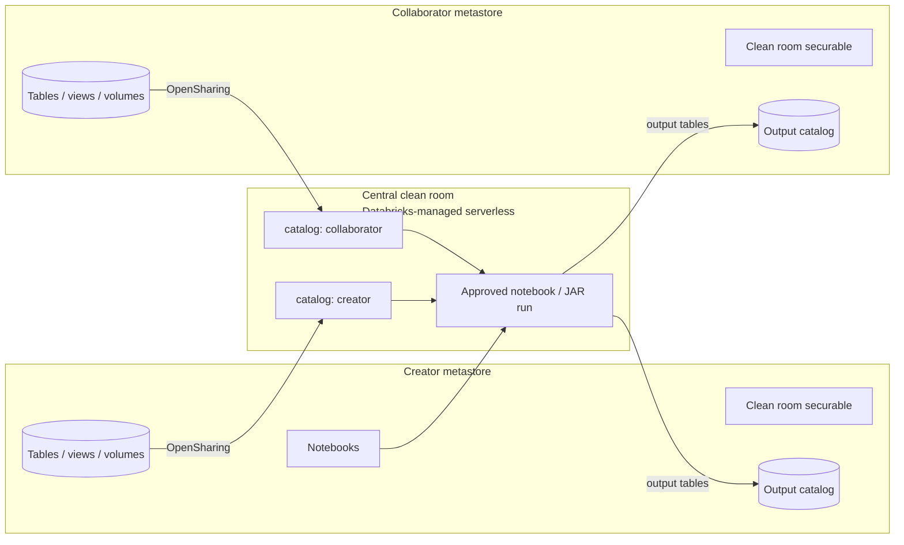
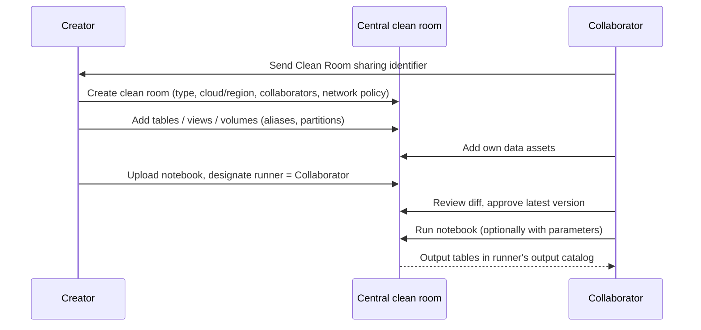

# Clean Rooms

## Overview

**Databricks Clean Rooms** uses OpenSharing and serverless compute to give multiple organizations a secure, privacy-protecting environment where they can analyze sensitive data together **without direct access to each other's data**. Each party shares tables, views, volumes, and code into a Databricks-managed *central clean room*; only approved code runs there, and results come back as read-only output tables.

> [!abstract]
>
> - A clean room = a securable in **each collaborator's Unity Catalog metastore** + an isolated, ephemeral **central clean room** on Databricks-managed serverless compute
> - Assets are shared **to the central clean room only** (via OpenSharing), never directly between collaborators; others see only aliases and column names/types
> - **No-trust model**: every notebook needs approval from every collaborator except its uploader; only the designated runner can run it
> - Two collaboration models: **approval-based** (default, equal privileges) and **packaged** (provider-consumer, provider code and data hidden — GA Jul 31, 2026)

> [!tip] What the Exam Tests
>
> - "Implement OpenSharing (D2D and Databricks-to-Open) and Clean Rooms for privacy-preserving collaboration" — decide when a clean room is needed instead of a plain share
> - Requirements: Unity Catalog, serverless compute, and OpenSharing enabled on the metastore
> - The workflow: sharing identifiers → create clean room → add assets with aliases/partitions → add notebook and designate runner → approvals → run → read output tables
> - Privileges (`CREATE CLEAN ROOM`, `MODIFY CLEAN ROOM`, `EXECUTE CLEAN ROOM TASK`, `MANAGE`, `BROWSE`) and the audit trail (`system.access.clean_room_events`)

---

## How a Clean Room Works



When you create a clean room, Databricks creates three things: a clean room securable in your metastore, the **central clean room** (an isolated ephemeral environment managed by Databricks), and a clean room securable in each collaborator's metastore. Data assets each collaborator adds are registered in the central clean room under that collaborator's catalog (by default **`creator`** and **`collaborator`**), so notebook code references them as `creator.sales.california` or `collaborator.advertiser.profiles`, using any aliases.

### What each party can see

| Shared with other collaborators | Shared with the central clean room only |
| :--- | :--- |
| Clean room name, cloud and region of the central clean room | Everything in the left column |
| Your organization name and Clean Room sharing identifier | **Read-only tables, views, volumes, and notebooks** (registered with their aliases) |
| Aliases of shared tables, views, volumes | |
| Column metadata (name or alias, type) — **not data** | |
| Notebooks (read-only), output tables (read-only, temporary) | |
| Clean room events system table, run history (notebook name, collaborator that ran it, state, start time) | |

### Requirements

- A workspace enabled for **serverless compute**
- A workspace enabled for **Unity Catalog**
- **OpenSharing enabled** on the Unity Catalog metastore
- Storage reachable from clean room serverless compute: if a bucket sits behind a storage firewall, use Databricks default storage, allow serverless access, or enable **SecureConnect** for clean rooms (SecureConnect is in Public Preview as of the June 15, 2026 release note)

### Built-in safeguards

- After creation the clean room is **locked**: no new collaborators can join.
- At most **ten collaborators** (the creator plus up to nine others).
- The name can't be changed and must be unique in every collaborator's metastore.
- If **any** collaborator deletes the clean room, the central clean room is void and nobody can run tasks.
- Comments you add to your securable are not propagated to others.
- You **cannot share metric views** in a clean room.

---

## Collaborators, Roles, and Privileges

- The **creator** is automatically the owner of the clean room in their account; in each collaborator's account, the **metastore admin** becomes the owner. Ownership can be transferred.
- Notebook roles: the **uploader** adds the notebook and picks exactly one **designated runner** (can be themselves).
- Packaged clean rooms add **provider** and **consumer** roles (see below).

| Privilege | Granted on | Lets the principal |
| :--- | :--- | :--- |
| `CREATE CLEAN ROOM` | Metastore | Create clean rooms; also needed (or metastore admin) to copy your Clean Room sharing identifier |
| `BROWSE` | Clean room | List it and view comments, owner, assets, run history |
| `MODIFY CLEAN ROOM` | Clean room | `BROWSE` + add/remove data assets and notebooks, update comments, approve/reject notebooks |
| `EXECUTE CLEAN ROOM TASK` | Clean room | `BROWSE` + run notebooks; also required to create the shared output catalog |
| `MANAGE` | Clean room | `BROWSE` + grant privileges, change owner, delete, manage auto-approval rules |

To add a table or view (if you aren't the owner), you **and** the owner need `SELECT` on it — or `READ VOLUME` for a volume — plus `USE CATALOG` and `USE SCHEMA` on its parents.

---

## Step-by-Step Workflow



1. **Collect sharing identifiers.** A Clean Room sharing identifier is the organization's **global metastore ID + workspace ID + the contact's email**. Each collaborator copies it from *Catalog → Clean Rooms → (org name) → Copy Clean Room sharing identifier*.
2. **Create the clean room** in Catalog Explorer (*Catalog → Clean Rooms → Create Clean Room*) or via the REST API:
   - **Clean room type**: *Approval-based Clean Room* (default) or *Packaged Clean Room*
   - **Name**: no spaces, periods, or forward slashes; immutable
   - **Cloud and region** of the central clean room: cloud must match your workspace, region can differ (data leaving a region can incur egress costs; pick a region that meets residency rules)
   - **Collaborators**: up to ten, by sharing identifier
   - **Network access policy**: *Full Access* or *Restricted Access* (serverless egress control); **cannot be changed later**
   - Compliance profile (HIPAA, FedRAMP Moderate) is inherited from your workspace; collaborators must use the same profile
3. **Add data assets** (*+ Add data assets*): tables, volumes, or views, each with an optional **alias** (the only name visible in the clean room) and, for tables, optional **partition clauses** to share only part of the table.
4. **Add notebooks** (*+ Add notebooks*), name them, and pick the runner. A notebook shared with results shares those results. JAR analyses and JAR UDFs are also supported (GA Oct 13, 2026).
5. **Approve** — every collaborator except the uploader must approve the **latest version**.
6. **Run** — the designated runner clicks **Run**, optionally passing parameters, or schedules it with the Clean Room notebook task in Lakeflow Jobs.
7. **Consume output** — the runner reads output tables in their output catalog.

To test end-to-end alone, use your own sharing identifier (or another user in your metastore): Databricks creates `test_clean_room` and `test_clean_room_collaborator` in your metastore.

---

## Notebook Approval and Version Control

| Rule | Detail |
| :--- | :--- |
| Who approves | All collaborators **except the uploader** |
| Who runs | Only the **designated runner**, even if everyone approved |
| Versions | Only the **latest** version can be approved, rejected, or run; changing content or the runner creates a new version and **resets all reviews** |
| Limits | Max 10 versions per notebook; up to ten reviews per collaborator per version (rejecting is always allowed) |
| Diff view | Version history shows a difference view between versions |
| Self-authored | You don't need to approve your own notebook to run it (you can still reject it) |

**Auto-approval rules** (owner or `MANAGE`): auto-approve notebooks authored by another collaborator (or *Anyone* in rooms with more than two parties), each rule tied to one runner. Auto-approval is the default for notebooks uploaded by another collaborator when **you** are the designated runner. Auto-approval rules are not available in packaged clean rooms.

### Runtime parameters available to clean room notebooks

| Parameter | Meaning |
| :--- | :--- |
| `cr_central_id` | Central clean room ID |
| `cr_runner_global_metastore_id`, `cr_runner_alias` | Who is running |
| `cr_<alias>_input_catalog` | Catalog holding a collaborator's shared data (`creator` / `collaborator` by default) |
| `cr_output_catalog` + `cr_output_schema` | Runner-only output location |
| `cr_shared_output_schema` | Output every collaborator can read (only when shared output is enabled) |

Read them with `dbutils.widgets.get("cr_central_id")` in Python or `:cr_central_id` in SQL.

---

## Output Tables and Shared Output

**Output tables** are temporary, read-only tables a notebook run creates and shares (via OpenSharing) to the **runner's** metastore.

```sql
-- Runner-only output: a new schema is created for every run
CREATE TABLE identifier(:cr_output_catalog || '.' || :cr_output_schema || '.overlapping_users') AS
SELECT collab_profiles.*
FROM collaborator.advertiser.profiles AS collab_profiles
JOIN creator.publisher.profiles AS creator_profiles
  ON collab_profiles.email = creator_profiles.email;
```

```sql
-- Shared output: readable by all collaborators as soon as each table is created
CREATE TABLE identifier(:cr_output_catalog || '.' || :cr_shared_output_schema || '.audience_overlap') AS
SELECT creator_profiles.segment_id, COUNT(DISTINCT collab_profiles.email) AS overlap_count
FROM collaborator.advertiser.profiles AS collab_profiles
JOIN creator.publisher.profiles AS creator_profiles
  ON collab_profiles.email = creator_profiles.email
GROUP BY creator_profiles.segment_id;
```

| Aspect | Runner-only output (`cr_output_schema`) | Shared output (`cr_shared_output_schema`) |
| :--- | :--- | :--- |
| Who can read | The principal who ran the notebook (and the clean room owner); a metastore admin can grant others | Every collaborator |
| When readable | After the run **completes successfully** | As soon as each table is created, even mid-run |
| Retention | Stored 30 days in the central clean room's default storage — copy elsewhere to keep longer | Schema auto-deleted after 30 days |
| Setup | Create the output catalog once per clean room (`EXECUTE CLEAN ROOM TASK`; default name `<clean-room-name>_output`) | Enable **Shared Output** when creating the clean room (cannot change later); all collaborators need the same account setting |
| Status | — | **GA Oct 13, 2026** |

Other output rules: only **tables** are supported (not views or volumes); each run creates a new schema (runs can't append to an earlier output table); queries on output tables require **serverless compute**; readers need `SELECT`, `USE CATALOG`, `USE SCHEMA`; deleting the clean room removes all output tables.

> [!note] Platform update (Oct 2026)
> Shared output in clean rooms became generally available on October 13, 2026. On Enterprise-tier accounts (and Premium on Azure) it is off by default until an account admin turns on **Clean Room Shared Output** on the account console Previews page. Source: [Databricks release notes, October 2026](https://docs.databricks.com/aws/en/release-notes/product/2026/october)

---

## Packaged Clean Rooms and Identity Resolution

A **packaged clean room** is a provider-consumer model: the **provider** supplies notebooks, JARs, and data; the **consumer** adds their own data, triggers runs, and sees the output — without seeing the provider's code or data.

| Capability | Approval-based | Packaged — consumer | Packaged — provider |
| :--- | :--- | :--- | :--- |
| View notebooks and JARs | All code visible | Names only, no code | Own code |
| Add notebooks and JARs | Yes | No | Yes |
| View data assets | All visible (metadata) | Own assets only | Own assets only |
| Trigger runs | Yes | Yes | No |
| View run output | Yes | Yes | No |
| Auto-approval rules | Yes | No | No |

- Packaged mode is chosen at creation and **cannot be changed**.
- Trust shifts to the provider ("similar to using a private library"), so the consumer should **review the egress network policy** before contributing sensitive data — open egress could let provider code send data out.
- **Identity resolution providers** (Acxiom, Adstra, LiveRamp, The Trade Desk): create a ready-to-use packaged clean room in one step from the Clean Rooms page (GA Oct 13, 2026). You are the consumer, the provider is preconfigured as the package provider, and shared output is enabled. Requires `CREATE CLEAN ROOM`.

> [!note] Platform update (Oct 2026)
> Packaged clean rooms became generally available on July 31, 2026, and one-step creation with identity resolution providers became GA on October 13, 2026. Sources: [Release notes, July 2026](https://docs.databricks.com/aws/en/release-notes/product/2026/july) and [October 2026](https://docs.databricks.com/aws/en/release-notes/product/2026/october)

---

## Privacy Controls Summary

| Control | How it protects data |
| :--- | :--- |
| Central clean room isolation | Code runs in a Databricks-managed serverless plane; neither party has admin privileges there |
| Metadata-only visibility | Collaborators see aliases and column names/types, never rows |
| Code approval + versioning | Nothing runs until all other parties approve the exact latest version |
| Designated runner | Only one named collaborator can execute a given notebook |
| Aliases and partition clauses | Hide real object names; share only a slice of a table |
| Network access policy | *Restricted Access* blocks egress to unapproved destinations |
| Output tables | Read-only, temporary (30 days), scoped to the runner unless shared output is used |
| Audit | `system.access.clean_room_events` + audit log service `clean-room` |

---

## Monitoring and Auditing

- **System table** `system.access.clean_room_events` (Public Preview) records `CLEAN_ROOM_CREATED`, `CLEAN_ROOM_DELETED`, `RUN_NOTEBOOK_STARTED`, `RUN_NOTEBOOK_COMPLETED`, `RUN_JAR_STARTED`, `RUN_JAR_COMPLETED`, `CLEAN_ROOM_ASSETS_UPDATED`, `OUTPUT_SCHEMA_DELETED`, `ASSET_REVIEW_CREATED`.
- **Audit log**: clean room actions are logged under service `clean-room` (for example `createCleanRoom`, `createCleanRoomAssetReview`, `createCleanRoomAutoApprovalRule`); permission changes on your securable are logged under `unityCatalog`.

```sql
-- Success rate of every clean room notebook
SELECT
  clean_room_name,
  run_notebook_completed_metadata.notebook_name AS notebook_name,
  ROUND(COUNT(CASE WHEN run_notebook_completed_metadata.state = 'SUCCESS' THEN 1 END) * 1.0 / COUNT(*) * 100) AS success_rate
FROM system.access.clean_room_events
WHERE event_type = 'RUN_NOTEBOOK_COMPLETED'
GROUP BY clean_room_name, notebook_name
ORDER BY clean_room_name, notebook_name;
```

---

## Clean Rooms vs Plain OpenSharing

| Question | OpenSharing share | Clean room |
| :--- | :--- | :--- |
| Does the recipient see rows? | **Yes** — read-only access to the shared data | **No** — only metadata; data is touched only by approved code |
| Direction | One-way, provider → recipient | Multi-party (up to 10), each contributes data |
| Who runs compute | Recipient (on their platform/compute) | Central clean room serverless compute |
| Code governance | None — recipient queries freely | Every analysis approved by the other parties |
| Non-Databricks parties | Yes, with Databricks-to-Open sharing | No — every collaborator needs a UC-enabled Databricks workspace |
| Typical use | Distribute a dataset, data products, Marketplace | Audience overlap, joint measurement, sensitive joins (e.g. PII matching) |

Rule of thumb: if the partner may **see** the data, use a share; if neither side may see the other's raw data but both need a joint result, use a clean room.

## Use Cases

- **Advertiser + publisher audience overlap** on hashed emails, returning only aggregate counts
- **Retail media measurement**: a retailer and a brand compute campaign lift without exchanging customer files
- **Identity resolution** with a provider (LiveRamp, The Trade Desk, ...) via a one-step packaged clean room
- **Proprietary model or analytic as a product**: a provider packages notebooks/JARs that consumers run on their own data without seeing the IP
- **Healthcare / financial collaboration** under a HIPAA compliance profile inherited by the central clean room

## Common Issues & Errors

| Symptom | Cause | Fix |
| :--- | :--- | :--- |
| Can't copy sharing identifier | Missing `CREATE CLEAN ROOM` | Grant it or ask a metastore admin |
| Notebook won't run after an edit | New version reset all approvals | Collaborators re-approve the latest version |
| Collaborator can't run an approved notebook | They aren't the designated runner | Re-upload with the right runner (creates a new version) |
| Notebook fails with table not found | Used the original table name instead of `creator.`/`collaborator.` catalog + alias | Reference the clean room catalog names and aliases |
| "Other collaborators have left the clean room" | Another party deleted the central clean room | Delete your local securable; create a new clean room |
| Data in a firewalled bucket unreadable | Serverless compute blocked by storage firewall | Default storage, allow serverless access, or SecureConnect |
| Can't add a new partner later | Clean rooms are locked after creation | Create a new clean room |
| Clean room creation fails with mismatched settings | Shared output / JAR settings differ between collaborators' accounts | Align account preview settings for all collaborators |

## Exam Tips

> [!tip]
>
> - **Clean Rooms = OpenSharing + serverless compute + approved code.** Requirements: UC, serverless, OpenSharing enabled on the metastore.
> - Partners never see each other's rows — only **column names/types and aliases**. If the scenario says "neither party may see the other's raw data", pick a clean room over a share.
> - Every notebook needs approval from **all collaborators except the uploader**, and only the **designated runner** can run it; any change creates a new version and resets reviews.
> - Max **10 collaborators**, no joining after creation, no renaming; any party deleting it ends it for everyone.
> - Output tables: read-only, runner-only by default, kept **30 days**; **shared output** (GA Oct 2026) makes results visible to all collaborators.
> - **Packaged clean rooms** (GA Jul 2026) = provider-consumer, provider code hidden, no auto-approval; mode fixed at creation.

## Key Takeaways

- A clean room creates a securable in every collaborator's metastore plus an isolated central clean room; assets are shared only into the central room via OpenSharing.
- The no-trust model rests on code approval, versioning, a single designated runner, and a fixed network access policy.
- Privileges map cleanly: `CREATE CLEAN ROOM` (metastore), then `BROWSE`, `MODIFY CLEAN ROOM`, `EXECUTE CLEAN ROOM TASK`, `MANAGE` on the clean room.
- Results flow back as temporary read-only output tables (runner-only or shared output), and every action is auditable in `system.access.clean_room_events`.
- Use OpenSharing to distribute data; use Clean Rooms when collaboration must happen without exposing raw data.

## Related Topics

- [OpenSharing](./06-opensharing.md) — the sharing protocol underneath clean rooms
- [Unity Catalog](../07-data-governance/01-unity-catalog.md) — securables and privileges
- [Access Control](../06-ensuring-data-security-and-compliance/01-access-control.md) — UC grants and fine-grained access
- [Audit, Lineage, and Network Security](../06-ensuring-data-security-and-compliance/06-audit-lineage-network-security.md) — audit logs and serverless egress control
- [System Tables](../04-monitoring-and-alerting/01-system-tables.md) — querying `system.access.*`

## Official Documentation

- [What is Databricks Clean Rooms?](https://docs.databricks.com/aws/en/clean-rooms/)
- [Create clean rooms](https://docs.databricks.com/aws/en/clean-rooms/create-clean-room)
- [Run notebooks in clean rooms](https://docs.databricks.com/aws/en/clean-rooms/clean-room-notebook)
- [Create and work with output tables in Databricks Clean Rooms](https://docs.databricks.com/aws/en/clean-rooms/output-tables)
- [Packaged clean rooms](https://docs.databricks.com/aws/en/clean-rooms/packaged-clean-rooms)
- [Manage clean rooms](https://docs.databricks.com/aws/en/clean-rooms/manage-clean-room)
- [Work with Databricks clean rooms as an invited collaborator](https://docs.databricks.com/aws/en/clean-rooms/clean-room-collaborator)
- [Run JAR workloads in Databricks clean rooms](https://docs.databricks.com/aws/en/clean-rooms/clean-room-jar-task)
- [Clean room events system table reference](https://docs.databricks.com/aws/en/admin/system-tables/clean-rooms)
- [Unity Catalog privileges reference](https://docs.databricks.com/aws/en/data-governance/unity-catalog/manage-privileges/privileges)
- [Release notes — June 2026](https://docs.databricks.com/aws/en/release-notes/product/2026/june), [July 2026](https://docs.databricks.com/aws/en/release-notes/product/2026/july), and [October 2026](https://docs.databricks.com/aws/en/release-notes/product/2026/october)

---

**[← Previous: OpenSharing](./06-opensharing.md) | [↑ Back to Section](./README.md) | [Next: Lakehouse Federation →](./08-lakehouse-federation.md)**
