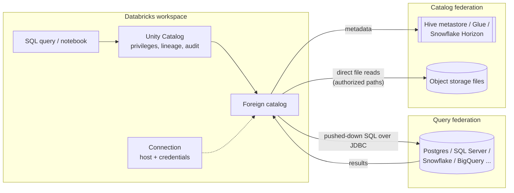

# Lakehouse Federation

## Overview

**Lakehouse Federation** is the Databricks query federation platform: governed, read-only access to data in external systems — MySQL, PostgreSQL, SQL Server, Oracle, Teradata, Redshift, Snowflake, BigQuery, Azure Synapse, Salesforce Data 360, other Databricks workspaces, and external catalogs such as Hive metastore and AWS Glue — **without ETL**. Data stays in the source; Unity Catalog governs access through a **connection** (which holds the credentials) and a **foreign catalog** (which mirrors the external database). The supported-source list grows over time; check the [supported data sources](https://docs.databricks.com/aws/en/query-federation/) page for the current set.

> [!abstract]
>
> - **Connection** — a UC securable storing the path and credentials for an external system (`CREATE CONNECTION`); credentials should be passed with the `secret()` function
> - **Foreign catalog** — a UC catalog that mirrors an external database or catalog and is queried with three-level names (`CREATE FOREIGN CATALOG ... USING CONNECTION`)
> - **Two flavors**: *query federation* (SQL pushed down over JDBC, runs on Databricks and the remote engine) and *catalog federation* (Databricks reads the foreign table's files directly from object storage)
> - **Read-only**: federated queries can't write back, except for a federated legacy *internal* Hive metastore
> - **Governance** — UC privileges, lineage, search, and audit apply to foreign tables exactly as to native ones

> [!tip] What the Exam Tests
>
> - "Configure Lakehouse Federation with governance across supported source systems, applying UC permissions and connection-level credentials"
> - The privilege chain: `CREATE CONNECTION` (metastore) → `CREATE CATALOG` (metastore) + `CREATE FOREIGN CATALOG` (connection) → `USE CATALOG` / `USE SCHEMA` / `SELECT` for readers; `USE CONNECTION` for `remote_query` and ingestion
> - Choosing **query federation vs catalog federation vs ingestion** (Lakeflow Connect) for a scenario
> - **Pushdown** behaviour and how to confirm it (Query Profile, `EXPLAIN FORMATTED`)

---

## Architecture



All federated traffic goes **directly between Databricks compute and the external system**; neither Unity Catalog nor the control plane sits on the data path (OAuth token exchange is the exception — it runs from the control plane).

### Query federation vs catalog federation

| | Query federation | Catalog federation |
| :--- | :--- | :--- |
| How it reads | Pushes the query down to the external database over JDBC; runs on both Databricks and remote compute | Reads table files directly from object storage; runs **only on Databricks compute** — more cost-effective and performance-optimized |
| Sources | MySQL, PostgreSQL, Teradata, Oracle, Amazon Redshift, Salesforce Data 360, Snowflake, Microsoft SQL Server, Azure Synapse, Google BigQuery, Databricks | Legacy Databricks Hive metastore, external Hive metastore, AWS Glue, Salesforce Data 360 (file sharing), Snowflake (Snowflake-managed Iceberg tables), Palantir Foundry, Workday Data Connect |
| Setup | Connection → foreign catalog → grants | Connection → **storage credential + external location** → foreign catalog with **authorized paths** → grants |
| Writes | Not supported | Not supported, except a federated **internal** (legacy workspace) Hive metastore |
| Best for | Ad hoc reporting, BI, proof-of-concept access to operational databases | Incremental migration to Unity Catalog, or a long-term hybrid with data still registered in an external catalog |

> [!note]
> For Snowflake, only Snowflake-managed **Iceberg** tables are eligible for catalog federation; other Snowflake tables are always read through query federation.

---

## Privileges and Connection-Level Credentials

### Who needs what

| Step | Privilege | Granted on |
| :--- | :--- | :--- |
| Create a connection | `CREATE CONNECTION` (or metastore admin) | Metastore |
| Create a foreign catalog | `CREATE CATALOG` **and** (`CREATE FOREIGN CATALOG` or connection ownership) | Metastore + connection |
| Set authorized paths (catalog federation) | `CREATE FOREIGN SECURABLE` | External location covering the paths |
| List / view connection details | `USE CONNECTION` | Connection (on the metastore it only allows viewing details) |
| Run `remote_query` or build Lakeflow ingestion pipelines on the connection | `USE CONNECTION` | Connection |
| Read federated data | `USE CATALOG` + `USE SCHEMA` + `SELECT` | Foreign catalog / schema / table |
| Grant on the connection | Connection owner or metastore admin | Connection |

In workspaces enabled for Unity Catalog automatically, workspace admins hold `CREATE CONNECTION` and `CREATE CATALOG` by default. `ALL PRIVILEGES` on a connection implies `CREATE FOREIGN CATALOG` and `USE CONNECTION`.

```sql
GRANT CREATE FOREIGN CATALOG ON CONNECTION my_postgres TO `data-platform-admins`;
GRANT USE CONNECTION ON CONNECTION my_postgres TO `ingestion-engineers`;

GRANT USE CATALOG ON CATALOG postgres_prod TO `analysts`;
GRANT USE SCHEMA ON SCHEMA postgres_prod.public TO `analysts`;
GRANT SELECT ON TABLE postgres_prod.public.orders TO `analysts`;

REVOKE USE CONNECTION ON CONNECTION my_postgres FROM `ingestion-engineers`;
```

### Connection-level credentials

- Credentials are defined **once, on the connection** — not in notebooks, cluster configs, or `spark.conf`. The foreign catalog takes its credentials from the named connection, so `CREATE FOREIGN CATALOG` never contains a password.
- Every query through the foreign catalog reaches the source with the **connection's** credential; Unity Catalog decides *which Databricks users* may run those queries. Give the source account only the database rights you are willing to expose through UC, and use source-side permissions to hide databases or tables from it.
- Provide secrets with the `secret()` function rather than literals.
- Authentication options vary by connector: username/password for most; **AWS IAM** authentication for MySQL and PostgreSQL (`aws_region` + `credential` options); **OAuth** for Snowflake (built-in OAuth, Microsoft Entra ID, Okta, OAuth access token) plus PEM private key or basic auth; OAuth / OAuth M2M with Microsoft Entra ID or basic auth for SQL Server.
- With Snowflake built-in OAuth, the connection creator signs in once; refresh tokens default to a 90-day validity (`OAUTH_REFRESH_TOKEN_VALIDITY`), after which the connection must be re-authenticated.
- **Dedicated access mode** (formerly single user) clusters can use a connection only if the user **owns the connection**.

---

## Creating a Connection and Foreign Catalog

### Query federation (PostgreSQL)

```sql
-- Step 1: credentials live in a UC connection
CREATE CONNECTION IF NOT EXISTS my_postgres
TYPE POSTGRESQL
OPTIONS (
  host 'pg.example.com',
  port '5432',
  user secret('pg_scope', 'pg_user'),
  password secret('pg_scope', 'pg_pwd')
);

-- Step 2: mirror one database as a foreign catalog (MySQL omits the database option)
CREATE FOREIGN CATALOG IF NOT EXISTS postgres_prod
USING CONNECTION my_postgres
OPTIONS (database 'prod_db');

-- Step 3: query like any UC catalog
SELECT order_id, amount
FROM postgres_prod.public.orders
WHERE order_date >= current_date() - INTERVAL 7 DAYS;
```

`CREATE CONNECTION` types documented in the SQL reference: `DATABRICKS`, `HTTP`, `MYSQL`, `POSTGRESQL`, `REDSHIFT`, `SNOWFLAKE`, `SQLDW`, `SQLSERVER` (other sources, such as Glue or Hive metastore, have their own connection types on their setup pages). Required options:

| Type | Required options |
| :--- | :--- |
| `MYSQL`, `POSTGRESQL`, `REDSHIFT`, `SQLDW`, `SQLSERVER` | `host`, `port`, `user`, `password` |
| `SNOWFLAKE` | `host`, `port`, `sfWarehouse`, `user`, `password` (basic auth) |
| `DATABRICKS` | `host`, `httpPath`, `personalAccessToken` |

The Catalog Explorer wizard (*Catalog → Add → Create a connection*) creates the connection **and** the foreign catalog in one flow, lets you test the connection, bind the catalog to specific workspaces, set the owner, and grant privilege presets (all account users get `BROWSE` by default; *Data Reader* grants read).

### Catalog federation (AWS Glue)

```sql
CREATE CONNECTION glue_conn TYPE glue
OPTIONS (
  aws_region '<aws-region-ID>',
  aws_account_id '<aws-account-ID>',
  credential '<service-credential-ID>'
);

-- External locations must already cover these paths
CREATE FOREIGN CATALOG IF NOT EXISTS glue_catalog
USING CONNECTION glue_conn
OPTIONS (
  authorized_paths 's3://demo,s3://depts/finance',
  storage_root 's3://my-catalog-metadata'
);
```

**Authorized paths** are a guardrail: the federated catalog can only read tables whose locations fall under them. Without them, a user who can edit Hive metastore metadata could repoint a table they can `SELECT` at a sensitive path that UC's storage credential can reach. A `storage_root` is required to read Iceberg tables from a Glue/Hive-federated catalog.

### Metadata refresh

Unity Catalog refreshes foreign-table metadata automatically at query time. Refresh proactively (for example from a scheduled Lakeflow Job) when external engines change the source or to avoid refresh latency on the first query:

```sql
REFRESH FOREIGN CATALOG postgres_prod;
REFRESH FOREIGN SCHEMA postgres_prod.public;
REFRESH FOREIGN TABLE postgres_prod.public.orders;
```

Foreign table and column comments can be synced from supported sources (Beta since June 17, 2026; DBR 18.2+ or DBSQL 2026.15+).

---

## Pushdown and Performance

Query federation translates Databricks SQL into the source dialect and pushes down what the source supports. PostgreSQL, for example:

| Pushed down | Not pushed down / partial |
| :--- | :--- |
| Filters, projections, `LIMIT`, `OFFSET`, aggregates, sorting with limit, `TABLESAMPLE`, arithmetic, boolean and bitwise operators | Date, math, string and misc functions — **partial (filter expressions only)**; window functions — **not supported**; joins — Public Preview on DBR 17.2+ / SQL warehouses (Join Pushdown toggle) |

- **Confirm pushdown**: click the foreign data source scan node in the Query Profile graph, or run `EXPLAIN FORMATTED`, to see the SQL actually sent to the source.
- **One stream per foreign table**: each referenced foreign table becomes a subquery whose result returns to one executor task over a single stream — huge result sets can run out of memory.
- **No Databricks caching**: Result Cache and Disk Cache don't apply to federated queries.
- **Concurrency**: throttling follows the Databricks SQL concurrent query limit; there is no per-connection limit across warehouses.
- **Repeated or heavy reads**: Databricks recommends loading federated data into a **materialized view** and querying that:

  ```sql
  CREATE MATERIALIZED VIEW main.silver.orders_mv AS
  SELECT * FROM postgres_prod.public.orders;
  ```

### `remote_query` for native SQL

The `remote_query` table-valued function runs SQL written in the **source's own dialect** on a connection (MySQL, PostgreSQL, Teradata, Oracle, Redshift, Snowflake, SQL Server, BigQuery, or a JDBC connection). It needs `USE CONNECTION` (or `MANAGE` on single-user clusters), DBR 18.3+, or a Pro/Serverless SQL warehouse 2025.35+.

```sql
SELECT * FROM remote_query(
  'my_postgres',
  database => 'prod_db',
  query => 'SELECT region, SUM(amount) AS revenue FROM orders GROUP BY region'
);

-- Delegate access without granting USE CONNECTION: wrap it in a view
CREATE VIEW main.reporting.revenue_by_region AS
SELECT * FROM remote_query('my_postgres', database => 'prod_db', dbtable => 'public.revenue');

GRANT SELECT ON VIEW main.reporting.revenue_by_region TO `analysts`;
```

When users query such a view, the connection check uses the **view owner's** privileges, so the view owner must hold `USE CONNECTION`.

---

## Governance Story

- **Access control**: foreign catalogs, schemas, and tables are UC securables — grant, revoke, set owners, apply tags, and bind catalogs to workspaces like native catalogs.
- **Lineage and audit**: Unity Catalog is the governance layer — it performs the access control checks and auditing and infers lineage for queries on foreign tables, while the read itself uses the source (query federation) or the external catalog's metadata (catalog federation). Query federation is documented as bringing UC fine-grained access control, data lineage, and search to external data.
- **Least privilege at the source**: the connection's database user bounds what *any* Databricks user could ever reach through that connection; UC narrows it per principal.
- **Credential hygiene**: one place to rotate (the connection or the secret it references) instead of per-notebook secrets.
- **Sharing onward**: foreign tables and schemas can be added to OpenSharing shares; results are materialized on the provider side (no `LIMIT` or predicate pushdown for the recipient).

---

## Use Cases

| Scenario | Recommendation |
| :--- | :--- |
| Ad-hoc analytics or BI over an operational database | **Query federation** — no pipeline overhead |
| Proof of concept before building an ETL pipeline | **Query federation**, then move to ingestion |
| Low-QPS source-of-truth lookups | **Query federation** — always current |
| Large fact-table transformations or frequent heavy joins | **Ingest** with Lakeflow Connect — Databricks recommends managed connectors for higher volumes and lower latency |
| Data registered in Glue / Hive metastore during a UC migration | **Catalog federation** (direct file reads, Databricks compute only) |
| Snowflake-managed Iceberg tables | **Catalog federation**; other Snowflake tables via query federation |
| Recurring incremental loads from a federated source without CDC | Lakeflow Connect **query-based connector** on the foreign catalog |
| Need writes to the external system or custom parallelism | Spark data source / JDBC connection, not federation |

## Common Issues & Errors

- **Pushdown missing** — a function or construct the source dialect doesn't support (for example a window function) is evaluated in Databricks after pulling rows; check the Query Profile or `EXPLAIN FORMATTED`.
- **Executor out of memory** — a large foreign-table result streams to a single task; filter so pushdown reduces rows, or materialize into Delta.
- **Authentication failures after a password rotation** — the secret or connection wasn't updated; with Snowflake OAuth the refresh token expired and the connection must be re-authenticated.
- **Network reachability** — compute must reach the host: stable egress IP or Private Link for classic compute, Databricks-published serverless outbound IPs for serverless; OAuth connections also need the control plane to reach the IdP endpoint.
- **Dedicated cluster can't use the connection** — dedicated access mode works only for the connection owner; use standard access mode or a SQL warehouse.
- **Missing or colliding tables** — names invalid in UC are skipped; table/schema names are lowercased, so case-only differences collide (Synapse and Redshift case-sensitive identifiers aren't supported).
- **Catalog federation read of a table outside authorized paths fails** — extend the authorized paths (requires `CREATE FOREIGN SECURABLE` on the external location).

## Exam Tips

> [!tip]
>
> - "Query Snowflake / BigQuery / Postgres **without copying data**, governed by UC" → **Lakehouse Federation**. "Continuously replicate changes" → Lakeflow Connect instead.
> - Order of DDL: **`CREATE CONNECTION`** (credentials) → **`CREATE FOREIGN CATALOG ... USING CONNECTION`** → **`GRANT USE CATALOG / USE SCHEMA / SELECT`**.
> - `CREATE FOREIGN CATALOG` needs `CREATE CATALOG` on the metastore **plus** `CREATE FOREIGN CATALOG` on the connection (or ownership).
> - Credentials live **on the connection** (use `secret()`); readers never see them and only need UC data privileges.
> - Query federation pushes SQL down over JDBC; **catalog federation** reads files directly with Databricks compute and needs external locations + authorized paths.
> - Federation is **read-only** (except a federated internal Hive metastore) and bypasses Databricks result/disk caching.

## Key Takeaways

- Federation = query path, not data path: data stays in the source and Unity Catalog governs access through connections and foreign catalogs.
- Connection-level credentials centralize secrets; UC privileges (`USE CATALOG`, `USE SCHEMA`, `SELECT`) decide who can use them, and `USE CONNECTION` covers `remote_query` and ingestion use.
- Query federation suits ad hoc and BI access; catalog federation suits Hive/Glue/Snowflake-Iceberg migrations and hybrids; Lakeflow Connect suits high-volume, low-latency needs.
- Pushdown is per-source and partial; verify it in the Query Profile and materialize repeated heavy reads.
- Governance (lineage, audit, workspace binding, tags) applies to foreign objects just like native UC objects.

## Related Topics

- [Lakeflow Connect Database CDC](./05-lakeflow-connect-database-cdc.md) — ingest instead of federate
- [OpenSharing](./06-opensharing.md) — open cross-org sharing (different problem, same domain)
- [Unity Catalog](../07-data-governance/01-unity-catalog.md) — the governance plane for federation
- [Access Control](../06-ensuring-data-security-and-compliance/01-access-control.md) — UC privileges and grants
- [Secret Management](../06-ensuring-data-security-and-compliance/05-secret-management.md) — secrets referenced by connections

## Official Documentation

- [Connect to external databases and catalogs](https://docs.databricks.com/aws/en/query-federation/)
- [What is query federation?](https://docs.databricks.com/aws/en/query-federation/database-federation)
- [What is catalog federation?](https://docs.databricks.com/aws/en/query-federation/catalog-federation)
- [Hive metastore federation](https://docs.databricks.com/aws/en/query-federation/hms-federation-concepts)
- [Enable Hive metastore federation for AWS Glue](https://docs.databricks.com/aws/en/query-federation/hms-federation-glue)
- [Enable Snowflake catalog federation](https://docs.databricks.com/aws/en/query-federation/snowflake-catalog-federation)
- [Run federated queries on PostgreSQL](https://docs.databricks.com/aws/en/query-federation/postgresql)
- [Run federated queries on Snowflake (OAuth)](https://docs.databricks.com/aws/en/query-federation/snowflake)
- [Manage connections for Lakehouse Federation](https://docs.databricks.com/aws/en/query-federation/connections)
- [Query external databases using `remote_query`](https://docs.databricks.com/aws/en/query-federation/remote-queries)
- [Networking recommendations for Lakehouse Federation](https://docs.databricks.com/aws/en/query-federation/networking)
- [Comments on foreign tables](https://docs.databricks.com/aws/en/query-federation/foreign-table-comments)
- [`CREATE CONNECTION`](https://docs.databricks.com/aws/en/sql/language-manual/sql-ref-syntax-ddl-create-connection)
- [`CREATE CATALOG` / `CREATE FOREIGN CATALOG`](https://docs.databricks.com/aws/en/sql/language-manual/sql-ref-syntax-ddl-create-catalog)
- [Unity Catalog privileges reference](https://docs.databricks.com/aws/en/data-governance/unity-catalog/manage-privileges/privileges)

---

**[← Previous: Clean Rooms](./07-clean-rooms.md) | [↑ Back to Section](./README.md) | [Next: Batch ETL Pipelines — Part 1 →](../03-data-manipulation/01-batch-etl-pipelines-part1.md)**
