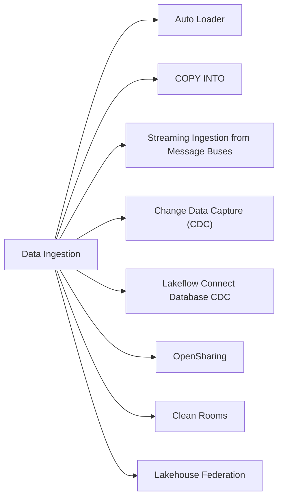

# Section 2: Data Ingestion & Acquisition (12 % of Exam)

Getting data into (or in front of) the lakehouse: Auto Loader and `COPY INTO` for files, message buses (Kafka, Kinesis, Pub/Sub), incremental CDC with Lakeflow Pipelines into Delta or Iceberg, Lakeflow Connect database CDC (SQL Server, MySQL, PostgreSQL), OpenSharing, Clean Rooms, and Lakehouse Federation. The Oct 9, 2026 guide folds the former *Data Sharing and Federation* domain into this one, which is why its weight rose from 7 % to 12 %.

## Topics Overview

## Section Contents

| File | Topic | Priority |
| :--- | :--- | :--- |
| [01-auto-loader.md](./01-auto-loader.md) | Auto Loader: file discovery modes, schema inference and evolution, rescued data | High |
| [02-copy-into.md](./02-copy-into.md) | `COPY INTO` idempotent batch loads and when to prefer Auto Loader | Medium |
| [03-streaming-ingestion-from-message-buses.md](./03-streaming-ingestion-from-message-buses.md) | Kafka, Kinesis, Pub/Sub, and a source × format matrix (Delta, Parquet, JSON, Iceberg, CSV, binary) | High |
| [04-change-data-capture-part1.md](./04-change-data-capture-part1.md) | CDC fundamentals, Change Data Feed, MERGE-based CDC | High |
| [04-change-data-capture-part2.md](./04-change-data-capture-part2.md) | Incremental CDC pipelines into Delta or Iceberg targets, multi-hop CDC | High |
| [05-lakeflow-connect-database-cdc.md](./05-lakeflow-connect-database-cdc.md) | Lakeflow Connect managed connectors for SQL Server, MySQL, PostgreSQL | High |
| [06-opensharing.md](./06-opensharing.md) | OpenSharing (formerly Delta Sharing): D2D vs Databricks-to-Open, shares, recipients | High |
| [07-clean-rooms.md](./07-clean-rooms.md) | Clean Rooms for privacy-preserving collaboration | High |
| [08-lakehouse-federation.md](./08-lakehouse-federation.md) | Connections, foreign catalogs, UC permissions, connection-level credentials | High |

## Exam Skill Coverage

Every skill bullet in Section 2 of the Oct 9, 2026 exam guide, with the files that cover it.

| Exam guide skill | Where it is covered |
| :--- | :--- |
| Develop data ingestion pipelines to ingest a variety of data formats, including Delta Lake, Parquet, JSON, Iceberg, CSV, and Binary from diverse sources such as message buses (Kafka, Kinesis, Pub/Sub) and cloud storage. | [01-auto-loader.md](./01-auto-loader.md), [02-copy-into.md](./02-copy-into.md), [03-streaming-ingestion-from-message-buses.md](./03-streaming-ingestion-from-message-buses.md) |
| Configure incremental CDC pipelines using Lakeflow Pipelines with Delta or Iceberg as the target table format. | [04-change-data-capture-part1.md](./04-change-data-capture-part1.md), [04-change-data-capture-part2.md](./04-change-data-capture-part2.md), [07-auto-cdc-api.md](../01-developing-code-for-data-processing/07-auto-cdc-api.md) |
| Configure CDC ingestion pipelines from relational database sources, including SQL Server, MySQL, and PostgreSQL, using Lakeflow Connect. | [05-lakeflow-connect-database-cdc.md](./05-lakeflow-connect-database-cdc.md) |
| Implement OpenSharing (D2D and Databricks-to-Open) and Clean Rooms for privacy-preserving collaboration. | [06-opensharing.md](./06-opensharing.md), [07-clean-rooms.md](./07-clean-rooms.md) |
| Configure Lakehouse Federation with governance across supported source systems, applying UC permissions and connection-level credentials. | [08-lakehouse-federation.md](./08-lakehouse-federation.md) |

## Key Concepts to Master

| Concept | Why it matters |
| :--- | :--- |
| **Auto Loader vs `COPY INTO`** | Auto Loader for continuous / high-volume file discovery; `COPY INTO` for simple idempotent batch loads |
| **Lakeflow Connect database connectors** | Managed CDC ingestion (inserts, updates, deletes) from operational databases with minimal code |
| **D2D vs Databricks-to-Open** | D2D recipients use a UC-enabled workspace and a sharing identifier; open recipients use bearer tokens or OIDC federation on any platform |
| **Clean Rooms** | Collaborators run approved code on each other's data without seeing the raw data |
| **Lakehouse Federation** | Query external databases through a UC connection + foreign catalog; data stays in the source |

## Related Resources

- [Auto Loader cheat sheet](../resources/cheat-sheets/auto-loader-quick-ref.md)
- [Streaming cheat sheet](../resources/cheat-sheets/streaming-quick-ref.md)
- [Unity Catalog Basics (shared)](../../../shared/fundamentals/unity-catalog-basics.md)

---

**[← Previous: Developing Code for Data Processing using Python and SQL](../01-developing-code-for-data-processing/README.md) | [↑ Back to DE Professional](../README.md) | [Next: Data Manipulation →](../03-data-manipulation/README.md)**
