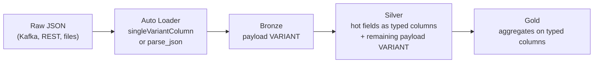

# VARIANT and Semi-Structured Data

## Overview

`VARIANT` is the Databricks data type for semi-structured data (JSON-like objects, arrays, and scalars). It stores values in an optimized binary encoding. Databricks recommends it over JSON strings when the schema is flexible, changing, or unknown. This page covers creating, ingesting, querying, and modeling `VARIANT` data, and when to choose it over `STRING` JSON or `STRUCT`.

> [!abstract]
>
> - Create `VARIANT` values with `parse_json` / `try_parse_json`, Auto Loader `singleVariantColumn`, `COPY INTO`, `from_xml(..., 'variant')`, or `from_csv(..., 'v variant')`
> - Query with the `:` path syntax plus `::` casts, or with `variant_get` / `try_variant_get`. Inspect shape with `schema_of_variant` / `schema_of_variant_agg`. Flatten with `variant_explode`
> - Variant shredding stores commonly occurring fields as separate Parquet columns, which gives semi-structured data structured-like read performance
> - `VARIANT` columns can't be partition, clustering, or Z-order keys, and can't be used in comparisons, `GROUP BY`, `ORDER BY`, `DISTINCT`, or set operations

> [!tip] What the Exam Tests
>
> - "Develop a model and query semi-structured data using the VARIANT data type and related functions (e.g., parse_json, variant_get)"
> - Choosing `VARIANT` vs `STRING` JSON vs `STRUCT` for a Bronze or Silver table, given schema volatility and read patterns
> - Knowing which functions raise errors (`parse_json`, `variant_get`) and which return `NULL` (`try_parse_json`, `try_variant_get`)
> - Promoting frequently filtered fields to typed columns so they can be clustered and skipped

> [!note] Platform update (Oct 2026)
> Variant and Variant shredding became generally available on July 22, 2026. Starting with Databricks Runtime 17.3, shredding is enabled automatically when you create a new table with `VARIANT` columns. Variant is "coming soon" to workspaces with the compliance security profile enabled. Source: [Databricks platform release notes, July 2026](https://docs.databricks.com/aws/en/release-notes/product/2026/july)

---

## Where VARIANT Fits

The exam's sample question describes a Bronze table holding raw JSON payloads "of varying shape in a single string column". The goal is efficient storage and fast field extraction with no fixed schema declared up front. The answer is to parse the payloads into `VARIANT` with `parse_json` and extract fields with `variant_get` and colon-path access.



## Runtime and Table Requirements

| Item | Requirement (per docs) |
| :--- | :--- |
| `VARIANT` type and functions | Function reference pages list Databricks SQL and Databricks Runtime 15.3+. The *Query variant data* page says the type is available in 15.4+ |
| Read/write tables with variant support | Databricks Runtime 15.4 LTS or above |
| Delta tables | Variant support must be enabled. Creating a table with a `VARIANT` column enables it, or set `delta.feature.variantType` = `supported`. This upgrades the writer protocol |
| Apache Iceberg tables | All Iceberg v3 tables support `VARIANT`. Iceberg v2 tables don't |
| Variant shredding | Databricks Runtime 17.3+ to read and write shredded tables. 18.1+ recommended for variant statistics and data skipping |
| File formats ingested as `VARIANT` | JSON (15.3+), XML (16.4+), CSV (16.4+) |

```sql
-- New table: a VARIANT column enables the feature
CREATE TABLE main.bronze.events_raw (payload VARIANT);

-- Existing Delta table: enable variant support explicitly
ALTER TABLE main.bronze.events_raw
SET TBLPROPERTIES ('delta.feature.variantType' = 'supported');
```

## Creating VARIANT Values

`parse_json(jsonStr)` returns a `VARIANT`. If the string isn't valid JSON, it raises `MALFORMED_RECORD_IN_PARSING`. `try_parse_json(jsonStr)` returns `NULL` instead.

```sql
-- CTAS: keep one typed key column, store the whole document as VARIANT
CREATE TABLE main.bronze.orders_raw AS
SELECT
  json_string:id AS id,              -- ':' on a JSON STRING returns STRING
  parse_json(json_string) AS payload
FROM main.landing.orders_json;

-- Append into an existing VARIANT column
INSERT INTO main.bronze.orders_raw (payload)
SELECT parse_json(json_string) FROM main.landing.orders_json;

-- Tolerate malformed records: NULL instead of a failed query
SELECT try_parse_json('{"a" : invalid, "b" : 2}');   -- NULL

-- Other constructors
SELECT from_xml(xml_string, 'variant') FROM main.landing.orders_xml;
SELECT from_csv(csv_string, 'v variant').v FROM main.landing.orders_csv;
SELECT CAST(123.456 AS VARIANT);                      -- typed literal to VARIANT
SELECT to_variant_object(named_struct('k', 'v'));     -- STRUCT or MAP to VARIANT object
```

> [!important]
> `VARIANT` natively holds `OBJECT`, `ARRAY`, and scalar types. To store a `STRUCT` or `MAP` as a variant object, use `to_variant_object`. `MAP` keys must be `STRING`.

```python
from pyspark.sql.functions import col, parse_json

(spark.read.table("main.landing.orders_json")
    .select(parse_json(col("json_string")).alias("payload"))
    .write
    .mode("append")
    .saveAsTable("main.bronze.orders_raw"))
```

## Ingesting into VARIANT

### Auto Loader

Auto Loader can load each whole record into a single `VARIANT` column with `singleVariantColumn`. Because the full record lands in one column, no schema evolution happens during ingestion, and `rescuedDataColumn` isn't supported.

```python
(spark.readStream
    .format("cloudFiles")
    .option("cloudFiles.format", "json")
    .option("singleVariantColumn", "payload")
    .load("/Volumes/main/landing/orders/")
    .writeStream
    .option("checkpointLocation", checkpoint_path)
    .toTable("main.bronze.orders_raw"))
```

You can also declare individual columns as `VARIANT` in a schema or in schema hints:

```python
# Typed column plus a VARIANT column
(spark.readStream.format("cloudFiles")
    .option("cloudFiles.format", "json")
    .schema("name STRING, address VARIANT")
    .load("/Volumes/main/landing/customers/"))

# Infer everything else; force one column to VARIANT
(spark.readStream.format("cloudFiles")
    .option("cloudFiles.format", "json")
    .option("cloudFiles.schemaHints", "address VARIANT")
    .load("/Volumes/main/landing/customers/"))
```

Caveats from the ingestion docs:

- Malformed records can't be encoded as `VARIANT`.
- Overly large records are treated like corrupt records. In the default `PERMISSIVE` mode, they're captured in the `corruptRecordColumn`.

### COPY INTO and Kafka

```sql
CREATE TABLE main.bronze.orders_raw (payload VARIANT);

COPY INTO main.bronze.orders_raw
  FROM '/Volumes/main/landing/orders/'
  FILEFORMAT = JSON
  FORMAT_OPTIONS ('singleVariantColumn' = 'payload');
```

```python
from pyspark.sql.functions import col, parse_json

(spark.readStream
    .format("kafka")
    .option("kafka.bootstrap.servers", "host1:port1")
    .option("subscribe", "orders")
    .load()
    .select(
        col("key").cast("string"),
        parse_json(col("value").cast("string")).alias("payload"))
    .writeStream
    .option("checkpointLocation", checkpoint_path)
    .toTable("main.bronze.orders_kafka"))
```

Databricks recommends Auto Loader over `COPY INTO` when available.

## Querying VARIANT with Path Syntax

The same SQL path operators used for JSON strings work on `VARIANT`.

| Syntax | Selects | Example |
| :--- | :--- | :--- |
| `col:field` | Top-level field | `payload:owner` |
| `col:a.b` or `col:a['b']` | Nested field with a named key | `payload:store.bicycle` |
| `col:arr[n]` | Array element (0-based) | `payload:store.fruit[0]` |
| `col:['field name']` | Field with special characters (space, `.`, `:`, `[ ]`) | `payload:['zip code']` |
| `expr::TYPE` | Cast (synonym for `cast`) | `payload:price::DOUBLE` |
| `expr ?:: TYPE` | Error-tolerant cast (synonym for `try_cast`, DBR 15.3+) | `payload:price ?::INT` |

```sql
SELECT
  payload:owner::STRING                     AS owner,
  payload:store.bicycle.price::DOUBLE       AS bike_price,
  payload:store.fruit[0].type::STRING       AS first_fruit,
  payload:['zip code']::STRING              AS zip,
  payload:store.bicycle::STRUCT<price DOUBLE, color STRING> AS bicycle
FROM main.bronze.store_data;
```

Rules to remember:

- **Field names are case-sensitive.** `payload:Owner` and `payload:owner` look for different fields. JSON strings match case-insensitively, so migrations can break here.
- **`:` on a `VARIANT` returns a `VARIANT`.** Cast with `::` before comparing, grouping, or sorting.
- **Missing path returns `NULL`** (a `NULL` of type `VARIANT`). An out-of-bounds array index also returns `NULL`.
- **`[*]` isn't supported** on `VARIANT` for unpacking all array elements. Use `variant_explode` instead.
- **Escaping:** `['<field>']` escapes every special character. Backticks escape spaces and colons but not periods or brackets. A backtick-escaped name that contains `.` or `[ ]` returns `NULL`.

## variant_get and try_variant_get

```text
variant_get ( variantExpr, path, type )
try_variant_get ( variantExpr, path, type )
```

- `path` is a `STRING` literal JSON path expression such as `'$.data[1].a'`.
- `type` is a `STRING` literal such as `'string'`, `'double'`, or `'array<int>'`.

| Situation | `variant_get` | `try_variant_get` |
| :--- | :--- | :--- |
| Path not found | `NULL` | `NULL` |
| Found, castable to `type` | Typed value | Typed value |
| Found, not castable to `type` | Error `INVALID_VARIANT_CAST` | `NULL` |

```sql
SELECT
  variant_get(payload, '$.owner', 'string')                AS owner,
  try_variant_get(payload, '$.store.bicycle.price', 'double') AS price,
  try_variant_get(payload, '$.key', 'boolean')             AS bad_cast   -- NULL, not an error
FROM main.bronze.store_data;

-- try_variant_get is equivalent to path + ?:: cast
SELECT payload:store.bicycle.price ?::DOUBLE FROM main.bronze.store_data;
```

```python
from pyspark.sql.functions import col, variant_get, try_variant_get

df = spark.read.table("main.bronze.store_data")
df.select(
    variant_get(col("payload"), "$.owner", "string").alias("owner"),
    try_variant_get(col("payload"), "$.store.bicycle.price", "double").alias("price"),
    variant_get(col("payload"), "$['zip.code']", "string").alias("zip"))
```

## NULL Semantics

Variants can contain two kinds of null:

| Kind | Meaning | Test |
| :--- | :--- | :--- |
| SQL `NULL` | The value is missing (for example `parse_json(NULL)`, or a path that doesn't exist) | `IS NULL` |
| Variant null | The document explicitly stores JSON `null` | `is_variant_null(expr)` |

```sql
SELECT
  is_variant_null(parse_json(NULL))                          AS sql_null,         -- false
  is_variant_null(parse_json('null'))                        AS variant_null,     -- true
  is_variant_null(parse_json('{"a": null}'):a)               AS null_value,       -- true
  is_variant_null(parse_json('{"a": null}'):missing)         AS missing_path;     -- false
```

## Discovering the Schema

| Function | Kind | Returns |
| :--- | :--- | :--- |
| `schema_of_variant(v)` | Scalar | DDL-format schema of one value, for example `OBJECT<data: ARRAY<BIGINT>, key: BIGINT>` |
| `schema_of_variant_agg(v) [FILTER (WHERE cond)]` | Aggregate | Combined schema of all values in a group. Fields merge by name using the least common type. Types with no common type (for example `TIMESTAMP` and `STRING`) become `VARIANT` |

```sql
-- What shapes are arriving in Bronze?
SELECT schema_of_variant_agg(payload) AS combined_schema
FROM main.bronze.events_raw
WHERE ingest_date = current_date();
```

Use the combined schema to decide which fields to promote to typed Silver columns, or which `STRUCT` to cast to.

## Flattening Arrays and Objects

`variant_explode(input)` is a table-valued generator that returns `pos INT`, `key STRING`, and `value VARIANT`. Use it in the `FROM` clause with `LATERAL`.

- **Object:** one row per key/value pair.
- **Array:** one row per element, and `key` is always `NULL`.
- **`NULL` or scalar input:** no rows. Use `variant_explode_outer` to keep a row of `NULL`s.

```sql
-- One row per line item
SELECT o.id, li.pos, li.value:sku::STRING AS sku, li.value:qty::INT AS qty
FROM main.bronze.orders_raw AS o,
LATERAL variant_explode(o.payload:line_items) AS li;
```

```python
from pyspark.sql.functions import col, variant_get

items = (spark.read.table("main.bronze.orders_raw")
    .select(variant_get(col("payload"), "$.line_items", "variant").alias("items")))

exploded = (items
    .lateralJoin(spark.tvf.variant_explode(col("items").outer()))
    .drop("items"))
```

## Converting Back to JSON

`to_json(variant)` returns a JSON `STRING`, and any options are ignored for `VARIANT` input. It's the *logical* inverse of `parse_json`, but not an exact one. Whitespace isn't preserved, key order is arbitrary, and trailing zeros in numbers might be dropped.

```sql
SELECT to_json(payload) AS payload_json FROM main.bronze.orders_raw;
```

## Variant Shredding

Shredding stores commonly occurring fields of a `VARIANT` column as separate columns in the underlying Parquet files. This cuts the I/O needed to read those fields and improves compression compared with a single binary blob.

| Topic | Behavior |
| :--- | :--- |
| Automatic enablement | From Databricks Runtime 17.3, `CREATE TABLE` with a `VARIANT` column enables shredding |
| Not automatic | `CREATE OR REPLACE TABLE` and `ALTER TABLE` don't enable it, so existing workloads don't change behavior |
| Opt in / out | `delta.enableVariantShredding` (Delta) or `iceberg.enableVariantShredding` (Iceberg) = `true` / `false` |
| Existing data | Enabling applies only to new writes. Rewrite old data with `REORG TABLE ... APPLY (SHRED VARIANT)` |
| Remove completely | `ALTER TABLE ... DROP FEATURE "variantShredding"` rewrites data unshredded and sets the property to `false` |
| Scope | Top-level `VARIANT` columns and `VARIANT` fields in structs. Not `VARIANT` inside arrays or maps |
| Cost | Some overhead on writes |

```sql
ALTER TABLE main.bronze.events_raw
SET TBLPROPERTIES ('delta.enableVariantShredding' = 'true');

-- Shred data written before the property was set
REORG TABLE main.bronze.events_raw APPLY (SHRED VARIANT);
```

## Limitations

- No partitioning by a `VARIANT` column, and a `VARIANT` column can't be a clustering key or Z-order key.
- No `GROUP BY`, `ORDER BY`, or `DISTINCT` on a `VARIANT` column, and no comparisons or set operators (`INTERSECT`, `UNION`, `EXCEPT`).
- A generated column can't produce a `VARIANT`.
- `VARIANT` columns don't collect `minValues` / `maxValues` statistics.
- A single value can't exceed 128 MiB (16 MiB in Databricks Runtime 17.1 and below).

## Modeling Choice: VARIANT vs STRING JSON vs STRUCT

| Approach | Best for | Schema handling | Read performance |
| :--- | :--- | :--- | :--- |
| `VARIANT` | Semi-structured JSON whose fields or types change, or where an optimized encoding is worth having | Flexible, with no pre-declared schema. Keeps case and `NULL`s from the source | Optimized encoding that outperforms JSON strings on reads and writes. Shredding adds columnar reads for common fields |
| `STRING` (JSON) | Capturing a complete, exact copy of raw source data | No type information and no pre-processing | Worst on read, because the whole string is parsed for every query |
| `STRUCT` | Well-known schemas where you want validated data | Enforced on write. Requires pre-processing. Less flexible for schema evolution | Best on read with full data skipping, but degrades past hundreds of columns |
| `MAP` / `ARRAY` | Semi-structured data with around 500 fields | Keys and values typed and enforced on write | Balanced reads and writes, but no statistics |

| Scenario | Choose |
| :--- | :--- |
| Bronze landing of JSON payloads whose shape varies by event type | `VARIANT` |
| Exact raw copy is required for replay or audit, and nobody queries the field values | `STRING` |
| Stable, contract-governed schema queried heavily in Silver/Gold | `STRUCT` or flat typed columns |
| Frequently filtered field inside a variant payload | Extract it to a typed top-level column, then cluster on it |
| Need to cluster or skip on a nested field | `STRUCT` field (liquid clustering accepts `struct_col.field`) or extracted column. `VARIANT` can't be a key |

> [!tip]
> Databricks recommends extracting frequently queried fields into non-variant columns "to accelerate queries and optimize storage layout". A common Silver pattern is: typed columns for keys, timestamps, and filters, plus the remaining payload kept as `VARIANT`.

```sql
-- CREATE TABLE (not CREATE OR REPLACE) so DBR 17.3+ enables shredding automatically
CREATE TABLE main.silver.events (
  event_id   STRING,
  event_type STRING,
  event_ts   TIMESTAMP,
  payload    VARIANT
)
CLUSTER BY (event_type, event_ts);

INSERT INTO main.silver.events
SELECT
  payload:id::STRING,
  payload:type::STRING,
  payload:ts::TIMESTAMP,
  payload
FROM main.bronze.events_raw;
```

## SQL to PySpark Reference

Import the functions from `pyspark.sql.functions`.

| SQL | PySpark |
| :--- | :--- |
| `parse_json(s)` | `parse_json(col("s"))` |
| `try_parse_json(s)` | `try_parse_json(col("s"))` |
| `variant_get(v, '$.a', 'int')` | `variant_get(col("v"), "$.a", "int")` |
| `try_variant_get(v, '$.a', 'int')` | `try_variant_get(col("v"), "$.a", "int")` |
| `schema_of_variant(v)` | `schema_of_variant(col("v"))` |
| `schema_of_variant_agg(v)` | `schema_of_variant_agg(col("v"))` |
| `is_variant_null(v)` | `is_variant_null(col("v"))` |
| `to_json(v)` | `to_json(col("v"))` |
| `LATERAL variant_explode(v)` | `df.lateralJoin(spark.tvf.variant_explode(col("v").outer()))` |
| `v:a.b::INT` | `df.selectExpr("v:a.b::INT")` |

Collected values arrive in Python as `VariantVal`. Call `.toPython()` to get a Python object or `.toJson()` to get a JSON string. You can also build one with `VariantVal.parseJson('{"a": 1}')`.

## Use Cases

- **Bronze ingestion of event streams.** Kafka, Kinesis, Event Hub, or webhook payloads land as `VARIANT` and stay robust to new or changed fields.
- **REST API responses and schemaless databases.** Store heterogeneous documents without per-source schemas, then promote stable fields downstream.
- **Multi-tenant or multi-event-type tables.** Different event types share one table, and `schema_of_variant_agg` profiles what arrives.
- **Replacing JSON-string columns.** Migrate `get_json_object` or `:` queries on strings to `VARIANT` for better read and write performance.

## Common Issues & Errors

| Symptom | Cause | Fix |
| :--- | :--- | :--- |
| `MALFORMED_RECORD_IN_PARSING` | `parse_json` hit invalid JSON | Use `try_parse_json` and route `NULL` results to a quarantine table |
| `INVALID_VARIANT_CAST` | `variant_get` found the field but couldn't cast it | Use `try_variant_get` or `?::`, then validate with an expectation |
| Field unexpectedly `NULL` | Case mismatch (paths are case-sensitive), wrong path, or a backtick-escaped name containing `.` | Check `schema_of_variant`. Use exact case and `['field.name']` escaping |
| Error grouping or sorting by `payload:status` | The result of `:` is still `VARIANT` | Cast first: `payload:status::STRING` |
| `[*]` query returns an error | Wildcard array access isn't supported on `VARIANT` | Use `LATERAL variant_explode(...)` |
| No speed-up after enabling shredding | Shredding applies only to new writes | Run `REORG TABLE ... APPLY (SHRED VARIANT)` |
| `CLUSTER BY (payload)` fails | `VARIANT` can't be a clustering or partition key | Extract the field to a typed column and cluster on that |
| External Delta client can't write the table | Enabling variant upgrades the writer protocol | Check client protocol support before enabling |

## Best Practices

- Land raw semi-structured data as `VARIANT` in Bronze. Use Auto Loader with `singleVariantColumn` when the whole record should stay intact.
- Use `try_parse_json` / `try_variant_get` in pipelines that must not fail on bad records. Pair them with expectations to quarantine failures.
- Promote fields used for joins, filters, and clustering to typed top-level columns in Silver.
- Run `schema_of_variant_agg` periodically to detect drift before it reaches typed layers.
- Use Databricks Runtime 18.1+ for shredded tables when you need variant statistics and data skipping.

## Exam Tips

> [!tip]
>
> - **Flexible schema plus efficient storage plus fast extraction means `VARIANT`.** Distractors usually include keeping JSON as `STRING` with `regexp_extract`, or forcing a rigid schema with `STRUCT` or Parquet.
> - **`try_` means `NULL`, not an error.** `parse_json` and `variant_get` raise errors. `try_parse_json`, `try_variant_get`, and `?::` return `NULL`.
> - **`:` returns `VARIANT`.** Cast with `::` (or `variant_get` with a type) to get a typed value.
> - **Paths are case-sensitive** on `VARIANT`, unlike JSON strings.
> - **`VARIANT` can't be a partition, clustering, or Z-order key**, and it can't be grouped, sorted, or compared. Extract a typed column instead.
> - **`variant_explode` goes in `FROM` with `LATERAL`.** It returns `pos`, `key`, and `value`. For arrays, `key` is `NULL`.
> - **Shredding** is automatic for new tables on DBR 17.3+. Use `REORG TABLE ... APPLY (SHRED VARIANT)` for existing data.

## Key Takeaways

- **`VARIANT`** is the recommended type for semi-structured data with changing or unknown schemas. It outperforms JSON strings on reads and writes.
- **Creation:** `parse_json` (errors on bad input), `try_parse_json` (`NULL` on bad input), Auto Loader / `COPY INTO` with `singleVariantColumn`, `from_xml(..., 'variant')`, and `from_csv(..., 'v variant')`.
- **Extraction:** `col:path` with `::` casts, `variant_get(v, '$.path', 'type')`, or the error-tolerant `try_variant_get`. Array indexes are 0-based, and missing paths return `NULL`.
- **Schema tools:** `schema_of_variant` describes one value. `schema_of_variant_agg` merges a group using least common types and falls back to `VARIANT` on conflicts.
- **Nulls:** SQL `NULL` (missing) is different from variant null (stored JSON `null`). Test the latter with `is_variant_null`.
- **Shredding** (GA Jul 22, 2026) gives structured-like performance. It's enabled automatically by `CREATE TABLE` on DBR 17.3+, but not by `CREATE OR REPLACE` or `ALTER`.
- **Modeling:** `VARIANT` for flexibility, `STRING` for an exact raw copy, `STRUCT` for validated, well-known schemas. Promote hot fields to typed columns for clustering and data skipping.

## Related Topics

- [Auto Loader](../02-data-ingestion-and-acquisition/01-auto-loader.md) - schema inference, schema hints, and rescued data
- [Streaming Ingestion from Message Buses](../02-data-ingestion-and-acquisition/03-streaming-ingestion-from-message-buses.md) - Kafka payloads
- [Schema Management](../09-data-modeling/04-schema-management.md) - enforcement and evolution
- [Expectations and Data Quality](./06-expectations-data-quality.md) - quarantining records that fail parsing or casting
- [AI Functions in Data Pipelines](./05-ai-functions.md) - task-specific AI functions return `VARIANT`
- [Partitioning Strategies](../09-data-modeling/03-partitioning-strategies.md) - clustering keys for promoted columns

## Official Documentation

- [Query variant data](https://docs.databricks.com/aws/en/semi-structured/variant)
- [How is variant different than JSON strings?](https://docs.databricks.com/aws/en/semi-structured/variant-json-diff)
- [Model semi-structured data](https://docs.databricks.com/aws/en/semi-structured/)
- [Ingest data as semi-structured variant type](https://docs.databricks.com/aws/en/ingestion/variant)
- [Variant type support for Apache Iceberg and Delta Lake](https://docs.databricks.com/aws/en/tables/features/variant)
- [Use variant shredding to optimize performance](https://docs.databricks.com/aws/en/tables/features/variant-shredding)
- [VARIANT type](https://docs.databricks.com/aws/en/sql/language-manual/data-types/variant-type)
- [parse_json function](https://docs.databricks.com/aws/en/sql/language-manual/functions/parse_json)
- [try_parse_json function](https://docs.databricks.com/aws/en/sql/language-manual/functions/try_parse_json)
- [variant_get function](https://docs.databricks.com/aws/en/sql/language-manual/functions/variant_get)
- [try_variant_get function](https://docs.databricks.com/aws/en/sql/language-manual/functions/try_variant_get)
- [schema_of_variant_agg function](https://docs.databricks.com/aws/en/sql/language-manual/functions/schema_of_variant_agg)
- [variant_explode table-valued function](https://docs.databricks.com/aws/en/sql/language-manual/functions/variant_explode)
- [`?::` (question double colon sign) operator](https://docs.databricks.com/aws/en/sql/language-manual/functions/questiondoublecolonsign)
- [Databricks platform release notes, July 2026](https://docs.databricks.com/aws/en/release-notes/product/2026/july)

---

**[← Previous: Data Deduplication](./03-data-deduplication.md) | [↑ Back to Section](./README.md) | [Next: AI Functions in Data Pipelines →](./05-ai-functions.md)**
