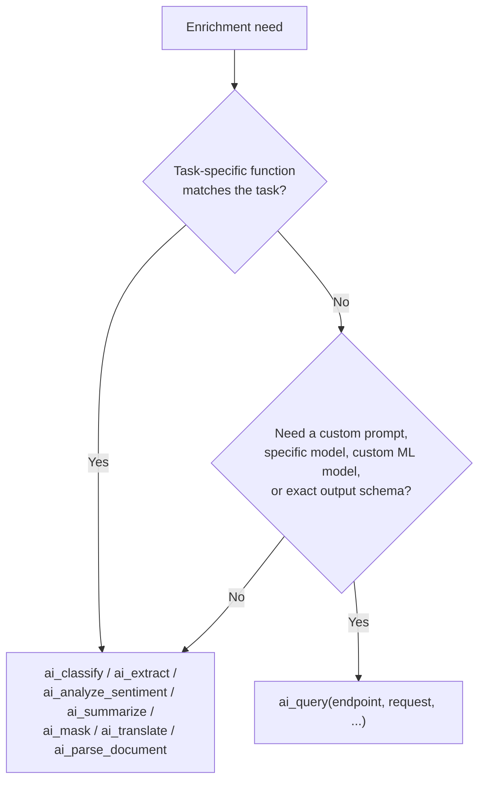
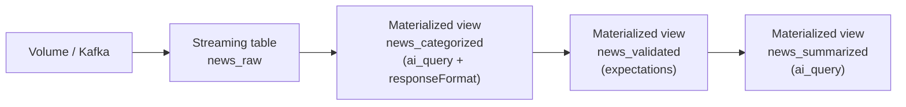

# AI Functions in Data Pipelines

## Overview

AI Functions are built-in SQL functions that apply large language models (LLMs) and other models to data stored on Databricks. You can call them from Databricks SQL, notebooks, Lakeflow pipelines, and jobs. For data engineers, they turn enrichment and classification (sentiment, categories, extracted fields, masking, summaries) into ordinary SQL expressions inside batch or streaming pipelines.

> [!abstract]
>
> - **Task-specific AI Functions** such as `ai_classify`, `ai_extract`, `ai_analyze_sentiment`, `ai_summarize`, `ai_mask`, `ai_translate`, and `ai_parse_document` are purpose-built, Databricks-managed, and need no prompt engineering
> - **`ai_query`** is the general-purpose function. It calls a model serving endpoint (Databricks-hosted `system.ai` models, provisioned throughput, external, or custom models) with your own prompt, `returnType` / `responseFormat`, `modelParameters`, and `failOnError`
> - AI Functions manage parallelization, retries, and scaling. Submit the whole dataset in one query and set `failOnError => false` for large jobs
> - Governance runs through Unity Catalog and Unity Gateway privileges, and cost shows up in `system.billing.usage`

> [!tip] What the Exam Tests
>
> - "Apply AI functions, including ai_query, to perform model inference within data pipelines for enrichment and classification tasks"
> - Choosing a task-specific function vs `ai_query` for a given enrichment requirement
> - Using `responseFormat` for structured output and `failOnError => false` so one bad row doesn't fail a batch
> - Placing inference in a Lakeflow pipeline, a scheduled job, or Structured Streaming, and accounting for cost and access control

> [!note] Platform update (Oct 2026)
> Docs now name Databricks-hosted models as `system.ai.<model>` model services. `ai_query` requests to `system.ai` model services are routed automatically through **Unity Gateway**, which provides usage tracking and permission checks. Gateway rate limits, guardrails, inference tables, and fallbacks don't apply to `ai_query` batch workloads. Source: [Use ai_query](https://docs.databricks.com/aws/en/large-language-models/ai-query)

---

## Requirements

| Requirement | Detail |
| :--- | :--- |
| Compute | Not available on Classic SQL warehouses (Databricks SQL Classic) |
| Runtime | Databricks Runtime 15.4 LTS or above. 18.2+ is recommended for performance and the latest features |
| Region | The workspace must be in a supported Model Serving / AI Functions region |
| Data access | Query permission on the Unity Catalog table that holds the input data |
| Endpoint (`ai_query`) | An existing serving endpoint. For Databricks-hosted foundation models, the endpoint already exists |

## Task-Specific Functions vs ai_query

Databricks recommends starting with a task-specific function when one matches the objective. Switch to `ai_query` when you need control over the prompt, the model, parameters, or output format, or when you need to call a custom, fine-tuned, or external model.



### Task-specific functions

| Task | Function | Signature | Returns |
| :--- | :--- | :--- | :--- |
| Classification / routing | `ai_classify` | `ai_classify(content, labels [, options])` | `VARIANT` (versions 2.x). Version 1.0 returns `STRING` |
| Structured field extraction | `ai_extract` | `ai_extract(content, schema [, options])` | `VARIANT` (versions 2.x) |
| Sentiment | `ai_analyze_sentiment` | `ai_analyze_sentiment(content)` | `STRING`: `positive`, `negative`, `neutral`, or `mixed` (`NULL` if undetected) |
| Summary | `ai_summarize` | `ai_summarize(content [, max_words])` | `STRING`. `max_words` defaults to 50, and 0 means no limit |
| PII masking | `ai_mask` | `ai_mask(content, labels)` with `labels` an `ARRAY<STRING>` literal | `STRING` with entities replaced by `[MASKED]` |
| Translation | `ai_translate` | `ai_translate(content, to_lang)` | `STRING` |
| Grammar | `ai_fix_grammar` | `ai_fix_grammar(content)` | `STRING` |
| Semantic similarity | `ai_similarity` | Compares two strings | Similarity score |
| Document parsing | `ai_parse_document` | Parses binary documents (text, tables, figures, layout) | `VARIANT` |
| Free-form prompt | `ai_gen` | Answers a user-provided prompt using a state-of-the-art model | Generated text |
| Forecasting | `ai_forecast` | Table-valued function that extrapolates time series | Forecast rows |
| Vector retrieval | `vector_search` | Queries an AI Search index | Matching rows |

The docs also list Beta functions such as `ai_enrich`, `ai_decide`, `ai_prep_search`, `ai_search`, `ai_transcribe`, `ai_predict_class`, `ai_predict_value`, `ai_detect_anomalies`, and `ai_top_drivers`.

```sql
SELECT
  review_id,
  ai_analyze_sentiment(review_text)                       AS sentiment,
  ai_summarize(review_text, 30)                           AS summary,
  ai_translate(review_text, 'en')                         AS review_en,
  ai_mask(review_text, array('person', 'email', 'phone')) AS review_masked
FROM main.silver.product_reviews;
```

### ai_classify

- `labels` is a `STRING`. It can be a JSON array of names (`'["urgent", "not_urgent"]'`) or a JSON object mapping names to descriptions. You need 2–500 labels in versions 2.x and 2–20 in version 1.0.
- `options` is a `MAP<STRING, STRING>`. Keys include `version` (`1.0`, `2.0`, `2.1`), `instructions`, `multilabel`, and, in version 2.1 only, `enableConfidenceScores` and `enableRationales`.
- `content` can be a `STRING` or a `VARIANT` produced by another AI function, such as `ai_parse_document`.
- Version 2.1 is recommended. It returns `{"response": [{"value": ...}], "metadata": {...}, "error_message": null}`. Version 2.1 isn't output-compatible with 2.0, because each label is now an object with a `value` key. Pin the version explicitly.

```sql
SELECT
  ticket_id,
  ai_classify(
    body,
    '{"billing_issue": "Payment, invoice, or refund problems",
      "product_defect": "Malfunction, bug, or breakage",
      "account_issue": "Login failures or password resets"}',
    map('version', '2.1', 'instructions', 'Customer support ticket routing.')
  ) AS c
FROM main.silver.support_tickets;

-- The result is VARIANT, so read it with path syntax and casts
SELECT ticket_id, c:response[0].value::STRING AS category, c:error_message::STRING AS err
FROM classified_tickets;
```

### ai_extract

`schema` is either a JSON array of field names (all treated as strings) or a JSON object with types (`string`, `integer`, `number`, `boolean`, `enum`), descriptions, nested `object`s, and `array`s. Types are validated. In versions 2.x the result is a `VARIANT`, and each scalar field comes back as an object with a `value` key. Version 2.1 adds optional citations and confidence scores. `options` can set `mode` = `precision` for long or complex documents.

```sql
SELECT
  invoice_id,
  ai_extract(
    invoice_text,
    '{"vendor_name": {"type": "string"},
      "total_amount": {"type": "number", "description": "Invoice total"},
      "invoice_date": {"type": "string", "description": "YYYY-MM-DD"}}',
    map('version', '2.1')
  ) AS x
FROM main.bronze.invoices;
-- x:response.total_amount.value::DECIMAL(18,2)
```

> [!tip]
> Task-specific functions that return `VARIANT` compose with `VARIANT` path syntax. See [VARIANT and Semi-Structured Data](./04-variant-semi-structured-data.md).

## ai_query

### Syntax

```text
-- Foundation model endpoint, or custom model endpoint that has a model schema
ai_query(endpoint, request)

-- Custom model endpoint without a model schema
ai_query(endpoint, request, returnType, failOnError)

-- Optional named arguments
ai_query(endpoint => ..., request => ..., returnType => ..., failOnError => ...,
         modelParameters => ..., responseFormat => ..., files => ...)
```

| Argument | Meaning |
| :--- | :--- |
| `endpoint` | `STRING` literal naming a Databricks foundation model, external model, or custom model serving endpoint in the same workspace. The definer must have `CAN QUERY` on the endpoint |
| `request` | `STRING` for foundation and external models. For custom models, a column or `STRUCT` whose field names match the model's input features |
| `returnType` | Expected return type, similar to the `from_json` schema. Optional on DBR 15.2+, where it's inferred from the custom endpoint's model schema |
| `failOnError` | Boolean literal, default `true` (DBR 15.3+). When `false`, the result is a `STRUCT` with `response` and `errorMessage` fields |
| `modelParameters` | Constant `STRUCT` of model parameters such as `max_tokens` and `temperature` (DBR 15.3+). `temperature` defaults to 0.0 |
| `responseFormat` | Structured output for chat models (DBR 15.4 LTS+). Accepts a DDL-style string or a JSON string of type `text`, `json_object`, or `json_schema` |
| `files` | Multimodal image input (JPEG or PNG), for example `files => content` from `read_files(..., format => 'binaryFile')` |

### Enrichment with structured output

```sql
SELECT
  article_id,
  ai_query(
    'system.ai.meta-llama-3-3-70b-instruct',
    'Extract the category of the following news article: ' || body,
    responseFormat => '{
      "type": "json_schema",
      "json_schema": {
        "name": "news_extraction",
        "schema": {
          "type": "object",
          "properties": {
            "title": {"type": "string"},
            "category": {"type": "string",
              "enum": ["Politics", "Sports", "Technology", "Business"]}
          }
        },
        "strict": true
      }
    }',
    modelParameters => named_struct('max_tokens', 200, 'temperature', 0.0),
    failOnError => false
  ) AS result
FROM main.silver.news;
```

With `failOnError => false`:

- A successful row has `result.errorMessage` set to `NULL`.
- A row that hits a model endpoint error has `result.response` set to `NULL` and `result.errorMessage` populated.
- Errors that aren't model endpoint errors still fail the whole query.

A DDL-style `responseFormat` is also accepted, for example `responseFormat => 'STRUCT<extraction:STRUCT<title:STRING, keywords:ARRAY<STRING>>>'`.

### Classification with a custom or traditional ML model

```sql
SELECT
  message_id,
  ai_query(
    endpoint   => 'spam-classification-endpoint',
    request    => named_struct('timestamp', ts, 'sender', from_number, 'text', text),
    returnType => 'BOOLEAN'
  ) AS is_spam
FROM main.silver.messages;
```

### Reusable, governed wrapper

Wrap `ai_query` in a Unity Catalog SQL function so consumers call a governed function instead of a raw endpoint:

```sql
CREATE FUNCTION main.ai.correct_grammar(text STRING)
  RETURNS STRING
  RETURN ai_query('system.ai.meta-llama-3-3-70b-instruct',
                  CONCAT('Correct this to standard English:\n', text));

GRANT EXECUTE ON FUNCTION main.ai.correct_grammar TO `data-scientists`;
```

### PySpark

There's no separate DataFrame API in the docs examples. Call AI Functions through `expr` / `selectExpr`:

```python
from pyspark.sql.functions import expr

df_out = (spark.read.table("main.silver.articles")
    .withColumn(
        "summary",
        expr(
            "ai_query('system.ai.gpt-oss-120b', "
            "CONCAT('Summarize: ', text), "
            "modelParameters => named_struct('max_tokens', 100, 'temperature', 0.7))"
        )))

df_out.write.mode("overwrite").saveAsTable("main.gold.article_summaries")
```

## Using AI Functions in Pipelines

The docs list three production deployment targets for batch inference pipelines: **Lakeflow pipelines**, scheduled **jobs**, and **Structured Streaming**.



### Lakeflow pipeline (SQL)

```sql
CREATE OR REFRESH STREAMING TABLE news_raw
AS SELECT * FROM STREAM(read_files(
  '/Volumes/main/news/raw_csv', format => 'csv', header => true));

CREATE OR REFRESH MATERIALIZED VIEW news_categorized
AS SELECT
  inputs,
  ai_query(
    'system.ai.meta-llama-3-3-70b-instruct',
    'Extract the category of the following news article: ' || inputs,
    responseFormat => '{"type": "json_schema", "json_schema": {"name": "news_extraction",
      "schema": {"type": "object", "properties": {"title": {"type": "string"},
      "category": {"type": "string"}}}, "strict": true}}'
  ) AS meta_data
FROM news_raw;

-- Validate LLM output before downstream use
CREATE OR REFRESH MATERIALIZED VIEW news_validated (
  CONSTRAINT valid_category EXPECT (
    get_json_object(meta_data, '$.category') IN ('Politics', 'Sports', 'Technology', 'Business'))
  ON VIOLATION DROP ROW
)
AS SELECT * FROM news_categorized;
```

### Lakeflow pipeline (Python)

```python
from pyspark import pipelines as dp
from pyspark.sql.functions import expr

@dp.materialized_view(comment="LLM-categorized news")
def news_categorized():
    return (spark.read.table("news_raw")
        .withColumn(
            "meta_data",
            expr(
                "ai_query('system.ai.meta-llama-3-3-70b-instruct', "
                "concat('Extract the category of the following news article: ', inputs))"
            )))

@dp.materialized_view()
@dp.expect_or_drop("has_output", "meta_data IS NOT NULL")
def news_validated():
    return spark.read.table("news_categorized")
```

### Structured Streaming and jobs

- **Structured Streaming:** apply `ai_query` in a `select` / `selectExpr` on a streaming DataFrame and write with a checkpoint. Each micro-batch infers only the new rows.
- **Lakeflow Jobs:** schedule a SQL or notebook task that runs the `ai_query` statement on a cadence. Refresh standalone materialized views with the SQL task type.

> [!warning] Incremental design consideration
> The materialized view incremental-refresh support table lists only *deterministic* built-in functions and immutable UDFs as incrementalizable, and says other non-deterministic functions aren't supported. If a materialized view that calls an AI function falls back to a full recompute, every row is re-inferred and billed again. Check with `EXPLAIN CREATE MATERIALIZED VIEW` or the pipeline's incrementalization status. For append-only inputs, run inference in a streaming table or a Structured Streaming query, which processes each new row once. Source: [Incremental refresh for materialized views](https://docs.databricks.com/aws/en/ldp/incremental-refresh)

## Batch Inference at Scale

Documented best practices:

- **Submit the full dataset in a single query.** AI Functions handle parallelization, retries, and scaling. Splitting data into small manual batches can reduce throughput.
- **Use Databricks-hosted `system.ai` models,** not provisioned throughput endpoints, for batch work. They're fully managed and scale automatically.
- **Pick a batch-optimized model.** The docs list models optimized for high-throughput batch. Non-optimized models give lower throughput.
- **Set `failOnError => false` for large workloads** so the job completes, keeps successful rows, and records per-row errors.
- **Monitor progress** in the query profile. The **AI Query** node shows completed and failed inferences and total time.

For provisioned throughput models (for example fine-tuned foundation models), AI Functions don't use the compute provisioned to the endpoint. AI Functions manage the scaling used for batch inference.

## Cost

Your query compute (SQL warehouse, job cluster, or pipeline) is always billed. Inference cost depends on the function:

| Function group | Inference billing |
| :--- | :--- |
| Task-specific functions (for example `ai_classify`, `ai_summarize`, `ai_translate`) | Databricks-managed serverless GPU infrastructure through Model Serving, billed in addition to query compute |
| `ai_query` | Billed for the endpoint you call. Databricks-hosted models bill like task-specific functions. Custom and provisioned throughput endpoints bill on their own serving compute |
| `ai_forecast`, `ai_detect_anomalies`, `ai_predict_class`, `ai_predict_value`, `ai_top_drivers` | Run entirely on your compute, with no separate inference cost |

In `system.billing.usage`:

- `ai_similarity`, `ai_analyze_sentiment`, `ai_summarize`, `ai_translate`, `ai_fix_grammar`, and `ai_mask` are recorded under `billing_origin_product = 'MODEL_SERVING'` with `product_features.model_serving.offering_type = 'BATCH_INFERENCE'`. `ai_query` batch workloads also appear under this product.
- Other inference-billed task functions, such as `ai_classify`, `ai_extract`, `ai_parse_document`, and `ai_search`, are recorded under `billing_origin_product = 'AI_FUNCTIONS'`.

```sql
-- Batch inference usage attributed to Lakeflow pipelines
SELECT u.usage_metadata.dlt_pipeline_id AS pipeline_id,
       SUM(u.usage_quantity)            AS usage_quantity
FROM system.billing.usage u
WHERE u.billing_origin_product = 'MODEL_SERVING'
  AND u.product_features.model_serving.offering_type = 'BATCH_INFERENCE'
  AND u.usage_metadata.dlt_pipeline_id IS NOT NULL
GROUP BY ALL;
```

`ai_query` calls to `system.ai` model services are also captured in the Unity Gateway usage table `system.ai_gateway.usage`.

## Governance: Who Can Call What

| Control | What it governs | Key facts |
| :--- | :--- | :--- |
| Endpoint permission | `ai_query` against a serving endpoint | The definer needs `CAN QUERY` on the endpoint |
| Unity Gateway model services (`system.ai`) | Databricks-hosted models queried through Unity Gateway | Querying needs `EXECUTE` on the model service plus `USE CATALOG` / `USE SCHEMA`. By default all account users have `EXECUTE` on `system.ai`. Restrict access by revoking the schema grant and granting per service |
| AI Functions Unity Catalog permissions (Public Preview, needs enablement) | Task-specific AI Functions in `system.ai` | Metastore admins revoke `EXECUTE` on the `system.ai` schema, then grant `EXECUTE` on approved functions. Requires DBR 17.3 LTS+. Does **not** govern `ai_query` |
| UC SQL function wrapper | Who can invoke a specific prompt or model combination | `GRANT EXECUTE ON FUNCTION ...` |
| Compute and workspace settings | Whether custom or external endpoints can be queried | Admins can turn off `ai_query` against custom or external endpoints in **Manage previews** |

> [!note] Platform update (Oct 2026)
> Foundation model Unity Catalog permissions no longer accept new enrollments. To restrict access to Databricks-hosted models, docs direct you to Unity Gateway model APIs. Source: [Foundation model Unity Catalog permissions](https://docs.databricks.com/aws/en/machine-learning/foundation-model-apis/model-uc-permissions)

**Data security:** for task-specific functions such as `ai_classify` and `ai_extract`, documents are processed inside the Databricks security perimeter. Databricks doesn't store the parameters passed to the call, but it does retain run metadata.

## Failure Handling Patterns

| Failure | Behavior | Pattern |
| :--- | :--- | :--- |
| Model endpoint error on one row (`ai_query`) | Default `failOnError => true` fails the query | `failOnError => false`, then filter `result.errorMessage IS NOT NULL` into a retry or quarantine table |
| Non-endpoint error (for example a bad argument) | Whole query fails even with `failOnError => false` | Fix the query, then test on a `LIMIT` sample first |
| Task function can't produce a result | Version 2.x functions return a `VARIANT` with `error_message`. Some functions return `NULL` (for example `ai_classify` on unclassifiable content) | Check `x:error_message` and `NULL`s with expectations |
| Output doesn't match the expected schema or labels | LLM output varies | Use `responseFormat` (`json_schema` with `strict`), `enum` labels, and expectations to drop or quarantine |
| Permission error on a custom or external endpoint | Admin turned off the feature, or the definer lacks `CAN QUERY` | Check **Manage previews** and endpoint permissions |

## Use Cases

- **Classification and routing:** `ai_classify` support tickets into queues, with label descriptions for accuracy.
- **Entity and field extraction:** `ai_extract` invoice or contract fields into typed Silver columns. Chain it after `ai_parse_document` for PDFs.
- **Sentiment and summarization:** `ai_analyze_sentiment` and `ai_summarize` on reviews or call transcripts for Gold dashboards.
- **PII protection:** `ai_mask` free text before sharing it downstream.
- **Custom models in SQL:** `ai_query` to score rows with a custom ML model (spam, churn) served on Model Serving.

## Common Issues & Errors

- **"Function not available" on a SQL warehouse:** AI Functions aren't available on Classic SQL warehouses.
- **One malformed response kills a nightly job:** `failOnError` defaults to `true`. Set it to `false` for batch.
- **Throughput lower than expected:** manual micro-batching, a non-batch-optimized model, or a provisioned throughput endpoint. Submit one query against a batch-optimized `system.ai` model.
- **Unexpected cost spikes:** a materialized view with inference may be recomputing fully on each refresh. Check the refresh technique in the event log (`planning_information`) or move inference to a streaming table.
- **`ai_classify` results changed shape after an upgrade:** version 2.1 returns label objects (`value`). Pin `map('version', '2.1')` and read `response[0].value`.
- **Rate limits or guardrails configured in Unity Gateway don't apply:** gateway rate limits, guardrails, inference tables, and fallbacks aren't applied to `ai_query` batch workloads.

## Best Practices

- Prefer task-specific functions. Use `ai_query` only when you need prompt, model, or output-format control.
- Always constrain output, with `responseFormat` for `ai_query`, `enum` / typed schemas for `ai_extract`, and explicit labels for `ai_classify`. Then validate with pipeline expectations.
- Pin function versions (`map('version', '2.1')`) for production stability.
- Attribute cost with `system.billing.usage` and `system.ai_gateway.usage`. Restrict who can call which model or function through Unity Catalog grants.

## Exam Tips

> [!tip]
>
> - **"Classify / extract / sentiment / summarize / mask / translate, with no custom model"** points to the task-specific function. **"Specific model, custom prompt, custom ML endpoint, or exact JSON schema"** points to `ai_query`.
> - **`failOnError => false`** returns a `STRUCT` with `response` and `errorMessage`, so a batch completes despite bad rows.
> - **`responseFormat`** enforces structured output for chat models. **`returnType`** declares the type for custom model endpoints. **`modelParameters`** passes constants such as `max_tokens` and `temperature`.
> - **Batch at scale:** use one query over the full dataset, Databricks-hosted `system.ai` models, and no manual batching. AI Functions handle retries and scaling.
> - **Where it runs:** Lakeflow pipelines (MV or streaming table definitions), scheduled jobs, or Structured Streaming. Not Classic SQL warehouses.
> - **Governance:** `CAN QUERY` on the endpoint for `ai_query`, `EXECUTE` on `system.ai` objects, and AI Functions UC permissions for task functions only (not `ai_query`).

## Key Takeaways

- **Two families:** task-specific AI Functions (managed, no prompt) and `ai_query` (general-purpose, any supported endpoint).
- **`ai_query` arguments:** `endpoint`, `request`, plus optional `returnType`, `failOnError` (default `true`), `modelParameters`, `responseFormat`, and `files`.
- **Structured outputs:** `ai_classify` and `ai_extract` (versions 2.x) return `VARIANT` with `response` / `error_message`. Read them with `VARIANT` path syntax.
- **Pipelines:** call AI Functions inside Lakeflow pipeline datasets, validate outputs with expectations, and watch materialized view refresh behavior because inference is expensive to recompute.
- **Cost:** query compute plus inference. Track it in `system.billing.usage` (`MODEL_SERVING` / `BATCH_INFERENCE` and `AI_FUNCTIONS`).
- **Governance:** Unity Catalog and Unity Gateway privileges decide who can call which model or function.

## Related Topics

- [VARIANT and Semi-Structured Data](./04-variant-semi-structured-data.md) - parsing `VARIANT` results from AI Functions
- [Expectations and Data Quality](./06-expectations-data-quality.md) - quarantining invalid LLM outputs
- [Lakeflow Spark Declarative Pipelines](../01-developing-code-for-data-processing/06-declarative-pipelines.md) - streaming tables and materialized views
- [System Tables](../04-monitoring-and-alerting/01-system-tables.md) - `system.billing.usage` cost attribution
- [Cost Optimization](../05-cost-and-performance-optimization/10-cost-optimization.md) - serverless and inference cost control
- [Access Control](../06-ensuring-data-security-and-compliance/01-access-control.md) - Unity Catalog grants

## Official Documentation

- [Transform unstructured data using AI Functions](https://docs.databricks.com/aws/en/large-language-models/ai-functions)
- [Use ai_query](https://docs.databricks.com/aws/en/large-language-models/ai-query)
- [ai_query function](https://docs.databricks.com/aws/en/sql/language-manual/functions/ai_query)
- [Deploy batch inference pipelines](https://docs.databricks.com/aws/en/large-language-models/batch-inference-pipelines)
- [ai_classify function](https://docs.databricks.com/aws/en/sql/language-manual/functions/ai_classify)
- [ai_extract function](https://docs.databricks.com/aws/en/sql/language-manual/functions/ai_extract)
- [ai_analyze_sentiment function](https://docs.databricks.com/aws/en/sql/language-manual/functions/ai_analyze_sentiment)
- [ai_summarize function](https://docs.databricks.com/aws/en/sql/language-manual/functions/ai_summarize)
- [ai_mask function](https://docs.databricks.com/aws/en/sql/language-manual/functions/ai_mask)
- [ai_translate function](https://docs.databricks.com/aws/en/sql/language-manual/functions/ai_translate)
- [AI Functions Unity Catalog permissions](https://docs.databricks.com/aws/en/large-language-models/ai-functions-uc-permissions)
- [Discover and govern access to model services](https://docs.databricks.com/aws/en/ai-gateway/govern-model-services)
- [Query model services (Unity Gateway)](https://docs.databricks.com/aws/en/ai-gateway/query-model-services)
- [Foundation model Unity Catalog permissions](https://docs.databricks.com/aws/en/machine-learning/foundation-model-apis/model-uc-permissions)
- [Incremental refresh for materialized views](https://docs.databricks.com/aws/en/ldp/incremental-refresh)
- [Databricks platform release notes, July 2026](https://docs.databricks.com/aws/en/release-notes/product/2026/july)

---

**[← Previous: VARIANT and Semi-Structured Data](./04-variant-semi-structured-data.md) | [↑ Back to Section](./README.md) | [Next: Expectations and Data Quality →](./06-expectations-data-quality.md)**
