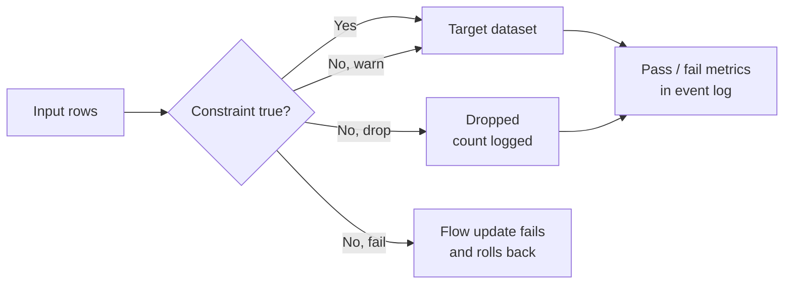
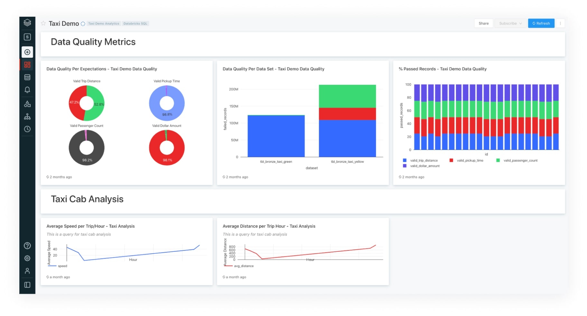
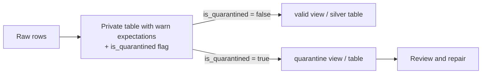

# Expectations and Data Quality

## Overview

Expectations are SQL Boolean constraints attached to streaming tables, materialized views, and temporary views in a Lakeflow pipeline. Each one has a name, a constraint, and an action (**warn**, **drop**, or **fail**), and its pass/fail counts are recorded in the pipeline event log. A **quarantine** keeps invalid records for review instead of silently losing them.

> [!note] Platform update (Oct 2026)
> The Python decorators moved from the `dlt` module to `pyspark.pipelines`: write `@dp.expect`, `@dp.expect_or_drop`, `@dp.expect_or_fail` after `from pyspark import pipelines as dp`. `import dlt` / `@dlt.expect` still work. The exam's "Lakeflow Pipelines" is the docs' "Lakeflow Spark Declarative Pipelines". Expectations are a Lakeflow feature and are not part of open-source Apache Spark Declarative Pipelines. Sources: [Expectations (Python reference)](https://docs.databricks.com/aws/en/ldp/developer/ldp-python-ref-expectations), [Lakeflow pipelines Python language reference](https://docs.databricks.com/aws/en/ldp/developer/python-ref)

> [!abstract]
>
> - **Warn** (default, `EXPECT` / `@dp.expect`): invalid rows are written to the target and counted
> - **Drop** (`ON VIOLATION DROP ROW` / `@dp.expect_or_drop`): invalid rows are dropped before the write and counted as dropped
> - **Fail** (`ON VIOLATION FAIL UPDATE` / `@dp.expect_or_fail`): an invalid row fails the flow's update, which is rolled back; manual fixing is required
> - **Quarantine**: flag invalid rows with warn-level expectations and route them to a separate path, instead of dropping or failing

> [!tip] What the Exam Tests
>
> - Implement data quality expectations in Lakeflow Pipelines to quarantine, drop, or fail on bad records
> - Choose the action for a business rule (keep and monitor vs remove vs stop the update)
> - Write the SQL `CONSTRAINT ... EXPECT ... ON VIOLATION` and the Python `@dp.expect*` / `expect_all*` forms
> - Find expectation metrics in the event log (`flow_progress` → `data_quality`)

---

## How Expectations Work





*Lakeflow pipeline graph showing expectation pass, fail, and drop row counts per table.*

Each expectation has three parts:

1. **Name**: identifies the expectation in metrics and errors. It must be unique within a dataset, and you can reuse it across datasets.
2. **Constraint**: a SQL Boolean expression evaluated per record. It must not contain custom Python functions, calls to external services, or subqueries that reference other tables.
3. **Action**: warn (default), drop, or fail.

## Choosing the Action

| Action | SQL | Python | Invalid rows | Update | Metrics |
| :--- | :--- | :--- | :--- | :--- | :--- |
| Warn | `CONSTRAINT c EXPECT (cond)` | `@dp.expect("c", "cond")` | Written to the target | Succeeds | Passed and failed counts recorded |
| Drop | `... ON VIOLATION DROP ROW` | `@dp.expect_or_drop("c", "cond")` | Dropped before the write | Succeeds | Dropped count recorded |
| Fail | `... ON VIOLATION FAIL UPDATE` | `@dp.expect_or_fail("c", "cond")` | Stop execution; table update rolled back atomically | Fails | **Not recorded** (the update fails) |

| Scenario | Action |
| :--- | :--- |
| Track a soft rule (missing optional email) without losing rows | Warn |
| Rows missing a required key must never reach silver | Drop (or quarantine if someone must review them) |
| Bad rows need investigation and possible repair | Quarantine (warn + flag + separate path) |
| A violation means the batch is corrupt (negative balances in a financial report) | Fail |
| Validate across tables (row counts match, no missing keys) | Fail on a validation materialized view |

> [!important] Fail scope
> In a **triggered** pipeline, a failed expectation fails and rolls back only **that flow**; other parallel flows keep updating. In a **continuous** pipeline it stops the flow **and all dependent flows**. Expectations enforce data quality, not orchestration. A validation table does not stop downstream tables from updating. To gate downstream work on a validation, split them into separate pipelines and chain the pipeline tasks in a job.

## SQL Syntax

```sql
-- Warn: keep the row, record the violation
CREATE OR REFRESH STREAMING TABLE silver_events (
  CONSTRAINT valid_event_type EXPECT (event_type IN ('click', 'view', 'purchase'))
)
AS SELECT * FROM STREAM bronze_events;

-- Drop: several constraints, separated by commas
CREATE OR REFRESH STREAMING TABLE silver_transactions (
  CONSTRAINT valid_transaction_id EXPECT (transaction_id IS NOT NULL) ON VIOLATION DROP ROW,
  CONSTRAINT valid_amount EXPECT (amount IS NOT NULL AND amount > 0) ON VIOLATION DROP ROW,
  CONSTRAINT valid_currency EXPECT (currency IN ('USD', 'EUR', 'GBP')) ON VIOLATION DROP ROW
)
AS SELECT * FROM STREAM bronze_transactions;

-- Fail: stop the update on any violation
CREATE OR REFRESH MATERIALIZED VIEW gold_account_balances (
  CONSTRAINT non_negative_balance EXPECT (balance >= 0) ON VIOLATION FAIL UPDATE
)
AS SELECT account_id, SUM(amount) AS balance
FROM silver_transactions
GROUP BY account_id;
```

The expectation expression may use literals, the dataset's columns, and deterministic built-in functions. It **cannot** contain aggregate functions, window functions, table-valued generator functions, or subqueries. Aggregate checks therefore go on a materialized view whose **output columns** hold the aggregates, as in `gold_account_balances` above.

## Python Syntax

Expectation decorators go **after** the dataset decorator (`@dp.table`, `@dp.materialized_view`, `@dp.temporary_view`) and before the function.

```python
from pyspark import pipelines as dp
from pyspark.sql.functions import col

@dp.table(name="silver_orders")
@dp.expect("valid_date", "order_date <= current_date()")                 # warn
@dp.expect_or_drop("valid_order_id", "order_id IS NOT NULL")             # drop
@dp.expect_or_fail("valid_currency", "currency IN ('USD', 'EUR', 'GBP')")  # fail
def silver_orders():
    return spark.readStream.table("bronze_orders")
```

### Groups of expectations (Python only)

Only Python can group expectations and apply **one collective action** with `expect_all`, `expect_all_or_drop`, or `expect_all_or_fail`. Each takes a dictionary of `{name: constraint}`. In SQL you list several `CONSTRAINT` clauses, each with its own action.

```python
order_rules = {
    "valid_order_id": "order_id IS NOT NULL",
    "valid_customer": "customer_id IS NOT NULL",
    "valid_amount": "amount IS NOT NULL AND amount > 0",
}

@dp.table(name="orders_monitored")
@dp.expect_all(order_rules)          # warn on each rule
def orders_monitored():
    return spark.readStream.table("bronze_orders")

@dp.table(name="orders_clean")
@dp.expect_all_or_drop(order_rules)  # drop a row that fails any rule
def orders_clean():
    return spark.readStream.table("bronze_orders")

@dp.materialized_view(name="orders_for_finance")
@dp.expect_all_or_fail(order_rules)  # fail the update if any rule fails
def orders_for_finance():
    return spark.read.table("orders_clean")
```

### Expectations on AUTO CDC targets

A target created with `dp.create_streaming_table()` takes expectations as **parameters** (`expect_all`, `expect_all_or_drop`, `expect_all_or_fail`), because no decorated function is involved. In SQL, use the `CONSTRAINT` clause on the target. Expectations are **not supported** with AUTO CDC FROM SNAPSHOT.

```python
dp.create_streaming_table(
    name="customers_current",
    expect_all_or_drop={"valid_id": "customer_id IS NOT NULL"},
)
```

### Reusable rules

Databricks recommends keeping rule definitions separate from pipeline code (a Delta table of rules or a Python module), tagging related rules, and loading them with a helper that returns a dictionary. Loading rules dynamically is supported in Python, not SQL.

```python
def get_rules(tag):
    rows = spark.read.table("main.dq.rules").filter(col("tag") == tag).collect()
    return {row["name"]: row["constraint"] for row in rows}

@dp.table(name="raw_markets")
@dp.expect_all_or_drop(get_rules("validity"))
def raw_markets():
    return spark.readStream.table("bronze_markets")
```

## Quarantine Pattern

Use quarantine when invalid records must be kept for review or repair, rather than dropped (lost from the main flow) or failed (blocking everyone).



### Documented pattern: flag, then split

Warn-level expectations record metrics for every rule. A computed `is_quarantined` column (the negation of all rules combined) splits the data into valid and invalid paths. Nothing is dropped, so the counts reconcile.

```python
from pyspark import pipelines as dp
from pyspark.sql.functions import expr

rules = {
    "valid_pickup_zip": "(pickup_zip IS NOT NULL)",
    "valid_dropoff_zip": "(dropoff_zip IS NOT NULL)",
}
quarantine_rules = "NOT({0})".format(" AND ".join(rules.values()))

@dp.temporary_view
def raw_trips_data():
    return spark.readStream.table("samples.nyctaxi.trips")

@dp.table(private=True, partition_cols=["is_quarantined"])
@dp.expect_all(rules)                       # warn: metrics, no rows lost
def trips_data_quarantine():
    return (
        spark.readStream.table("raw_trips_data")
        .withColumn("is_quarantined", expr(quarantine_rules))
    )

@dp.temporary_view
def valid_trips_data():
    return spark.read.table("trips_data_quarantine").filter("is_quarantined = false")

@dp.temporary_view
def invalid_trips_data():
    return spark.read.table("trips_data_quarantine").filter("is_quarantined = true")
```

```sql
-- SQL equivalent
CREATE OR REFRESH PRIVATE STREAMING TABLE trips_data_quarantine (
  CONSTRAINT valid_pickup_zip EXPECT (pickup_zip IS NOT NULL),
  CONSTRAINT valid_dropoff_zip EXPECT (dropoff_zip IS NOT NULL)
)
PARTITIONED BY (is_quarantined)
AS SELECT
  *,
  NOT ((pickup_zip IS NOT NULL) AND (dropoff_zip IS NOT NULL)) AS is_quarantined
FROM STREAM(samples.nyctaxi.trips);

CREATE TEMPORARY VIEW valid_trips_data AS
SELECT * FROM trips_data_quarantine WHERE is_quarantined = FALSE;

CREATE TEMPORARY VIEW invalid_trips_data AS
SELECT * FROM trips_data_quarantine WHERE is_quarantined = TRUE;
```

To publish the bad rows for a review team, make the invalid path a published table instead of a temporary view.

### Variant: drop from silver, mirror into a quarantine table

```python
VALID = "order_id IS NOT NULL AND amount IS NOT NULL AND amount > 0"

@dp.table(name="silver_orders")
@dp.expect_or_drop("valid_order", VALID)
def silver_orders():
    return spark.readStream.table("bronze_orders")

@dp.table(name="quarantine_orders")
def quarantine_orders():
    return spark.readStream.table("bronze_orders").filter(f"NOT ({VALID})")
```

The two filters must be **exact complements**. Write constraints with explicit `IS NOT NULL` guards so that they never evaluate to `NULL`. Otherwise a row can fall out of both paths, because `NOT (NULL)` is still `NULL` and `WHERE` keeps only `TRUE`.

| Pattern | Rows lost? | Metrics | Effort |
| :--- | :--- | :--- | :--- |
| Drop only | Yes (counted, not kept) | Dropped count | Lowest |
| Flag and split (documented quarantine) | No | Per-rule pass/fail | One extra table and views |
| Drop + mirror table | No, if conditions are exact complements | Dropped count on silver | Duplicate condition to maintain |
| Fail | Update rolled back | None for the failing update | Manual fix and rerun |

## Cross-Table Validation

For checks across datasets, define a validation materialized view with a **fail** expectation:

```python
@dp.materialized_view(name="count_verification")
@dp.expect_or_fail("no_rows_dropped", "a_count == b_count")
def count_verification():
    return spark.sql("""
        SELECT * FROM
          (SELECT COUNT(*) AS a_count FROM table_a),
          (SELECT COUNT(*) AS b_count FROM table_b)
    """)

@dp.materialized_view(name="report_pk_tests")
@dp.expect_or_fail("unique_pk", "num_entries = 1")
def report_pk_tests():
    return spark.read.table("report").groupBy("pk").count().withColumnRenamed("count", "num_entries")
```

Downstream tables do not wait for these checks. Use separate pipelines chained in a job if a failed check must block publication.

## Monitoring Expectations

The pipeline UI shows warn and drop metrics in the dataset's **Data quality** tab. In the event log, `flow_progress` events store per-expectation `passed_records` and `failed_records` in `details:flow_progress.data_quality.expectations`, and `dropped_records` in `details:flow_progress.data_quality`.

```sql
SELECT
  row_expectations.dataset AS dataset,
  row_expectations.name AS expectation,
  SUM(row_expectations.passed_records) AS passing_records,
  SUM(row_expectations.failed_records) AS failing_records
FROM (
  SELECT explode(
    from_json(
      details:flow_progress:data_quality:expectations,
      "array<struct<name: string, dataset: string, passed_records: int, failed_records: int>>"
    )
  ) AS row_expectations
  FROM event_log(<pipeline-id>)
  WHERE event_type = 'flow_progress'
)
GROUP BY row_expectations.dataset, row_expectations.name;
```

Metrics are **missing** when no expectations are defined, when the flow type does not support expectations (for example, sinks), when there was no update to the dataset in that run, or when the update failed on a fail expectation. Views are computed only when queried, so a view's metrics may be missing or appear several times. More event log queries are in [Lakeflow Event Logs](../04-monitoring-and-alerting/02-lakeflow-event-logs.md).

## Requirements and Limitations

- Expectations require the **ADVANCED** product edition, which is the default `edition` (`CORE` covers streaming ingest, `PRO` adds CDC).
- Supported on streaming tables, materialized views, and temporary views only, so data quality metrics exist only for those.
- Not supported on AUTO CDC FROM SNAPSHOT flows or sinks.
- You can also add expectations to standalone streaming tables and materialized views in Databricks SQL with the same `CONSTRAINT` clause; the Data quality tab isn't available there, so query the event log instead.

## Use Cases

- **Silver order gate**: `expect_all_or_drop` removes rows without `order_id` or with non-positive amounts. A warn expectation tracks missing emails without losing orders.
- **Repairable bad data**: a flag-and-split quarantine keeps rows with invalid zip codes in a separate path for a data-steward review job, and the metrics show the failure rate per rule.
- **Financial close**: `expect_or_fail` on a gold balance view stops the update if any balance is negative, so the previous good version stays published.

## Common Issues & Errors

| Symptom | Cause | Fix |
| :--- | :--- | :--- |
| Every row fails a string check | Unquoted literal (`status = active`) or case mismatch | Quote literals; normalize with `UPPER()` |
| Rows with NULLs slip through or vanish from both quarantine paths | Constraint evaluates to `NULL` for null columns | Guard with `col IS NOT NULL AND ...` so the result is always true or false |
| `EXPECTATION_VIOLATION` error stops a flow | `expect_or_fail` triggered | Read the message (it names the expectation and the offending input/output record), fix the data or code, rerun |
| No metrics for a fail expectation | Update failed before metrics were recorded | Expected behavior; use the error message |
| No metrics for a dataset | It is a view, a sink, unchanged in the run, or has no expectations | Put expectations on a table or MV |
| Downstream table updated despite failed validation table | Expectations do not orchestrate | Separate pipelines + job task dependencies |
| Aggregate inside the constraint rejected | Aggregates and subqueries are not allowed in expectation expressions | Compute the aggregate as an MV column and expect on that column |
| Pipeline rejects a dataset definition with repeated expectations | Two expectations share a name on one dataset (names must be unique per dataset) | Rename one |

> [!note]
> The docs disagree on whether expectations stop a materialized view from refreshing incrementally. The CREATE MATERIALIZED VIEW reference says an MV with expectations is fully refreshed on every update. The incremental refresh page lists expectations as supported, except when the MV reads from a view that has expectations, or has a DROP expectation together with NOT NULL columns. Check the refresh type of the update (Incrementalization column or the `planning_information` event) instead of assuming.

## Best Practices

- **Name expectations descriptively** (`valid_order_id`, not `c1`); the name appears in metrics and errors.
- **Layer the rules**: in bronze, keep everything and add warn-only expectations for observability. In silver, drop or quarantine on required fields and business rules. In gold, fail on critical invariants and cross-table checks.
- **Keep rules in one place** (a rules table or Python module) and apply them with `expect_all*` helpers.
- **Prefer quarantine over drop** when someone must be able to explain or repair rejected rows.

## Exam Tips

> [!tip]
>
> - **Three actions**: `EXPECT` = warn (keep row), `ON VIOLATION DROP ROW` = drop, `ON VIOLATION FAIL UPDATE` = fail.
> - **Python**: `@dp.expect`, `@dp.expect_or_drop`, `@dp.expect_or_fail`; grouped `@dp.expect_all`, `@dp.expect_all_or_drop`, `@dp.expect_all_or_fail` take a dict (Python only).
> - **Quarantine** = keep invalid rows separately (flag with warn expectations and split, or drop plus a complementary table). It is not an `ON VIOLATION` option.
> - **Fail** rolls back the flow's update; triggered pipelines keep other flows running, continuous pipelines stop dependent flows.
> - **Metrics** live in `flow_progress` events under `data_quality`; there are no metrics for a failed update.
> - Expectations are **Lakeflow-only** (not in open-source SDP) and need the ADVANCED edition (the default).

## Key Takeaways

- **Warn, drop, fail**: warn writes invalid rows and counts them, drop removes them before the write, and fail stops the flow's update and rolls it back.
- **SQL**: `CONSTRAINT name EXPECT (cond) [ON VIOLATION DROP ROW | FAIL UPDATE]`. **Python**: `@dp.expect*` decorators placed after `@dp.table` / `@dp.materialized_view` / `@dp.temporary_view`.
- **Group actions with `expect_all*`** (Python only); for AUTO CDC targets pass `expect_all*` to `dp.create_streaming_table()`.
- **Quarantine** keeps bad rows reviewable. The documented pattern uses warn expectations plus an `is_quarantined` flag and two views; drop plus a mirror table also works if the conditions are exact complements.
- **Constraints** are per-row deterministic SQL: no UDFs, external calls, subqueries, or aggregates. Guard NULLs explicitly.
- **Expectations do not orchestrate**: to block downstream work on a validation, use separate pipelines and job dependencies.

## Related Topics

- [Declarative Pipelines](../01-developing-code-for-data-processing/06-declarative-pipelines.md) — dataset types and run modes
- [AUTO CDC API](../01-developing-code-for-data-processing/07-auto-cdc-api.md) — CDC targets and their expectations
- [Data Deduplication](./03-data-deduplication.md) — removing duplicates before validation
- [Lakeflow Event Logs](../04-monitoring-and-alerting/02-lakeflow-event-logs.md) — querying data quality metrics

## Official Documentation

- [Manage data quality with pipeline expectations](https://docs.databricks.com/aws/en/ldp/expectations)
- [Expectation recommendations and advanced patterns](https://docs.databricks.com/aws/en/ldp/expectation-patterns)
- [Expectations (Python reference)](https://docs.databricks.com/aws/en/ldp/developer/ldp-python-ref-expectations)
- [CREATE STREAMING TABLE (pipelines)](https://docs.databricks.com/aws/en/ldp/developer/ldp-sql-ref-create-streaming-table)
- [CREATE MATERIALIZED VIEW (pipelines)](https://docs.databricks.com/aws/en/ldp/developer/ldp-sql-ref-create-materialized-view)
- [create_streaming_table](https://docs.databricks.com/aws/en/ldp/developer/ldp-python-ref-streaming-table)
- [Monitor pipelines with the event log](https://docs.databricks.com/aws/en/ldp/monitor-event-logs)
- [Incremental refresh for materialized views](https://docs.databricks.com/aws/en/ldp/incremental-refresh)
- [Pipeline properties reference (editions)](https://docs.databricks.com/aws/en/ldp/properties)

---

**[← Previous: AI Functions in Data Pipelines](./05-ai-functions.md) | [↑ Back to Section](./README.md) | [Next: System Tables →](../04-monitoring-and-alerting/01-system-tables.md)**
