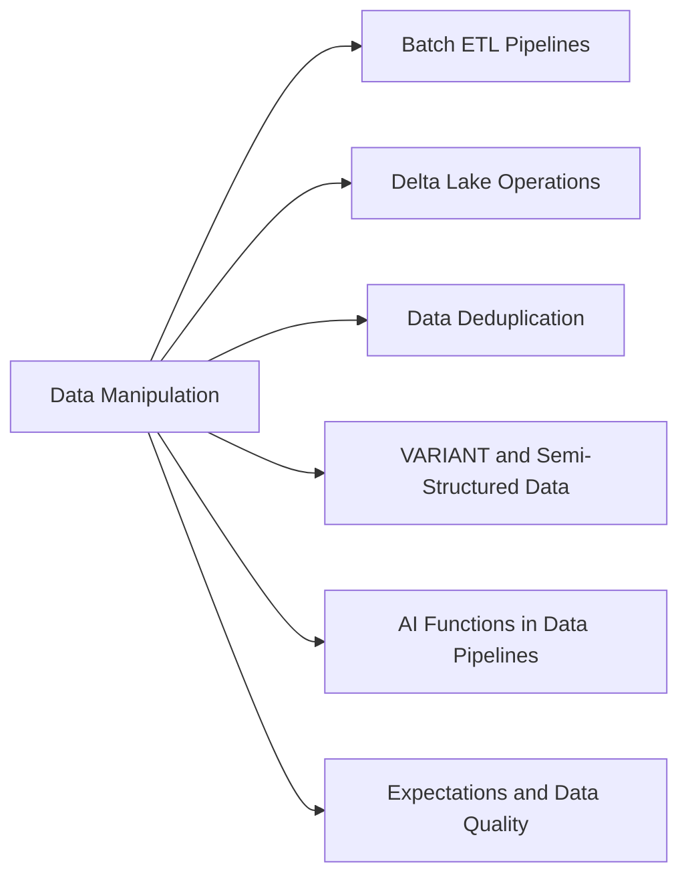

# Section 3: Data Manipulation (12 % of Exam)

Transforming data once it has landed: window functions, joins and aggregations in Spark SQL and PySpark, Delta DML (MERGE and friends), deduplication, the VARIANT type for semi-structured data, AI functions such as `ai_query` for in-pipeline enrichment, and Lakeflow Pipelines expectations that quarantine, drop or fail bad records. This domain replaces the former *Data Transformation, Cleansing, and Quality* domain.

## Topics Overview

## Section Contents

| File | Topic | Priority |
| :--- | :--- | :--- |
| [01-batch-etl-pipelines-part1.md](./01-batch-etl-pipelines-part1.md) | Reads, DataFrame transformations, joins, aggregations, window functions, writes | High |
| [01-batch-etl-pipelines-part2.md](./01-batch-etl-pipelines-part2.md) | Batch performance and error handling | Medium |
| [02-delta-lake-operations-part1.md](./02-delta-lake-operations-part1.md) | MERGE patterns, OPTIMIZE, VACUUM, time travel, cloning | High |
| [02-delta-lake-operations-part2.md](./02-delta-lake-operations-part2.md) | Schema operations, table properties, transaction log | Medium |
| [03-data-deduplication.md](./03-data-deduplication.md) | Batch and streaming deduplication, idempotent writes | High |
| [04-variant-semi-structured-data.md](./04-variant-semi-structured-data.md) | VARIANT, `parse_json`, `variant_get`, path access, shredding | High |
| [05-ai-functions.md](./05-ai-functions.md) | `ai_query` and task-specific AI functions for enrichment and classification | High |
| [06-expectations-data-quality.md](./06-expectations-data-quality.md) | Expectations: warn, drop, fail, and the quarantine pattern | High |

## Exam Skill Coverage

Every skill bullet in Section 3 of the Oct 9, 2026 exam guide, with the files that cover it.

| Exam guide skill | Where it is covered |
| :--- | :--- |
| Apply advanced data transformations, including window functions, joins, and aggregations, using Spark SQL and PySpark to process large datasets. | [01-batch-etl-pipelines-part1.md](./01-batch-etl-pipelines-part1.md), [01-batch-etl-pipelines-part2.md](./01-batch-etl-pipelines-part2.md), [02-delta-lake-operations-part1.md](./02-delta-lake-operations-part1.md), [03-data-deduplication.md](./03-data-deduplication.md) |
| Develop a model and query semi-structured data using the VARIANT data type and related functions (e.g., parse_json, variant_get). | [04-variant-semi-structured-data.md](./04-variant-semi-structured-data.md) |
| Apply AI functions, including ai_query, to perform model inference within data pipelines for enrichment and classification tasks. | [05-ai-functions.md](./05-ai-functions.md) |
| Implement data quality expectations in Lakeflow Pipelines to quarantine, drop, or fail on bad records. | [06-expectations-data-quality.md](./06-expectations-data-quality.md) |

## Key Concepts to Master

| Concept | Why it matters |
| :--- | :--- |
| **Window functions** | `row_number`, `rank`, `lag`/`lead` and running totals over a partitioned, ordered window |
| **VARIANT** | Schema-flexible binary encoding of JSON; `parse_json` to load, `:` paths and `variant_get` to extract |
| **`ai_query`** | Calls a model serving endpoint row by row from SQL or PySpark for enrichment and classification |
| **Expectations** | `expect` (warn), `expect_or_drop` (drop), `expect_or_fail` (fail); quarantine by inverting the rule into a second table |

## Related Resources

- [Delta Lake cheat sheet](../resources/cheat-sheets/delta-lake-quick-ref.md)
- [SQL functions cheat sheet (shared)](../../../shared/cheat-sheets/sql-functions.md)
- [Lakeflow Pipelines cheat sheet (shared)](../../../shared/cheat-sheets/lakeflow-declarative-pipelines-quick-ref.md)

---

**[← Previous: Data Ingestion & Acquisition](../02-data-ingestion-and-acquisition/README.md) | [↑ Back to DE Professional](../README.md) | [Next: Monitoring and Alerting →](../04-monitoring-and-alerting/README.md)**
