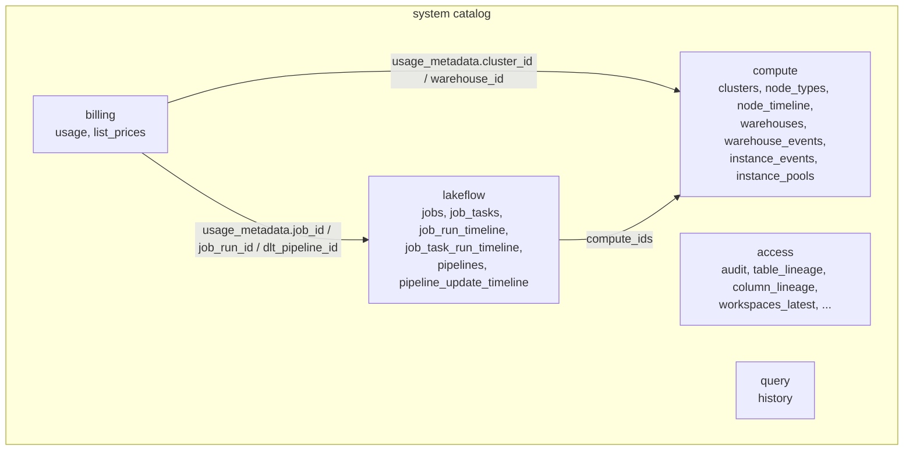
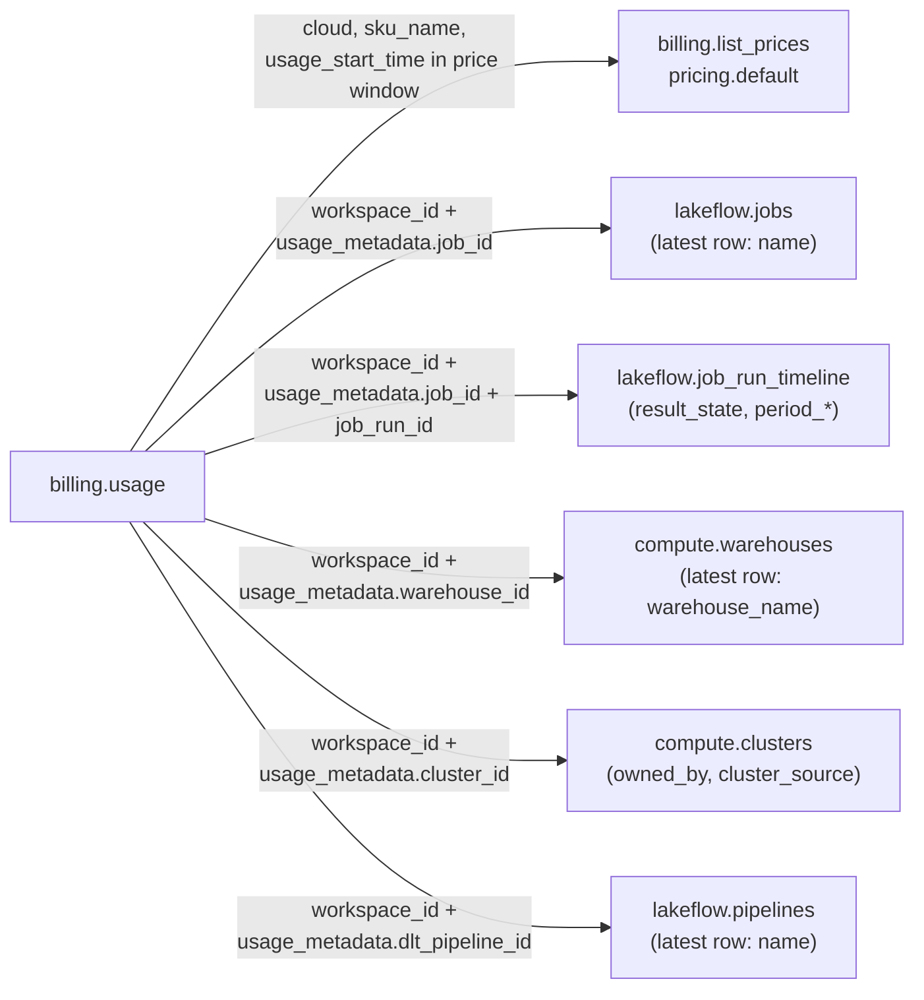

# System Tables

## Overview

System tables are a Databricks-hosted analytical store of your account's operational data, exposed as read-only Delta tables in the `system` catalog of every Unity Catalog metastore. For the exam, four schemas matter most. `system.billing` covers cost, `system.compute` covers clusters and warehouses, `system.access` covers audit and lineage, and `system.lakeflow` covers jobs and pipelines. `system.query.history` is the usual companion for SQL workload monitoring.

> [!abstract]
>
> - `system.billing.usage` holds DBU usage per record. `system.billing.list_prices` turns it into list cost through `pricing.default` over a price validity window.
> - `usage_metadata` (`job_id`, `job_run_id`, `warehouse_id`, `cluster_id`, `dlt_pipeline_id`, ...) and `identity_metadata.run_as` attribute spend to workloads and identities.
> - `system.compute.*` and `system.lakeflow.*` are mostly SCD2 dimension tables (latest row per entity by `change_time`). They also include immutable timelines sliced into rows of at most one hour.
> - `system.access.audit` records who did what (`service_name`, `action_name`, `user_identity`, `request_params`, `response`). Lineage lives in `system.access.table_lineage` and `column_lineage`.

> [!tip] What the Exam Tests
>
> - "Use Databricks system tables (billing, compute, access, lakeflow) for cost analysis, auditing, and workload monitoring."
> - Attributing DBU spend to specific jobs, pipelines, and SQL warehouses by joining `system.billing.usage` with `system.billing.list_prices` and the compute and lakeflow tables. The exam guide's sample question tests exactly this.
> - Choosing the right table for a question (audit trail vs lineage vs job runs vs warehouse events vs query history) and filtering it correctly.
> - Knowing the access model (UC privileges, admins by default), retention, and record latency, so you know what system tables can and cannot answer.

> [!note] Platform update (Oct 2026)
> The `system.lakeflow` tables `pipelines` and `pipeline_update_timeline` became generally available on October 21, 2026. The `lakeflow` schema was previously named `workflow`, and both contain identical content. The `system.lineage` and `system.operational_data` schemas are deprecated and contain empty tables. Query lineage from `system.access.table_lineage` and `system.access.column_lineage`. Sources: [October 2026 release notes](https://docs.databricks.com/aws/en/release-notes/product/2026/october), [Jobs system table reference](https://docs.databricks.com/aws/en/admin/system-tables/jobs), [System tables reference](https://docs.databricks.com/aws/en/admin/system-tables/)

---

## The System Catalog at a Glance



| Table | What it records | Streaming | Free retention | Data scope |
| :--- | :--- | :--- | :--- | :--- |
| `system.billing.usage` | Every billable usage record in the account | Yes | 365 days | Global |
| `system.billing.list_prices` | SKU price history (a row each time a price changes) | No | Indefinite | Global |
| `system.compute.clusters` | SCD history of classic compute configurations | Yes | 365 days | Regional |
| `system.compute.node_timeline` | Per-minute node utilization of classic compute | Yes | 90 days | Regional |
| `system.compute.warehouses` | History of SQL warehouse configurations | Yes | 365 days | Regional |
| `system.compute.warehouse_events` | Warehouse start, stop, and scale events | Yes | 365 days | Regional |
| `system.access.audit` (Public Preview) | Audit events from workspaces in the region | Yes | 365 days | Regional for workspace events, global for account events |
| `system.access.table_lineage` / `column_lineage` | Read and write events on UC tables and columns | Yes | 365 days | Regional |
| `system.lakeflow.jobs` / `job_tasks` | SCD history of job and task definitions | Yes | 365 days | Regional |
| `system.lakeflow.job_run_timeline` / `job_task_run_timeline` | Job runs and task runs, sliced by hour | Yes | 365 days | Regional |
| `system.lakeflow.pipelines` / `pipeline_update_timeline` | SCD history of pipelines, and pipeline updates | Yes | 365 days | Regional |
| `system.query.history` | Queries on SQL warehouses, serverless notebooks and jobs, and Lakeflow pipelines | No | 365 days | Regional |

Other schemas you may meet in monitoring scenarios include `system.storage` (predictive optimization history), `system.serving` (endpoint usage), `system.alert` (alert configuration and evaluations), and `system.data_quality_monitoring` (anomaly detection results).

---

## Access Requirements and Behavior

- **Unity Catalog required:** the account needs at least one UC-enabled workspace. The tables include data from all workspaces in the account, including non-UC workspaces, but you can only query them from a UC-enabled workspace. The metastore must be on Privilege Model Version 1.0.
- **Who can read by default:** users who hold **both** the account admin and metastore admin roles. Everyone else needs `USE CATALOG` on `system`, plus `USE SCHEMA` and `SELECT` on the schemas.
- **Read-only:** system tables cannot be modified.
- **Region scope:** regional tables only show workspaces in the same cloud region as the workspace you query from. Global tables (`billing.usage`, `billing.list_prices`) show the whole account.
- **Not real-time:** for example, `billing.usage` records typically arrive within 12 hours, while lakeflow, compute, and query history records typically arrive within an hour.
- **Schema drift:** Databricks can add new columns and struct fields at any time, but never changes or removes existing ones. Enable schema evolution if you copy system tables into your own tables.
- **Over-broad queries fail:** a query that isn't selective enough returns `System Table query returned too much data`. Add predicates, especially on date columns.

```sql
-- Grant a cost team read access to billing
GRANT USE CATALOG ON CATALOG system TO `cost-analysts`;
GRANT USE SCHEMA  ON SCHEMA  system.billing TO `cost-analysts`;
GRANT SELECT      ON SCHEMA  system.billing TO `cost-analysts`;
```

**Streaming from system tables:** system tables are shared with you through OpenSharing. Streaming reads need Databricks Runtime 16.4 or above, and reading the change data feed needs 17.3 or above. Set `skipChangeCommits` so that deletes in the source don't break the stream. Because the tables use a 7-day VACUUM retention, a stream that lags more than 7 days can break.

```python
usage_stream = (spark.readStream
    .option("skipChangeCommits", "true")
    .table("system.billing.usage"))
```

**Configurable retention (Beta):** an account admin can opt in and set one retention period, from 30 to 3,650 days, for all supported system tables. While the Beta is enabled, the free period becomes 395 days. The `data_classification`, `data_quality_monitoring`, and `lakebase` schemas are excluded.

---

## Billing: `system.billing`

### `system.billing.usage` key columns

| Column | Type | Notes |
| :--- | :--- | :--- |
| `record_id` | string | Unique ID of the usage record |
| `workspace_id`, `account_id` | string | Where the usage happened |
| `sku_name` | string | For example `STANDARD_ALL_PURPOSE_COMPUTE`. Joins to `list_prices.sku_name`. |
| `cloud` | string | `AWS`, `AZURE`, or `GCP`. Also a `list_prices` join key. |
| `usage_start_time`, `usage_end_time` | timestamp | The usage interval (UTC) |
| `usage_date` | date | Use this for fast date filtering and aggregation |
| `usage_quantity`, `usage_unit` | decimal, string | Amount consumed and its unit (for example `DBU`) |
| `custom_tags` | map | Tags on the compute or usage policy. Use `custom_tags['team']`. |
| `usage_metadata` | struct | Resource IDs: `job_id`, `job_run_id`, `job_name`, `warehouse_id`, `cluster_id`, `instance_pool_id`, `node_type`, `notebook_id`, `notebook_path`, `dlt_pipeline_id`, `dlt_update_id`, `endpoint_name`, `app_id`, `usage_policy_id`, ... |
| `identity_metadata` | struct | `run_as` (who ran the workload), `owned_by` (SQL warehouse owner), `created_by` (apps and agents) |
| `billing_origin_product` | string | The product that generated the usage: `JOBS`, `DLT` (Lakeflow pipelines), `SQL`, `ALL_PURPOSE`, `INTERACTIVE`, `MODEL_SERVING`, `PREDICTIVE_OPTIMIZATION`, `LAKEFLOW_CONNECT`, `DATA_QUALITY_MONITORING`, ... |
| `product_features` | struct | For example `is_serverless`, `is_photon`, `jobs_tier`, `sql_tier`, `dlt_tier`, `performance_target` |
| `usage_type` | string | `COMPUTE_TIME`, `STORAGE_SPACE`, `NETWORK_BYTE`, `TOKEN`, ... |
| `record_type` | string | `ORIGINAL`, `RETRACTION`, or `RESTATEMENT` |

Which `usage_metadata` field is populated depends on the workload:

| Field | Populated for |
| :--- | :--- |
| `job_id`, `job_run_id` | Serverless jobs and jobs on **job compute**. Not populated for jobs on all-purpose compute. |
| `warehouse_id` | Workloads run on a SQL warehouse |
| `cluster_id` | Non-serverless compute (notebooks, jobs, Lakeflow pipelines, legacy model serving) |
| `dlt_pipeline_id`, `dlt_update_id` | Lakeflow pipelines and features built on them (materialized views, Lakeflow Connect, ...) |
| `notebook_id`, `notebook_path` | Serverless notebooks |

**Corrections:** a correction adds a `RETRACTION` row (negative `usage_quantity`) and usually a `RESTATEMENT` row. Always `SUM(usage_quantity)` so the retraction cancels the original. Never filter to `record_type = 'ORIGINAL'` when you report totals.

### `system.billing.list_prices`

| Column | Notes |
| :--- | :--- |
| `price_start_time`, `price_end_time` | Validity window of the price (UTC). `price_end_time` is `NULL` for the current price. |
| `sku_name`, `cloud`, `currency_code`, `usage_unit` | Join and unit keys |
| `pricing` | struct. `pricing.default` is a single list price for simple estimates, `pricing.promotional` is a temporary promotion, and `pricing.effective_list` resolves the two. |

The table only stores price **changes**, so the join must match the price window. Joining on `sku_name` alone duplicates rows whenever a price changed.

```sql
-- Correct list-cost join (the pattern used throughout the docs)
SELECT
  u.usage_date,
  u.billing_origin_product,
  SUM(u.usage_quantity)                       AS dbus,
  SUM(u.usage_quantity * p.pricing.default)   AS list_cost
FROM system.billing.usage u
JOIN system.billing.list_prices p
  ON  u.cloud    = p.cloud
  AND u.sku_name = p.sku_name
  AND u.usage_start_time >= p.price_start_time
  AND (u.usage_end_time <= p.price_end_time OR p.price_end_time IS NULL)
WHERE u.usage_date >= current_date() - INTERVAL 30 DAYS
GROUP BY ALL
ORDER BY u.usage_date DESC, list_cost DESC;
```

```sql
-- Chargeback by custom tag (tags come from compute, jobs, or serverless usage policies)
SELECT
  custom_tags['team']  AS team,
  sku_name,
  SUM(usage_quantity)  AS dbus
FROM system.billing.usage
WHERE usage_date >= date_trunc('MONTH', current_date())
  AND custom_tags['team'] IS NOT NULL
GROUP BY ALL
ORDER BY dbus DESC;
```

---

## Cost Attribution: Billing + Pricing + Compute + Lakeflow

The exam guide's sample question asks how to attribute last month's DBU spend to specific jobs and SQL warehouses using governed data already in Unity Catalog. The answer is `system.billing.usage` joined with the pricing table and the compute and lakeflow tables. The Spark UI, driver logs, and PDF billing exports are all wrong answers.



```sql
-- Top 20 jobs and SQL warehouses by list cost, last calendar month
WITH priced AS (
  SELECT
    u.workspace_id,
    u.usage_metadata.job_id        AS job_id,
    u.usage_metadata.warehouse_id  AS warehouse_id,
    u.usage_quantity               AS dbus,
    u.usage_quantity * p.pricing.default AS list_cost
  FROM system.billing.usage u
  JOIN system.billing.list_prices p
    ON  u.cloud = p.cloud
    AND u.sku_name = p.sku_name
    AND u.usage_start_time >= p.price_start_time
    AND (u.usage_end_time <= p.price_end_time OR p.price_end_time IS NULL)
  WHERE u.usage_date BETWEEN date_trunc('MONTH', add_months(current_date(), -1))
                         AND last_day(add_months(current_date(), -1))
    AND u.usage_unit = 'DBU'
),
latest_jobs AS (            -- SCD2: keep the latest row per job
  SELECT workspace_id, job_id, name
  FROM system.lakeflow.jobs
  QUALIFY ROW_NUMBER() OVER (PARTITION BY workspace_id, job_id ORDER BY change_time DESC) = 1
),
latest_warehouses AS (      -- configuration history: keep the latest row per warehouse
  SELECT workspace_id, warehouse_id, warehouse_name
  FROM system.compute.warehouses
  QUALIFY ROW_NUMBER() OVER (PARTITION BY workspace_id, warehouse_id ORDER BY change_time DESC) = 1
)
SELECT
  CASE WHEN p.job_id IS NOT NULL THEN 'JOB' ELSE 'SQL_WAREHOUSE' END AS workload_type,
  COALESCE(j.name, w.warehouse_name)  AS workload_name,
  COALESCE(p.job_id, p.warehouse_id)  AS workload_id,
  SUM(p.dbus)      AS dbus,
  SUM(p.list_cost) AS list_cost
FROM priced p
LEFT JOIN latest_jobs j
  ON p.workspace_id = j.workspace_id AND p.job_id = j.job_id
LEFT JOIN latest_warehouses w
  ON p.workspace_id = w.workspace_id AND p.warehouse_id = w.warehouse_id
WHERE p.job_id IS NOT NULL OR p.warehouse_id IS NOT NULL
GROUP BY ALL
ORDER BY list_cost DESC
LIMIT 20;
```

```sql
-- Pipeline spend: billing enriched with pipeline names
WITH latest_pipelines AS (
  SELECT *
  FROM system.lakeflow.pipelines
  QUALIFY ROW_NUMBER() OVER (PARTITION BY workspace_id, pipeline_id ORDER BY change_time DESC) = 1
)
SELECT pl.name, u.usage_metadata.dlt_pipeline_id AS pipeline_id, SUM(u.usage_quantity) AS dbus
FROM system.billing.usage u
LEFT JOIN latest_pipelines pl
  ON u.workspace_id = pl.workspace_id
 AND u.usage_metadata.dlt_pipeline_id = pl.pipeline_id
WHERE u.usage_metadata.dlt_pipeline_id IS NOT NULL
  AND u.usage_date >= current_date() - INTERVAL 30 DAYS
GROUP BY ALL
ORDER BY dbus DESC;
```

Attribution caveats:

- **Jobs on all-purpose compute** carry no `usage_metadata.job_id`, because several workloads share that compute. You can only approximate their cost through `usage_metadata.cluster_id`. For precise attribution, run jobs on job compute or serverless.
- **Classic all-purpose usage:** `identity_metadata.run_as` is the identity that created the compute, not necessarily its owner. To attribute to the owner, join `usage_metadata.cluster_id` to `system.compute.clusters.owned_by`.
- **Notebook workflow runs** (`WORKFLOW_RUN`, for example `dbutils.notebook.run`) are billed to the parent notebook's run. They have no `job_id` or `job_run_id` of their own.
- **Region:** billing is global, but compute and lakeflow are regional. A join only matches rows for workspaces in the region you query from.

---

## Compute: `system.compute`

| Table | Type | Key columns |
| :--- | :--- | :--- |
| `clusters` | SCD (history of configs) | `cluster_id`, `cluster_name`, `owned_by`, `cluster_source`, `driver_node_type`, `worker_node_type`, `worker_count`, `min_autoscale_workers`, `max_autoscale_workers`, `auto_termination_minutes`, `dbr_version`, `data_security_mode`, `policy_id`, `tags`, `change_time`, `delete_time` |
| `node_types` | Reference | `node_type`, `core_count`, `memory_mb`, `gpu_count` |
| `node_timeline` | Per-minute metrics | `cluster_id`, `instance_id`, `start_time`, `end_time`, `driver`, `cpu_user_percent`, `cpu_system_percent`, `cpu_wait_percent`, `mem_used_percent`, `network_sent_bytes`, `network_received_bytes`, `node_type` |
| `warehouses` | History of configs | `warehouse_id`, `warehouse_name`, `warehouse_type`, `warehouse_size`, `min_clusters`, `max_clusters`, `auto_stop_minutes`, `tags`, `change_time`, `delete_time` |
| `warehouse_events` | Events | `warehouse_id`, `event_type` (`STARTING`, `RUNNING`, `SCALED_UP`, `SCALED_DOWN`, `STOPPING`, `STOPPED`), `cluster_count`, `event_time` |
| `instance_events` (Public Preview) | Events | `instance_id`, `event_type`, `state` (`INSTANCE_LAUNCHING`, `INSTANCE_READY`, `INSTANCE_PLACED`, `INSTANCE_TERMINATED`), `cluster_id`, `availability_type` |

`cluster_source` values: `UI` or `API` (all-purpose compute), `JOB` (all job compute), and `PIPELINE` or `PIPELINE_MAINTENANCE`. `data_security_mode`: `USER_ISOLATION` = Standard and `SINGLE_USER` = Dedicated.

> [!warning]
> `clusters` and `node_timeline` cover classic all-purpose, jobs, and pipeline compute only. They contain no records for **serverless** compute or **SQL warehouses**. Use `warehouses` and `warehouse_events` for warehouses, and `billing.usage` for serverless. Nodes that ran for less than 10 minutes might not appear in `node_timeline`.

```sql
-- Jobs running on all-purpose compute in the last 30 days (a cost anti-pattern)
WITH ap_clusters AS (
  SELECT workspace_id, cluster_id, cluster_name, owned_by
  FROM system.compute.clusters
  WHERE cluster_source IN ('UI', 'API')
  QUALIFY ROW_NUMBER() OVER (PARTITION BY workspace_id, cluster_id ORDER BY change_time DESC) = 1
),
task_compute AS (
  SELECT DISTINCT workspace_id, job_id, EXPLODE(compute_ids) AS cluster_id
  FROM system.lakeflow.job_task_run_timeline
  WHERE period_start_time >= current_date() - INTERVAL 30 DAYS
)
SELECT t.workspace_id, t.job_id, c.cluster_name, c.owned_by
FROM task_compute t
JOIN ap_clusters c USING (workspace_id, cluster_id);
```

```sql
-- Average and peak utilization per classic cluster over the last day
SELECT
  cluster_id,
  driver,
  AVG(cpu_user_percent + cpu_system_percent) AS avg_cpu_pct,
  MAX(cpu_user_percent + cpu_system_percent) AS peak_cpu_pct,
  AVG(mem_used_percent)                      AS avg_mem_pct
FROM system.compute.node_timeline
WHERE start_time >= current_timestamp() - INTERVAL 1 DAY
GROUP BY cluster_id, driver
ORDER BY avg_cpu_pct DESC;
```

```sql
-- Warehouse activity timeline for one warehouse this month (explains its billing)
SELECT event_time, event_type, cluster_count
FROM system.compute.warehouse_events
WHERE warehouse_id = '<warehouse-id>'
  AND event_time >= date_trunc('MONTH', current_date())
ORDER BY event_time DESC;
```

---

## Access: `system.access`

### Audit log: `system.access.audit` (Public Preview)

| Column | Notes |
| :--- | :--- |
| `event_time`, `event_date` | Filter on `event_date` for performance |
| `workspace_id` | `0` for account-level events |
| `service_name`, `action_name` | For example `unityCatalog` / `getTable` |
| `user_identity` | struct, for example `user_identity.email` |
| `identity_metadata` | struct, with `run_by` (who initiated the action) and `run_as` (whose authority was used) |
| `request_params` | map, for example `request_params['full_name_arg']` |
| `response` | struct, for example `response.status_code` |
| `source_ip_address`, `user_agent`, `session_id`, `request_id`, `event_id`, `audit_level` | Request context |

| `service_name` | Example `action_name` values |
| :--- | :--- |
| `accounts` | `login`, `tokenLogin`, `samlLogin`, `oidcBrowserLogin` |
| `unityCatalog` | `getTable`, `createTable`, `deleteTable`, `updatePermissions`, `generateTemporaryTableCredential` |
| `clusters` | `create`, `edit`, `start`, `restart`, `delete`, `permanentDelete` |
| `jobs` | `create`, `delete`, `runNow`, `cancel`, `repairRun`, `runFailed` |
| `secrets` | `createScope`, `putSecret`, `getSecret`, `deleteSecret`, `listSecrets` |

Masked parameters: some `request_params` keys that hold SQL definitions (`view_definition`, `function_info`, `definition_json`, `managed_definition`) are omitted unless you are an account admin or a member of the `databricks_pii_access` group.

```sql
-- Who changed Unity Catalog permissions this week, and on what
SELECT
  event_time,
  user_identity.email                    AS changed_by,
  request_params['securable_type']       AS securable_type,
  request_params['securable_full_name']  AS securable,
  request_params['changes']              AS changes
FROM system.access.audit
WHERE event_date >= current_date() - 7
  AND service_name = 'unityCatalog'
  AND action_name  = 'updatePermissions'
ORDER BY event_time DESC;
```

```sql
-- Who read a sensitive table in the last 30 days
SELECT user_identity.email, COUNT(*) AS reads, MAX(event_time) AS last_read
FROM system.access.audit
WHERE event_date >= current_date() - 30
  AND service_name = 'unityCatalog'
  AND action_name  = 'getTable'
  AND request_params['full_name_arg'] = 'prod.hr.salaries'
GROUP BY user_identity.email
ORDER BY reads DESC;
```

```sql
-- Denied or failed requests by service in the last day
SELECT service_name, action_name, response.status_code, COUNT(*) AS events
FROM system.access.audit
WHERE event_date >= current_date() - 1
  AND response.status_code >= 400
GROUP BY ALL
ORDER BY events DESC;
```

### Lineage: `system.access.table_lineage` and `column_lineage`

Each row is a read or write event. Key columns are `source_table_full_name`, `target_table_full_name` (plus `source_path` and `target_path` for path-based access), `source_type`, `target_type`, `entity_type` and `entity_id` (the notebook, job, pipeline, and so on that performed it), `created_by`, `event_time`, and `event_date`. `column_lineage` adds `source_column_name` and `target_column_name`.

```sql
-- Downstream impact: everything written from prod.silver.customers in the last 90 days
SELECT DISTINCT target_table_full_name, entity_type, entity_id
FROM system.access.table_lineage
WHERE source_table_full_name = 'prod.silver.customers'
  AND target_table_full_name IS NOT NULL
  AND event_date >= current_date() - 90;
```

---

## Lakeflow: `system.lakeflow`

| Table | Type | Entity key | Purpose |
| :--- | :--- | :--- | :--- |
| `jobs` | SCD2 | `workspace_id`, `job_id` | Job definitions: `name`, `run_as`, `trigger_type`, `triggers`, `paused`, `timeout_seconds`, `health_rules`, `tags`, `change_time`, `delete_time` |
| `job_tasks` | SCD2 | `workspace_id`, `job_id`, `task_key` | Task definitions: `depends_on_keys`, `timeout_seconds`, `health_rules` |
| `job_run_timeline` | Immutable | `workspace_id`, `job_id`, `run_id` | Job runs: `period_start_time`, `period_end_time`, `trigger_type`, `run_type`, `run_name`, `result_state`, `termination_code`, `job_parameters`, `compute_ids` |
| `job_task_run_timeline` | Immutable | `workspace_id`, `run_id` (task run) | Task runs: `job_run_id`, `parent_run_id`, `task_key`, `result_state`, `termination_code`, `compute_ids`, `setup_duration_seconds`, `execution_duration_seconds`, `cleanup_duration_seconds` |
| `pipelines` | SCD2 | `workspace_id`, `pipeline_id` | Pipeline definitions: `pipeline_type`, `name`, `run_as`, `settings` (`serverless`, `continuous`, `development`, `photon`, `edition`, `channel`), `configuration` |
| `pipeline_update_timeline` | Immutable | `workspace_id`, `pipeline_id`, `update_id` | Pipeline updates: `update_type`, `trigger_type`, `trigger_details`, `result_state`, `compute`, `period_start_time`, `period_end_time`, `refresh_selection`, `full_refresh_selection` |

### Reading SCD2 tables

A change emits a **new row**, and a deletion is a new row with `delete_time` set. Take the latest row per entity **first**, then drop deleted entities.

```sql
-- Current, non-deleted jobs
WITH latest AS (
  SELECT *,
         ROW_NUMBER() OVER (PARTITION BY workspace_id, job_id ORDER BY change_time DESC) AS rn
  FROM system.lakeflow.jobs
  QUALIFY rn = 1
)
SELECT workspace_id, job_id, name, run_as, trigger_type
FROM latest
WHERE delete_time IS NULL;
```

Since October 19, 2026, saving a job without changing it no longer adds rows to `jobs` or `job_tasks`.

### Timeline slicing

- Each timeline row covers **at most one hour**, so a run longer than an hour becomes several rows with the same `run_id`. Since January 19, 2026, new rows are aligned to clock hours (a run from 01:25 to 03:40 becomes rows ending at 02:00, 03:00, and 03:40).
- `result_state` and `termination_code` are populated **only on the final row** of a run. Filter `result_state IS NOT NULL` to count outcomes, and `SUM(period_end_time - period_start_time)` to get durations.
- A run that never started has `period_start_time = period_end_time`. Check `termination_code` to see why.
- The `*_duration_seconds` columns in `job_run_timeline` are populated only for single-task jobs created with legacy Jobs APIs. Use `job_task_run_timeline` for durations of multi-task jobs.

| Reference values | |
| :--- | :--- |
| `run_type` | `JOB_RUN` (normal job run, in all job tables), `SUBMIT_RUN` (one-time `runs/submit`, in both timeline tables), `WORKFLOW_RUN` (notebook workflow, only in `job_run_timeline`) |
| Job `result_state` | `SUCCEEDED`, `FAILED`, `SKIPPED`, `CANCELLED`, `TIMED_OUT`, `ERROR`, `BLOCKED`, `NULL` (intermediate slice) |
| `trigger_type` | `CRON`, `PERIODIC`, `CONTINUOUS`, `FILE_ARRIVAL`, `TABLE`, `MODEL`, `ONETIME`, `ONETIME_RETRY`, `RUN_JOB_TASK` (and `MULTIPLE` in `jobs`) |
| Pipeline `result_state` | `COMPLETED`, `FAILED`, `CANCELED` |
| Pipeline `update_type` | `FULL_REFRESH`, `REFRESH`, `VALIDATE` |
| `pipeline_type` | `ETL_PIPELINE`, `MATERIALIZED_VIEW`, `STREAMING_TABLE`, `INGESTION_PIPELINE`, `INGESTION_GATEWAY` |

### Workload monitoring queries

```sql
-- Failure rate per job over the last 7 days (terminal rows only)
WITH latest_jobs AS (
  SELECT workspace_id, job_id, name
  FROM system.lakeflow.jobs
  QUALIFY ROW_NUMBER() OVER (PARTITION BY workspace_id, job_id ORDER BY change_time DESC) = 1
),
terminal AS (
  SELECT workspace_id, job_id, run_id, result_state
  FROM system.lakeflow.job_run_timeline
  WHERE period_end_time >= current_timestamp() - INTERVAL 7 DAYS
    AND result_state IS NOT NULL
)
SELECT
  j.name,
  t.workspace_id,
  t.job_id,
  COUNT(*)                                                   AS terminal_runs,
  COUNT_IF(t.result_state IN ('FAILED', 'ERROR', 'TIMED_OUT')) AS failures,
  ROUND(100 * COUNT_IF(t.result_state IN ('FAILED', 'ERROR', 'TIMED_OUT')) / COUNT(*), 1) AS failure_pct
FROM terminal t
LEFT JOIN latest_jobs j USING (workspace_id, job_id)
GROUP BY ALL
ORDER BY failures DESC;
```

```sql
-- p50 / p90 duration per task over the last 7 days (sum hourly slices per task run first)
WITH task_runs AS (
  SELECT workspace_id, job_id, task_key, run_id,
         CAST(SUM(period_end_time - period_start_time) AS LONG) AS duration_seconds
  FROM system.lakeflow.job_task_run_timeline
  WHERE period_start_time >= current_timestamp() - INTERVAL 7 DAYS
  GROUP BY ALL
)
SELECT workspace_id, job_id, task_key,
       COUNT(*)                            AS task_runs,
       PERCENTILE(duration_seconds, 0.5)   AS p50_seconds,
       PERCENTILE(duration_seconds, 0.9)   AS p90_seconds
FROM task_runs
GROUP BY ALL
ORDER BY p90_seconds DESC
LIMIT 50;
```

```sql
-- Failed pipeline updates in the last 7 days, with pipeline names
WITH latest_pipelines AS (
  SELECT workspace_id, pipeline_id, name, pipeline_type
  FROM system.lakeflow.pipelines
  QUALIFY ROW_NUMBER() OVER (PARTITION BY workspace_id, pipeline_id ORDER BY change_time DESC) = 1
)
SELECT p.name, p.pipeline_type, u.pipeline_id, u.update_id, u.update_type,
       u.trigger_type, u.period_end_time
FROM system.lakeflow.pipeline_update_timeline u
LEFT JOIN latest_pipelines p USING (workspace_id, pipeline_id)
WHERE u.period_end_time >= current_timestamp() - INTERVAL 7 DAYS
  AND u.result_state = 'FAILED'
ORDER BY u.period_end_time DESC;
```

```sql
-- Jobs repaired or retried most often (more than one terminal row per run)
SELECT workspace_id, job_id, run_id, COUNT(*) - 1 AS retries_count
FROM system.lakeflow.job_run_timeline
WHERE result_state IS NOT NULL
GROUP BY ALL
HAVING retries_count > 0
ORDER BY retries_count DESC
LIMIT 10;
```

---

## Query History: `system.query.history`

This table records statements on SQL warehouses, serverless notebooks and jobs, and Lakeflow pipelines. By default only admins can read it, and Databricks recommends sharing it through dynamic views.

| Column | Notes |
| :--- | :--- |
| `statement_id`, `session_id` | Use `statement_id` to open the query profile from Query History |
| `execution_status` | `FINISHED`, `FAILED`, `CANCELED` |
| `compute` | struct. `compute.type` is `WAREHOUSE`, `SERVERLESS_COMPUTE`, or `CLASSIC_COMPUTE`. `compute.warehouse_id` is set only for warehouses. |
| `executed_by`, `executed_as` | User who ran it, and whose privileges were used |
| `statement_text`, `statement_type`, `error_message` | `statement_text` returns `<REDACTED>` unless you are an account admin or in `databricks_pii_access` |
| `total_duration_ms`, `execution_duration_ms`, `compilation_duration_ms`, `waiting_for_compute_duration_ms`, `waiting_at_capacity_duration_ms`, `total_task_duration_ms` | Time breakdown |
| `read_bytes`, `read_rows`, `produced_rows`, `read_files`, `pruned_files`, `spilled_local_bytes`, `from_result_cache` | I/O and caching |
| `query_source` | struct: `job_info.job_id`, `dashboard_id`, `alert_id`, `notebook_id`, `genie_space_id`, ... |
| `start_time`, `end_time`, `update_time` | UTC timestamps |

```sql
-- Slowest and failed statements on one warehouse in the last day
SELECT statement_id, executed_by, execution_status,
       total_duration_ms, waiting_at_capacity_duration_ms, produced_rows, error_message
FROM system.query.history
WHERE compute.warehouse_id = '<warehouse-id>'
  AND start_time >= current_timestamp() - INTERVAL 1 DAY
ORDER BY total_duration_ms DESC
LIMIT 50;
```

---

## Which Table Answers the Question?

| Scenario | Table(s) |
| :--- | :--- |
| Which jobs and warehouses cost the most last month? | `billing.usage` + `billing.list_prices` + `lakeflow.jobs` + `compute.warehouses` |
| What did a pipeline cost? | `billing.usage` (`usage_metadata.dlt_pipeline_id`) + `lakeflow.pipelines` |
| Who granted `SELECT` on a table, or who read it? | `access.audit` (`unityCatalog` / `updatePermissions`, `getTable`) |
| Which downstream tables break if I change this table? | `access.table_lineage` / `column_lineage` |
| Which jobs fail most, or got slower this week? | `lakeflow.job_run_timeline`, `lakeflow.job_task_run_timeline` |
| Which pipeline updates failed, and what triggered them? | `lakeflow.pipeline_update_timeline` + `lakeflow.pipelines` |
| Which jobs run on all-purpose clusters? | `lakeflow.job_task_run_timeline.compute_ids` + `compute.clusters` (`cluster_source` `UI` / `API`) |
| Is a cluster over-provisioned? | `compute.node_timeline` |
| When did a warehouse scale up, or why was it running? | `compute.warehouse_events` |
| Slow or failed SQL statements | `query.history` |

## Use Cases

- **Monthly chargeback:** attribute DBUs and list cost to teams with `custom_tags['team']`, and to workloads through `usage_metadata.job_id` / `warehouse_id` / `dlt_pipeline_id`. Publish the result as a governed view.
- **Security investigation:** trace `updatePermissions` events and denied (`response.status_code` 403) requests in `system.access.audit`, filtering on `event_date`.
- **Reliability review:** rank jobs by failure rate and p90 task duration from the lakeflow timelines, and flag jobs that run on all-purpose compute.
- **Change impact:** before deprecating a silver table, list its downstream targets from `system.access.table_lineage`.

## Common Issues & Errors

### Cost numbers are inflated after a join

**Cause:** joining `list_prices` on `sku_name` only matches every historical price row.

**Fix:** also join on `cloud`, and require `usage_start_time >= price_start_time AND (usage_end_time <= price_end_time OR price_end_time IS NULL)`.

### A job's cost is missing from `usage_metadata.job_id`

**Cause:** the job ran on all-purpose compute, or it was a `WORKFLOW_RUN` launched from a notebook.

**Fix:** move the job to job compute or serverless. For shared compute, attribute approximately by `usage_metadata.cluster_id`.

### Job counts or durations look wrong

**Cause:** long runs are split into hourly rows, and `result_state` is only set on the last row.

**Fix:** count outcomes with `result_state IS NOT NULL`, and sum `period_end_time - period_start_time` per `run_id`.

### Duplicate or deleted jobs appear in results

**Cause:** `jobs`, `job_tasks`, and `pipelines` are SCD2 tables.

**Fix:** take `ROW_NUMBER() ... ORDER BY change_time DESC = 1` per entity key, then filter `delete_time IS NULL`.

### Permission denied, or tables not visible

**Cause:** by default only users who are both account admin and metastore admin can read system tables. The workspace may also not be UC-enabled.

**Fix:** grant `USE CATALOG` on `system`, plus `USE SCHEMA` and `SELECT` on the schema, and query from a UC-enabled workspace.

### Workspaces are missing

**Cause:** regional tables (compute, lakeflow, access, query) only show workspaces in the region you query from.

**Fix:** run the query from a workspace in each region. `billing.usage` is global.

### Query fails with "returned too much data"

**Cause:** the predicates are not selective enough.

**Fix:** add date filters (`usage_date`, `event_date`, `period_start_time`) and narrow the workspace or entity.

## Exam Tips

> [!tip]
>
> - **Cost attribution** = `system.billing.usage` ⨝ `system.billing.list_prices` (price window + `cloud` + `sku_name`, `pricing.default`) ⨝ `lakeflow.jobs` / `compute.warehouses` / `lakeflow.pipelines` through `usage_metadata`. Never the Spark UI, driver logs, or a PDF export.
> - **`usage_metadata.job_id`** exists only for jobs on job compute or serverless. **`warehouse_id`** is for SQL warehouses, **`dlt_pipeline_id`** for pipelines, and **`cluster_id`** for classic compute.
> - **History tables** (SCD2 `jobs`, `job_tasks`, `pipelines`, the SCD `clusters` table, and `warehouses`, which adds a snapshot whenever properties change): take the latest `change_time` per key.
> - **Timelines are sliced hourly.** `result_state` appears only on the final row.
> - **Audit:** `service_name` + `action_name`, `user_identity.email`, `request_params['...']`, `response.status_code`, and filter on `event_date`. Account-level events have `workspace_id = 0`.
> - **Lineage** is in `system.access`. `system.lineage` is deprecated and empty.
> - **Access:** account admin + metastore admin by default. Otherwise grant `USE CATALOG`, `USE SCHEMA`, and `SELECT`. The tables are read-only.
> - **Retention:** most tables keep 365 days, `node_timeline` 90 days, and `list_prices` indefinitely. Records are not real-time.
> - **Serverless and SQL warehouses** are not in `compute.clusters` or `node_timeline`.

## Key Takeaways

- **Four exam schemas:** `billing` (usage, list_prices), `compute` (clusters, node_timeline, warehouses, warehouse_events, ...), `access` (audit, table/column lineage), and `lakeflow` (jobs, job_tasks, job_run_timeline, job_task_run_timeline, pipelines, pipeline_update_timeline).
- **List cost** is `usage_quantity * pricing.default` from the price row whose validity window covers the usage. Sum across `RETRACTION` and `RESTATEMENT` rows, because corrections cancel out.
- **Attribution keys** are in `usage_metadata`. Identity attribution is `identity_metadata.run_as` (and `owned_by` for warehouses).
- **Lakeflow tables** give account-wide job and pipeline history for 365 days. They complement the Jobs UI and API, which keep run history for 60 days.
- **Access model:** UC-governed and read-only. Data is regional or global, typically delivered within an hour (or 12 hours for billing), and streamable with `skipChangeCommits`.

## Related Topics

- [Lakeflow Event Logs](./02-lakeflow-event-logs.md) - Per-pipeline event log (expectations, flow progress)
- [Lakehouse Alerts](./03-lakehouse-alerts.md) - Alerting on system-table queries
- [Databricks REST API — Part 2](./05-rest-api-part2.md) - Monitoring runs through the SDK, REST, and CLI
- [Lakeflow Jobs — Part 2](../01-developing-code-for-data-processing/08-lakeflow-jobs-part2.md) - Jobs UI monitoring and notifications
- [Cost Optimization](../05-cost-and-performance-optimization/10-cost-optimization.md) - Acting on cost findings
- [Query Profiler](../05-cost-and-performance-optimization/05-query-profiler.md) - Drilling into a statement from query history
- [Audit, Lineage and Network Security](../06-ensuring-data-security-and-compliance/06-audit-lineage-network-security.md) - Audit and lineage for compliance

## Official Documentation

- [System tables reference](https://docs.databricks.com/aws/en/admin/system-tables/)
- [Billable usage system table reference](https://docs.databricks.com/aws/en/admin/system-tables/billing)
- [Pricing system table reference](https://docs.databricks.com/aws/en/admin/system-tables/pricing)
- [Monitor job costs and performance with system tables](https://docs.databricks.com/aws/en/admin/system-tables/jobs-cost)
- [Monitor the cost of serverless compute](https://docs.databricks.com/aws/en/admin/system-tables/serverless-billing)
- [Compute system tables reference](https://docs.databricks.com/aws/en/admin/system-tables/compute)
- [SQL warehouses system table reference](https://docs.databricks.com/aws/en/admin/system-tables/warehouses)
- [Warehouse events system table reference](https://docs.databricks.com/aws/en/admin/system-tables/warehouse-events)
- [Audit log system table reference](https://docs.databricks.com/aws/en/admin/system-tables/audit-logs)
- [Audit log reference (services and actions)](https://docs.databricks.com/aws/en/admin/account-settings/audit-logs)
- [Lineage system tables reference](https://docs.databricks.com/aws/en/admin/system-tables/lineage)
- [Jobs system table reference (lakeflow schema)](https://docs.databricks.com/aws/en/admin/system-tables/jobs)
- [Query history system table reference](https://docs.databricks.com/aws/en/admin/system-tables/query-history)
- [October 2026 release notes](https://docs.databricks.com/aws/en/release-notes/product/2026/october)

---

**[← Previous: Expectations and Data Quality](../03-data-manipulation/06-expectations-data-quality.md) | [↑ Back to Section](./README.md) | [Next: Lakeflow/Lakeflow Pipelines Event Logs →](./02-lakeflow-event-logs.md)**
