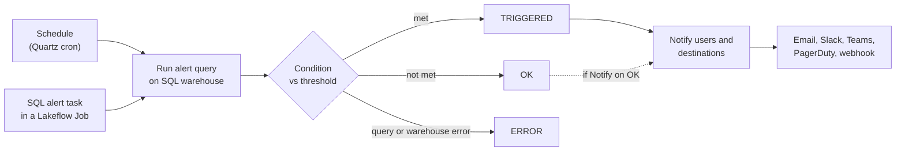
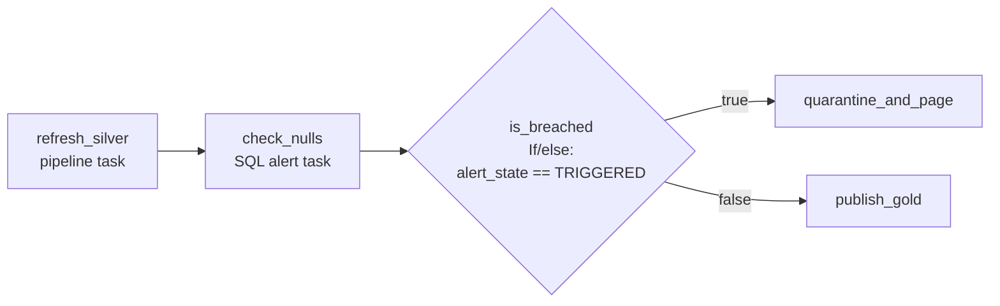

# Lakehouse Alerts

## Overview

A Databricks alert runs a SQL query on a schedule, checks a condition against the result, and notifies users or notification destinations when the condition is met. Because the alert is just a query, it can watch anything you can express in SQL: governed metric views, data quality results, billing, query and warehouse history, audit logs, agent traces, or a gate inside a Lakeflow Job.

> [!abstract]
>
> - An alert has a query (owned by the alert), a SQL warehouse, a **condition** (column or aggregation, operator, static or column threshold), a **schedule** (Quartz cron), and **notifications** (users or destinations, optional repeat, optional custom template).
> - Evaluations resolve to `OK`, `TRIGGERED`, or `ERROR`. Legacy alerts also had `UNKNOWN`.
> - The signals the exam lists map to sources: metric views, `system.data_quality_monitoring.table_results` and profile metric tables, `system.billing.*`, `system.query.history` and `system.compute.warehouse_events`, `system.access.audit`, MLflow production monitoring on agent traces, and the **SQL alert task** inside Lakeflow Jobs.
> - A **SQL alert task** evaluates an alert as a job step. An **If/else condition** task can then branch on `{{tasks.<task>.output.alert_state}}`.

> [!tip] What the Exam Tests
>
> - "Use Databricks Lakehouse alerts to monitor governed business metrics, data quality and anomaly signals, usage and cost, SQL warehouse/query health, audit and security events, AI agent quality, and Lakeflow Job branching."
> - Picking the right source table or feature for each signal type, and writing the alert query so a simple condition (for example `> 0`) fires.
> - Choosing between a scheduled alert, an account budget, a Data Quality Monitoring alert rule, and a SQL alert task in a job.
> - Wiring an alert into a job so downstream tasks run only when the alert is (or is not) `TRIGGERED`.

> [!note] Platform update (Oct 2026)
> The exam calls this feature "Databricks Lakehouse alerts". The docs call it **Databricks SQL alerts**. The earlier version is documented as **legacy alerts**, and both can be used side by side. Since July 9, 2026, Databricks SQL alerts are also available by default in workspaces with the compliance security profile enabled. Sources: [Databricks SQL alerts](https://docs.databricks.com/aws/en/sql/user/alerts/), [July 2026 release notes](https://docs.databricks.com/aws/en/release-notes/product/2026/july)

---

## How an Alert Works



### Alert editor components

| Component | What you set |
| :--- | :--- |
| **Query editor** | The SQL the alert evaluates. Each alert owns its query; an existing saved query cannot be reused. |
| **Compute** | The SQL warehouse that runs the alert query |
| **Schedule** | A periodic schedule, optionally edited as Quartz cron syntax |
| **Share** | Permissions (`CAN RUN`, `CAN MANAGE`) |
| **Condition** | The value to check, the operator, and the threshold. **Test condition** previews the result. |
| **Notifications** | Users or notification destinations, plus an optional notification frequency that repeats until the alert returns to `OK` |
| **Advanced** | **Notify on OK**, **Empty result state**, and the notification **Template** |

> [!important]
> Alerts do not support queries with parameters. If the logic needs runtime values, compute them inside the query (for example `current_date() - 1`).

### Condition options

- **Value:** the first value of a column in the result, or an aggregation over all rows of one column. The Alerts API defines `SUM`, `AVG`, `COUNT`, `COUNT_DISTINCT`, `MIN`, `MAX`, `MEDIAN`, and `STDDEV`.
- **Operator:** `EQUAL`, `NOT_EQUAL`, `GREATER_THAN`, `GREATER_THAN_OR_EQUAL`, `LESS_THAN`, `LESS_THAN_OR_EQUAL`, `IS_NULL`, `IS_NOT_NULL`.
- **Threshold:** a **static value** (default) or **another column** of the result.
- **Aggregations wrap your SQL:** a `SUM` condition on `SELECT 1 AS c` runs `WITH q AS (SELECT 1 AS c) SELECT SUM(c) FROM q`. In that case `QUERY_RESULT_ROWS` and `QUERY_RESULT_COLS` show only the aggregated result.
- **Multi-column logic:** return a single flag from the query and alert on it.

```sql
-- Fire only when BOTH conditions hold: alert when the value = 1
SELECT CASE WHEN drafts_count > 10000 AND archived_count > 5000 THEN 1 ELSE 0 END AS breach
FROM (
  SELECT
    SUM(CASE WHEN is_archived THEN 1 ELSE 0 END) AS archived_count,
    SUM(CASE WHEN is_draft THEN 1 ELSE 0 END)    AS drafts_count
  FROM queries
) data;
```

### Notifications and templates

- **Destinations:** workspace admins create them (Email, Slack, Webhook, Microsoft Teams, PagerDuty). After that, every user can pick them. Webhook endpoints must use HTTPS.
- **Template variables (standard editor):** `{{ALERT_NAME}}`, `{{ALERT_STATUS}}`, `{{ALERT_CONDITION}}`, `{{ALERT_THRESHOLD}}`, `{{ALERT_COLUMN}}`, `{{ALERT_URL}}`, `{{QUERY_RESULT_VALUE}}`, `{{QUERY_RESULT_ROWS}}`, `{{QUERY_RESULT_COLS}}`, `{{QUERY_RESULT_TABLE}}`. `QUERY_RESULT_TABLE` is limited to the first 100 rows, and only email destinations render HTML.
- **Markdown editor:** references variables as `@ALERT_NAME` and supports a subset of those variables.
- **Webhook payload:** after a state change the alert sends a JSON body with `"event": "alert_state_change"` and the alert's definition and evaluation details.

```text
Subject: Alert "{{ALERT_NAME}}" changed status to {{ALERT_STATUS}}
Body:    {{ALERT_COLUMN}} {{ALERT_CONDITION}} {{ALERT_THRESHOLD}}
         Current value: {{QUERY_RESULT_VALUE}}
         Open: {{ALERT_URL}}
```

### Operational limits worth knowing

- Each workspace has a default limit of **250 simultaneous active alert runs**. When every slot is busy, a scheduled run is **skipped**, and the alert does not evaluate. Stagger schedules (01:30, 01:32, 01:34 instead of all at 01:30).
- **Run now** on the alert page runs the query immediately and shows the result next to the evaluation history.
- You can track alerts in Databricks Git folders. Newly cloned alerts start with their **schedules paused**.

---

## Signal 1: Governed Business Metrics (Metric Views)

Alerts on Unity Catalog metric views work the same as alerts on any other dataset. Reference the metric view by its **fully qualified name**, and wrap each measure in `MEASURE()`.

```sql
-- Alert: TRIGGERED when yesterday's governed revenue is below plan
SELECT MEASURE(`Total Revenue`) AS total_revenue
FROM main.finance.orders_metric_view
WHERE `Order Date` = current_date() - 1;
-- Condition: total_revenue  LESS_THAN  static value 250000
```

Why use a metric view rather than raw tables: the measure's definition (filters, joins, aggregation) is governed in Unity Catalog in one place. The alert therefore computes "Total Revenue" the same way as every dashboard or query that reads the same metric view.

---

## Signal 2: Data Quality and Anomaly Signals

You can get data quality alerts in three ways:

| Need | Feature | How the alert is defined |
| :--- | :--- | :--- |
| "Tell me when any table in schema X goes stale or is missing rows" | **Anomaly detection** (Public Preview) with **Data Quality Monitoring UI alert rules** (Beta) | No SQL. **Manage alerts**, then **Create alert**, scoped to a catalog or schema. Each recipient gets one notification per important unhealthy table. Needs `MANAGE` on the schema or catalog. |
| Custom threshold on anomaly results | SQL alert on `system.data_quality_monitoring.table_results` | Query the latest row per table |
| Statistic out of range or drift (null fraction, distribution shift) | **Profile alerts**: a SQL alert on `{output_schema}.{table}_profile_metrics` or `_drift_metrics` | Query the metric table |

Anomaly detection checks **freshness** (is a commit unusually late?) and **completeness** (did the last 24 hours write fewer rows than predicted?). It stores results in `system.data_quality_monitoring.table_results`. By default only account admins can read that table.

```sql
-- Alert on anomaly detection: count tables currently Unhealthy in main.sales
-- Condition: unhealthy_tables GREATER_THAN 0
WITH latest AS (
  SELECT *,
         ROW_NUMBER() OVER (PARTITION BY table_id ORDER BY event_time DESC) AS rn
  FROM system.data_quality_monitoring.table_results
  WHERE catalog_name = 'main' AND schema_name = 'sales'
)
SELECT COUNT(*) AS unhealthy_tables
FROM latest
WHERE rn = 1 AND status = 'Unhealthy';
```

```sql
-- Profile alert on a profiled table "orders" whose metrics go to main.monitoring
-- Latest null percentage of customer_id; Condition: pct_null GREATER_THAN <your threshold>
SELECT percent_null AS pct_null
FROM main.monitoring.orders_profile_metrics
WHERE column_name = 'customer_id'
  AND slice_key IS NULL          -- whole table, not a slice
  AND log_type = 'INPUT'
ORDER BY window.start DESC
LIMIT 1;
```

> [!tip]
> To catch failures in a **pipeline's own expectations**, query the Lakeflow pipeline event log (`flow_progress` events). See [Lakeflow Event Logs](./02-lakeflow-event-logs.md). You can put an alert on that query too.

---

## Signal 3: Usage and Cost

Cost alerts are plain SQL over `system.billing.usage` joined to `system.billing.list_prices`. The query returns a row only when spend is over budget, so the condition can be "row count > 0" (or the value of `list_cost`).

```sql
-- Alert when any workspace's serverless jobs/notebooks list cost in the last 30 days exceeds 5,000
SELECT
  u.workspace_id,
  SUM(u.usage_quantity * p.pricing.default) AS list_cost
FROM system.billing.usage u
JOIN system.billing.list_prices p
  ON  u.cloud = p.cloud
  AND u.sku_name = p.sku_name
  AND u.usage_start_time >= p.price_start_time
  AND (u.usage_end_time <= p.price_end_time OR p.price_end_time IS NULL)
WHERE u.sku_name LIKE '%SERVERLESS%'
  AND u.billing_origin_product IN ('JOBS', 'INTERACTIVE')
  AND u.usage_date >= current_date() - INTERVAL 30 DAYS
GROUP BY u.workspace_id
HAVING list_cost > 5000;
```

Swap the `GROUP BY` for `identity_metadata.run_as` (per user) or `usage_metadata.job_id` (per job). For Lakeflow Connect ingestion, filter `billing_origin_product = 'LAKEFLOW_CONNECT'`.

### SQL alert vs budget

| | SQL alert on `system.billing` | Account **budget** |
| :--- | :--- | :--- |
| Who creates it | Anyone with access to the system tables | Account admins (or workspace admins for their workspaces, through Governance Hub) |
| Scope | Any SQL you can write (per job, per user, per tag, trend vs last week) | Workspaces, resource type, and custom tags |
| Thresholds | One condition per alert | Up to **four** monthly USD thresholds per budget |
| Delivery | Any notification destination | Email addresses |
| Latency | `system.billing.usage` records typically arrive within 12 hours | Up to 24 hours between usage and email |
| Money basis | List price from `list_prices` | List price of the SKU; ignores credits and negotiated discounts |

---

## Signal 4: SQL Warehouse and Query Health

```sql
-- Alert: queries on a warehouse that failed or ran > 10 minutes in the last hour
-- Condition: bad_queries GREATER_THAN 0
SELECT COUNT(*) AS bad_queries
FROM system.query.history
WHERE compute.warehouse_id = '<warehouse-id>'
  AND start_time >= current_timestamp() - INTERVAL 1 HOUR
  AND (execution_status = 'FAILED' OR total_duration_ms > 600000);
```

```sql
-- Alert: warehouses scaled up to 2+ clusters and still upscaled (hours since scale-up)
-- Condition: MAX(upscaled_hours) GREATER_THAN 4
SELECT
  we.warehouse_id,
  TIMESTAMPDIFF(MINUTE, we.event_time, current_timestamp()) / 60.0 AS upscaled_hours
FROM system.compute.warehouse_events we
WHERE we.event_type = 'SCALED_UP'
  AND we.cluster_count >= 2
  AND NOT EXISTS (
    SELECT 1 FROM system.compute.warehouse_events we2
    WHERE we2.warehouse_id = we.warehouse_id
      AND we2.event_time > we.event_time
      AND (we2.event_type = 'SCALED_DOWN'
           OR (we2.event_type = 'SCALED_UP' AND we2.cluster_count < 2))
  );
```

Useful `system.query.history` columns for health alerts: `execution_status` (`FINISHED`, `FAILED`, `CANCELED`), `total_duration_ms`, `waiting_at_capacity_duration_ms` (time queued for available compute capacity), `waiting_for_compute_duration_ms` (time waiting for compute to be provisioned), `spilled_local_bytes`, and `compute.warehouse_id`. Warehouse event types are `STARTING`, `RUNNING`, `SCALED_UP`, `SCALED_DOWN`, `STOPPING`, and `STOPPED`.

---

## Signal 5: Audit and Security Events

```sql
-- Alert: Unity Catalog permission changes in the last hour
-- Condition: row count GREATER_THAN 0 (or COUNT(*) as the value)
SELECT
  event_time,
  user_identity.email                    AS changed_by,
  request_params['securable_full_name']  AS securable,
  request_params['changes']              AS changes
FROM system.access.audit
WHERE event_date >= current_date() - 1          -- partition filter
  AND event_time >= current_timestamp() - INTERVAL 1 HOUR
  AND service_name = 'unityCatalog'
  AND action_name = 'updatePermissions';
```

```sql
-- Alert: spike of denied requests (HTTP 403) per user in the last hour
-- Condition: MAX(denied) GREATER_THAN 50
SELECT user_identity.email AS user_email, COUNT(*) AS denied
FROM system.access.audit
WHERE event_date >= current_date() - 1
  AND event_time >= current_timestamp() - INTERVAL 1 HOUR
  AND response.status_code = 403
GROUP BY user_identity.email;
```

The docs' Genie Agents monitoring page follows the same pattern: query `system.access.audit` with `service_name = 'aibiGenie'`, for example grouped by `response.status_code`, and attach an alert.

---

## Signal 6: AI Agent Quality

There is no "agent quality" system table. The documented approach has two parts:

1. **Production monitoring (Beta)** runs MLflow 3 scorers continuously on a sample of an agent's traces. You register a scorer and start it with a sampling rate, and the results are attached to each trace as feedback.
2. **Traces stored in Unity Catalog** land in Delta tables (`<prefix>_otel_spans`, `<prefix>_otel_annotations`, `<prefix>_otel_logs`, `<prefix>_otel_metrics`). Because they are SQL-native, they can "drive alerts and Lakeflow pipelines". The alerts docs list "catch failures in agents" as a use case that pairs with production monitoring.

```python
from mlflow.genai.scorers import Safety, ScorerSamplingConfig

# Score 100 % of production traces for safety; results attach to traces as feedback
safety = Safety().register(name="safety")
safety = safety.start(sampling_config=ScorerSamplingConfig(sample_rate=1.0))
```

Exam framing: to alert on agent quality, first get the quality signal (scorers through production monitoring), then put a SQL alert on the query over the stored results. Monitoring UC-stored traces needs a SQL warehouse ID set on the experiment with `set_databricks_monitoring_sql_warehouse_id()`.

---

## Signal 7: Lakeflow Job Branching

A **SQL alert task** evaluates an existing Databricks SQL alert as a job step. The task runs the alert query on the chosen warehouse (or the alert's own warehouse), evaluates the condition, and notifies the task's subscribers (or the alert's own).

Key behaviors:

- **Task status is Succeeded whether or not the alert triggered.** The task reports **Failed** only when evaluation errors (query error, warehouse problem). A triggered alert therefore does **not** stop the job by itself. You branch on it.
- **Branch with an If/else condition task** on the dynamic value `{{tasks.<alert_task_key>.output.alert_state}}`, whose value is `UNKNOWN`, `OK`, or `TRIGGERED`.
- **The task ignores the alert's own schedule.** That schedule keeps running independently.
- **Requirements:** at least `CAN RUN` on the alert, and a **serverless or pro** SQL warehouse.
- **Limitations:** no parameters (use a SQL task with a query if you need them), and only Databricks SQL alerts. Legacy alerts are not supported.



```yaml
resources:
  jobs:
    silver_quality_gate:
      name: silver_quality_gate
      tasks:
        - task_key: refresh_silver
          pipeline_task:
            pipeline_id: <pipeline-id>

        - task_key: check_nulls
          depends_on:
            - task_key: refresh_silver
          alert_task:                       # SQL alert task (Alert v2), CLI 0.296.0+
            alert_id: <alert-id>            # or workspace_path: ./nulls.dbalert.json
            warehouse_id: <warehouse-id>    # serverless or pro

        - task_key: is_breached
          depends_on:
            - task_key: check_nulls
          condition_task:
            op: EQUAL_TO
            left: "{{tasks.check_nulls.output.alert_state}}"
            right: TRIGGERED

        - task_key: quarantine_and_page
          depends_on:
            - task_key: is_breached
              outcome: "true"
          notebook_task:
            notebook_path: ../src/quarantine.py

        - task_key: publish_gold
          depends_on:
            - task_key: is_breached
              outcome: "false"
          notebook_task:
            notebook_path: ../src/publish_gold.py
```

The **SQL task** type also has an **Alert** option (`sql_task.alert.alert_id`, with `pause_subscriptions` and `subscriptions`). The Databricks SQL alerts docs point to the dedicated **SQL Alert** task type (`alert_task`) for running an alert as a job step.

| Branch on... | Use |
| :--- | :--- |
| Whether an alert condition is met | SQL alert task → If/else on `output.alert_state` |
| A value a query returns | SQL task (query) → If/else on `{{tasks.<t>.output.first_row.<col>}}` |
| A value a notebook computed | Notebook task sets a task value → If/else on `{{tasks.<t>.values.<key>}}` |
| Whether an upstream task failed | `run_if: AT_LEAST_ONE_FAILED` (no condition task needed) |

---

## Managing Alerts Programmatically

- **REST (Alerts API, latest alerts):** `GET /api/2.0/alerts`, `GET /api/2.0/alerts/{id}`, `POST /api/2.0/alerts`, `PATCH /api/2.0/alerts/{id}`, `DELETE /api/2.0/alerts/{id}` (moves the alert to trash).
- **Python SDK:** `w.alerts_v2.list_alerts()`, `get_alert(id)`, `create_alert(alert)`, `update_alert(id, alert, update_mask)`, `trash_alert(id)`.
- **System tables (Public Preview):** `system.alert.alerts` (SCD history of each alert's configuration) and `system.alert.alert_evaluation_history` (one row per evaluation: `evaluated_state`, `error_code`, `error_message`, `notified_subscriptions`, `failed_subscriptions`, and `job_id`/`task_key` when the alert ran inside a job).

```sql
-- Which alerts fired most in the last 7 days (alert on alerts / alert hygiene)
SELECT alert_id, COUNT(*) AS trigger_count_7d
FROM system.alert.alert_evaluation_history
WHERE start_time >= current_date() - INTERVAL 7 DAY
  AND evaluated_state = 'TRIGGERED'
GROUP BY alert_id
ORDER BY trigger_count_7d DESC;
```

---

## Use Cases

- **Revenue guardrail:** a daily alert on a governed metric view pages finance when yesterday's `Total Revenue` falls below plan. Every consumer uses the same measure definition.
- **Schema-wide freshness:** a Data Quality Monitoring alert rule on `main.sales` posts to Slack when any table is marked stale or incomplete, without writing SQL.
- **Runaway serverless spend:** an hourly alert on `system.billing.usage` joined with `list_prices` returns rows only for workspaces above budget, and notifies a PagerDuty destination.
- **Quality gate in a pipeline job:** after the silver refresh, a SQL alert task checks null rates. An If/else task routes to a quarantine notebook when the alert is `TRIGGERED`, and to the gold publish otherwise.

## Common Issues & Errors

### Alert never triggers inside a job, but the job "succeeds"

**Cause:** the SQL alert task reports **Succeeded** whenever the evaluation completes, even when the state is `TRIGGERED`.

**Fix:** add an If/else condition task on `{{tasks.<alert_task>.output.alert_state}}` and make downstream tasks depend on its `true`/`false` outcome.

### Alert runs are skipped at a busy time

**Cause:** the workspace hit its limit of 250 simultaneous active alert runs because many alerts share the same schedule.

**Fix:** stagger schedules. If the limit is consistently reached, request a quota increase from Databricks Support.

### Alert shows ERROR or the task fails

**Cause:** the query fails, the warehouse is unavailable, or the job uses a classic warehouse (SQL alert tasks need serverless or pro).

**Fix:** use **Test condition** or **Run now**, fix the query, and pick a serverless or pro warehouse.

### Query uses parameters

**Cause:** alerts and SQL alert tasks don't support parameterized queries.

**Fix:** hard-code or compute the values in SQL, or use a SQL task with a parameterized query.

### Cost alert fires on "yesterday" data that is still changing

**Cause:** billing records typically arrive within 12 hours, and corrections add `RETRACTION` and `RESTATEMENT` rows.

**Fix:** aggregate with `SUM(usage_quantity)` (retractions cancel originals) and evaluate a closed window, such as the last full day.

## Exam Tips

> [!tip]
>
> - **One query, one condition:** put the business logic in SQL and leave the alert condition trivial (`> 0`, `= 1`, `< threshold`).
> - **States:** latest alerts use `OK` / `TRIGGERED` / `ERROR`. `UNKNOWN` belongs to legacy alerts, and it also appears in the `alert_state` dynamic value.
> - **Job branching:** SQL alert task + If/else on `{{tasks.<t>.output.alert_state}}`. Remember the task is **Succeeded** even when triggered.
> - **Metric views:** reference by fully qualified name and use `MEASURE()`. Nothing else is special.
> - **Schema-wide data quality without SQL:** Data Quality Monitoring alert rules. **Statistic or drift thresholds:** profile alerts on `_profile_metrics` / `_drift_metrics`.
> - **Cost:** `system.billing.usage` × `system.billing.list_prices` (`pricing.default`). **Monthly account-level guardrail with email:** budgets.
> - **Warehouse and query health:** `system.query.history` (`execution_status`, `total_duration_ms`, `compute.warehouse_id`) and `system.compute.warehouse_events`.
> - **Security:** `system.access.audit` filtered on `service_name` / `action_name`. Always filter `event_date`.
> - **Agents:** production monitoring scorers → feedback on traces → alert on the stored results.

## Key Takeaways

- **Databricks SQL alerts** (the exam's "Lakehouse alerts") schedule a query, evaluate a condition, and notify users or destinations. Each alert owns its query, and parameters aren't supported.
- **Conditions** use a column value or an aggregation (`SUM`, `AVG`, `COUNT`, ...), an operator, and a static or column threshold. Aggregations wrap the query in a CTE.
- **Notifications** go to users or admin-managed destinations (Email, Slack, Teams, PagerDuty, webhook). They support **Notify on OK**, repeat frequency, and custom templates with `{{ALERT_*}}` / `{{QUERY_RESULT_*}}` variables.
- **Signal sources:** metric views, `system.data_quality_monitoring.table_results` and profile metric tables, `system.billing.*`, `system.query.history` and `system.compute.warehouse_events`, `system.access.audit`, and MLflow production monitoring results.
- **Job branching** uses a SQL alert task (`alert_task`) followed by an If/else condition task (`condition_task`) whose dependents use `outcome: "true"` / `"false"`.
- **Alert operations** can be audited through `system.alert.alerts` and `system.alert.alert_evaluation_history` (Public Preview).

## Related Topics

- [System Tables](./01-system-tables.md) - Schemas and columns used by alert queries
- [Lakeflow Event Logs](./02-lakeflow-event-logs.md) - Pipeline health and expectation metrics to alert on
- [Databricks REST API — Part 2](./05-rest-api-part2.md) - SDK, REST, and CLI monitoring of jobs and pipelines
- [Lakeflow Jobs — Part 1](../01-developing-code-for-data-processing/08-lakeflow-jobs-part1.md) - Task values and If/else tasks
- [Lakeflow Jobs — Part 2](../01-developing-code-for-data-processing/08-lakeflow-jobs-part2.md) - Job notifications and health rules
- [Expectations and Data Quality](../03-data-manipulation/06-expectations-data-quality.md) - Pipeline expectations
- [Cost Optimization](../05-cost-and-performance-optimization/10-cost-optimization.md) - Acting on cost signals
- [Audit, Lineage and Network Security](../06-ensuring-data-security-and-compliance/06-audit-lineage-network-security.md) - Audit log events

## Official Documentation

- [Databricks SQL alerts](https://docs.databricks.com/aws/en/sql/user/alerts/)
- [Create an alert](https://docs.databricks.com/aws/en/sql/user/alerts/create)
- [Alert query patterns](https://docs.databricks.com/aws/en/sql/user/alerts/query-patterns)
- [Manage alerts](https://docs.databricks.com/aws/en/sql/user/alerts/manage)
- [SQL alert webhook payload](https://docs.databricks.com/aws/en/sql/user/alerts/webhook-payload)
- [What are legacy alerts?](https://docs.databricks.com/aws/en/sql/user/alerts/legacy)
- [SQL alert task for jobs](https://docs.databricks.com/aws/en/jobs/tasks/alert)
- [Add branching logic to a job with the If/else task](https://docs.databricks.com/aws/en/jobs/tasks/if-else)
- [What is a dynamic value reference?](https://docs.databricks.com/aws/en/jobs/dynamic-value-references)
- [Job task types in bundles (alert_task, condition_task, sql_task)](https://docs.databricks.com/aws/en/dev-tools/bundles/job-task-types)
- [Query metric views](https://docs.databricks.com/aws/en/uc-semantics/metric-views/query)
- [Anomaly detection](https://docs.databricks.com/aws/en/data-governance/unity-catalog/data-quality-monitoring/anomaly-detection/)
- [Alerts for anomaly detection](https://docs.databricks.com/aws/en/data-governance/unity-catalog/data-quality-monitoring/anomaly-detection/alerts)
- [Data quality monitoring results system table](https://docs.databricks.com/aws/en/admin/system-tables/data-quality-monitoring)
- [Profile alerts](https://docs.databricks.com/aws/en/data-governance/unity-catalog/data-quality-monitoring/data-profiling/monitor-alerts)
- [Profile metric tables](https://docs.databricks.com/aws/en/data-governance/unity-catalog/data-quality-monitoring/data-profiling/monitor-output)
- [Monitor the cost of serverless compute](https://docs.databricks.com/aws/en/admin/system-tables/serverless-billing)
- [Create and monitor budgets](https://docs.databricks.com/aws/en/admin/account-settings/budgets)
- [Example queries for monitoring SQL warehouse activity](https://docs.databricks.com/aws/en/compute/sql-warehouse/monitor/queries)
- [Warehouse events system table](https://docs.databricks.com/aws/en/admin/system-tables/warehouse-events)
- [Query history system table](https://docs.databricks.com/aws/en/admin/system-tables/query-history)
- [Audit log system table](https://docs.databricks.com/aws/en/admin/system-tables/audit-logs)
- [Monitor Genie Agents usage with audit logs and alerts](https://docs.databricks.com/aws/en/ai-bi/admin/audit)
- [Set up production monitoring](https://docs.databricks.com/aws/en/mlflow3/genai/eval-monitor/production-monitoring)
- [Store OpenTelemetry traces in Unity Catalog](https://docs.databricks.com/aws/en/mlflow3/genai/tracing/trace-unity-catalog)
- [Alert system tables](https://docs.databricks.com/aws/en/admin/system-tables/alerts)
- [Manage notification destinations](https://docs.databricks.com/aws/en/admin/workspace-settings/notification-destinations)
- [Access control lists (Alerts ACLs)](https://docs.databricks.com/aws/en/security/auth/access-control/)

---

**[← Previous: Lakeflow/Lakeflow Pipelines Event Logs](./02-lakeflow-event-logs.md) | [↑ Back to Section](./README.md) | [Next: Databricks CLI — Part 1 →](./04-databricks-cli-part1.md)**
