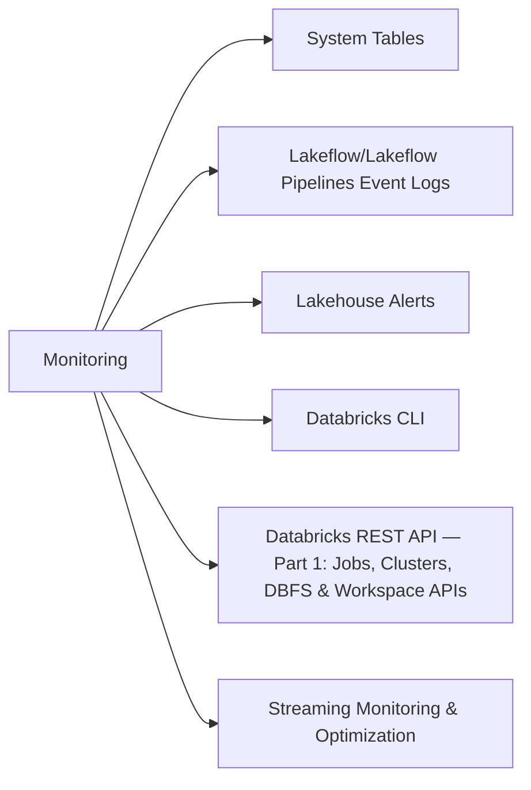

# Section 4: Monitoring and Alerting (10 % of Exam)

Watching production workloads: system tables (billing, compute, access, lakeflow), the pipeline event log, Databricks REST APIs / CLI / SDK for jobs and pipelines, Lakehouse alerts across business, quality, cost, query, security and AI-agent signals, and Lakeflow Jobs run monitoring.

## Topics Overview

## Section Contents

| File | Topic | Priority |
| :--- | :--- | :--- |
| [01-system-tables.md](./01-system-tables.md) | `system.billing`, `system.compute`, `system.access`, `system.lakeflow` for cost, audit and workload monitoring | High |
| [02-lakeflow-event-logs.md](./02-lakeflow-event-logs.md) | Pipeline event log: health, flow progress, expectation metrics | High |
| [03-lakehouse-alerts.md](./03-lakehouse-alerts.md) | Alerts on metrics, quality, cost, query health, audit events, agent quality; job branching | High |
| [04-databricks-cli-part1.md](./04-databricks-cli-part1.md) | CLI install, auth, workspace and jobs commands | Medium |
| [04-databricks-cli-part2.md](./04-databricks-cli-part2.md) | Clusters, secrets, bundles, UC commands, output formats | Medium |
| [05-rest-api-part1.md](./05-rest-api-part1.md) | REST API basics, auth, Jobs API | Medium |
| [05-rest-api-part2.md](./05-rest-api-part2.md) | Permissions, SQL Statement Execution, Databricks SDK for Python monitoring | High |
| [06-streaming-monitoring-optimization.md](./06-streaming-monitoring-optimization.md) | Streaming metrics, back-pressure, state store monitoring | Medium |

## Exam Skill Coverage

Every skill bullet in Section 4 of the Oct 9, 2026 exam guide, with the files that cover it.

| Exam guide skill | Where it is covered |
| :--- | :--- |
| Use Databricks system tables (billing, compute, access, lakeflow) for cost analysis, auditing, and workload monitoring. | [01-system-tables.md](./01-system-tables.md) |
| Use Databricks REST APIs / CLI and SDK for monitoring and analyzing jobs and pipelines. | [04-databricks-cli-part1.md](./04-databricks-cli-part1.md), [04-databricks-cli-part2.md](./04-databricks-cli-part2.md), [05-rest-api-part1.md](./05-rest-api-part1.md), [05-rest-api-part2.md](./05-rest-api-part2.md) |
| Use Pipeline event logs to monitor pipeline health and data quality. | [02-lakeflow-event-logs.md](./02-lakeflow-event-logs.md) |
| Use Databricks Lakehouse alerts to monitor governed business metrics, data quality and anomaly signals, usage and cost, SQL warehouse/query health, audit and security events, AI agent quality, and Lakeflow Job branching. | [03-lakehouse-alerts.md](./03-lakehouse-alerts.md) |
| Use Lakeflow Jobs UI and Jobs API to monitor job status and performance metrics. | [08-lakeflow-jobs-part2.md](../01-developing-code-for-data-processing/08-lakeflow-jobs-part2.md), [05-rest-api-part1.md](./05-rest-api-part1.md), [06-streaming-monitoring-optimization.md](./06-streaming-monitoring-optimization.md) |

## Key Concepts to Master

| Concept | Why it matters |
| :--- | :--- |
| **`system.billing.usage`** | DBU consumption per workload; join with `system.billing.list_prices` for cost attribution |
| **`system.lakeflow.*`** | Job and pipeline metadata and run timelines for workload monitoring |
| **Pipeline event log** | Per-pipeline Delta log of updates, flow progress and expectation results |
| **Alerts** | A scheduled query evaluated against a condition that notifies destinations — and can drive job branching |
| **Databricks SDK** | Typed Python client (`WorkspaceClient`) over the REST API for scripted monitoring |

## Related Resources

- [Unity Catalog cheat sheet](../resources/cheat-sheets/unity-catalog-quick-ref.md)
- [Performance troubleshooting (shared)](../../../shared/appendix/performance-troubleshooting.md)

---

**[← Previous: Data Manipulation](../03-data-manipulation/README.md) | [↑ Back to DE Professional](../README.md) | [Next: Cost & Performance Optimization →](../05-cost-and-performance-optimization/README.md)**
