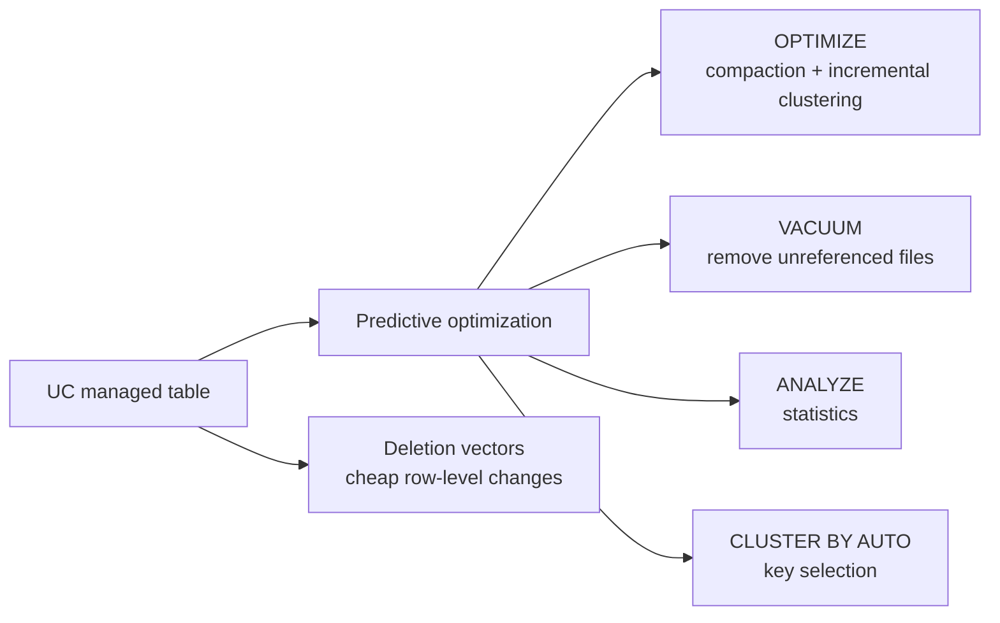
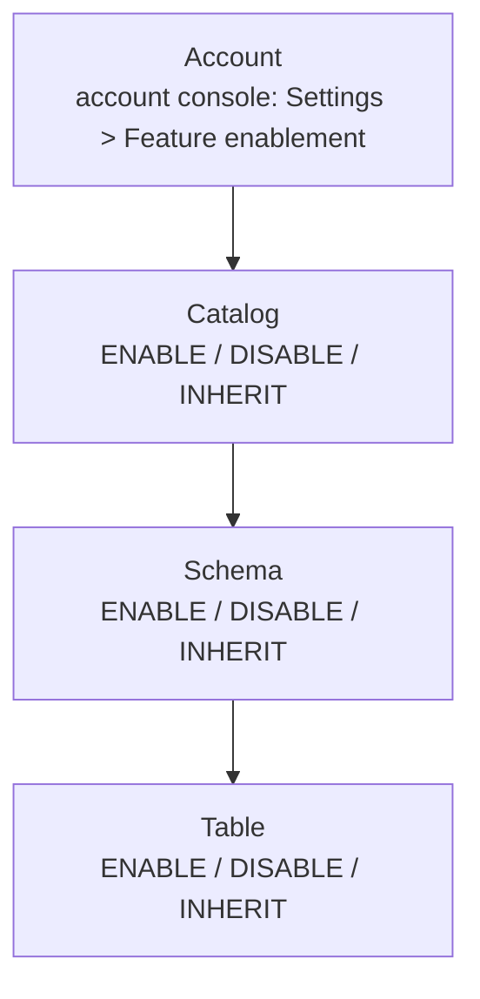
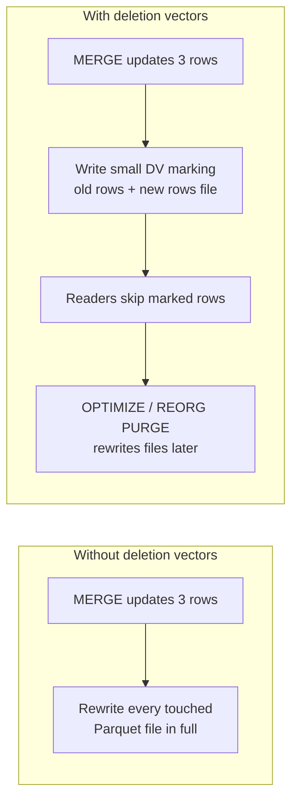
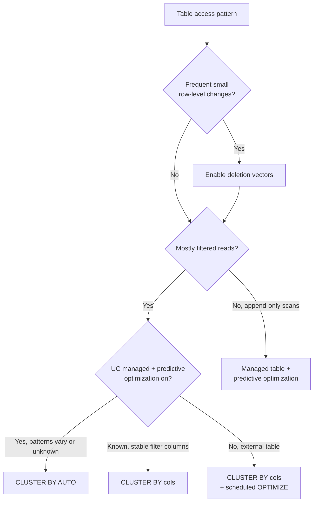

# Managed Tables, Predictive Optimization, and Automatic Clustering

## Overview

Unity Catalog managed tables hand storage, layout, and maintenance to the platform. Predictive optimization then runs `OPTIMIZE`, `VACUUM`, and `ANALYZE` for you. Liquid clustering (manual keys or `CLUSTER BY AUTO`) and deletion vectors decide how data is laid out and how cheaply rows can change. Together they remove most of the hand-written maintenance jobs that older Delta pipelines needed.

> [!abstract]
>
> - **UC managed tables** are the default and recommended table type; some features (predictive optimization, automatic liquid clustering, metadata caching, auto file deletion after `DROP`) only exist for managed tables
> - **Predictive optimization** runs `OPTIMIZE`, `VACUUM`, and `ANALYZE` on serverless jobs compute, controlled by an account → catalog → schema → table inheritance model
> - **Liquid clustering** (`CLUSTER BY`) replaces partitioning and `ZORDER`; **`CLUSTER BY AUTO`** lets predictive optimization pick and evolve the keys from the query workload
> - **Deletion vectors** mark changed rows in metadata instead of rewriting whole Parquet files, which cuts write amplification from frequent small `MERGE` / `UPDATE` / `DELETE`

> [!tip] What the Exam Tests
>
> - Explain how Unity Catalog managed tables, Predictive Optimization, and Liquid Clustering reduce operational and maintenance overhead for a given workload
> - Choose the appropriate Delta optimization technique (deletion vectors, Liquid Clustering, `CLUSTER BY AUTO`) for a given table access pattern
> - Know the requirements and defaults (managed tables only, predictive optimization required for `CLUSTER BY AUTO`, deletion vectors need compatible clients)

---

## The Maintenance Work These Features Remove

| Manual task on an older Delta table | Who does it on a UC managed table |
| :--- | :--- |
| Scheduled `OPTIMIZE` jobs for compaction | Predictive optimization (`OPTIMIZE`, run when it is cost-effective) |
| Scheduled `VACUUM` jobs | Predictive optimization (`VACUUM`, honouring `delta.deletedFileRetentionDuration`) |
| `ANALYZE TABLE` for statistics | Predictive optimization (`ANALYZE`, plus statistics collected on write) |
| Choosing partition / `ZORDER` columns and rewriting when queries change | Liquid clustering; with `CLUSTER BY AUTO`, predictive optimization selects and evolves the keys |
| Rewriting whole files for a handful of updated rows | Deletion vectors (soft-deletes resolved at read time, purged later) |
| Deleting files from cloud storage after `DROP TABLE` | Automatic for managed tables after the recovery period (default 7 days) |



---

## Unity Catalog Managed Tables

Unity Catalog managed tables are the default and recommended table type for Delta Lake and Apache Iceberg. Unity Catalog manages all read, write, storage, and optimization responsibilities, and data files live in the managed storage location of the containing schema or catalog.

### Features Only Managed Tables Get

| Feature | What it does | Default |
| :--- | :--- | :--- |
| Predictive optimization | Automatically runs maintenance operations | Enabled by default for accounts created on or after November 11, 2024; being rolled out to existing accounts |
| Automatic liquid clustering | Selects and updates clustering keys as query patterns change (needs predictive optimization) | Turned off by default |
| Metadata caching | In-memory caching of transaction metadata, fewer requests to the transaction log in cloud storage | Enabled; not configurable |
| Automatic file deletion after `DROP TABLE` | Data files are deleted after the recovery period expires | Enabled; recovery period default 7 days |
| Catalog commits | Commit coordination in Unity Catalog: multi-table transactions, faster query planning, safe external writes | Turned off by default (Beta; `delta.feature.catalogManaged` table property) |
| Multi-statement transactions | Multiple statements as one atomic commit | Turned off by default |

External tables do not get these features. For external tables you also have to delete files from your storage bucket yourself after a drop.

### Access by Name, Not Path

All reads and writes to managed tables use the three-level name (`catalog.schema.table`). Path-based access to managed tables isn't supported (except in Compatibility Mode), because it bypasses Unity Catalog access controls.

```sql
-- Managed Delta table (Delta is the default format)
CREATE TABLE main.sales.orders (
  order_id BIGINT,
  customer_id BIGINT,
  order_ts TIMESTAMP,
  amount DECIMAL(10, 2)
);

-- Managed Iceberg table: you must say USING iceberg
CREATE TABLE main.sales.orders_iceberg (order_id BIGINT) USING iceberg;
```

### Dropping and Recovering

- `UNDROP TABLE` recovers a dropped managed table; by default tables are recoverable for 7 days.
- After the recovery period, an asynchronous purge deletes the underlying data files.
- A configurable recovery period (Public Preview) can be set at catalog or schema level: 0 hours (no recovery) or 7 to 30 days; the schema setting wins if both are set.

### Converting External Tables to Managed

Databricks recommends `ALTER TABLE ... SET MANAGED` over CTAS: it keeps the table name, settings, permissions, views, and history, and keeps reader/writer downtime short.

```sql
-- External Delta table -> UC managed table
-- Requires Databricks Runtime 17.3 LTS+ or serverless compute
ALTER TABLE main.legacy.events SET MANAGED;
```

> [!note]
> Foreign tables use a different form (`SET MANAGED {MOVE | COPY}`). Adding `MOVE` or `COPY` when converting an external table makes the command fail.

---

## Predictive Optimization

Predictive optimization automatically runs `OPTIMIZE`, `VACUUM`, and `ANALYZE` on Unity Catalog managed tables (Delta Lake and Iceberg). It finds tables that would benefit from maintenance, queues the operations, and also collects statistics when data is written. Databricks recommends it for all UC managed tables.

### What It Runs

| Operation | Effect |
| :--- | :--- |
| `OPTIMIZE` | Triggers incremental clustering for clustered tables; optimizes file sizes |
| `VACUUM` | Deletes data files no longer referenced by the table (storage cost) |
| `ANALYZE` | Collects statistics to improve query performance |
| Key selection | With automatic liquid clustering, may select new clustering keys before clustering data |

> [!important]
> `OPTIMIZE` run by predictive optimization **does not run `ZORDER`**, and it ignores Z-ordered files. Tables that rely on Z-order do not get their Z-order maintained automatically, which is one more reason to move them to liquid clustering.

### Compute, Billing, and Prerequisites

- Runs on **serverless compute for jobs**; billed under a **serverless jobs SKU**.
- Workspace on the **Premium plan or above** in a supported region.
- Use **SQL warehouses or Databricks Runtime 12.2 LTS or above**.
- **Only Unity Catalog managed tables** are supported. It does not run on **external tables** or on **tables loaded as OpenSharing recipients**.

### Enablement Hierarchy

You can enable predictive optimization for an account, a catalog, a schema, or a table. All UC managed tables inherit the account value by default, and each lower level can override it.



```sql
-- Override at catalog, schema, or table level
ALTER CATALOG main ENABLE PREDICTIVE OPTIMIZATION;
ALTER SCHEMA main.staging DISABLE PREDICTIVE OPTIMIZATION;
ALTER TABLE main.sales.orders INHERIT PREDICTIVE OPTIMIZATION;  -- go back to the parent's setting

-- Check the effective setting (the "Predictive Optimization" field shows if it is inherited)
DESCRIBE SCHEMA EXTENDED main.staging;
DESCRIBE TABLE EXTENDED main.sales.orders;
```

| Level | Who can change it |
| :--- | :--- |
| Account | Account admin |
| Catalog | Catalog owner, or `MANAGE` on the catalog |
| Schema | Schema owner, or `MANAGE` on the schema |
| Table | Table owner, or `MANAGE` on the table |

Two inheritance rules that show up in scenarios:

- Disabling at the account level does **not** disable it for catalogs or schemas that explicitly enabled it.
- An object that explicitly disabled it stays blocked even if the account is later enabled.

### Observing What It Did

```sql
-- Operation history, cost (ESTIMATED_DBU), and status per table
SELECT catalog_name, schema_name, table_name, operation_type,
       SUM(usage_quantity) AS estimated_dbus,
       COUNT(*) AS operations
FROM system.storage.predictive_optimization_operations_history
WHERE start_time >= current_date() - INTERVAL 30 DAYS
  AND operation_status = 'SUCCESSFUL'
GROUP BY ALL
ORDER BY estimated_dbus DESC;
```

- `operation_type` values include `COMPACTION`, `VACUUM`, `ANALYZE`, `CLUSTERING`, and `AUTO_CLUSTERING_COLUMN_SELECTION`.
- The system table is in Public Preview; records are typically available within 12 hours.
- On Databricks Runtime 18 LTS and above, `DESCRIBE TABLE EXTENDED ... AS JSON` returns a `predictive_optimization_evaluations` field with the latest evaluation (and skip reason) per operation type. The Catalog Explorer **History** tab marks skipped operations as **Not applied**.

### VACUUM Retention Still Matters

The `VACUUM` retention window comes from `delta.deletedFileRetentionDuration` (default 7 days). To keep longer time travel, set it **before** enabling predictive optimization:

```sql
ALTER TABLE main.sales.orders
SET TBLPROPERTIES ('delta.deletedFileRetentionDuration' = '30 days');
```

If you set it below 7 days, predictive optimization still keeps files for at least 7 days when it runs `VACUUM FULL`.

---

## Liquid Clustering

Liquid clustering is a data layout technique that **replaces table partitioning and `ZORDER`**. It organizes data by clustering keys, and you can redefine keys without rewriting existing data. Databricks recommends liquid clustering for **all new tables, including streaming tables and materialized views**. It is not compatible with partitioning or `ZORDER` on the same table.

Liquid clustering is generally available for Delta Lake tables with Databricks Runtime 15.4 LTS and above (Public Preview for Iceberg tables on 16.4 LTS and above). Triggering clustering needs Databricks Runtime 13.3 LTS or above.

### When It Helps Most

- Queries that filter on high-cardinality columns
- Tables with heavy data skew
- Fast-growing tables that would otherwise need maintenance and tuning
- Tables with concurrent write requirements
- Tables with varied or changing access patterns
- Tables where a typical partition key would give too many or too few partitions

### Syntax

```sql
-- New table
CREATE TABLE main.sales.orders (
  order_id BIGINT, customer_id BIGINT, order_date DATE, amount DECIMAL(10, 2)
) CLUSTER BY (customer_id, order_date);

-- CTAS: CLUSTER BY goes after the table name, not in the SELECT
CREATE TABLE main.sales.orders_copy CLUSTER BY (customer_id)
AS SELECT * FROM main.sales.orders;

-- Existing unpartitioned table
ALTER TABLE main.sales.orders CLUSTER BY (customer_id, order_date);

-- Change keys at any time (existing data is not rewritten)
ALTER TABLE main.sales.orders CLUSTER BY (order_date);

-- Turn clustering off (clustered data is not rewritten)
ALTER TABLE main.sales.orders CLUSTER BY NONE;

-- See the current keys
DESCRIBE DETAIL main.sales.orders;
```

```python
# DataFrame API: clustering keys can only be set on create / overwrite, not on append
(spark.read.table("main.sales.orders")
    .write.clusterBy("customer_id")
    .saveAsTable("main.sales.orders_by_customer"))
```

### Choosing Keys

- Up to **four** clustering keys; pick the columns most often used in query filters. Order does not matter.
- If two columns are highly correlated, include only one of them.
- Keys must have **statistics collected** (by default the first 32 columns of the schema).
- For tables under about 10 TB, more keys can make single-column filters slower (four keys performs worse than two); the gap becomes negligible as tables grow.
- Supported key types include date, timestamp, string, integer types, float, double, and decimal; struct fields work with dot notation, but map/array elements and complex types do not.

### How Data Actually Gets Clustered

Clustering happens in two places: on write (for some operations, above a size threshold) and during `OPTIMIZE`.

| Clustering keys | Clustering-on-write threshold (UC managed) | Threshold (other Delta tables) |
| :--- | :--- | :--- |
| 1 | 64 MB | 256 MB |
| 2 | 256 MB | 1 GB |
| 3 | 512 MB | 2 GB |
| 4 | 1 GB | 4 GB |

- Operations that cluster on write include `INSERT INTO`, CTAS/RTAS, `COPY INTO` from Parquet, and `spark.write.mode("append")`. Not all operations cluster on write, so `OPTIMIZE` still matters.
- `OPTIMIZE` on a clustered table is **incremental**: it only rewrites data that needs clustering, so most runs are quick.
- With predictive optimization, Databricks recommends **disabling scheduled `OPTIMIZE` jobs**. Without it, schedule `OPTIMIZE`; for tables with many updates or inserts, every one or two hours.
- After you **enable clustering for the first time or change keys**, run `OPTIMIZE <table> FULL` to recluster existing data (Databricks Runtime 16.4 LTS and above per the liquid clustering page). On large tables that were never clustered on those keys, this can take hours.

```sql
OPTIMIZE main.sales.orders;        -- incremental clustering
OPTIMIZE main.sales.orders FULL;   -- recluster everything after a key change
```

### Protocol and Concurrency Side Effects

- Tables with liquid clustering use Delta **writer version 7 and reader version 3**; clients that don't support these protocols cannot read them, and the protocol cannot be downgraded.
- Enabling liquid clustering turns on deletion vectors and row tracking by default. Together they give **row-level concurrency**, so concurrent writes conflict less. Turning either off also turns off row-level concurrency, and `DELETE`, `MERGE`, and `UPDATE` might run slower.

```sql
-- Optional: opt out of deletion vectors before enabling clustering (for old clients)
ALTER TABLE main.sales.orders SET TBLPROPERTIES ('delta.enableDeletionVectors' = false);
ALTER TABLE main.sales.orders CLUSTER BY (customer_id);
```

---

## Automatic Liquid Clustering (`CLUSTER BY AUTO`)

With `CLUSTER BY AUTO`, Databricks chooses the clustering keys for you. It is available for **Unity Catalog managed Delta tables on Databricks Runtime 15.4 LTS and above** (managed Iceberg v3 tables need 18.0 and above; not available for managed Iceberg v2). It also works for materialized views and streaming tables in Lakeflow Pipelines.

### How Keys Are Chosen

Automatic liquid clustering **requires predictive optimization** for key selection and clustering, and runs asynchronously:

- **Analyzes the query workload**: looks at the table's historical queries to find the best candidate columns.
- **Adapts to changes**: selects new keys if query patterns or data distributions change.
- **Cost-aware**: changes keys only when the predicted savings from better data skipping outweigh the cost of reclustering.

It might not select keys when the table is too small, already has an effective layout (from earlier manual keys or a natural insertion order that matches queries), isn't queried often, or the workloads aren't on Databricks Runtime 15.4 LTS or above (key selection relies on metadata introduced in 15.4 LTS).

### Syntax

```sql
-- New table
CREATE OR REPLACE TABLE main.sales.events (event_id BIGINT, event_ts TIMESTAMP, user_id BIGINT)
CLUSTER BY AUTO;

-- Existing table, including one with manual keys
ALTER TABLE main.sales.orders CLUSTER BY AUTO;

-- Give hints first, then switch to AUTO
ALTER TABLE main.sales.orders CLUSTER BY (customer_id, order_date);
ALTER TABLE main.sales.orders CLUSTER BY AUTO;

-- Convert a partitioned table (DBR 18.1+); starts from the partition columns
ALTER TABLE main.sales.legacy_orders REPLACE PARTITIONED BY WITH CLUSTER BY AUTO;

-- Turn it off (or set explicit keys instead)
ALTER TABLE main.sales.orders CLUSTER BY NONE;
```

```python
# DataFrameWriter (DBR 16.4+): only when creating or replacing a table
(df.write
    .format("delta")
    .option("clusterByAuto", "true")
    .saveAsTable("main.sales.events"))
```

```python
# Lakeflow Pipelines (pyspark.pipelines)
from pyspark import pipelines as dp

@dp.table(cluster_by_auto=True)
def events_bronze():
    return spark.readStream.table("main.raw.events")
```

Check the result with `DESCRIBE TABLE` or `SHOW TBLPROPERTIES`: `clusterByAuto` is `true`, and `clusteringColumns` shows the keys currently selected.

> [!warning]
> Running `CREATE OR REPLACE TABLE` **without** `CLUSTER BY AUTO` on a table that had automatic clustering turns it off and does not keep the selected columns. Include `CLUSTER BY AUTO` in the replace statement to keep it.

---

## Deletion Vectors

Without deletion vectors, changing one row means rewriting the whole Parquet file that contains it. Deletion vectors mark rows as modified in metadata instead, and **reads apply the deletion vector entries at query time** to resolve the current table state (a merge-on-read pattern). Updated rows are written to new files; the old versions are marked as soft-deleted.



### When Deletion Vectors Help

| Pattern | Effect |
| :--- | :--- |
| Frequent small `MERGE`, `UPDATE`, or `DELETE` on large tables (CDC upserts, GDPR deletes) | Big win: avoids rewriting whole files on every change |
| Concurrent writers on the same table | Row-level concurrency (DBR 14.2+, with row tracking) reduces conflicts |
| Append-only tables | Little benefit; nothing is being rewritten |
| Tables read by external clients without deletion-vector support | Avoid, or drop the feature: those clients can't read the table |

On Photon compute (serverless and pro SQL warehouses, and clusters on DBR 14.0+), **predictive I/O for updates** uses deletion vectors automatically to speed up `DELETE`, `MERGE`, and `UPDATE`.

### Enabling Them

```sql
CREATE TABLE main.cdc.customers (id BIGINT, name STRING)
TBLPROPERTIES ('delta.enableDeletionVectors' = true);

ALTER TABLE main.cdc.customers SET TBLPROPERTIES ('delta.enableDeletionVectors' = true);
```

- The **Auto-Enable Deletion Vectors** workspace setting controls whether new Delta tables get them by default (options: *New UC managed and Databricks SQL tables*, *All new tables*, *Disabled*, or *Default*, which varies by workspace/region). It applies to tables created with SQL warehouses and DBR 14.0+.
- You can't use `ALTER` to enable or remove deletion vectors on a materialized view or streaming table; use `CREATE`.
- Enabling them **upgrades the table protocol**: clients without deletion-vector support can no longer read the table.

| Client | Write support | Read support |
| :--- | :--- | :--- |
| Databricks Runtime with Photon | `MERGE`, `UPDATE`, `DELETE` on 12.2 LTS+ | 12.2 LTS+ |
| Databricks Runtime without Photon | `DELETE` 12.2 LTS+, `UPDATE` 14.1+, `MERGE` 14.3 LTS+ | 12.2 LTS+ |
| OSS Spark + OSS Delta Lake | `DELETE` on Delta 2.4.0+, `UPDATE` on 3.0.0+ | Delta 2.3.0+ |
| OpenSharing recipients | Not supported | DBR 14.1+, or `delta-sharing-spark` 3.1+ |

### Physically Applying the Changes

Soft-deleted rows stay in the old Parquet files until something rewrites them:

```sql
OPTIMIZE main.cdc.customers;                    -- compaction rewrites files with DVs (no strict guarantee for every file)
REORG TABLE main.cdc.customers APPLY (PURGE);   -- rewrites all files that contain soft-deleted rows
-- Auto compaction on write also rewrites files that carry deletion vectors
```

To **physically remove** deleted data (storage cost, GDPR), run `REORG TABLE ... APPLY (PURGE)` and then `VACUUM` so the old files from earlier versions are deleted.

To restore compatibility with other clients, drop the feature with `ALTER TABLE <table> DROP FEATURE deletionVectors` (Databricks recommends Databricks Runtime 16.3 and above for `DROP FEATURE`).

---

## Choosing a Technique for an Access Pattern

| Access pattern | Best fit | Why |
| :--- | :--- | :--- |
| Large table, frequent small `MERGE` / `UPDATE` / `DELETE` of individual rows | **Deletion vectors** | Marks rows instead of rewriting whole files; compaction reconciles later |
| Filters on a few known columns (high or low cardinality), stable query patterns | **Liquid clustering** `CLUSTER BY (cols)` | Data skipping on the keys; incremental `OPTIMIZE`; keys changeable without a rewrite |
| UC managed table, many consumers with shifting or unknown filters | **`CLUSTER BY AUTO`** + predictive optimization | Keys chosen and evolved from the real query workload |
| Fast-growing or skewed table where a partition key would create tiny or huge partitions | **Liquid clustering** (manual or `AUTO`) | No fixed partition boundaries, handles skew |
| Many concurrent writers hitting the same table | Liquid clustering (deletion vectors + row tracking) | Row-level concurrency reduces write conflicts |
| Team spends time on scheduled `OPTIMIZE` / `VACUUM` / `ANALYZE` jobs | **UC managed table + predictive optimization** | Platform runs maintenance on serverless; disable the scheduled jobs |
| External table or table read by clients without DV / writer v7 support | Keep it simple: avoid DVs (or drop the feature); predictive optimization won't run | Compatibility beats optimization |



---

## Use Cases

- **CDC upserts into a large silver table**: hourly `MERGE` touches a few thousand rows spread across many files. Deletion vectors stop each `MERGE` from rewriting those files in full; predictive optimization compacts and purges later.
- **Shared gold table with changing consumers**: analysts filter by region one quarter and by product the next. `CLUSTER BY AUTO` on a managed table lets predictive optimization change keys when it pays off, so no one has to re-plan partitioning.
- **Retiring maintenance jobs**: a team migrates external tables with `ALTER TABLE ... SET MANAGED`, confirms predictive optimization is inherited from the catalog, and deletes their nightly `OPTIMIZE`/`VACUUM` notebooks. They then use `system.storage.predictive_optimization_operations_history` for cost reporting.
- **GDPR erasure**: `DELETE` is fast with deletion vectors, but compliance needs the bytes gone, so the job follows with `REORG TABLE ... APPLY (PURGE)` and `VACUUM`.

## Common Issues & Errors

### Predictive Optimization Not Running on a Table

**Cause:** the table is external, shared in through OpenSharing, in a schema/catalog with `DISABLE`, or the workspace is not on Premium / a supported region.

**Fix:** check `DESCRIBE TABLE EXTENDED` for the inherited value, convert external tables with `SET MANAGED`, and check skip reasons (Catalog Explorer History tab, **Not applied** rows).

### Z-Order Degrades After Enabling Predictive Optimization

**Cause:** predictive optimization's `OPTIMIZE` does not run `ZORDER` and ignores Z-ordered files.

**Fix:** move the table to liquid clustering (use the `ZORDER BY` columns as clustering keys, or `CLUSTER BY AUTO`).

### `CLUSTER BY AUTO` Never Picks Keys

**Cause:** table too small, already well laid out, rarely queried, predictive optimization disabled, or queries come from runtimes older than 15.4 LTS.

**Fix:** confirm predictive optimization is enabled; check the `AUTO LIQUID` row in the History tab for the skip reason; optionally seed hints with `CLUSTER BY (cols)` before `CLUSTER BY AUTO`.

### Old Data Still Not Clustered After Changing Keys

**Cause:** changing keys does not rewrite existing data; plain `OPTIMIZE` is incremental.

**Fix:** run `OPTIMIZE <table> FULL` once after enabling clustering or changing keys.

### External Reader Fails After Enabling Deletion Vectors

**Cause:** the protocol upgrade makes the table unreadable to clients without deletion-vector support (for example OSS Delta below 2.3.0).

**Fix:** upgrade the client, or `ALTER TABLE ... DROP FEATURE deletionVectors`; set the workspace auto-enable option to *Disabled* if such clients read newly created tables.

### Deleted Data Still Present in Storage

**Cause:** deletion vectors only soft-delete; old files remain until rewritten and vacuumed.

**Fix:** `REORG TABLE ... APPLY (PURGE)`, then `VACUUM`.

## Best Practices

- Create new tables as **UC managed tables** and keep predictive optimization inherited from the account unless you have a reason to override.
- Use **`CLUSTER BY AUTO`** for managed tables when query patterns are mixed or unknown; use explicit `CLUSTER BY` when you know the filter columns or the table is external.
- **Disable scheduled `OPTIMIZE` jobs** on tables covered by predictive optimization.
- Set `delta.deletedFileRetentionDuration` before enabling predictive optimization if you need more than 7 days of time travel.
- Keep deletion vectors on for update-heavy tables unless an external or old client must read them.

## Exam Tips

> [!tip]
>
> - **Frequent small `MERGE`/`UPDATE`/`DELETE` → deletion vectors.** They mark rows instead of rewriting files (sample exam Q6). Partitioning by primary key, `VACUUM` with zero retention, or disabling predictive optimization are distractors.
> - **"Reduce maintenance overhead" → UC managed tables + predictive optimization.** It runs `OPTIMIZE`, `VACUUM`, `ANALYZE` on serverless jobs compute; external tables are not covered.
> - **`CLUSTER BY AUTO` requires predictive optimization** and a UC managed table; keys come from the table's query history and change only when it is cost-beneficial.
> - **Liquid clustering is incompatible with partitioning and `ZORDER`** on the same table; change keys with `ALTER TABLE ... CLUSTER BY`, recluster old data with `OPTIMIZE ... FULL`.
> - **Enablement hierarchy:** account → catalog → schema → table, with `ENABLE | DISABLE | INHERIT PREDICTIVE OPTIMIZATION`; history lives in `system.storage.predictive_optimization_operations_history`.
> - **Deletion vectors are soft deletes:** `REORG TABLE ... APPLY (PURGE)` + `VACUUM` to physically remove data.

## Key Takeaways

- **Managed tables are the base layer**: predictive optimization, automatic liquid clustering, metadata caching, and automatic file cleanup after `DROP` only exist for UC managed tables.
- **Predictive optimization replaces maintenance jobs**: it runs `OPTIMIZE` (compaction and incremental clustering, never `ZORDER`), `VACUUM`, and `ANALYZE`, billed as serverless jobs.
- **Inheritance**: account default flows to catalogs, schemas, and tables; explicit `ENABLE`/`DISABLE` at a lower level overrides it, and `INHERIT` resets it.
- **Liquid clustering is the recommended layout for new tables**, including streaming tables and materialized views; up to four keys; keys can change without rewriting data.
- **`CLUSTER BY AUTO`** lets predictive optimization pick and evolve keys from real queries; it needs a managed Delta table on DBR 15.4 LTS+ and predictive optimization.
- **Deletion vectors cut write amplification** for row-level changes; reads apply them at query time, and `OPTIMIZE`, auto compaction, or `REORG ... APPLY (PURGE)` rewrite files later.
- **Compatibility costs**: liquid clustering needs writer v7/reader v3, and deletion vectors upgrade the protocol, so old or external clients may lose access.

## Related Topics

- [File Sizing and Compaction](./02-file-sizing.md) - `OPTIMIZE`, auto compaction, `VACUUM`
- [Liquid Clustering vs Partitioning and Z-ORDER](./03-zorder-indexing.md) - choosing a layout by table size and query pattern
- [Disk Caching](./04-disk-caching.md) - faster repeated reads of the same data
- [Query Profile](./05-query-profiler.md) - confirm data skipping after clustering
- [Cost Optimization](./10-cost-optimization.md) - compute and serverless cost levers
- [Partitioning Strategies](../09-data-modeling/03-partitioning-strategies.md) - when partitioning still makes sense
- [Unity Catalog](../07-data-governance/01-unity-catalog.md) - managed vs external tables, privileges
- [System Tables](../04-monitoring-and-alerting/01-system-tables.md) - querying system tables for cost and operations

## Official Documentation

- [Unity Catalog managed tables for Delta Lake and Apache Iceberg](https://docs.databricks.com/aws/en/tables/managed)
- [Convert external or foreign tables to managed tables](https://docs.databricks.com/aws/en/tables/convert-to-managed)
- [Predictive optimization for Unity Catalog managed tables](https://docs.databricks.com/aws/en/optimizations/predictive-optimization)
- [Predictive optimization system table reference](https://docs.databricks.com/aws/en/admin/system-tables/predictive-optimization)
- [Use liquid clustering for tables](https://docs.databricks.com/aws/en/delta/clustering)
- [Deletion vectors in Databricks](https://docs.databricks.com/aws/en/delta/deletion-vectors)
- [Auto-enable deletion vectors](https://docs.databricks.com/aws/en/admin/workspace-settings/deletion-vectors)
- [What is predictive I/O?](https://docs.databricks.com/aws/en/optimizations/predictive-io)
- [REORG TABLE](https://docs.databricks.com/aws/en/sql/language-manual/delta-reorg-table)
- [Drop a Delta Lake table feature](https://docs.databricks.com/aws/en/delta/drop-feature)
- [Catalog commits](https://docs.databricks.com/aws/en/tables/features/catalog-commits)
- [Lakeflow pipelines Python `table` reference](https://docs.databricks.com/aws/en/ldp/developer/ldp-python-ref-table)

---

**[← Previous: Streaming Monitoring & Optimization](../04-monitoring-and-alerting/06-streaming-monitoring-optimization.md) | [↑ Back to Section](./README.md) | [Next: File Sizing and Compaction →](./02-file-sizing.md)**
