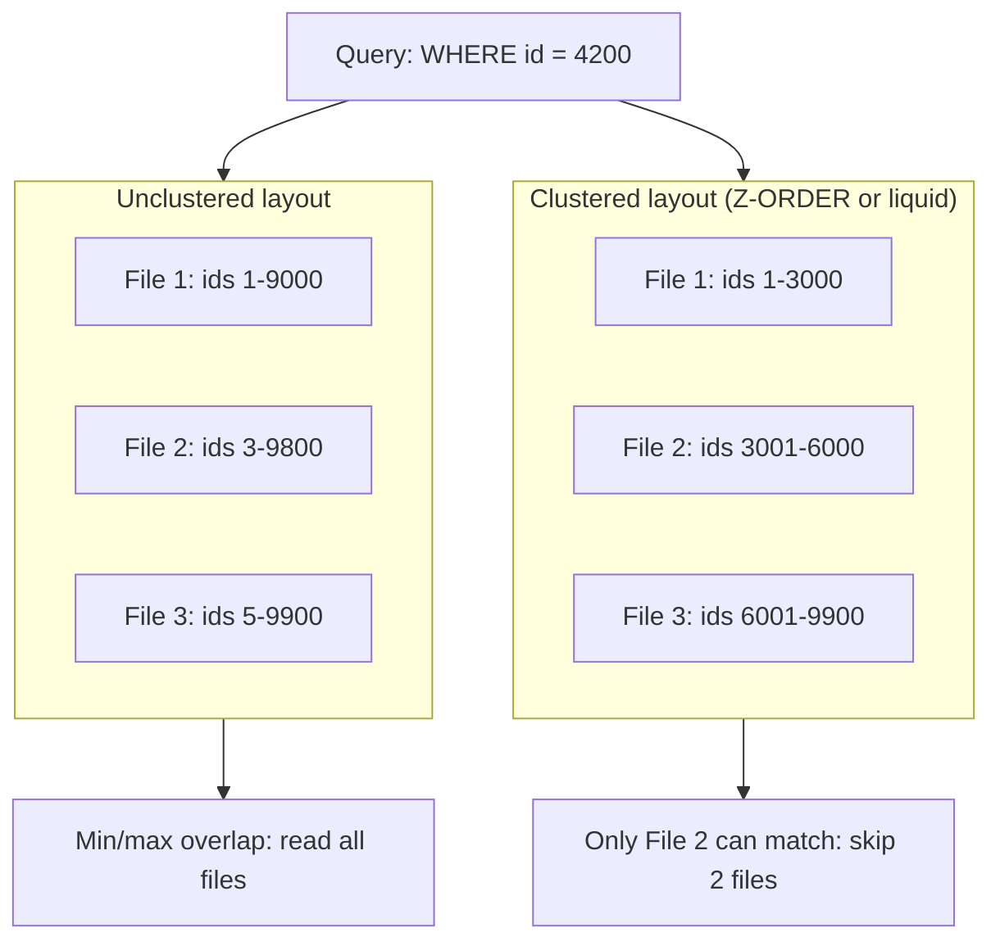
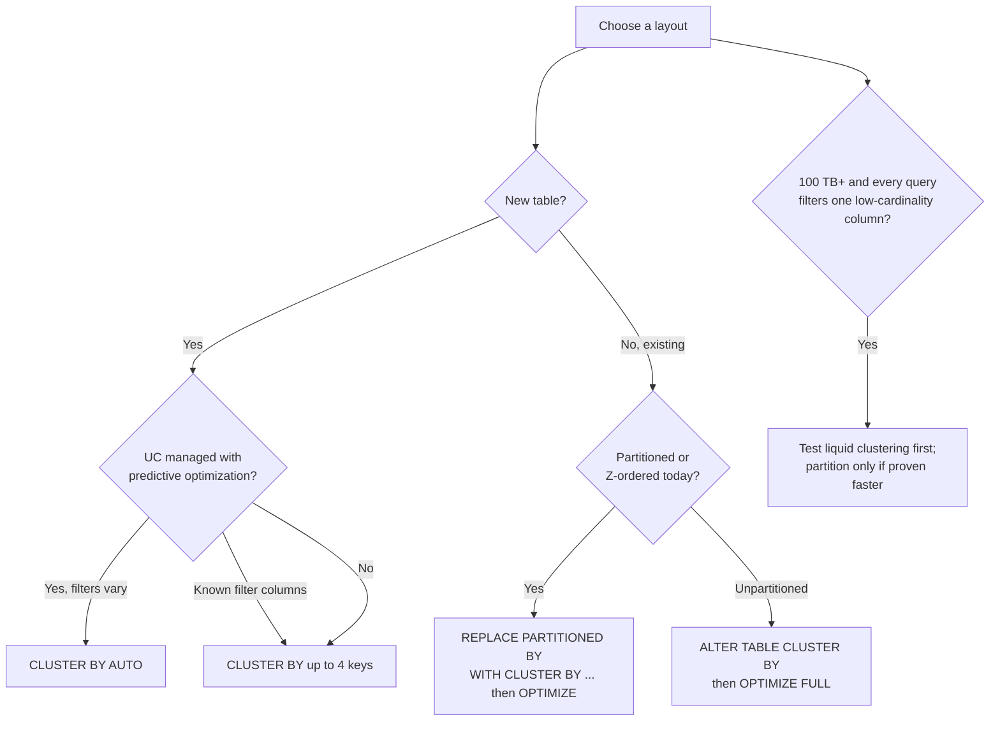

# Data Skipping: Liquid Clustering vs Partitioning and Z-ORDER

## Overview

Every layout technique on Databricks exists to let queries skip files. Hive-style partitioning skips whole directories, Z-ORDER co-locates values inside files so per-file statistics can skip them, and liquid clustering does the same job incrementally with keys you can change. The exam asks you to pick the right one for a given table size and query pattern; the docs' current answer for new tables is liquid clustering.

> [!abstract]
>
> - **Data skipping** uses per-file min/max/null-count/record-count statistics collected on write
> - **Partitioning** = one directory per value; only for low/known-cardinality columns and very large tables (Databricks: don't partition tables under 1 TB)
> - **Z-ORDER** = multi-column co-location applied by `OPTIMIZE ... ZORDER BY`; manual, not maintained by predictive optimization, not combinable with liquid clustering
> - **Liquid clustering** (`CLUSTER BY` / `CLUSTER BY AUTO`) replaces both, works for low and high cardinality, clusters incrementally, and lets keys change without a rewrite

> [!tip] What the Exam Tests
>
> - Compare Liquid Clustering vs partitioning/ZORDER for a given table size and query pattern
> - Know Databricks' size guidance (< 1 TB, 1–100 TB, ≥ 100 TB) and that liquid clustering is recommended for all new tables
> - Know how to migrate a partitioned or Z-ordered table to liquid clustering and how to verify skipping

---

## Data Skipping Fundamentals



Data skipping statistics are collected **automatically when you write** to a Delta Lake or managed Iceberg table. At query time Databricks uses per-file **minimum and maximum values, null counts, and total records** to skip files that can't match the filter. Layout techniques make those min/max ranges narrow; without them, every file's range overlaps the filter value.

### Which Columns Have Statistics

| Table type | Default statistics columns |
| :--- | :--- |
| UC external tables | First 32 columns of the schema |
| UC managed tables with predictive optimization | First 32 columns, plus additional columns that predictive optimization selects because they are frequently used in filters |

If you aren't using predictive optimization, change the defaults with table properties:

```sql
-- Number of leading columns to collect stats on (depends on column order)
ALTER TABLE main.sales.orders SET TBLPROPERTIES ('delta.dataSkippingNumIndexedCols' = '40');

-- Explicit list (DBR 13.3 LTS+); supersedes dataSkippingNumIndexedCols
ALTER TABLE main.sales.orders SET TBLPROPERTIES ('delta.dataSkippingStatsColumns' = 'customer_id, order_date, region');

-- Changing the properties only affects future writes; recompute for existing data (DBR 14.3 LTS+)
ANALYZE TABLE main.sales.orders COMPUTE DELTA STATISTICS;
```

- Statistics aren't used for columns outside the current statistics column list.
- Long strings are truncated during statistics collection; consider excluding long string columns that are rarely filtered.
- Z-ORDER and liquid clustering keys **must** be columns with statistics; Z-ordering a column without stats is ineffective and wastes compute.

---

## Hive-Style Partitioning

Partitioning splits a table into one directory per partition-column value, so filters on that column prune whole directories.

```sql
CREATE TABLE main.sales.orders_by_date (
  order_id BIGINT, customer_id BIGINT, amount DECIMAL(10, 2), order_date DATE
) PARTITIONED BY (order_date);
```

What the docs say about it today:

- Most tables **under 100 TB don't need partitioning**. Unpartitioned Delta tables automatically use **ingestion time clustering**, which gives partitioning-like performance for datetime filters with no tuning.
- Partitioning works well only for **low or known cardinality** fields (dates, physical locations), not high-cardinality fields such as timestamps.
- Each partition should hold **at least 1 GB**; fewer, larger partitions tend to outperform many small ones.
- A bad partitioning choice can need a **full rewrite** to fix, which is slow and expensive for large tables.
- Partition columns must be top-level columns; you can't partition by struct fields or complex types (liquid clustering can cluster on struct fields).

### Size Guidance from the Docs

| Table size | Guidance |
| :--- | :--- |
| Less than 1 TB | Don't partition |
| More than 1 TB to 100 TB | Use liquid clustering instead of partitioning; partitioning more often hurts than helps |
| 100 TB or more | Partitioning might improve performance, but use liquid clustering first and verify any gain |

---

## Z-ORDER

Z-ordering co-locates related values in the same set of files so data-skipping statistics become selective. It is applied by `OPTIMIZE`:

```sql
OPTIMIZE main.sales.events ZORDER BY (event_type);

-- Multiple columns (effectiveness drops with each extra column)
OPTIMIZE main.sales.events ZORDER BY (user_id, event_type);

-- Limit the rewrite with a partition predicate (WHERE accepts partition columns only)
OPTIMIZE main.sales.events
WHERE event_date >= current_timestamp() - INTERVAL 1 day
ZORDER BY (event_type);
```

Rules to know:

- Use `ZORDER BY` on columns that are commonly used in predicates and have **high cardinality**.
- You **cannot Z-order on partition columns**, and Z-order can only co-locate data **within a partition** (files are never combined across partition boundaries).
- Z-ordering is **not idempotent** but aims to be incremental; re-running is not guaranteed to get faster. If no new data was added to a partition that was just Z-ordered, Z-ordering it again has no effect.
- It balances files by number of rows, not bytes, so `OPTIMIZE` task times and file sizes can be skewed when recent rows are much wider.
- Data written after the last `OPTIMIZE ... ZORDER BY` is not Z-ordered until the next run, so Z-order needs a scheduled job.
- **Predictive optimization never runs `ZORDER`** and ignores Z-ordered files.
- You **can't use `ZORDER` on a liquid-clustered table**.

---

## Liquid Clustering in Brief

Liquid clustering replaces partitioning and Z-ORDER. It is recommended for all new tables, including streaming tables and materialized views. Full details (syntax, thresholds, `CLUSTER BY AUTO`, deletion vectors) are in [Managed Tables, Predictive Optimization, and Automatic Clustering](./01-managed-tables-predictive-optimization.md).

```sql
CREATE TABLE main.sales.orders (
  order_id BIGINT, customer_id BIGINT, order_date DATE, amount DECIMAL(10, 2)
) CLUSTER BY (customer_id, order_date);

ALTER TABLE main.sales.orders CLUSTER BY AUTO;   -- UC managed + predictive optimization
OPTIMIZE main.sales.orders;                       -- incremental clustering
OPTIMIZE main.sales.orders FULL;                  -- recluster everything after a key change
```

- Up to **four** keys; for tables under about 10 TB, more keys can slow single-column filters (four keys is worse than two).
- Keys can change any time with `ALTER TABLE ... CLUSTER BY`; existing data is not rewritten until `OPTIMIZE ... FULL`.
- Works for both low- and high-cardinality columns and avoids fixed partition boundaries and the small-file issues of static partitioning.
- Liquid clustering tables allow **row-level concurrency** (with deletion vectors and row tracking), so concurrent writes conflict less.

---

## Comparison: Liquid Clustering vs Partitioning vs Z-ORDER

| Aspect | Hive-style partitioning | Z-ORDER | Liquid clustering |
| :--- | :--- | :--- | :--- |
| Mechanism | Separate directory per value; prunes directories | Co-locates values inside files during `OPTIMIZE` | Organizes files by clustering keys on write (above size thresholds) and during `OPTIMIZE` |
| Column cardinality | Low or known only (date, region) | High (ids, timestamps) | Low **and** high |
| Columns | One or a few low-cardinality columns | Several, but effectiveness drops with each extra column | Up to 4 keys |
| Changing the columns | Full table rewrite | Re-run `OPTIMIZE ... ZORDER BY` with new columns (rewrite) | `ALTER TABLE ... CLUSTER BY`; no immediate rewrite |
| New data | Lands in the right partition | Unordered until the next `ZORDER` run | Clustered incrementally (on write or next `OPTIMIZE`) |
| Maintained by predictive optimization | Compaction within partitions only | **No** (`ZORDER` never run) | **Yes** (incremental clustering; `AUTO` also picks keys) |
| Automatic key selection | No | No | `CLUSTER BY AUTO` (UC managed tables) |
| Skewed data | Partition key can give too many or too few partitions | Balances rows (not bytes) per file; `OPTIMIZE` tasks can skew | Recommended for heavy skew |
| Combine with the others | Can combine with Z-ORDER | Can combine with partitioning | **Not compatible** with partitioning or `ZORDER` |
| Docs recommendation | Only for 100 TB+ tables, after testing liquid clustering | Use liquid clustering instead for new tables | **Recommended for all new tables** |

---

## Decision by Table Size and Query Pattern

| Table size | Query pattern | Choose |
| :--- | :--- | :--- |
| Under 1 TB | Any | **No partitioning.** Liquid clustering (or `CLUSTER BY AUTO`) on the filter columns, or rely on ingestion time clustering for time-ordered appends |
| Under ~10 TB | Mostly single-column filters | Liquid clustering with **few keys** (one or two) |
| 1–100 TB | Filters on high-cardinality columns (`customer_id`, `device_id`) | **Liquid clustering** on those columns |
| 1–100 TB | Filters on a date plus an id | Liquid clustering on both (not partition-by-date + Z-ORDER) |
| Any (UC managed) | Mixed, changing, or unknown filter patterns | **`CLUSTER BY AUTO`** with predictive optimization |
| Any | Heavy skew, or a partition key would create too many or too few partitions | Liquid clustering |
| Any | Many concurrent writers | Liquid clustering (row-level concurrency) |
| 100 TB+ | Every query filters on a low-cardinality column with ≥ 1 GB per value | Start with liquid clustering; add partitioning only if testing proves it faster |
| Existing partitioned / Z-ordered table | Poor skipping, over-partitioning, or rising `OPTIMIZE` cost | Convert with `REPLACE PARTITIONED BY WITH CLUSTER BY` |
| Table read by clients that can't handle writer v7 / reader v3 | Any | Partitioning / Z-ORDER may have to stay until the clients are upgraded |



---

## Migrating to Liquid Clustering

### Convert a Partitioned Table In Place (Recommended)

Databricks recommends the `REPLACE PARTITIONED BY WITH CLUSTER BY` conversion (Databricks Runtime 18.1 and above; external and managed Delta tables). It minimizes reader and writer downtime; afterwards the table supports reads from DBR 13.3 LTS and above.

```sql
-- Keep the partition columns as clustering keys
ALTER TABLE main.sales.orders_by_date REPLACE PARTITIONED BY WITH CLUSTER BY;

-- Cluster on different/additional columns, then run OPTIMIZE to benefit
ALTER TABLE main.sales.orders_by_date REPLACE PARTITIONED BY WITH CLUSTER BY (order_date, customer_id);
OPTIMIZE main.sales.orders_by_date;

-- Start from the partition columns and let predictive optimization adapt (UC managed only)
ALTER TABLE main.sales.orders_by_date REPLACE PARTITIONED BY WITH CLUSTER BY AUTO;
```

- On conversion, the old partition columns become **hierarchical clustering keys** (prioritized ahead of the other keys).
- Verify with `DESCRIBE EXTENDED` (new clustering columns) and `DESCRIBE HISTORY` (REORG, UPGRADE PROTOCOL, and REPLACE PARTITIONED BY WITH CLUSTER BY operations).
- **Not supported** for streaming tables and materialized views created in Lakeflow Pipelines: change the pipeline definition from `PARTITIONED BY` to `CLUSTER BY` instead.
- Converting a table partitioned by a **timestamp** column needs `spark.databricks.delta.liquidConversion.statsGeneration.enabled = false` and then `ANALYZE TABLE ... COMPUTE DELTA STATISTICS`.

### Picking Keys When You Migrate

| Current technique | Clustering keys to use |
| :--- | :--- |
| Hive-style partitioning | The partition columns |
| Z-order indexing | The `ZORDER BY` columns |
| Partitioning + Z-order | Both the partition columns and the `ZORDER BY` columns |
| Generated column to reduce cardinality (e.g. `date` from a timestamp) | The original column; don't create the generated column |

### Unpartitioned, Z-Ordered Table

```sql
ALTER TABLE main.sales.events CLUSTER BY (user_id, event_type);  -- former ZORDER BY columns
OPTIMIZE main.sales.events FULL;                                 -- recluster existing data once
```

A CTAS into a new `CLUSTER BY` table also works, but it rewrites the whole table and doesn't keep all table metadata.

---

## Bloom Filter Indexes (Deprecated)

> [!note] Platform update (Oct 2026)
> Bloom filter indexes are **deprecated**: Databricks says not to use them and to remove existing ones. Predictive I/O (Photon) performs file skipping on all columns automatically and fully supersedes them; liquid clustering improves skipping for frequently filtered columns. Source: [Bloom filter indexes (deprecated)](https://docs.databricks.com/aws/en/optimizations/bloom-filters)

```sql
-- Remove an existing Bloom filter index, then VACUUM to clean up the _delta_index files
DROP BLOOMFILTER INDEX ON TABLE main.sales.orders;
```

---

## Verifying That Skipping Works

- **Query profile / query history**: the query details panel shows the percentage of data pruned during scanning; see [Query Profile](./05-query-profiler.md).
- **`system.query.history`**: compare `pruned_files` vs `read_files` and `pruned_files_bytes` vs `read_files_bytes`.
- **Performance insights** flag layout problems: `COVERAGE_FILTER_KEYS_CLUSTERING` / `COVERAGE_FILTER_KEYS_PARTITIONING` (table clustered/partitioned on keys the query doesn't filter on), `COVERAGE_STATS_DELTA` (missing statistics for the filter columns), `DATA_FILE_SIZE` (many small files), and `MANUAL_DATA_LAYOUT` (manually optimized table that could use automatic liquid clustering).
- **`EXPLAIN`**: `PartitionFilters` shows partition pruning; see [EXPLAIN Plans & AQE](./07-explain-plans-aqe.md).

```sql
SELECT statement_id, read_files, pruned_files,
       ROUND(pruned_files / NULLIF(read_files + pruned_files, 0) * 100, 1) AS pct_files_pruned
FROM system.query.history
WHERE statement_text ILIKE '%main.sales.orders%'
  AND start_time >= current_timestamp() - INTERVAL 1 DAY
ORDER BY start_time DESC;
```

---

## Use Cases

- **200 GB dimension table partitioned by `country`**: under 1 TB, so remove partitioning; liquid clustering on `country` (or `CLUSTER BY AUTO`) gives the same skipping without small files.
- **20 TB event table filtered by `user_id` and `event_date`**: liquid clustering on both columns instead of partition-by-date plus nightly `ZORDER BY (user_id)`; predictive optimization keeps it clustered.
- **Shared gold table whose filters change every quarter**: `CLUSTER BY AUTO` on the managed table instead of re-planning partitions.
- **Legacy 50 TB table partitioned by `(year, month, day)` and Z-ordered by `customer_id`**: `REPLACE PARTITIONED BY WITH CLUSTER BY (day, customer_id)` (or with the partition and Z-order columns), then `OPTIMIZE`.

## Common Issues & Errors

### Z-ORDER Stops Paying Off

**Cause:** new files arrive unordered between runs, the filter columns don't match the Z-order columns, or too many columns are listed.

**Fix:** move to liquid clustering using the `ZORDER BY` columns as keys; predictive optimization will then cluster new data incrementally.

### `ZORDER` Fails on a Clustered Table

**Cause:** liquid clustering is not compatible with `ZORDER` (or partitioning).

**Fix:** use `OPTIMIZE` without `ZORDER BY`, or change keys with `ALTER TABLE ... CLUSTER BY`.

### Thousands of Tiny Partitions

**Cause:** partitioned on a high-cardinality column, or a table far below 1 TB.

**Fix:** convert with `REPLACE PARTITIONED BY WITH CLUSTER BY`; partitions should hold at least 1 GB each.

### Filters on a Column Still Scan Everything

**Cause:** the column has no statistics (beyond the first 32 columns), or the filter wraps the column in a type conversion.

**Fix:** add it with `delta.dataSkippingStatsColumns` and `ANALYZE TABLE ... COMPUTE DELTA STATISTICS`, or enable predictive optimization on a managed table; check the `COVERAGE_STATS_DELTA` insight.

### Old Data Not Clustered After Changing Keys

**Cause:** key changes don't rewrite existing data; `OPTIMIZE` is incremental.

**Fix:** run `OPTIMIZE <table> FULL`.

## Exam Tips

> [!tip]
>
> - **New table → liquid clustering** (Databricks recommends it for all new tables, including streaming tables and materialized views). Unknown or changing filters on a UC managed table → `CLUSTER BY AUTO`.
> - **Size rules:** < 1 TB don't partition; 1–100 TB use liquid clustering instead; ≥ 100 TB partitioning *might* help but test liquid clustering first; ≥ 1 GB per partition.
> - **Partitioning = low/known cardinality; Z-ORDER = high cardinality; liquid = both.**
> - **Liquid clustering can't be combined with partitioning or `ZORDER`**; predictive optimization never runs `ZORDER`.
> - **Changing layout columns:** partitioning needs a rewrite; Z-order needs a new `OPTIMIZE ... ZORDER BY`; liquid clustering just needs `ALTER TABLE ... CLUSTER BY` (+ `OPTIMIZE FULL` for old data).
> - **Migration:** `ALTER TABLE ... REPLACE PARTITIONED BY WITH CLUSTER BY`; use partition + Z-order columns as keys.
> - Bloom filter indexes are deprecated; don't pick them as the modern answer.

## Key Takeaways

- **Data skipping** relies on per-file min/max/null/record statistics, collected on write for the first 32 columns by default (managed tables with predictive optimization add frequently filtered columns).
- **Partitioning** suits only very large tables filtered on a low-cardinality column with ≥ 1 GB per partition; tables under 1 TB shouldn't be partitioned, and unpartitioned tables get ingestion time clustering for free.
- **Z-ORDER** co-locates high-cardinality values within files but is manual, not maintained by predictive optimization, works only within partitions, and loses effectiveness with each added column.
- **Liquid clustering** handles low and high cardinality, up to four keys, clusters incrementally, supports row-level concurrency, and lets you change keys without an immediate rewrite.
- **`CLUSTER BY AUTO`** is the low-maintenance choice for UC managed tables with mixed or changing query patterns.
- **Migrate** partitioned or Z-ordered tables with `REPLACE PARTITIONED BY WITH CLUSTER BY`, then verify pruning in the query profile or `system.query.history`.

## Related Topics

- [Managed Tables, Predictive Optimization, and Automatic Clustering](./01-managed-tables-predictive-optimization.md) - liquid clustering, `CLUSTER BY AUTO`, deletion vectors in depth
- [File Sizing and Compaction](./02-file-sizing.md) - `OPTIMIZE` and small files
- [Query Profile](./05-query-profiler.md) - confirm files and bytes pruned
- [EXPLAIN Plans & AQE](./07-explain-plans-aqe.md) - `PartitionFilters`, pushed filters
- [Partitioning Strategies](../09-data-modeling/03-partitioning-strategies.md) - partition design in data modeling
- [Delta Lake Fundamentals](../09-data-modeling/02-delta-lake-fundamentals.md) - transaction log and file statistics

## Official Documentation

- [Use liquid clustering for tables](https://docs.databricks.com/aws/en/delta/clustering)
- [When to partition tables on Databricks](https://docs.databricks.com/aws/en/tables/partitions)
- [Data skipping (statistics and Z-ordering)](https://docs.databricks.com/aws/en/delta/data-skipping)
- [Optimize data file layout (OPTIMIZE)](https://docs.databricks.com/aws/en/delta/optimize)
- [Predictive optimization for Unity Catalog managed tables](https://docs.databricks.com/aws/en/optimizations/predictive-optimization)
- [Bloom filter indexes (deprecated)](https://docs.databricks.com/aws/en/optimizations/bloom-filters)
- [Query performance insights](https://docs.databricks.com/aws/en/sql/user/queries/performance-insights)
- [Query history system table reference](https://docs.databricks.com/aws/en/admin/system-tables/query-history)

---

**[← Previous: File Sizing and Compaction](./02-file-sizing.md) | [↑ Back to Section](./README.md) | [Next: Disk Caching →](./04-disk-caching.md)**
