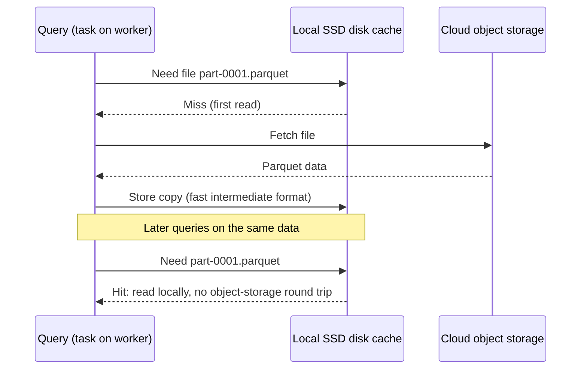
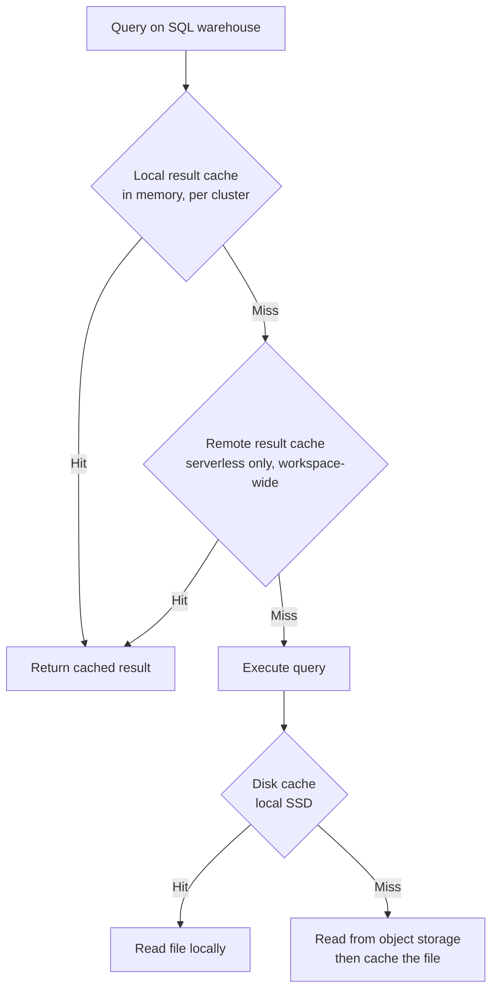

# Disk Caching

## Overview

The exam calls it the **Delta cache**: Databricks keeps local copies of remote Parquet and Delta data files on worker SSDs, so repeated reads of the same data skip the trip to cloud object storage. You also need to know how it differs from the Apache Spark cache (`cache()` / `persist()`), the result caches in Databricks SQL, and what changes on serverless compute.

> [!note] Platform update (Oct 2026)
> The Delta cache is now called the **disk cache** (it was also called the DBIO cache). It is a proprietary Databricks feature, not part of the Delta Lake protocol; the rename avoids that confusion. Source: [Optimize performance with caching on Databricks](https://docs.databricks.com/aws/en/optimizations/disk-cache)

> [!abstract]
>
> - **Disk (Delta) cache**: automatic, local-SSD copies of Parquet data files (including Delta tables) in a fast intermediate format, filled on first read and kept consistent automatically
> - **Spark cache**: manual `df.cache()` / `persist()` of any DataFrame or RDD, stored as blocks according to the storage level
> - **Databricks SQL** adds a UI cache, local and remote **result caches**, and the disk cache on warehouse nodes
> - **Serverless**: disk-cache Spark configs aren't settable; DataFrame caching on serverless (Public Preview, Oct 23, 2026) stores a session-private snapshot

> [!tip] What the Exam Tests
>
> - Understand how caching (Delta cache) improves query performance for repeated reads of the same data
> - Choose between the disk cache and the Spark cache for a given workload
> - Recognise when caching does not help (single reads, cold starts, frequently changing data, wrong instance type)

---

## How the Disk Cache (Delta Cache) Works

Reading from cloud object storage is slower than reading from local disk. Without caching, every query that reads the same Parquet files fetches them from object storage again.

When a node fetches a Parquet data file from remote storage, it **automatically stores a copy on its local storage in a fast intermediate format**. Later reads of the same data run locally and are significantly faster. The cache works for all Parquet data files, including Delta Lake tables.



### Key Properties

| Property | Behaviour |
| :--- | :--- |
| What is cached | Parquet data files (Delta Lake tables included) read from S3, ABFS, and other file systems |
| When | Automatically, on the first read (if the cache is enabled) |
| Where | Local files on the worker node (local SSD) |
| Consistency | Detects files that are created, deleted, modified, or overwritten and updates itself; stale entries are invalidated and evicted automatically, no manual invalidation |
| Eviction | Automatically in LRU fashion or on any file change; cleared when the cluster restarts |
| Size | By default uses at most half of the space on the workers' local SSDs |
| Availability | Enabled by default on worker instance types that support it (workers with SSD volumes) |

> [!important]
> The disk cache stores **files**, not query results. Any query that reads the same files benefits, even if its filters, joins, or aggregations are different from the query that first loaded them.

---

## Enabling and Configuring the Disk Cache

The recommended (and easiest) setup is to **choose a worker instance type with SSD volumes**; those workers are enabled and configured for disk caching automatically.

```python
# Check and toggle at runtime (classic compute)
spark.conf.get("spark.databricks.io.cache.enabled")
spark.conf.set("spark.databricks.io.cache.enabled", "true")
```

Disabling the cache does **not** drop data already on local storage. It stops queries from adding data to the cache and from reading from it.

To control how much local storage it uses, set these Spark configurations **when you create the cluster**:

| Setting | Meaning |
| :--- | :--- |
| `spark.databricks.io.cache.maxDiskUsage` | Disk space per node reserved for cached data, in bytes |
| `spark.databricks.io.cache.maxMetaDataCache` | Disk space per node reserved for cached metadata, in bytes |
| `spark.databricks.io.cache.compression.enabled` | Whether cached data is stored compressed |

```text
spark.databricks.io.cache.maxDiskUsage 50g
spark.databricks.io.cache.maxMetaDataCache 1g
spark.databricks.io.cache.compression.enabled false
```

> [!note]
> In SQL warehouses and Databricks Runtime 14.2 and above, the `CACHE SELECT` command (used to pre-warm the disk cache) is **ignored**; an enhanced disk caching algorithm is used instead.

When a worker is decommissioned (for example, when autoscaling removes it), the data cached on that worker is lost and has to be reread from the source, so heavy autoscaling makes the cache less stable.

---

## Disk Cache vs Spark Cache

| Feature | Disk cache (Delta cache) | Apache Spark cache |
| :--- | :--- | :--- |
| Stored as | Local files on a worker node | In-memory blocks, depending on storage level |
| Applied to | Any Parquet table on S3, ABFS, and other file systems | Any DataFrame or RDD |
| Triggered | Automatically, on the first read (if enabled) | Manually; requires code changes (`df.cache()`, `df.persist()`) |
| Evaluated | Lazily | Lazily (on classic compute) |
| Availability | Enabled by default on certain node types; toggle with config flags | Always available |
| Evicted | Automatically (LRU) or on any file change; manually by restarting the cluster | Automatically (LRU); manually with `unpersist()` |
| Sees new data | Yes, invalidates changed files automatically | Varies: refreshed in some cases, a stale snapshot in others |

```python
# Spark cache: you choose what to cache, typically an expensive intermediate result
enriched = (spark.table("main.sales.orders")
    .join(spark.table("main.sales.customers"), "customer_id")
    .filter("order_date >= '2026-01-01'"))

enriched.cache()          # lazy on classic compute: filled by the first action
enriched.count()          # materializes the cache
by_region = enriched.groupBy("region").sum("amount")
enriched.unpersist()      # release when done
```

### Which One to Use

| Scenario | Choose |
| :--- | :--- |
| Dashboards or analysts repeatedly querying the same Delta tables | **Disk cache** (automatic; nothing to code) |
| Iterative queries on the same tables in a notebook | **Disk cache** |
| An expensive join/aggregation result reused several times in one job or session | **Spark cache** (`df.cache()`) |
| Data must always reflect the latest table version | Disk cache (consistent); avoid relying on Spark cache |
| Non-Parquet intermediate data (any DataFrame) | Spark cache |

Databricks recommends using automatic disk caching, and using the disk cache instead of the Spark cache for repeated reads of Parquet and Delta Lake data.

---

## Caching Layers in Databricks SQL

Databricks SQL warehouses stack several caches. A query first checks result caches; only if there is no cached result does it execute, and execution reads files through the disk cache.



| Cache | Scope and storage | Lifetime | Invalidation |
| :--- | :--- | :--- | :--- |
| Databricks SQL UI cache | Per user; query results and SQL editor visualizations (not AI/BI dashboards) | At most 7 days | When underlying tables are updated; re-running replaces the old result |
| Local result cache | Per cluster, in memory | Cluster lifetime or until full; 24 hours from cache entry | Table updates; cleared when the warehouse stops or restarts |
| Remote result cache | **Serverless only**; persisted as workspace system data, shared by all warehouses in the workspace | 24 hours from cache entry; survives warehouse stop/restart | Table updates; needs a running warehouse to read; for ODBC/JDBC clients and the SQL Statement API |
| Disk cache | Local SSD on warehouse nodes; data files, not results | Same lifecycle as the local result cache (cleared on stop/restart) | Detects changed data files automatically |

```sql
-- Turn off result caching for testing or benchmarking only
SET use_cached_result = false;
```

Two consequences to remember:

- A **query profile is not available** for a query served from the query cache. To get one, make a trivial change to the query (for example, change or remove the `LIMIT`).
- `system.query.history` records cache behaviour: `from_result_cache` (result came from the cache), `cache_origin_statement_id`, and `read_io_cache_percent` (share of persistent data bytes read from the IO cache).

```sql
-- How much of each warehouse's reading came from cache in the last day
SELECT compute.warehouse_id,
       COUNT(*) AS statements,
       AVG(CASE WHEN from_result_cache THEN 1 ELSE 0 END) AS result_cache_hit_ratio,
       AVG(read_io_cache_percent) AS avg_io_cache_percent
FROM system.query.history
WHERE start_time >= current_timestamp() - INTERVAL 1 DAY
GROUP BY ALL;
```

---

## Caching on Serverless Compute

On serverless notebooks and jobs, Databricks manages the compute, and only a short list of Spark properties can be set (such as `spark.sql.shuffle.partitions` and `spark.sql.files.maxPartitionBytes`). The `spark.databricks.io.cache.*` settings are not among them, so you can't configure the disk cache there.

### DataFrame Caching on Serverless (Public Preview)

> [!note] Platform update (Oct 2026)
> DataFrame caching on serverless compute entered Public Preview on October 23, 2026. `df.cache()` or `df.persist()` reuses an expensive result for the rest of the session. It requires serverless environment version 5 or above, Databricks Connect for Python 18.1.8+ or Scala 18.1.5+, and is enabled by default for most workspaces (admins can disable it from the Previews page). Source: [Databricks platform release notes, October 2026](https://docs.databricks.com/aws/en/release-notes/product/2026/october)

| Behaviour | Serverless compute | Classic compute |
| :--- | :--- | :--- |
| Materialization | **Eager**: computed when you call `df.cache()` | Lazy: computed at the first action |
| Cache matching | Only the cached DataFrame and DataFrames derived from it | Any query with the same plan shape |
| Data freshness | Fixed snapshot taken at `df.cache()` | Varies: refreshed in some cases, snapshot in others |
| Sharing scope | Private to your session | Shared across sessions on the cluster |
| `df.unpersist()` | Destroys the DataFrame and releases the snapshot | Releases the in-memory cache |
| Storage level | `persist(level)` accepts and ignores any level; `storageLevel` reports `DISK_ONLY` | Honoured |

```python
from pyspark.sql import functions as F

daily = (spark.table("main.sales.orders")
    .filter(F.col("order_date") == "2026-10-15")
    .join(spark.table("main.sales.customers"), "customer_id"))

daily.cache()                     # runs the join now and stores a snapshot

total = daily.agg(F.sum("amount").alias("total")).first()["total"]
by_region = daily.groupBy("region").agg(F.sum("amount").alias("revenue"))   # reads the snapshot

daily.unpersist()                 # daily and DataFrames derived from it are now unusable
```

Other serverless rules:

- The snapshot lasts until the session ends, **at most seven days**; only that session can read it.
- Permission changes, row filters, and column masks applied to source tables **after** caching don't apply to the cached data.
- A new DataFrame that repeats the same query does **not** use the cache; derive from the cached DataFrame instead.
- Not available in workspaces with the compliance security profile, or in AWS GovCloud.
- Not supported on serverless (they raise an exception): `CACHE TABLE`, `UNCACHE TABLE`, `CLEAR CACHE`, `REFRESH TABLE`, `spark.catalog.cacheTable()`, `spark.catalog.uncacheTable()`, `spark.catalog.clearCache()`, and `df.checkpoint()`. To reuse a result in SQL, use a session-local temporary table.

---

## When Caching Does Not Help

| Situation | Why caching doesn't pay off | Better lever |
| :--- | :--- | :--- |
| Data read only once (single-pass ETL, one-off backfill) | First read always comes from object storage; the cache only helps the second read | File sizing, data skipping, liquid clustering |
| Cold start: new cluster, restarted cluster, or stopped warehouse | Local caches are empty after a restart | Keep warehouses warm for BI; serverless remote result cache for repeated identical queries |
| Workers without local SSDs | Disk cache isn't enabled by default on those instance types | Choose cache-accelerated (SSD) worker types |
| Data that isn't Parquet | The disk cache applies to Parquet data files | Convert to Delta, or Spark-cache the parsed DataFrame |
| Tables rewritten constantly | Changed files are evicted; result caches invalidate on table updates | Data layout and incremental processing instead |
| Heavy autoscaling churn | Decommissioned workers lose their cached data | Stable cluster size for cache-heavy interactive work |
| Spark-caching a plain table read | Later reads still scan a full copy of the table | Rely on the disk cache; cache only expensive computed results |
| Write-heavy jobs | Caches speed up reads, not writes | Optimized writes, deletion vectors |

---

## Use Cases

- **BI dashboards on a SQL warehouse**: the same gold tables are queried all day. The disk cache keeps the files on local SSD; identical queries hit the result cache; on serverless warehouses the remote result cache survives a warehouse restart.
- **Iterative notebook analysis**: an analyst runs many different queries against the same Delta table on a cluster with SSD workers; after the first query, scans read locally.
- **Reusing an expensive join in one job**: a job joins a large fact table with customers once, then writes three different aggregates. `df.cache()` on the joined DataFrame (or the serverless DataFrame cache) avoids recomputing the join three times.
- **Benchmarking a query change**: set `use_cached_result = false` so the second run actually executes, then compare query profiles.

## Common Issues & Errors

### Cache Doesn't Seem to Help

**Cause:** worker type without local SSD, a cold cluster or warehouse, or data read only once.

**Fix:** pick an SSD-backed worker type; check `read_io_cache_percent` in `system.query.history`; accept that the first read always hits object storage.

### `CACHE SELECT` Has No Effect

**Cause:** in SQL warehouses and DBR 14.2+, `CACHE SELECT` is ignored.

**Fix:** remove it; the enhanced disk caching algorithm fills the cache on read.

### `CACHE TABLE` Fails on Serverless

**Cause:** SQL and catalog cache APIs aren't supported on serverless compute.

**Fix:** use `df.cache()` (serverless DataFrame caching) or a session-local temporary table.

### Stale Results After Writing to the Source Table

**Cause:** a cached DataFrame (Spark cache, or the serverless snapshot) does not reliably pick up new writes; serverless snapshots never do.

**Fix:** rebuild the DataFrame from the source tables after writing; don't use `unpersist()` as a refresh.

### "Query Profile Is Not Available"

**Cause:** the result was served from the query cache.

**Fix:** make a trivial change to the query (such as the `LIMIT`) or `SET use_cached_result = false` while testing.

## Exam Tips

> [!tip]
>
> - **"Repeated reads of the same data are slow" → disk (Delta) cache.** It is automatic on SSD-backed workers and caches Parquet/Delta files locally after the first read.
> - **Disk cache = files on local SSD, automatic, always consistent.** Spark cache = DataFrame blocks, manual (`cache()`/`persist()`), may be stale.
> - **No manual invalidation**: the disk cache detects changed files; result caches invalidate when tables are updated.
> - **SQL warehouse layers**: UI cache (per user, ≤ 7 days), local result cache, remote result cache (serverless only, 24 hours, survives restarts), disk cache.
> - **Serverless**: `CACHE TABLE` and friends throw errors; `df.cache()` creates an eager, session-private snapshot (Public Preview).
> - The cache only helps **reads that repeat**; it doesn't speed up the first scan or writes.

## Key Takeaways

- **Disk cache (formerly Delta cache / DBIO cache)** copies remote Parquet data files, including Delta tables, to local SSD in a fast intermediate format on first read; later reads are local.
- **Enabled by default** on worker types with SSD volumes; uses at most half the local SSD by default; toggled with `spark.databricks.io.cache.enabled` and sized with `maxDiskUsage` / `maxMetaDataCache` at cluster creation.
- **Consistency is automatic**: changed, deleted, or overwritten files are detected and evicted.
- **Spark cache is different**: manual, any DataFrame/RDD, stored per storage level, released with `unpersist()`; Databricks recommends the disk cache for repeated reads of Parquet and Delta data.
- **Databricks SQL** adds result caching: a local in-memory cache per cluster and a serverless-only remote result cache shared across warehouses, both with a 24-hour life cycle.
- **Serverless** doesn't expose disk-cache configs; DataFrame caching on serverless (Public Preview, Oct 2026) is eager, snapshot-based, and session-private.

## Related Topics

- [Managed Tables, Predictive Optimization, and Automatic Clustering](./01-managed-tables-predictive-optimization.md) - reduce what has to be read in the first place
- [File Sizing and Compaction](./02-file-sizing.md) - fewer, right-sized files to scan and cache
- [Query Profile](./05-query-profiler.md) - read IO and cache metrics for a query
- [Spark Tuning](./06-spark-tuning.md) - memory, shuffle, and other runtime settings
- [Photon Diagnostics and Optimization (Part 1)](./08-photon-diagnostics-optimization-part1.md) - Photon and fast repeat access
- [Databricks Compute](../01-developing-code-for-data-processing/09-databricks-compute-part1.md) - choosing instance types and serverless

## Official Documentation

- [Optimize performance with caching on Databricks](https://docs.databricks.com/aws/en/optimizations/disk-cache)
- [Query caching (Databricks SQL)](https://docs.databricks.com/aws/en/sql/user/queries/query-caching)
- [Cache DataFrames on serverless compute](https://docs.databricks.com/aws/en/compute/serverless/dataframe-cache)
- [Serverless compute limitations](https://docs.databricks.com/aws/en/compute/serverless/limitations)
- [Configure Spark properties (serverless supported list)](https://docs.databricks.com/aws/en/spark/conf)
- [Query history system table reference](https://docs.databricks.com/aws/en/admin/system-tables/query-history)
- [Databricks platform release notes, October 2026](https://docs.databricks.com/aws/en/release-notes/product/2026/october)

---

**[← Previous: Data Skipping: Liquid Clustering vs Partitioning and Z-ORDER](./03-zorder-indexing.md) | [↑ Back to Section](./README.md) | [Next: Query Profile →](./05-query-profiler.md)**
