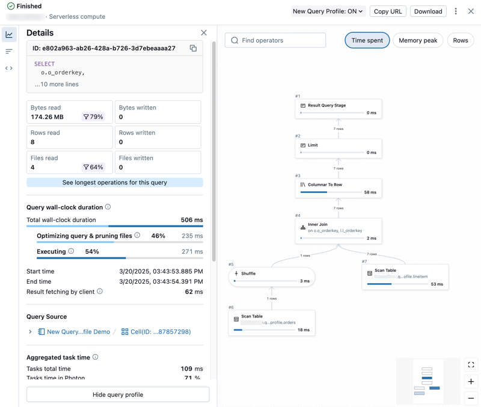
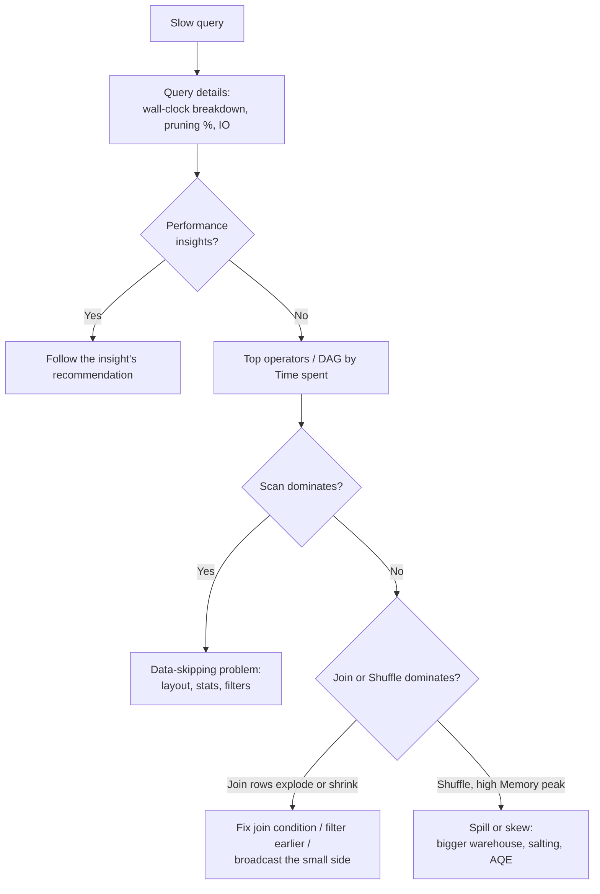

# Query Profile

## Overview

The query profile visualizes how a query actually executed: every operator, its time, rows, and memory, plus Databricks' own performance insights. It is the main tool for finding bottlenecks in queries run on SQL warehouses and serverless compute, and this topic shows how to read it for three exam-tested problems: poor data skipping, the wrong join strategy, and expensive shuffles (with spill and skew).

> [!abstract]
>
> - **Where**: Query History, the SQL editor, notebooks on a SQL warehouse or serverless compute, the Lakeflow pipelines UI, and the Jobs UI; classic clusters use the Spark UI instead
> - **What**: a query details summary (metrics, pruning, wall-clock breakdown, IO) and a detailed DAG of operators with *Time spent*, *Memory peak*, and *Rows*
> - **Performance insights** name the problem for you (`COVERAGE_STATS_DELTA`, `EXPLODING_JOIN`, `DATA_SPILL`, `DATA_SKEW`, ...)
> - The same metrics are queryable in `system.query.history` (`pruned_files`, `read_files`, `spilled_local_bytes`, `shuffle_read_bytes`, ...)

> [!tip] What the Exam Tests
>
> - Use the query profile to identify performance bottlenecks, such as data-skipping inefficiencies, join strategies, and shuffle operations
> - Map a symptom in the profile (low pruning, exploding join, large shuffle, spill, skew) to the right fix
> - Know where the profile is available and when it isn't (queries served from the result cache)

---

## Where to Open the Query Profile

| Starting point | How |
| :--- | :--- |
| **Query History** (sidebar) | Click a query → query details panel → **See query profile** |
| **SQL editor** | During or after execution, click the elapsed-time / rows link at the bottom → query details → **See query profile** |
| **Notebook** attached to a SQL warehouse or **serverless compute** | Click **See performance** under the cell → run history → click a statement |
| **Lakeflow pipelines UI** | **Query History** tab of the pipeline |
| **Jobs UI** | Query details for job runs on SQL warehouses and serverless compute |
| Classic all-purpose / jobs compute | Use the Spark UI (SQL/DataFrame tab); see [Spark UI Debugging](../08-debugging-and-deploying/01-spark-ui-debugging.md) |

- To view a profile you must **own the query** or have at least **CAN MONITOR** on the SQL warehouse that ran it.
- If your workspace is enabled for serverless compute, Query History also contains SQL and Python queries run on **serverless notebooks and jobs**.
- **No profile is available for queries served from the query cache.** Make a trivial change (for example, change or remove the `LIMIT`) to force execution.
- For Databricks SQL queries you can also open the profile in the Spark UI: kebab menu → **Open in Spark UI**.



*Query Profile in the Databricks SQL editor visualizing per-operator execution details.*

---

## Anatomy of the Query Profile

### Query Details Panel (Summary)

| Item | Use it to |
| :--- | :--- |
| Query status | Queued, Running, Finished, Failed, or Cancelled |
| Query metrics | Popular metrics; the **filter icons show the percent of data pruned** during scanning |
| Query wall-clock duration | Total elapsed time, broken down into **scheduling**, **query optimization and file pruning**, and **execution** |
| Aggregated task time | Combined task time across all cores; much longer than wall-clock means good parallelism, shorter means tasks waited for nodes |
| Input/Output (IO) | Data read and written |
| See longest operators | Opens **Top operators**: the most expensive operators |
| Performance insights summary | The most impactful insights, ranked by projected effect on total task duration |

### Detailed Profile

- **Left side** tabs: **Details** (summary metrics), **Top operators**, **Query text**, and **Performance insights** (full detail for each insight).
- **Right side**: the operator **DAG**. Switch the displayed metric between **Time spent**, **Memory peak**, and **Rows**; search for operators or columns; click an operator for detailed metrics and its description.
- Some operations are hidden by default because they're unlikely to be bottlenecks. Use **Enable verbose mode** to see all operations and extra metrics.
- Some non-Photon operations run as a group and share the parent operator's metrics.
- **Photon**: the Execution Details view shows the percentage of task time spent in Photon, and the plan colours **Photon operators purple** and standard operators **grey**.

### Common Operators

| Operator | Meaning |
| :--- | :--- |
| **Scan** | Data read from a data source and output as rows |
| **Filter** | Rows filtered by a criterion such as a `WHERE` clause |
| **Join** | Rows from multiple relations combined into one set |
| **Shuffle** | Data redistributed or repartitioned between executors; **expensive** because it moves data across the cluster |
| **Hash / Sort** | Rows grouped by a key and aggregated (`SUM`, `COUNT`, `MAX`) |
| **Union** | Rows from relations with the same schema concatenated |

### A Reading Workflow



---

## Symptom → Cause → Fix

| What you see in the profile | Likely cause | Fix |
| :--- | :--- | :--- |
| Scan is the top operator; low pruning percentage | Filters don't hit the layout or statistics | Filter on clustering keys; liquid clustering / `CLUSTER BY AUTO`; collect statistics |
| Many small files read (`DATA_FILE_SIZE`) | Small-file problem | Predictive optimization, `OPTIMIZE`, or switch partitioned tables to liquid clustering |
| Join outputs far more rows than it reads (`EXPLODING_JOIN`) | Missing or wrong join condition, duplicate keys | Fix the join condition; reduce input rows |
| Join outputs far fewer rows than it reads (`SELECTIVE_JOIN`) | Filtering happens after the join | Filter before the join |
| Large Shuffle feeding a join of a big and a small table | Shuffled join where a broadcast would do | `BROADCAST` hint, statistics, AQE threshold |
| High *Memory peak* and `DATA_SPILL` | Operator state doesn't fit in memory | Bigger warehouse; fewer rows/columns; smaller wide columns |
| A few tasks far slower than the rest (`DATA_SKEW`) | Uneven key distribution | Key salting or pre-aggregation; AQE skew handling |
| Long scheduling portion, `EXCESSIVE_QUEUE_TIME` | Warehouse at capacity | Increase the warehouse's maximum clusters |
| `COVERAGE_PHOTON` | Operation not supported by Photon | Rewrite to a supported path (for example, avoid unsupported UDFs) |

---

## Identifying Data-Skipping Inefficiencies

Data skipping is efficient when the scan reads only the files that can contain matching rows. In the profile:

1. **Query metrics** in the details panel show the **percent of data pruned** (filter icons).
2. The **wall-clock breakdown** includes *query optimization and file pruning* time.
3. In the DAG, a **Scan** with most of the *Time spent* and *Rows* far above what the query returns points to weak skipping.
4. **Performance insights** name the layout problem:

| Insight | Meaning | Recommendation |
| :--- | :--- | :--- |
| `COVERAGE_FILTER_KEYS_CLUSTERING` | Table is clustered by keys the scan doesn't filter on | Add filters on the clustering keys |
| `COVERAGE_FILTER_KEYS_PARTITIONING` | Table is partitioned by keys the scan doesn't filter on | Add filters on the partition keys |
| `COVERAGE_STATS_DELTA` | Delta skipping statistics missing or incomplete for the filter columns (status *Full*, *Partial*, *Unavailable*, or *Unused* when the filter converts the data type) | Collect Delta statistics |
| `DATA_FILE_SIZE` | Scan reads many small files | Predictive optimization, `OPTIMIZE`, liquid clustering for partitioned tables |
| `MANUAL_DATA_LAYOUT` | Manually optimized table that could benefit from automatic liquid clustering | Convert to managed, enable predictive optimization and automatic clustering |
| `WIDE_PROJECTION` | Query projects all columns | Select only the columns you need |
| `AUTO_LIQUID_CLUSTERING` (applied acceleration) | Query read less data thanks to automatic liquid clustering | None needed |

```sql
-- Stats "Unused": the filter converts the column's type, so min/max can't be used
SELECT * FROM main.sales.orders WHERE CAST(order_date AS STRING) = '2026-10-15';

-- Skippable: compare the column directly
SELECT order_id, amount FROM main.sales.orders WHERE order_date = DATE'2026-10-15';
```

Confirm pruning at scale with `system.query.history`:

| Column | Meaning |
| :--- | :--- |
| `read_files` / `pruned_files` | Files read after pruning / files pruned |
| `read_files_bytes` / `pruned_files_bytes` | Bytes of files read / pruned after partition and file pruning |
| `read_rows`, `produced_rows` | Rows read / rows returned |
| `read_io_cache_percent` | Percent of persistent data bytes read from the IO (disk) cache |

---

## Identifying Join Strategies

| Strategy | How it works | When it fits |
| :--- | :--- | :--- |
| Broadcast hash join | The small side is broadcast to every executor; the large side isn't shuffled | One side is small (below the broadcast threshold or hinted) |
| Shuffled hash join | Both sides are shuffled by the join key; a hash table is built from one side | Both sides large; Photon favours hash joins |
| Sort-merge join | Both sides are shuffled and sorted, then merged | Large equi-joins on the Spark engine (Photon replaces sort-merge joins with hash joins) |
| Nested loop join (broadcast or shuffle-and-replicate) | Every row compared with every row | Non-equi conditions; a sign of a missing equality condition if unexpected |

How to read it in the profile:

- Click the **Join** operator for its details and description. If **Shuffle** operators feed **both** join inputs, it is a shuffled join (hash or sort-merge). If the small input reaches the join without a shuffle of the big side, it is a broadcast join.
- For the exact physical operator names (`BroadcastHashJoin`, `ShuffledHashJoin`, `SortMergeJoin`), use **Open in Spark UI** or `EXPLAIN`; see [EXPLAIN Plans & AQE](./07-explain-plans-aqe.md).
- Compare *Rows* in vs out of the join: `EXPLODING_JOIN` and `SELECTIVE_JOIN` insights flag both extremes; `REDUNDANT_JOIN` flags an outer join that changed nothing.
- `HISTORY_BASED_JOIN_STRATEGY` (applied acceleration) means Databricks chose a broadcast join instead of shuffling, based on measurements from earlier runs of similar queries.
- On Photon, sort-merge joins are replaced with hash joins.

Levers when the strategy is wrong:

```sql
-- Hints (priority if both sides are hinted: BROADCAST > MERGE > SHUFFLE_HASH > SHUFFLE_REPLICATE_NL)
SELECT /*+ BROADCAST(c) */ o.order_id, c.segment
FROM main.sales.orders o
JOIN main.sales.customers c ON o.customer_id = c.customer_id;

SELECT /*+ SHUFFLE_HASH(c) */ * FROM main.sales.orders o JOIN main.sales.customers c USING (customer_id);
SELECT /*+ MERGE(c) */ * FROM main.sales.orders o JOIN main.sales.customers c USING (customer_id);

-- Give the optimizer statistics (COVERAGE_STATS_OPTIMIZER insight)
ANALYZE TABLE main.sales.customers COMPUTE STATISTICS FOR ALL COLUMNS;
```

| Setting | Default | Effect |
| :--- | :--- | :--- |
| `spark.sql.autoBroadcastJoinThreshold` | 10 MB (Apache Spark) | Max table size broadcast at planning time; `-1` disables |
| `spark.databricks.adaptive.autoBroadcastJoinThreshold` | 30MB | AQE threshold for switching a sort-merge join to a broadcast hash join at runtime |

A `BROADCAST` hint broadcasts the hinted side regardless of `autoBroadcastJoinThreshold`, but Databricks doesn't guarantee a hinted strategy if it doesn't support the join type.

---

## Identifying Shuffle, Spill, and Skew

**Shuffle** operators redistribute data between executors and are expensive. In the DAG, sort by *Time spent* and *Memory peak* and look at shuffles feeding joins, aggregations, and windows.

| Signal | Where | Meaning | Fix |
| :--- | :--- | :--- | :--- |
| Large Shuffle operators | DAG, Top operators; `shuffle_read_bytes` in `system.query.history` | Lots of data sent over the network | Broadcast the small side; filter and project earlier; pre-aggregate |
| `DATA_SPILL` | Performance insights; `spilled_local_bytes` | Data didn't fit in memory and was written to disk | Larger warehouse (more memory); fewer rows/columns or smaller wide columns |
| `DATA_SKEW` | Performance insights | Data unevenly distributed across compute | Key salting or pre-aggregation; AQE splits skewed join partitions |
| Aggregated task time ≫ wall-clock | Query details | Many tasks ran in parallel | Usually fine |
| Aggregated task time < wall-clock, long scheduling | Query details; `EXCESSIVE_QUEUE_TIME` | Tasks waited for capacity | More clusters / larger warehouse |

Adaptive query execution is on by default and re-optimizes at each shuffle or broadcast exchange: it can switch sort-merge joins to broadcast hash joins, coalesce small post-shuffle partitions, split skewed partitions, and propagate empty relations. The profile shows the plan that actually ran, unlike SQL `EXPLAIN`, which shows only the initial plan. On classic compute, `spark.sql.shuffle.partitions` defaults to 200 (set it to `auto` for auto-optimized shuffle); on serverless it defaults to `auto`.

---

## Find Bottlenecks Across Many Queries

```sql
-- Worst offenders in the last day: spill, shuffle, and poor pruning
SELECT statement_id,
       executed_by,
       total_duration_ms,
       spilled_local_bytes,
       shuffle_read_bytes,
       read_files,
       pruned_files,
       from_result_cache
FROM system.query.history
WHERE start_time >= current_timestamp() - INTERVAL 1 DAY
  AND execution_status = 'FINISHED'
ORDER BY spilled_local_bytes DESC, shuffle_read_bytes DESC
LIMIT 20;
```

Then open the profile for a `statement_id` from Query History to see which operator caused it.

---

## Query Profile vs EXPLAIN vs Spark UI

| Tool | Shows | Best for |
| :--- | :--- | :--- |
| Query profile | Executed plan with per-operator time, rows, memory; insights; pruning % | SQL warehouses and serverless compute |
| `EXPLAIN` / `df.explain()` | Planned physical plan (SQL `EXPLAIN` doesn't run the query, so no AQE changes) | Checking pruning filters and planned join type before running |
| Spark UI (SQL/DataFrame tab) | Executed plan DAG, stages, tasks, executors | Classic compute; task-level skew and GC |

## Sharing a Profile

- **Share** copies a URL; the recipient needs **CAN MANAGE** on the query.
- Otherwise **Download** the profile as JSON; others **Import query profile (JSON)** from the Query History kebab menu (it loads only into their browser session).

---

## Use Cases

- **Dashboard query got slower after a schema change**: the profile shows the Scan dominating and `COVERAGE_STATS_DELTA` with status *Unavailable*: the new filter column is beyond the first 32 columns. Adding it to `delta.dataSkippingStatsColumns` and recomputing statistics restores skipping.
- **Fact-dimension join taking minutes**: Shuffle operators feed both inputs of the join although the dimension is small; a `BROADCAST` hint (or fresh statistics) removes the shuffle of the fact table.
- **Nightly aggregation on a Small warehouse**: `DATA_SPILL` and high *Memory peak* on the Hash aggregate; scaling the warehouse up removes the spill.
- **Pipeline review**: the Query History tab in the Lakeflow pipelines UI shows a flow flagged `FLOW_FULL_RECOMPUTE`; rewriting the query for incremental support cuts bytes read.

## Common Issues & Errors

### "Query profile is not available"

**Cause:** the result came from the query cache.

**Fix:** change the query trivially (for example the `LIMIT`) or `SET use_cached_result = false` while testing.

### Can't See Another User's Query Profile

**Cause:** you need to own the query or have **CAN MONITOR** on the warehouse.

**Fix:** ask for CAN MONITOR, or have the owner download the profile JSON for you to import.

### Profile Shows Low Pruning Even with Filters

**Cause:** filters on columns that aren't clustering/partition keys, missing statistics, or a type conversion in the filter.

**Fix:** follow `COVERAGE_FILTER_KEYS_*` / `COVERAGE_STATS_DELTA`; consider `CLUSTER BY AUTO`.

### Expected a Broadcast Join but Got a Shuffled Join

**Cause:** the small side's estimated size is above the threshold or statistics are missing.

**Fix:** `ANALYZE TABLE ... COMPUTE STATISTICS`, a `BROADCAST` hint, or rely on AQE's runtime switch (30MB threshold).

### Cartesian-Like Join

**Cause:** missing or non-equi join condition (nested loop join, `EXPLODING_JOIN`).

**Fix:** add the equality condition; filter inputs first.

## Exam Tips

> [!tip]
>
> - **Data-skipping problem** → look at the **pruning %** in query details, a dominant **Scan**, and insights like `COVERAGE_STATS_DELTA` / `COVERAGE_FILTER_KEYS_CLUSTERING`; fix with layout (liquid clustering), statistics, and direct column comparisons.
> - **Join problem** → inspect the **Join** node and whether **Shuffle** operators feed both inputs; broadcast the small side; `EXPLODING_JOIN` = output rows ≫ input rows.
> - **Shuffle problem** → Shuffle operators with high *Time spent* / *Memory peak*; `DATA_SPILL` → bigger warehouse; `DATA_SKEW` → salting or pre-aggregation.
> - **Where**: Query History, SQL editor, notebooks on SQL warehouse/serverless (**See performance**), pipelines and Jobs UI; classic clusters → Spark UI.
> - **Not available for cached results**; needs ownership or **CAN MONITOR** on the warehouse.

## Key Takeaways

- **The query profile shows what actually ran**: an operator DAG with *Time spent*, *Memory peak*, and *Rows*, plus Top operators and Photon coverage.
- **Query details** give the fast triage view: pruning percentage, wall-clock breakdown (scheduling, optimization and file pruning, execution), aggregated task time, and IO.
- **Performance insights** turn common problems into named findings with recommendations, from data layout (`COVERAGE_STATS_DELTA`, `DATA_FILE_SIZE`) to joins (`EXPLODING_JOIN`, `SELECTIVE_JOIN`) to resources (`DATA_SPILL`, `DATA_SKEW`, `EXCESSIVE_QUEUE_TIME`).
- **Join strategy**: Shuffle operators on both join inputs mean a shuffled join; a broadcast join avoids shuffling the large side. Hints, statistics, and AQE (30MB runtime threshold) steer it.
- **Shuffle is the expensive operator**; spill and skew show up as insights and in `system.query.history` (`spilled_local_bytes`, `shuffle_read_bytes`).
- **`system.query.history`** holds the same metrics for every statement (`pruned_files`, `read_files`, `read_io_cache_percent`, `from_result_cache`), so you can find bad queries in bulk.

## Related Topics

- [EXPLAIN Plans & AQE](./07-explain-plans-aqe.md) - physical plan operators and runtime re-optimization
- [Spark Tuning](./06-spark-tuning.md) - shuffle partitions, broadcast, memory
- [Data Skipping: Liquid Clustering vs Partitioning and Z-ORDER](./03-zorder-indexing.md) - fixing poor pruning
- [Managed Tables, Predictive Optimization, and Automatic Clustering](./01-managed-tables-predictive-optimization.md) - automatic layout maintenance
- [Disk Caching](./04-disk-caching.md) - IO cache and result cache
- [Photon Diagnostics and Optimization (Part 1)](./08-photon-diagnostics-optimization-part1.md) - Photon coverage in the profile
- [Spark UI Debugging](../08-debugging-and-deploying/01-spark-ui-debugging.md) - classic-compute equivalent
- [System Tables](../04-monitoring-and-alerting/01-system-tables.md) - `system.query.history` and others

## Official Documentation

- [Query profile](https://docs.databricks.com/aws/en/sql/user/queries/query-profile)
- [Query performance insights](https://docs.databricks.com/aws/en/sql/user/queries/performance-insights)
- [Query history](https://docs.databricks.com/aws/en/sql/user/queries/query-history)
- [Query history system table reference](https://docs.databricks.com/aws/en/admin/system-tables/query-history)
- [Adaptive query execution](https://docs.databricks.com/aws/en/optimizations/aqe)
- [Hints (join and partitioning hints)](https://docs.databricks.com/aws/en/sql/language-manual/sql-ref-syntax-qry-select-hints)
- [What is Photon?](https://docs.databricks.com/aws/en/compute/photon)
- [Apache Spark SQL performance tuning (broadcast threshold)](https://spark.apache.org/docs/latest/sql-performance-tuning.html)

---

**[← Previous: Disk Caching](./04-disk-caching.md) | [↑ Back to Section](./README.md) | [Next: Spark Tuning →](./06-spark-tuning.md)**
