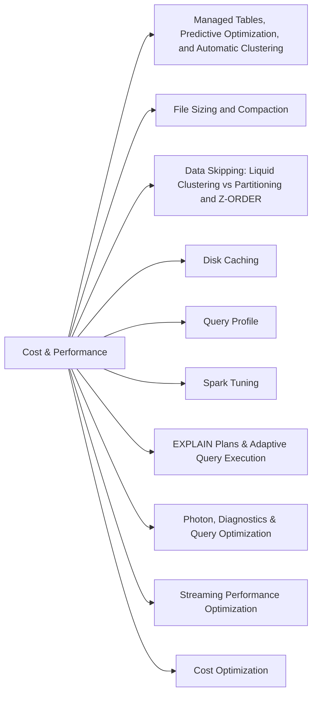

# Section 5: Cost & Performance Optimization (15 % of Exam)

Making tables and queries cheaper and faster: Unity Catalog managed tables with Predictive Optimization, Liquid Clustering and `CLUSTER BY AUTO`, deletion vectors, file sizing, the disk (Delta) cache, Change Data Feed for incremental downstream work, the query profile, and Spark tuning. Up from 13 % to 15 % in the Oct 9, 2026 guide.

## Topics Overview

## Section Contents

| File | Topic | Priority |
| :--- | :--- | :--- |
| [01-managed-tables-predictive-optimization.md](./01-managed-tables-predictive-optimization.md) | UC managed tables, Predictive Optimization, Liquid Clustering, `CLUSTER BY AUTO`, deletion vectors | High |
| [02-file-sizing.md](./02-file-sizing.md) | Small-file problem, OPTIMIZE, auto compaction, optimized writes | Medium |
| [03-zorder-indexing.md](./03-zorder-indexing.md) | Data skipping: Liquid Clustering vs partitioning and Z-ORDER by table size and query pattern | High |
| [04-disk-caching.md](./04-disk-caching.md) | Disk cache (Delta cache) vs Spark cache; SQL warehouse caching | High |
| [05-query-profiler.md](./05-query-profiler.md) | Query profile: pruning, join strategies, shuffle and spill | High |
| [06-spark-tuning.md](./06-spark-tuning.md) | Shuffle partitions, AQE, join optimization, memory | Medium |
| [07-explain-plans-aqe.md](./07-explain-plans-aqe.md) | Reading EXPLAIN plans; Adaptive Query Execution | Medium |
| [08-photon-diagnostics-optimization-part1.md](./08-photon-diagnostics-optimization-part1.md) | Photon, memory and spill diagnostics | Medium |
| [08-photon-diagnostics-optimization-part2.md](./08-photon-diagnostics-optimization-part2.md) | Query optimization strategies | Medium |
| [09-streaming-optimization.md](./09-streaming-optimization.md) | Trigger intervals, state, checkpoint and source tuning | Medium |
| [10-cost-optimization.md](./10-cost-optimization.md) | Compute cost levers: job vs all-purpose, spot, autoscaling, pools, serverless, SQL warehouses | Medium |

## Exam Skill Coverage

Every skill bullet in Section 5 of the Oct 9, 2026 exam guide, with the files that cover it.

| Exam guide skill | Where it is covered |
| :--- | :--- |
| Explain how Unity Catalog managed tables, Predictive Optimization, and Liquid Clustering reduce operational and maintenance overhead for a given workload. | [01-managed-tables-predictive-optimization.md](./01-managed-tables-predictive-optimization.md) |
| Choose the appropriate Delta optimization technique (deletion vectors, Liquid Clustering, CLUSTER BY AUTO) for a given table access pattern. | [01-managed-tables-predictive-optimization.md](./01-managed-tables-predictive-optimization.md), [03-zorder-indexing.md](./03-zorder-indexing.md) |
| Understand how caching (Delta cache) improves query performance for repeated reads of the same data. | [04-disk-caching.md](./04-disk-caching.md) |
| Apply Change Data Feed (CDF) to expose row-level changes (updates/deletes) for efficient incremental downstream processing. | [04-change-data-capture-part1.md](../02-data-ingestion-and-acquisition/04-change-data-capture-part1.md) |
| Use the query profile to identify performance bottlenecks, such as data-skipping inefficiencies, join strategies, and shuffle operations. | [05-query-profiler.md](./05-query-profiler.md), [07-explain-plans-aqe.md](./07-explain-plans-aqe.md) |
| Compare Liquid Clustering vs partitioning/ZORDER for a given table size and query pattern. | [03-zorder-indexing.md](./03-zorder-indexing.md), [03-partitioning-strategies.md](../09-data-modeling/03-partitioning-strategies.md) |

## Key Concepts to Master

| Concept | Why it matters |
| :--- | :--- |
| **Predictive Optimization** | Databricks runs OPTIMIZE, VACUUM and statistics collection on UC managed tables automatically |
| **Liquid Clustering / `CLUSTER BY AUTO`** | Incremental, changeable clustering keys; with AUTO, Databricks picks the keys from the query workload |
| **Deletion vectors** | Mark deleted / updated rows without rewriting whole files — cuts write amplification from frequent small MERGEs |
| **Disk cache** | Local-SSD copies of remote Parquet / Delta files that speed up repeated reads |
| **Change Data Feed** | Row-level inserts / updates / deletes readable with `table_changes` or `readChangeFeed` for incremental downstream jobs |

## Related Resources

- [Performance optimization cheat sheet (shared)](../../../shared/cheat-sheets/performance-optimization.md)
- [Spark configurations cheat sheet (shared)](../../../shared/cheat-sheets/spark-configurations.md)
- [Delta Lake cheat sheet](../resources/cheat-sheets/delta-lake-quick-ref.md)

---

**[← Previous: Monitoring and Alerting](../04-monitoring-and-alerting/README.md) | [↑ Back to DE Professional](../README.md) | [Next: Ensuring Data Security and Compliance →](../06-ensuring-data-security-and-compliance/README.md)**
