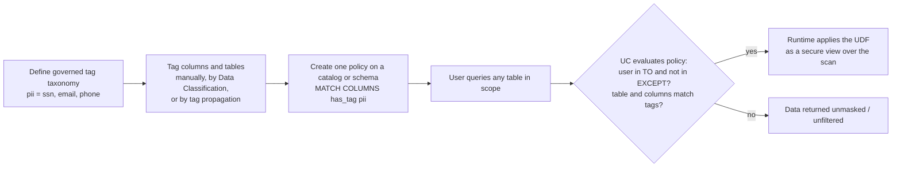
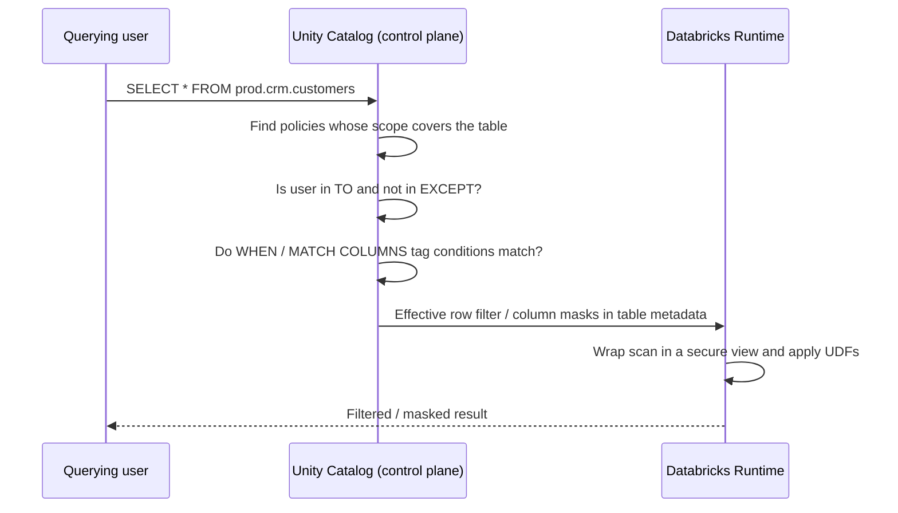

# ABAC Policies and Governed Tags

## Overview

Attribute-based access control (ABAC) in Unity Catalog replaces per-table row filters and column masks with a small number of centrally managed **policies** that match tables and columns by **governed tags**. One policy attached to a catalog or schema protects every current and future table whose tags match, and table owners cannot remove or bypass it.

> [!abstract]
>
> - **Governed tags** are account-level tag keys with a tag policy: an allowed-value list and permissions (`CREATE`, `MANAGE`, `ASSIGN`) that control who can define and apply them.
> - **ABAC policies** (`CREATE POLICY ... ON CATALOG | SCHEMA | TABLE`) apply a row filter or column mask UDF to every table in scope whose tags match `WHEN` / `MATCH COLUMNS` conditions, for the principals in `TO` minus `EXCEPT`.
> - Policies are evaluated by Unity Catalog at query time and enforced by the Databricks Runtime, so new tagged tables are covered automatically; policies "act like future grants".
> - ABAC needs serverless, or standard/dedicated compute on Databricks Runtime 16.4+; older runtimes fail closed.

> [!tip] What the Exam Tests
>
> - Apply attribute-based access control (ABAC) policies with governed tags to enforce row filters and column masks at scale.
> - Choose ABAC over per-table `ALTER TABLE ... SET MASK` / `SET ROW FILTER` or dynamic views when one central rule must cover hundreds of current and future tables (exam guide sample Question 7).
> - Read a `CREATE POLICY` statement and predict which tables, columns, and users it affects.
> - Know the permissions involved: `ASSIGN` on the governed tag plus `APPLY TAG` on the object to tag; `MANAGE` (or ownership) on the scope plus `EXECUTE` on the UDF to create a policy.

---

## Why ABAC

With table-level controls, every table needs its own `ALTER TABLE ... ALTER COLUMN ... SET MASK` statement, and each table owner can change or drop it. With hundreds of PII tables this does not scale and drifts as new tables arrive. ABAC moves the rule up the hierarchy and keys it on metadata:



## Governed Tags

Governed tags are account-level tags with built-in rules. When you create a governed tag you also define its **tag policy**: the allowed values and who can assign it. They can be applied to Unity Catalog objects (catalogs, schemas, tables, columns, volumes, models, and more) and to workspace objects such as dashboards, Genie Agents, apps, and notebooks, but **not** to compute resources such as SQL warehouses or to jobs, which use a separate tagging mechanism.

ABAC policies use **governed tags only**, not ungoverned (free-form) tags.

### Governed tag permissions

| Permission | What it allows | Scope |
| :--- | :--- | :--- |
| `CREATE` | Create new governed tags | Account |
| `MANAGE` | Edit, delete, and manage permissions on governed tags | Account or individual governed tag |
| `ASSIGN` | Assign the governed tag to Unity Catalog objects | Account or individual governed tag |

- Account admins hold `CREATE`, `MANAGE`, and `ASSIGN` on the account by default; workspace admins hold `CREATE` by default (account admins can revoke this).
- A user with `CREATE` automatically gets `MANAGE` on each governed tag they create.
- `ASSIGN` controls who can use the tag; assigning a governed tag to a Unity Catalog object **also** requires `APPLY TAG` on that object (plus `USE CATALOG` / `USE SCHEMA` on its parents), or ownership of the object.

> [!warning]
> Tagging is a security boundary. Anyone who can change tags on a data asset can change which policies apply to it. Restrict `ASSIGN` to data stewards and audit tag changes.

### Create, edit, and apply governed tags

Governed tags can be created in Catalog Explorer (**Catalog** > **Govern** > **Governed Tags**) or with SQL (`CREATE GOVERNED TAG` requires Databricks Runtime 18.1 or above):

```sql
-- Key-only governed tag
CREATE GOVERNED TAG isPii;

-- Governed tag with a description and an allowed-value list
CREATE GOVERNED TAG pii
  DESCRIPTION 'Kind of personally identifiable information the asset contains'
  VALUES ('ssn', 'email', 'phone');

-- SET VALUES is declarative: the list REPLACES all existing allowed values
ALTER GOVERNED TAG pii SET VALUES ('ssn', 'email', 'phone', 'dob');

DROP GOVERNED TAG isPii;
```

Apply the tag to objects (requires `ASSIGN` on the governed tag and `APPLY TAG` on the object):

```sql
-- Databricks Runtime 13.3+: ALTER ... SET TAGS
ALTER TABLE prod.crm.customers ALTER COLUMN ssn SET TAGS ('pii' = 'ssn');
ALTER SCHEMA prod.hr SET TAGS ('sensitivity' = 'high');

-- Databricks Runtime 16.1+: SET TAG / UNSET TAG
SET TAG ON COLUMN prod.crm.customers.email pii = email;
UNSET TAG ON COLUMN prod.crm.customers.email pii;
```

### Rules that matter for ABAC

| Rule | Detail |
| :--- | :--- |
| Inheritance for policy evaluation | Tags on a catalog or schema are implicitly inherited by the schemas and tables beneath it **when ABAC policies are evaluated**. Columns never inherit: column tags must be applied directly. |
| Governing existing tags | Creating a governed tag with the same key as tags already in use makes all existing assignments with that key governed immediately. |
| Deleting a governed tag | Assignments stay on objects but become ungoverned. Any policy that references the tag makes **all** queries in its scope fail with `INVALID_PARAMETER_VALUE.UC_ABAC_UNKNOWN_TAG_POLICY`, even on tables that never carried the tag. The UI and API do not block this deletion. |
| Dropping a tagged column | Fails until the governed tag is removed from the column (blocks pipelines that drop tagged columns). |
| System governed tags | Predefined by Databricks and not editable, for example `class.*` (applied by Data Classification), `system.certification_status`, `ai.*`. Applying them still needs `ASSIGN`. |
| Limits | Up to 1,000 governed tags per account and 500 allowed values per governed tag; tag keys and values are case-sensitive. |
| Propagation delay | After assigning or modifying a tag, it can take a few minutes to take effect. |

## ABAC Policy Types

| Policy type | Effect | Uses a UDF | Supported scope |
| :--- | :--- | :--- | :--- |
| **Row filter policy** | Hides rows where the UDF returns `FALSE` | Yes (returns `BOOLEAN`) | Catalog, schema, table (metastore in Beta) |
| **Column mask policy** | Replaces the column value with the UDF result | Yes (returns value castable to the column type) | Catalog, schema, table (metastore in Beta) |
| **GRANT policy** | Dynamically grants a privilege on matching securables (models, model services, MCP services, and other supported types) | No | Catalog, schema, metastore |
| **DENY policy** (Beta) | Denies `MANAGE ACCESS CONTROL`; always wins over any grant | No | Catalog, schema |

For this exam objective, focus on **row filter and column mask policies** — the ABAC equivalents of table-level row filters and column masks.

## CREATE POLICY Syntax

```sql
CREATE [ OR REPLACE ] POLICY policy_name
ON { METASTORE | CATALOG catalog_name | SCHEMA schema_name | TABLE table_name }
[ COMMENT description ]
{ row_filter_body | column_mask_body | grant_policy_body }

row_filter_body
  ROW FILTER function_name
  TO principal [, ...]
  [ EXCEPT principal [, ...] ]
  FOR TABLES
  [ WHEN condition ]
  [ MATCH COLUMNS condition [ [ AS ] alias ] [, ...] ]
  [ USING COLUMNS ( function_arg [, ...] ) ]

column_mask_body
  COLUMN MASK function_name
  TO principal [, ...]
  [ EXCEPT principal [, ...] ]
  FOR TABLES
  [ WHEN condition ]
  [ MATCH COLUMNS condition [ [ AS ] alias ] [, ...] ]
  ON COLUMN alias
  [ USING COLUMNS ( function_arg [, ...] ) ]
```

| Clause | Meaning |
| :--- | :--- |
| `ON CATALOG / SCHEMA / TABLE` | **Scope.** The policy is evaluated for every table (including streaming tables, materialized views, and views in Beta) in that securable and all its descendants. The policy name is scoped to that securable. |
| `TO ... EXCEPT ...` | **Principals.** Users, groups, or service principals the policy applies to, minus exempt principals (max 20 principals per policy). |
| `FOR TABLES` | Securable type the row filter / mask targets. |
| `WHEN condition` | **Table condition** on the table's tags (direct or inherited from the catalog/schema). Omitted = `TRUE` (all tables in scope). |
| `MATCH COLUMNS condition AS alias` | **Column condition** on column tags (direct only). Row filter policies allow up to 6 expressions, column mask policies up to 3; all must match for the policy to apply. |
| `ON COLUMN alias` | Column mask only: the matched column that is masked. Its value is bound automatically as the UDF's **first** argument. |
| `USING COLUMNS (...)` | Extra UDF arguments, in order: `MATCH COLUMNS` aliases, constants, or tag introspection functions. |

### Condition functions

| Function | Where | Behavior |
| :--- | :--- | :--- |
| `has_tag('key')` | `WHEN` and `MATCH COLUMNS` | `WHEN`: tag on the table or inherited from catalog/schema. `MATCH COLUMNS`: tag set directly on the column only. |
| `has_tag_value('key', 'value')` | `WHEN` and `MATCH COLUMNS` | Same context rules, also checks the value. |
| `get_tag_value('key')` | `USING COLUMNS` only | Passes the table's (or inherited) tag value to the UDF; creating such a policy needs Databricks Runtime 18 LTS+. |
| `get_column_tag_value(alias, 'key')` | `USING COLUMNS` only | Passes a matched column's tag value to the UDF. |
| `has_identity_attribute_value(...)` (Beta) | `WHEN` of column mask policies | Evaluates the querying user's identity attributes. |

> [!note]
> The snake_case names (`has_tag`, `has_tag_value`) are current. The older camelCase forms `hasTag` and `hasTagValue` still work for backward compatibility but are not recommended; you may still see them in older exam material.

## Worked Examples

### Column mask on every `pii` column in a catalog (sample Question 7)

```sql
-- 1. Masking UDF: SQL UDFs are recommended (the optimizer can inline them)
CREATE FUNCTION prod.governance.mask_pii(val STRING)
  RETURNS STRING
  DETERMINISTIC
  RETURN '***';

-- 2. One policy for all current AND future tables in the catalog
CREATE POLICY mask_pii_columns
ON CATALOG prod
COMMENT 'Mask any column tagged pii for everyone except the privacy team'
COLUMN MASK prod.governance.mask_pii
TO `account users`
EXCEPT `privacy_officers`, `sp-etl-pipeline`
FOR TABLES
MATCH COLUMNS has_tag('pii') AS pii_col
ON COLUMN pii_col;
```

No table is altered. A new table created next month with a column tagged `pii` is masked the moment the tag is applied.

### Row filter on tables tagged `sensitivity = high`

```sql
CREATE FUNCTION prod.governance.non_eu_region(geo_region STRING)
  RETURNS BOOLEAN
  RETURN geo_region <> 'eu';

CREATE POLICY hide_eu_customers
ON SCHEMA prod.customers
ROW FILTER prod.governance.non_eu_region
TO `analysts`
FOR TABLES
WHEN has_tag_value('sensitivity', 'high')      -- table condition
MATCH COLUMNS has_tag('geo_region') AS region  -- column condition
USING COLUMNS (region);                        -- column value passed to the UDF
```

### One policy and one UDF for all PII types

```sql
CREATE FUNCTION main.governance.mask_by_type(col STRING, pii_type STRING)
  RETURNS STRING
  RETURN CASE
    WHEN pii_type = 'email' THEN regexp_replace(col, '(^[^@]+)', '***')
    WHEN pii_type = 'ssn'   THEN '***-**-' || right(col, 4)
    WHEN pii_type = 'phone' THEN '***-***-' || right(col, 4)
    ELSE '***'
  END;

CREATE POLICY mask_all_pii
ON CATALOG main
COLUMN MASK main.governance.mask_by_type
TO `account users`
FOR TABLES
MATCH COLUMNS has_tag('pii') AS col
ON COLUMN col
USING COLUMNS (get_column_tag_value(col, 'pii'));
```

A new PII type only needs a new `CASE` branch, not a new policy.

### UDF requirements

- Row filter UDFs return `BOOLEAN`; column mask UDFs return a type that matches or can be cast to the column type (Databricks auto-casts input and output; incompatible casts raise a runtime error).
- The policy creator needs `EXECUTE` on the UDF; querying users need only their normal table grants for the policy to apply to them.
- Prefer SQL UDFs, simple `CASE` logic, `DETERMINISTIC`, few arguments, and error-safe expressions (`try_divide`); Python UDFs are supported but cannot be inlined.
- Prefer `TO` / `EXCEPT` over `is_account_group_member()` inside the UDF to target principals; use identity functions only for genuinely conditional logic.

### Manage and inspect policies

```sql
SHOW POLICIES ON SCHEMA prod.customers;            -- policies attached directly here
SHOW EFFECTIVE POLICIES ON TABLE prod.crm.orders;  -- plus policies inherited from parents
DESCRIBE POLICY hide_eu_customers ON SCHEMA prod.customers;
DROP POLICY hide_eu_customers ON SCHEMA prod.customers;
```

| Action | Required permission |
| :--- | :--- |
| `CREATE` / `DROP` a policy | `MANAGE` on the target securable or ownership (metastore admin for `ON METASTORE`), plus `EXECUTE` on the UDF |
| `SHOW [EFFECTIVE] POLICIES` | `READ METADATA` or `MANAGE` on the target, or ownership |

## Scope, Inheritance, and Future Tables

- A policy on a **catalog** evaluates every table in every schema of that catalog; on a **schema**, every table in that schema; on a **table**, only that table. Databricks recommends the highest applicable level, usually the catalog; table-level policies should be the exception.
- Policies are dynamic: when a new table is created in scope and tagged (directly, by inheritance from its schema/catalog, by Data Classification, or by tag propagation), existing policies apply with no extra configuration — the docs describe policies as acting **like future grants**.
- Policies **do not grant access.** Users still need `USE CATALOG`, `USE SCHEMA`, and `SELECT` through normal grants; row filter and column mask policies only restrict what those users see.
- A policy set at the catalog or schema level cannot be modified, removed, or bypassed by individual table owners.

## Policy Evaluation at Query Time



| Behavior | Detail |
| :--- | :--- |
| Views and functions | Access to underlying tables is checked against the **view/function owner**, but ABAC policies are evaluated against the **querying user**. |
| One filter per table, one mask per column | Only one distinct row filter can resolve per user and table, and one distinct mask per user and column. Two different UDFs (from two policies, or an ABAC policy plus a table-level mask) block the query with `INVALID_PARAMETER_VALUE.UC_ABAC_MULTIPLE_ROW_FILTERS` or `COLUMN_MASKS_FEATURE_NOT_SUPPORTED.MULTIPLE_MASKS`, even if their output is identical. Same UDF with same arguments is allowed. |
| Fail-closed | If Databricks cannot enforce every applicable policy (unsupported runtime, unsupported operation, deleted tag or UDF), access is denied rather than returning unprotected data. |
| Deleted UDF | Queries in scope fail with `UC_DEPENDENCY_DOES_NOT_EXIST` until the function is restored or the policy updated. |
| Time travel | Time travel on ABAC-protected tables is in Beta for qualifying tables and compute; table-level filters and masks do not support time travel. |

## Separation of Duties

| Step | Typical owner | Required permissions |
| :--- | :--- | :--- |
| 1. Define tag taxonomy | Governance team | Account admin, or `CREATE` on governed tags at the account level |
| 2. Tag data assets | Data stewards, data creators, or Data Classification | `ASSIGN` on the tag + `APPLY TAG` on the object |
| 3. Write policies | Governance admins | `MANAGE` (or ownership) on the catalog/schema/table + `EXECUTE` on the UDF |
| 4. Create tables in governed scopes | Data engineers | `CREATE TABLE` on the schema; new objects inherit catalog/schema tags, and creators get `APPLY TAG` automatically on their objects |
| 5. Query | Consumers | Normal grants (`USE CATALOG`, `USE SCHEMA`, `SELECT`); policies are applied automatically |

## Compute Requirements and Limitations

| Area | Requirement or limitation |
| :--- | :--- |
| Compute | Serverless; **standard** compute on Databricks Runtime 16.4+; **dedicated** compute on 16.4+ with fine-grained access control filtering enabled (enforcement is delegated to serverless). Older runtimes cannot read ABAC-secured tables — exempt the principal that runs a legacy workload via `EXCEPT` while migrating. |
| Policy quotas | 100 policies per catalog, 100 per schema, 50 per table, 10,000 per metastore; 20 principals per policy. |
| Materialized views and streaming tables | Pipelines refresh them as the pipeline owner / run-as identity. If that identity is subject to a policy, the MV or ST **permanently** stores masked/filtered data. Put the pipeline identity in `EXCEPT` on policies covering the source tables. |
| Cloning | Deep and shallow clones of ABAC-protected tables are blocked unless the cloning principal is in `EXCEPT` of every applicable policy. |
| OpenSharing | ABAC-protected tables can be shared only if the share owner is exempt; the provider's policy does not govern the recipient, who can apply their own policies. |
| AI Search indexes | Source-table policies are not enforced on the index; exclude masked columns from the sync. |
| Views | ABAC on views is Beta (workspace preview, Databricks Runtime 19+); metric views are not supported; `CREATE OR REPLACE VIEW` drops governed tags and directly attached policies. |

> [!important]
> Principals in `EXCEPT` see unfiltered, unmasked data. Exempt only trusted identities such as the service principals that run ETL, cloning, or sharing workloads.

### Cross-engine ABAC and governed tag propagation

> [!note] Platform update (Oct 2026)
> Cross-engine ABAC is generally available (Oct 1, 2026): supported external engines can read Unity Catalog **managed** tables with ABAC policies, row filters, and column masks enforced by Databricks serverless compute. It requires external data access on the metastore, `EXTERNAL USE SCHEMA` for the querying principal, managed tables with catalog commits, and OAuth M2M or PAT authentication. Source: [Cross-engine attribute-based access controls (ABAC)](https://docs.databricks.com/aws/en/external-access/cross-engine-abac)

> [!note] Platform update (Oct 2026)
> Governed tag propagation is in Beta (Oct 12, 2026). When enabled per governed tag, Unity Catalog uses lineage to copy table- and column-level governed tags to tables and views derived through `CREATE TABLE AS SELECT`, `CREATE VIEW`, `INSERT INTO ... SELECT`, or `MERGE` on serverless compute, so ABAC policies follow the data downstream. It is asynchronous, does not apply to ungoverned tags, and is not supported for streaming tables or materialized views created by Lakeflow pipelines. Source: [Tag propagation](https://docs.databricks.com/aws/en/admin/governed-tags/tag-propagation)

## ABAC Policy vs Table-Level Row Filter / Column Mask vs Dynamic View

| Consideration | ABAC policy | Table-level row filter / column mask | Dynamic view |
| :--- | :--- | :--- | :--- |
| Syntax | `CREATE POLICY ... ON CATALOG/SCHEMA/TABLE` | `ALTER TABLE ... SET ROW FILTER` / `ALTER COLUMN ... SET MASK` | `CREATE VIEW` with `current_user()` / `is_account_group_member()` |
| Scope | All tables in the catalog/schema whose tags match, **including future tables** | One table at a time | One view (can join many sources) |
| Matching | Dynamic, via governed tags | Bound to specific columns | Hard-coded SQL |
| Who controls it | Catalog/schema owner or `MANAGE` holder; table owners cannot override | Table owner (can modify or remove) | View owner |
| Principal targeting | `TO` / `EXCEPT` plus optional identity functions in the UDF | Identity functions inside the UDF | Identity functions in the view SQL |
| New object needed | No | No | Yes — users must query the view, not the table |
| Inspect | `SHOW EFFECTIVE POLICIES`, `DESCRIBE POLICY` | Table definition, `INFORMATION_SCHEMA.ROW_FILTERS` / `COLUMN_MASKS` | View definition |
| Performance and probing | Secure-view barrier; some optimizations restricted | Secure-view barrier | Full optimization and pushdown, but no `SecureView` barrier, so vulnerable to probing |
| Best for | Hundreds of tables, centralized rules, separation of duties | A small, stable set of tables with table-specific logic | Curated, joined, or reshaped data for sharing |

## Use Cases

- **Enterprise PII masking:** one catalog-level column mask policy masks every column tagged `pii` in hundreds of tables, including tables created later by any team.
- **Regional row-level security:** a schema-level row filter policy restricts each regional team to its own rows for every table that has a column tagged `region`.
- **Quarantine until classified:** apply a default `classification = unverified` tag at the catalog level and a row filter policy that blocks those tables until a steward reviews and retags them.
- **Pipeline exemptions:** list the ETL service principal in `EXCEPT` so materialized views and streaming tables refresh with unmasked source data, while consumers see masked results.

## Common Issues & Errors

| Symptom | Likely cause | Fix |
| :--- | :--- | :--- |
| Policy created but data is not masked | Column tag missing (table tags do not flow to columns), user is in `EXCEPT`, or tag change not yet propagated | Tag the column directly; check `SHOW EFFECTIVE POLICIES`; wait a few minutes after tagging |
| `UC_ABAC_MULTIPLE_ROW_FILTERS` / `MULTIPLE_MASKS` error | Two different UDFs resolve for the same user and table/column (often ABAC plus a manual `SET MASK`) | Narrow `WHEN` / `MATCH COLUMNS`, adjust `TO` / `EXCEPT`, or consolidate into one policy |
| All queries in a catalog fail with `UC_ABAC_UNKNOWN_TAG_POLICY` | A governed tag referenced by a policy was deleted | Restore the tag or update/drop the policy |
| Job on Databricks Runtime 15.4 cannot read the table | Runtime below 16.4 (fail-closed) | Upgrade to 16.4+ or serverless, or exempt that principal temporarily |
| Materialized view contains masked values for everyone | Pipeline owner / run-as identity was subject to the mask during refresh | Add the pipeline identity to `EXCEPT` and fully refresh |
| `ALTER TABLE ... DROP COLUMN` fails | Column carries a governed tag | Remove the tag (needs `ASSIGN` + `APPLY TAG`), drop the column, reapply tags where needed |
| `CREATE POLICY` permission denied | Missing `MANAGE`/ownership on the scope or `EXECUTE` on the UDF | Grant `MANAGE` on the catalog/schema and `EXECUTE` on the function |

## Best Practices

- Design a small, controlled taxonomy (for example one `sensitivity` tag with fixed values) before writing policies.
- Attach policies at the catalog or schema level; avoid policy sprawl and review overlapping policies.
- Restrict `ASSIGN` on sensitive governed tags and audit tag and policy changes in `system.access.audit`.
- Use simple, deterministic SQL UDFs and `TO` / `EXCEPT` rather than complex identity logic.
- Never delete a governed tag that a policy references.

## Exam Tips

> [!tip]
>
> - "Single, centrally managed rule ... all current and future tables ... without altering each table" → **ABAC policy with governed tags**, not per-table `SET MASK`, schema row filters, or dynamic views.
> - `MATCH COLUMNS has_tag(...)` checks **column** tags only; `WHEN has_tag(...)` checks **table** tags, including tags inherited from the schema or catalog.
> - Policies restrict data; they never grant `SELECT`. Users still need `USE CATALOG` + `USE SCHEMA` + `SELECT`.
> - `EXCEPT` = fully exempt (sees raw data). Pipeline owners, cloning principals, and share owners must be exempt for those operations.
> - Tagging permission = `ASSIGN` on the governed tag **and** `APPLY TAG` on the object. Policy permission = `MANAGE` (or ownership) on the scope **and** `EXECUTE` on the UDF.
> - ABAC requires Databricks Runtime 16.4+ or serverless; older compute fails closed.
> - Only one distinct row filter per table and one distinct mask per column can resolve for a user; conflicting UDFs return an error.

## Key Takeaways

- **Governed tags** are account-level tags with allowed values and `CREATE` / `MANAGE` / `ASSIGN` permissions; ABAC policies only work with governed tags.
- **`CREATE POLICY`** attaches a row filter or column mask UDF to a catalog, schema, or table scope; `TO` / `EXCEPT` pick principals; `WHEN` matches table tags; `MATCH COLUMNS` matches column tags; `ON COLUMN` picks the masked column; `USING COLUMNS` passes extra arguments.
- **Inheritance:** policies cover every current and future table in scope; tags on catalogs and schemas are inherited by tables for policy evaluation, but never by columns.
- **Table owners cannot override** catalog- or schema-level policies, unlike table-level filters and masks that the owner manages.
- **Enforcement** happens at query time as a secure view, evaluated for the querying user, and fails closed on unsupported compute or missing dependencies.
- **Limitations** to remember: Databricks Runtime 16.4+, one distinct filter/mask per user, pipeline identities in `EXCEPT` for MV/ST refreshes, cloning and OpenSharing require exempt principals.
- **Oct 2026 updates:** cross-engine ABAC is GA (Oct 1); governed tag propagation is Beta (Oct 12).

## Related Topics

- [Access Control](./01-access-control.md) — least-privilege grants, table-level row filters and column masks, dynamic views
- [Anonymization, PII Controls, and Data Purging](./03-anonymization-pii-and-data-purging.md) — masking UDF techniques, Data Classification, erasure workflow
- [Data Classification, Compliance & Permissions](./04-classification-compliance-permissions.md) — tag-based classification and compliance patterns
- [Tags, Comments, and Discoverability](../07-data-governance/02-tags-comments-and-discoverability.md) — tags and comments as metadata
- [Unity Catalog](../07-data-governance/01-unity-catalog.md) — privilege inheritance model
- [OpenSharing](../02-data-ingestion-and-acquisition/06-opensharing.md) — sharing tables protected by policies

## Official Documentation

- [Attribute-based access control in Unity Catalog](https://docs.databricks.com/aws/en/data-governance/unity-catalog/abac/)
- [Core concepts for ABAC](https://docs.databricks.com/aws/en/data-governance/unity-catalog/abac/core-concepts)
- [CREATE POLICY](https://docs.databricks.com/aws/en/sql/language-manual/sql-ref-syntax-ddl-create-policy)
- [SHOW POLICIES](https://docs.databricks.com/aws/en/sql/language-manual/sql-ref-syntax-aux-show-policies)
- [When to use ABAC vs table-level row filters and column masks](https://docs.databricks.com/aws/en/data-governance/unity-catalog/abac/abac-vs-rls-cm)
- [Requirements, quotas, and limitations for row filter and column mask policies](https://docs.databricks.com/aws/en/data-governance/unity-catalog/abac/requirements)
- [Row filter and column mask policy evaluation and runtime behavior](https://docs.databricks.com/aws/en/data-governance/unity-catalog/abac/policy-evaluation)
- [Best practices for ABAC policies](https://docs.databricks.com/aws/en/data-governance/unity-catalog/abac/best-practices)
- [Common patterns for row filtering and column masking](https://docs.databricks.com/aws/en/data-governance/unity-catalog/abac/common-patterns)
- [Governed tags](https://docs.databricks.com/aws/en/admin/governed-tags/)
- [Create and manage governed tags](https://docs.databricks.com/aws/en/admin/governed-tags/manage-governed-tags)
- [Manage permissions on governed tags](https://docs.databricks.com/aws/en/admin/governed-tags/manage-permissions)
- [Apply tags to Unity Catalog securable objects](https://docs.databricks.com/aws/en/database-objects/tags)
- [Tag propagation](https://docs.databricks.com/aws/en/admin/governed-tags/tag-propagation)
- [Cross-engine attribute-based access controls (ABAC)](https://docs.databricks.com/aws/en/external-access/cross-engine-abac)
- [October 2026 release notes](https://docs.databricks.com/aws/en/release-notes/product/2026/october)

---

**[← Previous: Access Control](./01-access-control.md) | [↑ Back to Section](./README.md) | [Next: Anonymization, PII Controls, and Data Purging →](./03-anonymization-pii-and-data-purging.md)**
