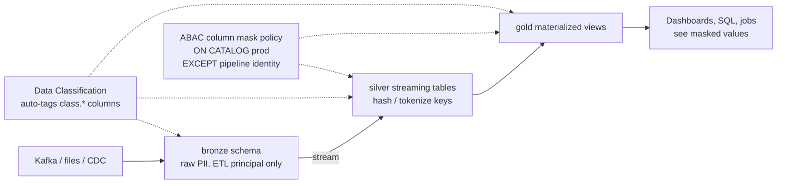
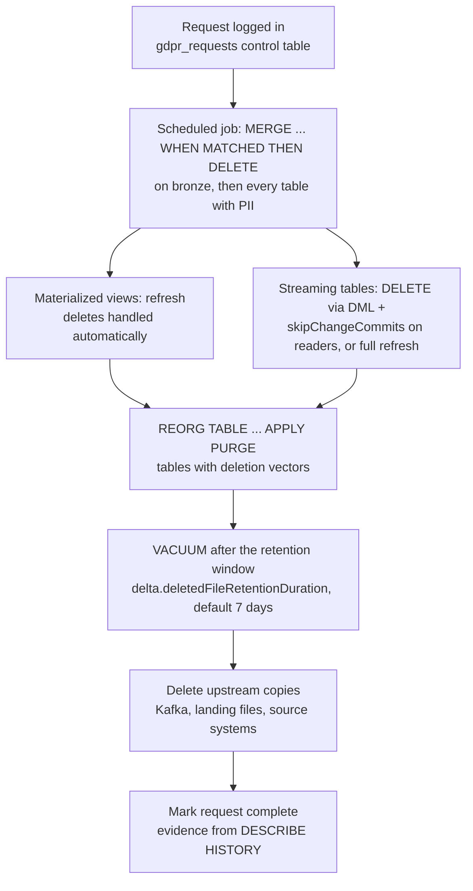

# Anonymization, PII Controls, and Data Purging

## Overview

This topic covers the three privacy controls a professional data engineer builds on Databricks: transforming confidential values (hashing, tokenization, suppression, generalization), detecting and masking PII consistently across batch and streaming pipelines, and physically purging personal data to satisfy retention and right-to-erasure requests with Delta Lake and Unity Catalog.

> [!abstract]
>
> - **Pseudonymization** (hashing, tokenization, encryption) keeps records linkable and is reversible with extra information; **anonymization** (suppression, generalization, aggregation) removes the link.
> - Techniques can run at **write time** in the pipeline (silver/gold store transformed values) or at **query time** through column masks and ABAC policies (storage keeps raw values).
> - **Data Classification** scans Unity Catalog tables, streaming tables, and materialized views, tags sensitive columns with `class.*` system tags, and feeds ABAC masking policies.
> - **Erasure** = `DELETE` / `MERGE` → `REORG TABLE ... APPLY (PURGE)` for deletion vectors → `VACUUM` after the retention window, plus downstream propagation, CDF, and upstream sources.

> [!tip] What the Exam Tests
>
> - Apply anonymization and pseudonymization methods — hashing, tokenization, suppression, and generalization — to confidential data, for example with column masks and related Unity Catalog features.
> - Implement a compliant data pipeline that enforces PII detection and masking controls across batch and streaming workloads using Unity Catalog features.
> - Implement a data purging strategy that satisfies retention and deletion policies (GDPR right-to-erasure / right-to-be-forgotten) using Delta Lake and Unity Catalog features.
> - Know why `DELETE` alone does not erase data: old files, deletion vectors, time travel, and change data feed still hold it.

---

## Anonymization vs Pseudonymization

| Aspect | Pseudonymization | Anonymization |
| :--- | :--- | :--- |
| Goal | Replace identifiers with substitutes while keeping records joinable | Remove or coarsen data so individuals cannot be singled out |
| Reversible? | Yes, with additional information (salt, key, token vault) | No (by design) |
| Typical techniques | Salted hashing, tokenization, reversible encryption | Suppression, generalization, aggregation |
| Joinability | Same input → same pseudonym across tables (deterministic) | Lost or reduced |
| Still personal data? | Generally treated as personal data because it can be re-linked | Intended to fall outside personal data when done properly |

> [!important]
> Databricks guidance for GDPR/CCPA is that **complete deletion is preferable to obfuscation**: pseudonymization and masking reduce exposure, but eliminating re-identification risk often requires deleting the PII. Use the techniques below to minimize who sees PII, and the purge workflow to erase it.

## Technique Catalog

| Technique | Reversible | Databricks building blocks | Typical use |
| :--- | :--- | :--- | :--- |
| Hashing | No (but guessable for low-entropy values) | `sha2(expr, bitLength)` with a secret salt from `secret()` | Join keys across tables without exposing email/SSN |
| Tokenization | Yes, via a token vault | Token lookup table in a restricted schema, `uuid()`, `MERGE` | Analytics on tokens; re-identify only by authorized service |
| Encryption | Yes, with the key | `aes_encrypt` / `aes_decrypt` / `try_aes_decrypt`, key from `secret()` | Field-level protection where authorized users need clear text |
| Suppression | No | `CASE ... THEN NULL`, `mask()`, dropping the column | Hide values entirely or partially |
| Generalization | No | `date_trunc`, `year`, `floor` buckets, `left()` truncation | Age bands, month of birth, ZIP prefix |

### Hashing (deterministic pseudonymization)

`sha2(expr, bitLength)` returns a hex string; `bitLength` can be `0` (equivalent to `256`), `224`, `256`, `384`, or `512`.

```sql
-- Write-time: salted, normalized hash stored in silver
CREATE OR REPLACE TABLE prod.silver.customers AS
SELECT
  sha2(concat(secret('pii-scope', 'hash-salt'), lower(trim(email))), 256) AS customer_key,
  country,
  signup_date
FROM prod.bronze.customers;
```

An unsalted hash of a low-entropy value (phone number, SSN) can be reversed by hashing every candidate value, so keep the salt in a secret scope and never in code. The ABAC documentation's **consistent hashing** pattern adds a version parameter so the hash can be rotated through the policy's `USING COLUMNS`:

```sql
CREATE FUNCTION prod.governance.pseudonymize(val STRING, version INT)
  RETURNS STRING
  DETERMINISTIC
  RETURN sha2(concat(val, CAST(version AS STRING)), 256);
```

> [!note]
> The `secret()` SQL function requires Databricks Runtime 11.3 LTS or above and is in preview in Databricks SQL; Databricks makes a best-effort attempt to redact secret values from output.

### Tokenization with a token vault

```sql
-- Token vault in a schema only the privacy service principal can read
CREATE TABLE IF NOT EXISTS prod.vault.email_tokens (token STRING, email STRING);

MERGE INTO prod.vault.email_tokens AS v
USING (SELECT DISTINCT email FROM prod.bronze.customers) AS s
ON v.email = s.email
WHEN NOT MATCHED THEN INSERT (token, email) VALUES (uuid(), s.email);

-- Downstream tables store only the token
CREATE OR REPLACE TABLE prod.silver.orders AS
SELECT t.token AS customer_token, o.order_id, o.amount, o.order_date
FROM prod.bronze.orders AS o
JOIN prod.vault.email_tokens AS t ON o.email = t.email;
```

Re-identification is a join back to the vault, controlled by Unity Catalog grants on `prod.vault`. This also supports erasure: the GDPR guidance notes that when non-PII data is keyed by a non-natural key such as a `user_id` instead of a natural key like email, you can delete the PII and leave the non-PII data in place — a vault token plays the same role, so deleting the vault row unlinks every downstream record.

### Reversible encryption

```sql
-- Key: 16, 24, or 32 bytes (AES-128/192/256); GCM is the default mode
SELECT base64(aes_encrypt(email, secret('pii-scope', 'aes-key'))) AS email_enc
FROM prod.bronze.customers;

SELECT CAST(try_aes_decrypt(unbase64(email_enc), secret('pii-scope', 'aes-key')) AS STRING) AS email
FROM prod.silver.customers_enc;
```

### Suppression and partial masking

```sql
SELECT
  customer_id,
  CASE WHEN is_account_group_member('privacy_officers') THEN ssn END AS ssn,  -- NULL for others
  concat('***-**-', right(ssn, 4))                                    AS ssn_last4,
  mask(phone)                                                          AS phone_masked  -- digits become 'n'
FROM prod.silver.customers;
```

`mask(str [, upperChar [, lowerChar [, digitChar [, otherChar]]]])` replaces upper-case letters with `X`, lower-case with `x`, and digits with `n` by default.

### Generalization

```sql
SELECT
  concat(CAST(floor(age / 10) * 10 AS STRING), '-', CAST(floor(age / 10) * 10 + 9 AS STRING)) AS age_band,
  date_trunc('MONTH', birth_date)  AS birth_month,
  concat(left(zip_code, 3), '**')  AS zip3,
  country
FROM prod.silver.patients;
```

## Applying Techniques with Column Masks

A column mask is a SQL UDF attached to a column; it runs at query time, so storage keeps the raw value and each user sees the version their group allows.

```sql
CREATE OR REPLACE FUNCTION prod.governance.mask_email(email STRING)
  RETURNS STRING
  RETURN CASE
    WHEN is_account_group_member('privacy_officers') THEN email
    ELSE sha2(lower(email), 256)   -- pseudonymized but still joinable
  END;

-- Table-level: one column on one table
ALTER TABLE prod.silver.customers ALTER COLUMN email SET MASK prod.governance.mask_email;

-- At scale: one ABAC policy for every column tagged by Data Classification
CREATE POLICY mask_detected_emails
ON CATALOG prod
COLUMN MASK prod.governance.mask_email
TO `account users`
EXCEPT `sp-etl-pipeline`
FOR TABLES
MATCH COLUMNS has_tag('class.email_address') AS e
ON COLUMN e;
```

### Write-time vs query-time protection

| Choose | When |
| :--- | :--- |
| **Write-time** transformation (hash, tokenize, generalize in the pipeline) | Downstream consumers never need raw values; data is shared outside the platform; you want to shrink the number of tables that contain PII |
| **Query-time** column mask / ABAC policy | Some users must see raw values; rules differ by group; you want one central rule applied to every consumer (dashboards, ad hoc queries, jobs) |
| Both | Raw PII isolated in a restricted bronze schema; silver/gold pseudonymized; masks as a backstop on any residual PII column |

## PII Detection with Data Classification

Databricks **Data Classification** uses an agentic AI system (an LLM plus regular-expression detectors) to classify and tag sensitive columns in Unity Catalog.

| Aspect | Behavior |
| :--- | :--- |
| What is scanned | Tables, streaming tables, and materialized views in enabled catalogs (all or selected schemas); Unity Catalog views in Beta; metric views and views with unsafe definitions are not scanned |
| How | Incremental "intelligent scanning" on serverless compute; new tables and columns are typically scanned within 24 hours; a full scan can be triggered manually |
| Output | Detections per class (for example `class.email_address`, `class.us_ssn`, `class.credit_card`) in the results UI and the `system.data_classification.results` system table (account-admin only by default, serverless only, includes sample values) |
| Auto-tagging | When enabled for a class (metastore or catalog level), existing and future detections are tagged with the `class.*` **system governed tag**; tags are applied on the next scan, within about 24 hours |
| Enable on a catalog | Own the catalog or have `MANAGE` on it; workspace must have serverless compute |
| Enable auto-tagging | `USE CATALOG` and `APPLY TAG` on the catalog plus `ASSIGN` on the tag (metastore admin for the metastore-level setting) |
| Wrong detection | Exclude it in the review panel: removes the tag, prevents re-tagging, and improves future accuracy (Beta) |
| Governance | From the results page, **New policy** creates an ABAC column mask policy pre-filled for that class; Databricks recommends ABAC for controls based on classification results |

> [!note] Platform update (Oct 2026)
> Data Classification became generally available on Apr 20, 2026. The Data Classification **API and Terraform resource** became GA on Oct 14, 2026 (auto-tagging configuration `auto_tag_configs` remains Public Preview), and on Oct 15, 2026 it added 50 new classes (payment card, personal/employee data, software secrets, regional identifiers). Source: [Data Classification release notes](https://docs.databricks.com/aws/en/release-notes/data-classification/)

> [!warning]
> AI-generated comments are not a PII detector: Databricks states the comment model should not be relied on for data classification tasks such as detecting PII columns. Use Data Classification (or custom classifiers) instead.

## Compliant Pipeline: Detection and Masking Across Batch and Streaming



1. **Isolate raw PII**: land raw data in a bronze schema granted only to the pipeline's service principal; keep PII in clearly named schemas and columns so grants and audits stay simple.
2. **Detect**: enable Data Classification with auto-tagging on the catalog so new PII columns in tables, streaming tables, and materialized views get `class.*` tags without manual work.
3. **Mask centrally**: create ABAC column mask (and row filter) policies on the catalog keyed on those tags. Policies apply to every table type in scope, so batch tables, streaming tables, and materialized views are protected identically for every reader.
4. **Exempt the pipeline identity**: pipelines refresh materialized views and streaming tables with the pipeline owner's or run-as identity; if that identity is masked, the target permanently stores masked data. Put it in `EXCEPT`.
5. **Pseudonymize at write** for columns consumers never need in clear text (hash or tokenize in the silver transformation).
6. **Audit**: query `system.access.audit` for tag and policy changes and use the classification results page to see unmasked access.

Databricks recommends applying Unity Catalog column masks and row filters to the tables a pipeline produces rather than writing custom masking logic in pipeline code, because table-level controls protect every consumer, not just the pipeline.

### Pipeline-defined masks and filters

For a single streaming table or materialized view you can declare the controls in the Lakeflow pipeline definition; add, change, or drop them through the `CREATE OR REFRESH` statement:

```sql
CREATE OR REFRESH STREAMING TABLE customers_silver (
  id INT COMMENT 'Customer ID',
  name STRING,
  region STRING,
  ssn STRING MASK prod.governance.ssn_mask_fn COMMENT 'SSN masked for privacy'
)
WITH ROW FILTER prod.governance.us_filter_fn ON (region)
AS SELECT * FROM STREAM(customers_bronze);
```

| Behavior | Detail |
| :--- | :--- |
| Refresh | Filter and mask functions run with the **pipeline owner's** rights; `CURRENT_USER` / `IS_MEMBER` evaluate as the owner |
| Query | When users query the streaming table or materialized view, identity functions evaluate as the **invoker** |
| Audit | `DESCRIBE EXTENDED`, `INFORMATION_SCHEMA`, or Catalog Explorer show the filters and masks |
| Dedicated compute | Tables with row filters or column masks don't support streaming workloads on dedicated compute (only batch reads of streaming tables); use standard or serverless compute for streams |
| Tag propagation (Beta) | Not supported for streaming tables or materialized views created by Lakeflow pipelines, so rely on Data Classification or explicit tagging for those targets |

## Data Purging and the Right to Erasure

### Why DELETE is not enough

| Where the data still lives after `DELETE` | Removed by |
| :--- | :--- |
| Current files, when **deletion vectors** are enabled (rows only marked deleted) | `REORG TABLE ... APPLY (PURGE)` (or `OPTIMIZE`, without strict guarantees) |
| Old data files referenced by earlier table versions (time travel) | `VACUUM` once the files are older than the retention threshold |
| Change data feed records (include the deleted row's data) | Expire with table history; legacy CDF `_change_data` files are removed by `VACUUM` |
| Downstream silver/gold tables and materialized views | Propagated deletes, MV refresh, maintenance |
| Upstream sources (Kafka topics, landing files, source databases) | Deletion at the source; Auto Loader `cloudFiles.cleanSource` for processed files |
| Disk cache on running clusters | Cluster restart |

### Erasure workflow



#### 1. Delete in bronze first, driven by a control table

```sql
MERGE INTO prod.bronze.users AS target
USING (SELECT user_id FROM prod.compliance.gdpr_requests WHERE status = 'pending') AS source
ON target.user_id = source.user_id
WHEN MATCHED THEN DELETE;
```

Databricks recommends `MERGE` against a control table when deleting many subjects at once, starting in bronze and then propagating to silver and gold.

#### 2. Propagate to downstream tables

- **Materialized views** handle source deletions automatically; refresh them (deleting source data can trigger a full recompute) and run maintenance.
- **Streaming tables** process append-only sources, so a delete in the source breaks the stream. Recommended: delete from the source with DML, delete from the streaming table with DML, then set `skipChangeCommits` on the streaming read. Alternative: full refresh, which clears the streaming state and reprocesses everything — risky if the upstream (for example a Kafka topic with 7-day retention) no longer has the history.

```python
from pyspark import pipelines as dp

@dp.table(name="prod.bronze.users_bronze")
def users_bronze():
    return (spark.readStream
        .option("skipChangeCommits", "true")
        .table("prod.raw.source_users"))
```

> [!note]
> Streaming state also matters: Structured Streaming keeps state across micro-batches until watermarks remove it, so an identifier used as a key in a stateful operator persists in the checkpoint's state until it is evicted or the stream is fully refreshed.

#### 3. Purge soft-deleted rows (deletion vectors)

With deletion vectors, `DELETE`, `UPDATE`, and `MERGE` only mark rows as removed. For GDPR, run `REORG TABLE ... APPLY (PURGE)` after deleting — this applies to Delta tables, materialized views, and streaming tables.

```sql
REORG TABLE prod.bronze.users APPLY (PURGE);
-- Only partition-column predicates are supported in WHERE
REORG TABLE prod.bronze.events WHERE event_date >= '2026-01-01' APPLY (PURGE);
```

`APPLY (PURGE)` rewrites only files that contain soft-deleted data and is idempotent. The same purge is needed after `ALTER TABLE ... DROP COLUMN` on tables with column mapping, because dropping a column is also a soft delete. For large tables, `spark.databricks.delta.reorg.purgeMode = rows` limits the purge to files with soft-deleted rows.

#### 4. VACUUM after the retention window

`REORG` creates a new table version; the old files still serve time travel until `VACUUM` removes them once they **expire** under the retention threshold, so `VACUUM` must run with a delay after `REORG`.

```sql
-- Retention is controlled by table properties
ALTER TABLE prod.bronze.users SET TBLPROPERTIES (
  'delta.deletedFileRetentionDuration' = 'interval 7 days',   -- default; VACUUM threshold
  'delta.logRetentionDuration'         = 'interval 30 days'   -- default; table history
);

VACUUM prod.bronze.users DRY RUN;   -- list up to 1000 files that would be deleted
VACUUM prod.bronze.users;           -- FULL mode by default; LITE uses the transaction log
```

| Setting | Default | Notes |
| :--- | :--- | :--- |
| `delta.deletedFileRetentionDuration` | `interval 7 days` | Threshold `VACUUM` uses; Databricks strongly recommends at least 7 days |
| `delta.logRetentionDuration` | `interval 30 days` | How long table history (log) is kept; log files are cleaned after checkpoints, not by `VACUUM` |
| `spark.databricks.delta.retentionDurationCheck.enabled` | `true` | Safety check that blocks retention shorter than the threshold; disable only if no long-running writers exist |

> [!important]
> In Databricks Runtime 18.0 and above, `VACUUM` ignores the retention-duration argument except when it is `0 HOURS`, time travel beyond `deletedFileRetentionDuration` is blocked for all tables, and `deletedFileRetentionDuration` cannot exceed `logRetentionDuration` (or vice versa). Set retention with the `delta.deletedFileRetentionDuration` table property instead of `RETAIN n HOURS`; for Unity Catalog managed tables the table property governs retention from Databricks Runtime 13.3 LTS. Source: [Databricks Runtime 18.0 release notes](https://docs.databricks.com/aws/en/release-notes/runtime/18.0)

**Predictive optimization** automatically runs `VACUUM` on Unity Catalog managed tables, and Lakeflow pipelines maintain streaming tables and materialized views (within 24 hours of an update when predictive optimization is not enabled). Manual `VACUUM` is still needed elsewhere.

#### 5. Change data feed and time travel

- Each CDF change record includes the row data plus whether it was inserted, updated, or deleted, so the delete itself is visible in the feed until those versions leave the retention window. Legacy CDF stores change files under `_change_data`, which `VACUUM` removes.
- Anything that copied CDF output (audit tables, replicas, caches) must be purged too; archive tables built from CDF are ordinary tables under your own retention.
- After `VACUUM`, versions older than the retention period can no longer be queried with time travel.

#### 6. Upstream raw data

GDPR and CCPA apply to data outside Delta Lake too: delete from Kafka and other queues, source databases, and cloud storage. For files ingested by Auto Loader, `cloudFiles.cleanSource` (`OFF` default, `DELETE`, or `MOVE`; Databricks Runtime 16.4+) removes or archives processed files after `cloudFiles.cleanSource.retentionDuration` (default 30 days).

### Retention-policy purging

The same mechanics enforce time-based retention:

```sql
DELETE FROM prod.silver.web_events WHERE event_date < current_date() - INTERVAL 365 DAYS;
REORG TABLE prod.silver.web_events APPLY (PURGE);  -- if deletion vectors are enabled
-- VACUUM (or predictive optimization) removes the old files after the retention window
```

`VACUUM` commits audit information to the transaction log, so `DESCRIBE HISTORY` shows the `DELETE`, `REORG`, and `VACUUM` operations as evidence that a request was completed.

## Use Cases

- **Pseudonymized analytics:** silver stores a salted `sha2` customer key so analysts can join orders, clicks, and support tickets without ever seeing an email address.
- **Right-to-be-forgotten service:** a nightly job reads `gdpr_requests`, runs `MERGE ... DELETE` from bronze through gold, purges deletion vectors, and records completion once `VACUUM` has run past the retention window.
- **Automatic PII protection for new feeds:** Data Classification tags a newly ingested `phone` column with a `class.*` tag, and an existing catalog-level ABAC policy masks it the same day without any engineer action.
- **Research data release:** gold tables expose age bands and ZIP prefixes (generalization) with direct identifiers suppressed, for sharing with a partner.

## Common Issues & Errors

| Symptom | Cause | Fix |
| :--- | :--- | :--- |
| Deleted customer still visible with `VERSION AS OF` | Old files not yet vacuumed | Wait for the retention threshold and run `VACUUM` (or rely on predictive optimization) |
| Data still physically present after `DELETE` and `VACUUM` | Deletion vectors only marked rows deleted | Run `REORG TABLE ... APPLY (PURGE)`, then `VACUUM` after the new retention window |
| `VACUUM ... RETAIN 24 HOURS` seems to do nothing on Databricks Runtime 18 | Retention argument ignored except `0 HOURS` | Lower `delta.deletedFileRetentionDuration` (respecting the 7-day recommendation) |
| Streaming table fails after a GDPR delete in its source | Streaming from Delta expects append-only input | Use `skipChangeCommits` on the read after deleting with DML, or full refresh |
| Materialized view refreshed with masked values for everyone | Pipeline identity subject to the mask | Add the identity to the policy's `EXCEPT`, then fully refresh |
| `ALTER TABLE ... DROP COLUMN` of a PII column fails | Column has a governed tag | Remove the tag first; then `REORG ... APPLY (PURGE)` and `VACUUM` to erase the dropped data |
| Hash values reversed by an attacker | Unsalted hash of a small value space | Salt with a secret from a secret scope, or tokenize |

## Best Practices

- Model PII so it can be deleted without destroying non-PII facts: key facts by a surrogate `user_id` or token, keep identifiers in one table.
- Keep raw PII in as few tables as possible; pseudonymize at write for silver and gold.
- Combine Data Classification auto-tagging with catalog-level ABAC policies so detection and masking scale together.
- Schedule erasure as a job with a control table, and record completion only after `VACUUM` has passed the retention window.
- Enable predictive optimization on managed tables so `VACUUM` actually runs.

## Exam Tips

> [!tip]
>
> - Reversible with a key or lookup → **pseudonymization** (hashing with salt, tokenization, encryption). Not reversible → **anonymization** (suppression, generalization).
> - "Same masked value everywhere so joins still work" → deterministic **hashing** (`sha2`) in a mask UDF or at write time.
> - "Detect PII automatically across new tables" → **Data Classification** with auto-tagging (`class.*` tags) + **ABAC** policy on those tags.
> - GDPR erasure on a table with deletion vectors: `DELETE`/`MERGE` → `REORG TABLE ... APPLY (PURGE)` → `VACUUM`. `OPTIMIZE` alone does not guarantee the purge.
> - Default `VACUUM` threshold is 7 days (`delta.deletedFileRetentionDuration`); default history is 30 days (`delta.logRetentionDuration`).
> - `VACUUM RETAIN 0 HOURS` after every `MERGE` is a trap: it breaks time travel and can delete files of in-flight writers.
> - Streaming tables need `skipChangeCommits` (or a full refresh) after source deletes; materialized views handle deletes on refresh.

## Key Takeaways

- **Hashing, tokenization, and encryption pseudonymize** (linkable, reversible with extra information); **suppression and generalization anonymize**.
- **Column masks and ABAC policies** apply these techniques at query time per group; write-time transformations remove PII from downstream storage.
- **Data Classification** scans tables, streaming tables, and materialized views, applies `class.*` system tags, and pairs with ABAC policies for scalable masking; it is GA, with its API GA since Oct 14, 2026.
- **Pipelines** should publish tables protected by Unity Catalog masks/filters, and the pipeline identity must be exempt from policies on its sources.
- **Erasure** requires delete → purge deletion vectors → `VACUUM` after retention, plus propagation to downstream tables, CDF consumers, and upstream sources.
- **Databricks Runtime 18.0+** ignores `VACUUM` retention arguments other than `0 HOURS`; manage retention with table properties.

## Related Topics

- [ABAC Policies and Governed Tags](./02-abac-governed-tags.md) — policy syntax for tag-driven masking at scale
- [Data Classification, Compliance & Permissions](./04-classification-compliance-permissions.md) — tagging basics, CCPA export, deletion tracking table
- [Access Control](./01-access-control.md) — table-level row filters, column masks, dynamic views
- [Secret Management](./05-secret-management.md) — secret scopes for salts and encryption keys
- [Tags, Comments, and Discoverability](../07-data-governance/02-tags-comments-and-discoverability.md) — tags as metadata
- [Auto Loader](../02-data-ingestion-and-acquisition/01-auto-loader.md) — ingesting the raw files that may also need purging

## Official Documentation

- [Prepare your data for GDPR compliance](https://docs.databricks.com/aws/en/ldp/gdpr)
- [Deletion vectors in Databricks](https://docs.databricks.com/aws/en/tables/features/deletion-vectors)
- [REORG TABLE](https://docs.databricks.com/aws/en/sql/language-manual/delta-reorg-table)
- [Remove unused data files with vacuum](https://docs.databricks.com/aws/en/tables/operations/vacuum)
- [VACUUM](https://docs.databricks.com/aws/en/sql/language-manual/delta-vacuum)
- [Work with table history](https://docs.databricks.com/aws/en/tables/history)
- [Use change data feed on Databricks](https://docs.databricks.com/aws/en/tables/features/change-data-feed)
- [Databricks Runtime 18.0 release notes](https://docs.databricks.com/aws/en/release-notes/runtime/18.0)
- [Data Classification](https://docs.databricks.com/aws/en/data-governance/unity-catalog/data-classification)
- [Data Classification release notes](https://docs.databricks.com/aws/en/release-notes/data-classification/)
- [Row filters and column masks](https://docs.databricks.com/aws/en/data-governance/unity-catalog/filters-and-masks/)
- [Common patterns for row filtering and column masking](https://docs.databricks.com/aws/en/data-governance/unity-catalog/abac/common-patterns)
- [Manage identities, permissions, and privileges for pipelines](https://docs.databricks.com/aws/en/ldp/privileges)
- [Use Unity Catalog with pipelines](https://docs.databricks.com/aws/en/ldp/unity-catalog)
- [CREATE STREAMING TABLE (pipelines)](https://docs.databricks.com/aws/en/ldp/developer/ldp-sql-ref-create-streaming-table)
- [Fine-grained access control on dedicated compute](https://docs.databricks.com/aws/en/compute/single-user-fgac)
- [sha2 function](https://docs.databricks.com/aws/en/sql/language-manual/functions/sha2)
- [secret function](https://docs.databricks.com/aws/en/sql/language-manual/functions/secret)
- [aes_encrypt function](https://docs.databricks.com/aws/en/sql/language-manual/functions/aes_encrypt)
- [mask function](https://docs.databricks.com/aws/en/sql/language-manual/functions/mask)
- [Spark API options reference (Auto Loader `cloudFiles.cleanSource`)](https://docs.databricks.com/aws/en/spark/api-options)
- [Apply watermarks to control data processing thresholds](https://docs.databricks.com/aws/en/structured-streaming/watermarks)

---

**[← Previous: ABAC Policies and Governed Tags](./02-abac-governed-tags.md) | [↑ Back to Section](./README.md) | [Next: Data Classification, Compliance & Permissions →](./04-classification-compliance-permissions.md)**
