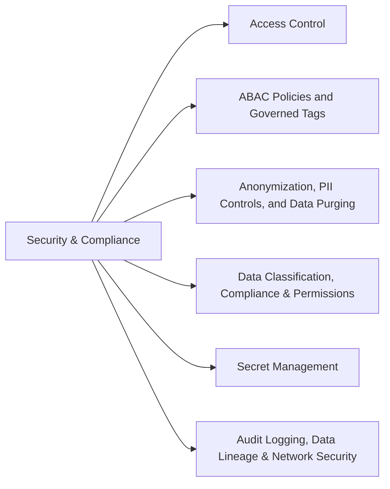

# Section 6: Ensuring Data Security and Compliance (8 % of Exam)

Protecting data: least-privilege ACLs on Unity Catalog securables and workspace objects, ABAC policies driven by governed tags, anonymization and pseudonymization through column masks, PII detection and masking in batch and streaming pipelines, and data purging for retention and GDPR erasure.

## Topics Overview

## Section Contents

| File | Topic | Priority |
| :--- | :--- | :--- |
| [01-access-control.md](./01-access-control.md) | UC grants and workspace-object ACLs, row filters and column masks, least privilege | High |
| [02-abac-governed-tags.md](./02-abac-governed-tags.md) | Governed tags and ABAC row-filter / column-mask policies at scale | High |
| [03-anonymization-pii-and-data-purging.md](./03-anonymization-pii-and-data-purging.md) | Hashing, tokenization, suppression, generalization; PII detection; GDPR purging | High |
| [04-classification-compliance-permissions.md](./04-classification-compliance-permissions.md) | Data classification, compliance patterns, advanced permission patterns | Medium |
| [05-secret-management.md](./05-secret-management.md) | Secret scopes and secret access in code and jobs | Medium |
| [06-audit-lineage-network-security.md](./06-audit-lineage-network-security.md) | Audit logs, lineage, network security | Medium |

## Exam Skill Coverage

Every skill bullet in Section 6 of the Oct 9, 2026 exam guide, with the files that cover it.

| Exam guide skill | Where it is covered |
| :--- | :--- |
| Apply least-privilege access control lists (ACLs) to secure Unity Catalog securable objects and workspace resources. | [01-access-control.md](./01-access-control.md) |
| Apply attribute-based access control (ABAC) policies with governed tags to enforce row filters and column masks at scale. | [02-abac-governed-tags.md](./02-abac-governed-tags.md) |
| Apply anonymization and pseudonymization methods — such as hashing, tokenization, suppression, and generalization — to confidential data (e.g., using column masks and related Unity Catalog features). | [03-anonymization-pii-and-data-purging.md](./03-anonymization-pii-and-data-purging.md) |
| Implement a compliant data pipeline that enforces PII detection and masking controls across batch and streaming workloads using Unity Catalog features. | [03-anonymization-pii-and-data-purging.md](./03-anonymization-pii-and-data-purging.md), [04-classification-compliance-permissions.md](./04-classification-compliance-permissions.md) |
| Implement a data purging strategy that satisfies data retention and deletion policies (e.g., GDPR right-to-erasure, GDPR right-to-be-forgotten deletion) using Delta Lake and Unity Catalog features. | [03-anonymization-pii-and-data-purging.md](./03-anonymization-pii-and-data-purging.md), [04-classification-compliance-permissions.md](./04-classification-compliance-permissions.md) |

## Key Concepts to Master

| Concept | Why it matters |
| :--- | :--- |
| **Least privilege** | Grant the narrowest privilege on the narrowest securable to a group, never broad ownership |
| **ABAC policy** | One central rule that applies a row filter or column mask wherever a governed tag appears — including future tables |
| **Pseudonymization vs anonymization** | Pseudonymized data can be re-linked with a key or lookup; anonymized data cannot |
| **Right to erasure** | DELETE the rows, purge deletion vectors, then VACUUM so old files are physically removed |

## Related Resources

- [Unity Catalog cheat sheet](../resources/cheat-sheets/unity-catalog-quick-ref.md)
- [Unity Catalog quick reference (shared)](../../../shared/cheat-sheets/unity-catalog-quick-ref.md)

---

**[← Previous: Cost & Performance Optimization](../05-cost-and-performance-optimization/README.md) | [↑ Back to DE Professional](../README.md) | [Next: Data Governance →](../07-data-governance/README.md)**
