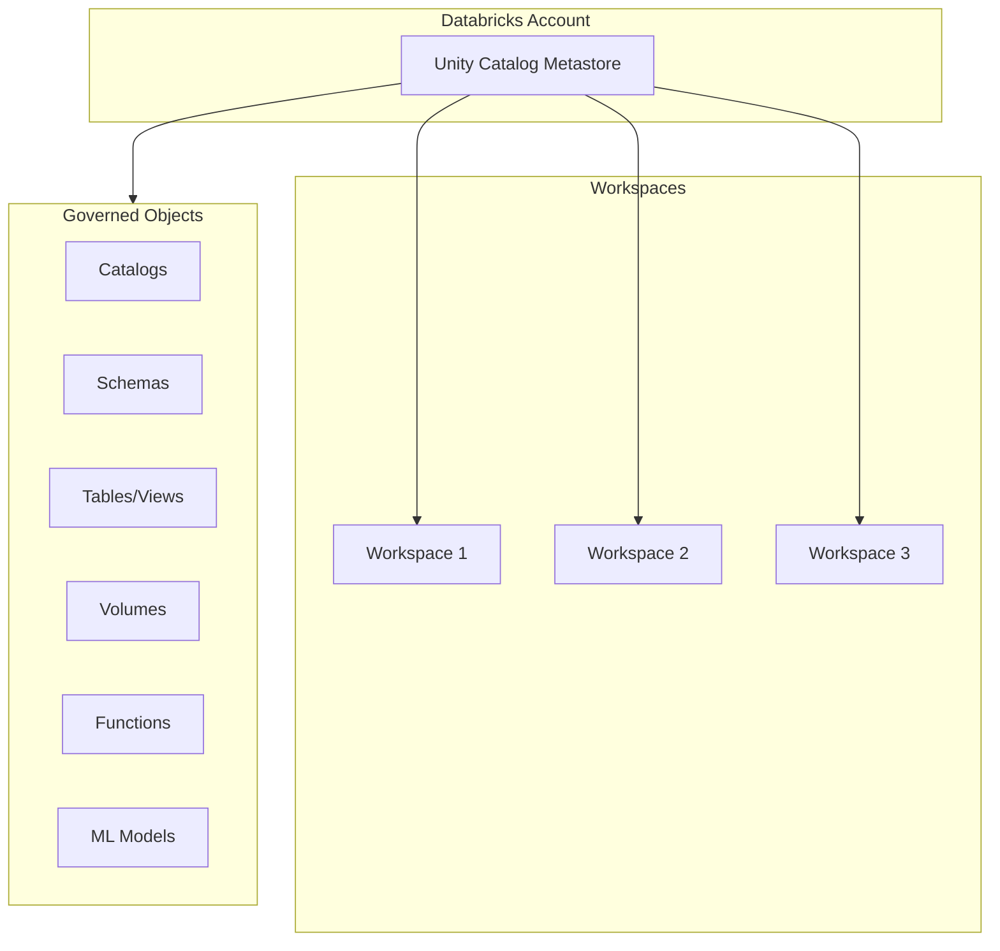
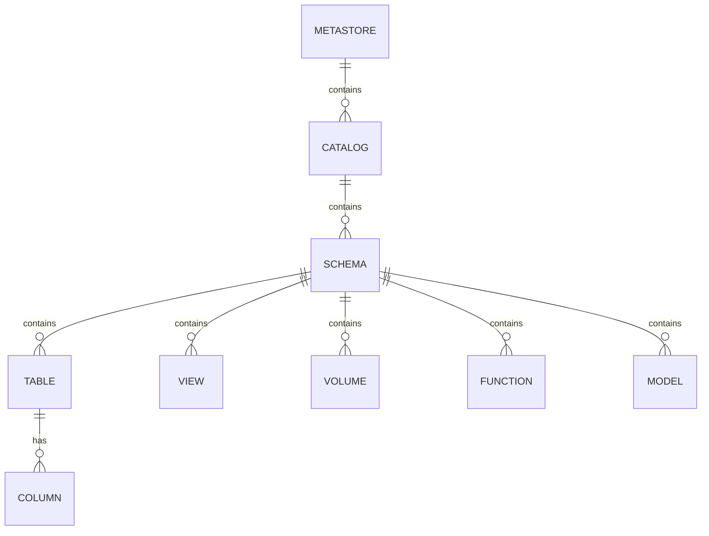
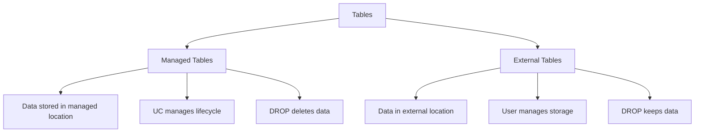
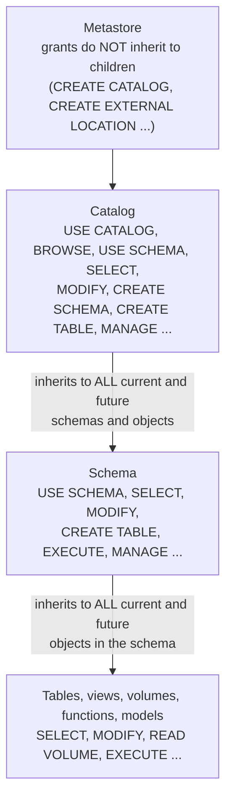

# Unity Catalog

Unity Catalog is Databricks' unified governance solution for data and AI assets. It provides centralized access control, auditing, lineage, and data discovery across workspaces.

## Overview



> [!abstract]
>
> - One metastore per region per account; objects are addressed as `catalog.schema.object`.
> - Privileges are granted on securable objects and **inherit downward** to all current and future child objects; `USE CATALOG` and `USE SCHEMA` gate access to everything below them.
> - Every object has one owner; ownership does not inherit, but owners (and `MANAGE` holders) can manage child objects.

> [!tip] What the Exam Tests
>
> - Demonstrate understanding of the Unity Catalog permission inheritance model as a mechanism for managing access control across catalogs, schemas, and objects.
> - Predict effective access from a set of grants (exam guide sample Question 8: `SELECT` on a catalog covers schemas and tables created later).
> - Distinguish ownership, `MANAGE`, `BROWSE`, `ALL PRIVILEGES`, and usage privileges.

## Unity Catalog Architecture

### Hierarchy



### Three-Level Namespace

All objects are referenced using a three-part name:

```sql
catalog_name.schema_name.object_name

-- Examples
main.default.customers
prod.sales.orders
dev.analytics.daily_metrics
```

| Level | Purpose | Examples |
| :--- | :--- | :--- |
| Catalog | Top-level container, often by environment or domain | `prod`, `dev`, `staging`, `sales`, `marketing` |
| Schema | Logical grouping (like database) | `raw`, `bronze`, `silver`, `gold`, `default` |
| Object | Tables, views, volumes, functions, models | `customers`, `orders`, `daily_revenue` |

## Metastore

The metastore is the top-level container for all Unity Catalog objects.

### Metastore Characteristics

| Aspect | Description |
| :--- | :--- |
| Scope | One per region per account |
| Storage | Managed storage location in cloud |
| Attachment | Attached to one or more workspaces |
| Admin | Metastore admin role has full control |

### Creating and Managing Metastore

```sql
-- Metastore is created via account console or API
-- Cannot be created via SQL

-- View metastore information
SELECT * FROM system.information_schema.metastores;

-- View current metastore
SELECT current_metastore();
```

### Metastore Admin Capabilities

- Create and manage catalogs
- Assign catalog ownership
- Create storage credentials and external locations
- Manage metastore-level settings
- Assign workspace access to catalogs

## Catalogs

Catalogs are the primary container for organizing data assets.

### Creating Catalogs

```sql
-- Create catalog
CREATE CATALOG IF NOT EXISTS prod;

-- Create catalog with comment
CREATE CATALOG dev
COMMENT 'Development environment catalog';

-- Create catalog with managed location
CREATE CATALOG staging
MANAGED LOCATION 's3://my-bucket/staging/';

-- View catalogs
SHOW CATALOGS;

-- Describe catalog
DESCRIBE CATALOG prod;

-- Drop catalog (must be empty)
DROP CATALOG IF EXISTS temp_catalog;

-- Force drop catalog with contents
DROP CATALOG IF EXISTS temp_catalog CASCADE;
```

### Catalog Best Practices

| Pattern | Example | Use Case |
| :--- | :--- | :--- |
| By environment | `prod`, `dev`, `staging` | Environment isolation |
| By domain | `sales`, `marketing`, `finance` | Business domain separation |
| By team | `data_engineering`, `data_science` | Team ownership |
| Hybrid | `prod_sales`, `dev_marketing` | Combined approach |

## Schemas

Schemas (also called databases) group related tables and objects.

### Creating Schemas

```sql
-- Set current catalog
USE CATALOG prod;

-- Create schema
CREATE SCHEMA IF NOT EXISTS sales;

-- Create schema with comment
CREATE SCHEMA bronze
COMMENT 'Raw data landing zone';

-- Create schema with managed location
CREATE SCHEMA gold
MANAGED LOCATION 's3://my-bucket/prod/gold/';

-- View schemas in current catalog
SHOW SCHEMAS;

-- View schemas in specific catalog
SHOW SCHEMAS IN prod;

-- Describe schema
DESCRIBE SCHEMA prod.sales;

-- Drop schema
DROP SCHEMA IF EXISTS temp_schema;
DROP SCHEMA IF EXISTS temp_schema CASCADE;
```

### Default Schema

Each catalog has a `default` schema created automatically:

```sql
-- These are equivalent
SELECT * FROM prod.default.customers;

USE CATALOG prod;
USE SCHEMA default;
SELECT * FROM customers;
```

## Tables

### Table Types



### Creating Tables

```sql
-- Managed table (default)
CREATE TABLE prod.sales.orders (
    order_id STRING,
    customer_id INT,
    order_date DATE,
    amount DECIMAL(18,2)
)
USING DELTA;

-- External table
CREATE TABLE prod.raw.external_data (
    id INT,
    data STRING
)
USING DELTA
LOCATION 's3://external-bucket/data/';

-- Create table from query
CREATE TABLE prod.gold.daily_revenue AS
SELECT
    order_date,
    SUM(amount) as total_revenue
FROM prod.silver.orders
GROUP BY order_date;
```

### Table Properties

```sql
-- View table details
DESCRIBE TABLE EXTENDED prod.sales.orders;

-- View table properties
SHOW TBLPROPERTIES prod.sales.orders;

-- Set table properties
ALTER TABLE prod.sales.orders SET TBLPROPERTIES (
    'delta.autoOptimize.optimizeWrite' = 'true'
);

-- Add table comment
COMMENT ON TABLE prod.sales.orders IS 'Sales orders fact table';
```

### Managed vs External Tables

| Aspect | Managed Table | External Table |
| :--- | :--- | :--- |
| Storage location | Unity Catalog managed | User-specified location |
| Data lifecycle | Managed by UC | User managed |
| DROP behavior | Deletes data | Keeps data |
| Creation | No LOCATION clause | LOCATION clause required |
| Best for | Most use cases | Existing data, shared storage |

## Views

### Creating Views

```sql
-- Standard view
CREATE VIEW prod.gold.customer_summary AS
SELECT
    customer_id,
    COUNT(*) as order_count,
    SUM(amount) as total_spent
FROM prod.silver.orders
GROUP BY customer_id;

-- Replace existing view
CREATE OR REPLACE VIEW prod.gold.customer_summary AS
SELECT
    customer_id,
    COUNT(*) as order_count,
    SUM(amount) as total_spent,
    MAX(order_date) as last_order
FROM prod.silver.orders
GROUP BY customer_id;

-- Materialized views: CREATE MATERIALIZED VIEW on a Pro or Serverless SQL warehouse,
-- or inside a Lakeflow pipeline (refreshes run on serverless pipelines)
```

### Dynamic Views for Security

```sql
-- Row-level security using current_user()
CREATE VIEW prod.sales.my_orders AS
SELECT *
FROM prod.sales.orders
WHERE sales_rep = current_user();

-- Column masking
CREATE VIEW prod.sales.orders_masked AS
SELECT
    order_id,
    customer_id,
    order_date,
    CASE
        WHEN is_account_group_member('finance') THEN amount
        ELSE NULL
    END as amount
FROM prod.sales.orders;
```

## Volumes

Volumes provide governed access to non-tabular data (files).

### Volume Types

| Type | Storage | Use Case |
| :--- | :--- | :--- |
| Managed | UC managed location | Generated files, outputs |
| External | User cloud storage | Landing zones, existing files |

### Creating Volumes

```sql
-- Managed volume
CREATE VOLUME prod.raw.landing_zone;

-- External volume
CREATE EXTERNAL VOLUME prod.raw.external_files
LOCATION 's3://my-bucket/external/';

-- List volumes
SHOW VOLUMES IN prod.raw;

-- Describe volume
DESCRIBE VOLUME prod.raw.landing_zone;
```

### Using Volumes

```python
# Volume paths

volume_path = "/Volumes/prod/raw/landing_zone/"

# Read from volume

df = spark.read.format("csv").load(f"{volume_path}data.csv")

# Write to volume

df.write.format("parquet").save(f"{volume_path}output/")

# File operations

dbutils.fs.ls(volume_path)
dbutils.fs.cp(f"{volume_path}file.csv", f"{volume_path}archive/file.csv")
```

## Storage Credentials and External Locations

### Storage Credentials

Storage credentials define how to authenticate to cloud storage (for example an IAM role for S3). They are created in Catalog Explorer (**Catalog** > **Connect** > **Credentials**), the Databricks CLI, or Terraform — there is no `CREATE STORAGE CREDENTIAL` SQL statement (SQL can list, describe, alter, and grant on them). Creating one requires the `CREATE STORAGE CREDENTIAL` privilege on the metastore (metastore admins have it by default).

```sql
-- Inspect storage credentials with SQL
SHOW STORAGE CREDENTIALS;
DESCRIBE STORAGE CREDENTIAL my_s3_credential;
```

### External Locations

External locations map cloud storage paths to Unity Catalog.

```sql
-- Create external location
CREATE EXTERNAL LOCATION my_landing_zone
URL 's3://my-bucket/landing/'
WITH (STORAGE CREDENTIAL my_s3_credential);

-- Grant access to external location
GRANT READ FILES, WRITE FILES ON EXTERNAL LOCATION my_landing_zone TO `data-engineers`;

-- List external locations
SHOW EXTERNAL LOCATIONS;
```

## Permission Model

Unity Catalog access control works by granting **privileges** on **securable objects**. Catalogs and schemas are **container objects**: a privilege granted on a container applies to its children through inheritance.

### Privilege Inheritance



| Rule | What it means |
| :--- | :--- |
| **Privileges inherit downward** | A privilege granted on a catalog applies to all schemas in it and all tables, views, volumes, and functions in those schemas; a privilege on a schema applies to all objects in the schema — **including objects created after the grant**. |
| **Usage privileges gate access** | To read a table you need `USE CATALOG` on the catalog, `USE SCHEMA` on the schema, **and** `SELECT` on the table (directly or inherited). `SELECT` alone is not enough. |
| **Usage privileges are a boundary** | Only catalog/schema owners or `MANAGE` holders can grant `USE CATALOG` / `USE SCHEMA`, so a table owner cannot share a table outside approved boundaries. |
| **Metastore grants don't inherit** | Metastore-level privileges control metastore-scoped operations (`CREATE CATALOG`, `CREATE EXTERNAL LOCATION`), not data access. `READ METADATA` on the metastore is the exception. |
| **Denials inherit too** | ABAC DENY policies (Beta, currently only `MANAGE ACCESS CONTROL`) apply to all current and future children and override any grant. |
| **ABAC follows the same rules** | Inheritance applies whether a privilege is granted manually or through an ABAC GRANT policy. |

> [!note]
> Metastores created during the Unity Catalog public preview (before August 25, 2022) may still run an earlier privilege model without inheritance; they can be upgraded to Privilege Model version 1.0.

### Inheritance in Practice (sample Question 8)

```sql
-- One statement: access the catalog, every schema, and every current AND future table
GRANT USE CATALOG, USE SCHEMA, SELECT ON CATALOG sales TO `finance_team`;

-- Engineers can create tables in any current or future schema of the catalog
GRANT USE CATALOG, USE SCHEMA, CREATE TABLE ON CATALOG analytics TO `data_engineers`;

-- Narrower: read every current and future table in one schema only
GRANT USE CATALOG ON CATALOG prod TO `analysts`;
GRANT USE SCHEMA, SELECT ON SCHEMA prod.gold TO `analysts`;
```

If `SELECT` is granted on a catalog and new schemas and tables are created later, the grantee can read the new tables (given the usage privileges) without any new grant. There is no need to re-grant per table, and no "future grants" syntax is required.

### Common Privileges

| Privilege | Lowest securable it applies to | Allows |
| :--- | :--- | :--- |
| `USE CATALOG` | Catalog | Prerequisite to interact with any object in the catalog |
| `USE SCHEMA` | Schema | Prerequisite to interact with any object in the schema |
| `BROWSE` | Catalog (granted at catalog level) | See objects and their metadata (names, comments, tags) and request access, without `USE CATALOG` / `USE SCHEMA` or data access |
| `SELECT` | Table, view | Read data |
| `MODIFY` | Table | Insert, update, and delete data (`INSERT`, `UPDATE`, `DELETE` child privileges are in Beta) |
| `CREATE SCHEMA` | Catalog | Create schemas |
| `CREATE TABLE` | Schema | Create tables and views |
| `CREATE VOLUME` / `READ VOLUME` / `WRITE VOLUME` | Schema / volume | Create volumes; read or write files in a volume |
| `EXECUTE` | Function, model | Call a function or use a model |
| `APPLY TAG` | Object | Add and edit tags on the object (and its columns) |
| `READ METADATA` | Any | Read-only visibility into metadata (a child of `MANAGE`) |
| `MANAGE` | Any | Manage privileges, transfer ownership, and drop the object without being the owner |
| `ALL PRIVILEGES` | Any | All applicable privileges, expanded at permission-check time; **excludes** `MANAGE`, `READ METADATA`, `EXTERNAL USE SCHEMA`, and `EXTERNAL USE LOCATION` |

Any privilege in the table can be granted on a parent container (for example `SELECT` on a schema or catalog) to cover the children by inheritance.

### Granting, Revoking, and Viewing Permissions

```sql
GRANT SELECT ON TABLE prod.gold.revenue TO `data-analysts`;
GRANT SELECT, MODIFY ON TABLE prod.silver.orders TO `data-engineers`;
GRANT ALL PRIVILEGES ON SCHEMA prod.silver TO `data-engineers`;   -- does not include MANAGE
GRANT MANAGE ON SCHEMA prod.gold TO `governance-admins`;          -- delegate grant management
GRANT BROWSE ON CATALOG prod TO `account users`;                  -- discoverability without data access

REVOKE SELECT ON TABLE prod.gold.revenue FROM `data-analysts`;
REVOKE ALL PRIVILEGES ON SCHEMA prod.silver FROM `data-engineers`;

-- SHOW GRANTS [principal] ON securable_object (inherited, denied, and granted privileges)
SHOW GRANTS ON TABLE prod.gold.revenue;
SHOW GRANTS `data-analysts` ON SCHEMA prod.gold;
```

> [!warning]
> Unity Catalog `GRANT` has no `WITH GRANT OPTION`. To let someone else administer grants on an object, grant `MANAGE` or transfer ownership. `SHOW GRANTS` always needs an `ON <securable>` clause.

## Ownership

Every securable object has exactly one owner (a user, service principal, or group); the principal that creates the object is the initial owner.

```sql
DESCRIBE TABLE EXTENDED prod.sales.orders;                      -- shows the owner
ALTER TABLE prod.sales.orders SET OWNER TO `data-engineering-team`;
ALTER SCHEMA prod.sales SET OWNER TO `sales-team`;
ALTER CATALOG prod SET OWNER TO `platform-team`;
```

| Capability | Owner | `MANAGE` privilege |
| :--- | :--- | :--- |
| All capabilities on the object | Yes, implied (not shown as `ALL PRIVILEGES` in `SHOW GRANTS`) | No — but can grant themselves privileges such as `SELECT` |
| Grant and revoke privileges, transfer ownership, drop | Yes | Yes |
| Manage child objects | Yes, implied for all current and future children | Yes, `MANAGE` on a container is inherited by its children |
| Usage privileges needed | Only on the containers above the object | Only on the containers strictly above where `MANAGE` is granted (`MANAGE` on a catalog needs none) |
| Number of principals | Exactly one | Many |

- **Ownership does not inherit.** Owning a catalog does not make you the owner of its schemas or tables, but you can manage all of them.
- Data access still needs usage privileges: `MANAGE` reduces usage requirements only for metadata and management actions, not for `SELECT` or `MODIFY`.
- Best practice: assign ownership of production objects to **groups** (the creator is the first owner and should reassign it), so administration does not depend on one person.

## Groups and Users

### Identity Management

```sql
-- Create group (account admin)
-- Done via account console or SCIM

-- Add user to group (account admin)
-- Done via account console or SCIM

-- Use groups in grants
GRANT SELECT ON TABLE prod.gold.revenue TO `data-analysts`;

-- Check group membership
SELECT is_account_group_member('data-analysts');

-- Get current user
SELECT current_user();
```

### Group-Based Access Pattern

```sql
-- Create role-based access
GRANT USE CATALOG ON CATALOG prod TO `analysts`;
GRANT USE SCHEMA ON SCHEMA prod.gold TO `analysts`;
GRANT SELECT ON SCHEMA prod.gold TO `analysts`;

GRANT USE CATALOG ON CATALOG prod TO `engineers`;
GRANT USE SCHEMA ON SCHEMA prod.silver TO `engineers`;
GRANT SELECT, MODIFY ON SCHEMA prod.silver TO `engineers`;
GRANT CREATE TABLE ON SCHEMA prod.silver TO `engineers`;
```

## Information Schema

Unity Catalog provides system tables for metadata queries.

```sql
-- List all catalogs
SELECT * FROM system.information_schema.catalogs;

-- List all schemas
SELECT * FROM system.information_schema.schemata
WHERE catalog_name = 'prod';

-- List all tables
SELECT * FROM system.information_schema.tables
WHERE table_schema = 'gold';

-- List all columns
SELECT * FROM system.information_schema.columns
WHERE table_name = 'orders';

-- List all privileges
SELECT * FROM system.information_schema.table_privileges
WHERE table_name = 'orders';
```

## Lineage

Unity Catalog automatically tracks data lineage.

Lineage is captured for queries run on Databricks at table and column level and is visible in Catalog Explorer, through the lineage API, and in the lineage system tables (rolling 1-year window):

```sql
SELECT source_table_full_name, target_table_full_name, entity_type, event_time
FROM system.access.table_lineage
WHERE target_table_full_name = 'prod.gold.daily_revenue'
ORDER BY event_time DESC;
-- Column-level lineage: system.access.column_lineage
```

## Migration from Hive Metastore

### Comparison

| Aspect | Hive Metastore | Unity Catalog |
| :--- | :--- | :--- |
| Scope | Workspace-level | Account-level |
| Governance | Limited | Comprehensive |
| Lineage | None | Automatic |
| Access control | Basic ACLs | Fine-grained |
| Data sharing | Not supported | OpenSharing |

### Migration Approaches

```sql
-- External (or externally stored managed) Hive tables -> UC external tables, metadata only
SYNC TABLE prod.bronze.my_table FROM hive_metastore.default.my_table DRY RUN;
SYNC TABLE prod.bronze.my_table FROM hive_metastore.default.my_table;
SYNC SCHEMA prod.bronze FROM hive_metastore.default SET OWNER `data-engineering-team`;

-- Hive managed tables stored in workspace storage (DBFS root) -> copy into a UC managed table
CREATE TABLE prod.bronze.my_managed_table DEEP CLONE hive_metastore.default.my_managed_table;
```

`SYNC` records the target in an `upgraded_to` table property on the source table for bookkeeping; it cannot upgrade Hive managed tables stored in DBFS root.

## Use Cases

### Multi-Environment Setup

```sql
-- Create environment catalogs
CREATE CATALOG dev;
CREATE CATALOG staging;
CREATE CATALOG prod;

-- Same schema structure across environments
CREATE SCHEMA dev.sales;
CREATE SCHEMA staging.sales;
CREATE SCHEMA prod.sales;

-- Environment-specific permissions
GRANT ALL PRIVILEGES ON CATALOG dev TO `developers`;
GRANT USE CATALOG, USE SCHEMA, SELECT ON CATALOG staging TO `developers`;  -- read all, incl. future tables
GRANT USE CATALOG ON CATALOG prod TO `analysts`;
GRANT USE SCHEMA, SELECT ON SCHEMA prod.gold TO `analysts`;
```

### Data Mesh Pattern

```sql
-- Domain-based catalogs
CREATE CATALOG sales_domain;
CREATE CATALOG marketing_domain;
CREATE CATALOG finance_domain;

-- Each domain manages their own data
GRANT ALL PRIVILEGES ON CATALOG sales_domain TO `sales-data-team`;
GRANT ALL PRIVILEGES ON CATALOG marketing_domain TO `marketing-data-team`;

-- Cross-domain read access
GRANT USE CATALOG, USE SCHEMA, SELECT ON CATALOG sales_domain TO `marketing-data-team`;
```

## Common Issues & Errors

### Permission Denied

**Scenario:** User cannot access table.

**Fix:** Grant required privileges:

```sql
-- Check what's missing (SHOW GRANTS needs an ON clause)
SHOW GRANTS `user@company.com` ON TABLE prod.gold.revenue;
SHOW GRANTS `user@company.com` ON SCHEMA prod.gold;

-- Grant catalog access
GRANT USE CATALOG ON CATALOG prod TO `user@company.com`;

-- Grant schema access
GRANT USE SCHEMA ON SCHEMA prod.gold TO `user@company.com`;

-- Grant table access
GRANT SELECT ON TABLE prod.gold.revenue TO `user@company.com`;
```

### Cannot Create External Table

**Scenario:** External location not configured.

**Fix:** Create external location first:

```sql
-- Create storage credential and external location
-- Then create table
CREATE TABLE prod.raw.external_data
USING DELTA
LOCATION 's3://bucket/path/';
```

### Catalog Not Visible

**Scenario:** User cannot see catalog.

**Fix:** Grant USE CATALOG:

```sql
GRANT USE CATALOG ON CATALOG prod TO `data-team`;
```

## Exam Tips

1. **Three-level namespace** - Always `catalog.schema.object`
2. **Managed vs External** - Managed tables have UC-managed storage and lifecycle
3. **Permission inheritance** - Privileges granted on a catalog or schema apply to all current AND future children; still need USE CATALOG and USE SCHEMA
4. **Metastore scope** - One per region per account
5. **Ownership** - One owner per object; ownership does not inherit, but owners can manage all child objects
6. **Storage credentials** - Required for external locations
7. **Volumes** - For non-tabular file access with governance
8. **Groups** - Use groups for scalable access management
9. **Information schema** - Query metadata via `system.information_schema`
10. **Lineage** - Automatic, visible in Catalog Explorer and `system.access.table_lineage`
11. **No `WITH GRANT OPTION`** - Delegate with `MANAGE`; `ALL PRIVILEGES` excludes `MANAGE`

## Key Takeaways

- **Three-level namespace**: every Unity Catalog object is referenced as `catalog.schema.object`; the metastore is one level above the catalog and is scoped to one per cloud region per account
- **Managed vs external tables**: managed tables store data in the UC-controlled location and `DROP TABLE` deletes the data; external tables store data at a user-specified `LOCATION` and `DROP TABLE` keeps the data
- **Permission hierarchy**: to access a table, a user must have `USE CATALOG` on the catalog, `USE SCHEMA` on the schema, and then the relevant privilege (e.g., `SELECT`) on the table — missing any level causes permission denied
- **Volume types**: managed volumes store files in the UC-managed location; external volumes point to a user-controlled cloud path; both are accessed via `/Volumes/<catalog>/<schema>/<volume>/` paths
- **Storage credentials and external locations**: a storage credential holds the cloud authentication (IAM role / managed identity); an external location maps a cloud storage URL to a credential; external tables and volumes require a matching external location
- **Dynamic views for row/column security**: `current_user()` and `is_account_group_member()` in view `WHERE` / `CASE` clauses enforce user-specific data access without modifying the underlying table
- **Privilege inheritance**: a grant on a catalog or schema applies to all current and future child objects, so `SELECT` on a catalog covers schemas and tables created later (with `USE CATALOG` / `USE SCHEMA`); metastore-level grants do not inherit
- **Ownership model**: every UC object has exactly one owner with full control (grant, alter, drop, transfer); ownership does not inherit downward but owners can manage all child objects; `MANAGE` delegates grant management without ownership; `BROWSE` exposes metadata without data access
- **Information schema**: `system.information_schema.tables`, `.columns`, `.table_privileges`, `.schemata` provide SQL-standard metadata and are permission-filtered (users only see what they have access to)

## Related Topics

- [Access Control](../06-ensuring-data-security-and-compliance/01-access-control.md) - Row/column level security
- [Data Sharing](../02-data-ingestion-and-acquisition/06-opensharing.md) - OpenSharing
- [Secret Management](../06-ensuring-data-security-and-compliance/05-secret-management.md) - Secure credentials
- [Tags, Comments, and Discoverability](./02-tags-comments-and-discoverability.md) - Metadata for discovery
- [ABAC Policies and Governed Tags](../06-ensuring-data-security-and-compliance/02-abac-governed-tags.md) - Tag-driven row filters and column masks

## Official Documentation

- [Unity Catalog permissions model concepts](https://docs.databricks.com/aws/en/data-governance/unity-catalog/access-control/permissions-concepts)
- [Unity Catalog privileges reference](https://docs.databricks.com/aws/en/data-governance/unity-catalog/access-control/privileges-reference)
- [Unity Catalog best practices](https://docs.databricks.com/aws/en/data-governance/unity-catalog/best-practices)
- [GRANT](https://docs.databricks.com/aws/en/sql/language-manual/security-grant)
- [SHOW GRANTS](https://docs.databricks.com/aws/en/sql/language-manual/security-show-grant)
- [Manage storage credentials](https://docs.databricks.com/aws/en/connect/unity-catalog/cloud-storage/manage-storage-credentials)
- [SYNC](https://docs.databricks.com/aws/en/sql/language-manual/sql-ref-syntax-aux-sync)
- [Data lineage](https://docs.databricks.com/aws/en/data-governance/unity-catalog/data-lineage)
- [CREATE MATERIALIZED VIEW](https://docs.databricks.com/aws/en/sql/language-manual/sql-ref-syntax-ddl-create-materialized-view)

---

**[← Previous: Audit Logging, Data Lineage & Network Security](../06-ensuring-data-security-and-compliance/06-audit-lineage-network-security.md) | [↑ Back to Section](./README.md) | [Next: Tags, Comments, and Discoverability →](./02-tags-comments-and-discoverability.md)**
