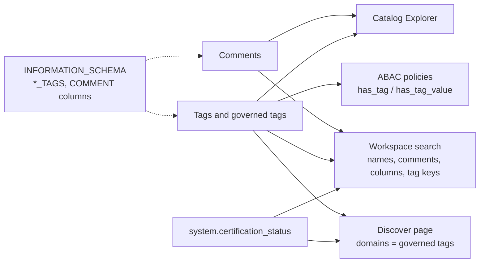

# Tags, Comments, and Discoverability

## Overview

Unity Catalog lets you attach two kinds of descriptive metadata to securable objects: **comments** (free-text descriptions) and **tags** (key/optional-value attributes). Both feed workspace search, Catalog Explorer, and the Discover page, and tags additionally drive classification, certification, domains, and ABAC policies.

> [!abstract]
>
> - **Comments** describe catalogs, schemas, tables, views, columns, and volumes; they are set with `COMMENT ON`, `COMMENT` clauses in `CREATE` / `ALTER`, or AI-generated suggestions in Catalog Explorer.
> - **Tags** are key/optional-value pairs set with `ALTER ... SET TAGS` or `SET TAG ON`; **governed tags** add an account-level allowed-value list and `ASSIGN` permission; **system tags** are predefined by Databricks.
> - Metadata is queryable through `INFORMATION_SCHEMA` (`*_TAGS` views, `COMMENT` columns) and searchable from the workspace search bar.
> - Discovery surfaces: workspace search, Catalog Explorer, and the curated **Discover** page organized by **domains** (built on governed tags).

> [!tip] What the Exam Tests
>
> - Demonstrate understanding of Unity Catalog tags and comments as mechanisms for adding metadata to securable objects to improve data discoverability.
> - Pick the right mechanism: comment (human description) vs ungoverned tag (flexible label) vs governed tag (controlled vocabulary, policy-ready) vs certification system tag (trust signal).
> - Know the SQL to set and query tags and comments, and the privileges required (`APPLY TAG`, `MODIFY`, ownership, `ASSIGN`, `BROWSE`).

---

## Metadata Mechanisms Compared

| Mechanism | What it is | Set with | Used for |
| :--- | :--- | :--- | :--- |
| **Comment** | Free-text description of an object or column | `COMMENT ON`, `COMMENT` clause, AI-generated comments | Human understanding; indexed by search |
| **Ungoverned tag** | Key with optional value, any user with `APPLY TAG` can set any value | `ALTER ... SET TAGS`, `SET TAG ON` | Flexible labels (team, project, cost center) |
| **Governed tag** | Account-level tag key with a tag policy (allowed values, who may assign) | Same SQL, plus `ASSIGN` on the tag | Consistent classification, domains, ABAC policies |
| **System governed tag** | Governed tag predefined by Databricks (`system.certification_status`, `class.*`, `ai.*`) | UI or SQL; needs `ASSIGN` | Certification/deprecation, Data Classification results |
| **Domain** | Business-aligned grouping on the Discover page, built on a governed tag | Discover page (curators) | Browsing assets by business area |



## Comments

### Setting comments

```sql
-- At creation time
CREATE CATALOG sales COMMENT 'Sales domain data, owned by revenue engineering';
CREATE SCHEMA sales.gold COMMENT 'Curated, business-ready sales tables';
CREATE TABLE sales.gold.orders (
  order_id BIGINT COMMENT 'Surrogate key from the order system',
  amount   DECIMAL(18, 2) COMMENT 'Order total in USD'
) COMMENT 'One row per completed order';

-- Afterwards with COMMENT ON
COMMENT ON TABLE sales.gold.orders IS 'One row per completed order, refreshed hourly';
COMMENT ON COLUMN sales.gold.orders.amount IS 'Order total in USD, tax included';  -- DBR 16.1+
COMMENT ON SCHEMA sales.gold IS 'Curated sales layer';
COMMENT ON VOLUME sales.raw.landing IS 'Raw CSV drops from the POS vendor';
COMMENT ON TABLE sales.gold.orders IS NULL;   -- NULL removes the comment

-- Or with ALTER TABLE
ALTER TABLE sales.gold.orders ALTER COLUMN amount COMMENT 'Order total in USD';
```

`COMMENT ON` supports catalogs, schemas, tables (including streaming tables, views, and materialized views), columns, volumes, connections, shares, recipients, and providers.

### Privileges to set comments

| Object | Required |
| :--- | :--- |
| Catalog, schema, volume | Owner or `MANAGE` on the object |
| Table or column of a table | `MODIFY` on the table |
| View or column of a view | Owner of the view |
| Materialized view | `COMMENT ON` requires Databricks Runtime 16.3+ |

### AI-generated comments

In Catalog Explorer, **AI generate** suggests a description for catalogs, schemas, tables, views, materialized views, table columns, functions, models, and volumes, based on metadata such as the table schema and column names. You review it and **Accept** or **Edit** before saving.

| Fact | Detail |
| :--- | :--- |
| Who can add them | Object owner or a user with `MODIFY` (views and materialized views: owner only) |
| Toggle | No workspace- or catalog-level switch; generated per object on request |
| Side effect | Saving runs an `ALTER` statement, which can disrupt running pipelines and jobs |
| Review | Human review is strongly recommended; the model should **not** be relied on to detect PII |
| Viewing | `BROWSE` on the catalog is enough to view comments without `USE CATALOG` / `USE SCHEMA` |

## Tags

Tags are attributes with a key and an optional value. Unity Catalog supports tags on catalogs, schemas, tables, table columns, volumes, views, functions, registered models, model versions, secrets, external metadata objects, and services; dashboards, Genie Agents, apps, and notebooks can be tagged too.

### Setting tags

```sql
-- Databricks Runtime 13.3+: ALTER <object> ... SET TAGS / UNSET TAGS
ALTER CATALOG sales SET TAGS ('domain' = 'revenue');
ALTER SCHEMA sales.gold SET TAGS ('layer' = 'gold', 'owner_team' = 'revenue_eng');
ALTER TABLE sales.gold.orders SET TAGS ('refresh' = 'hourly');
ALTER TABLE sales.gold.orders ALTER COLUMN customer_email SET TAGS ('pii' = 'email');
ALTER TABLE sales.gold.orders UNSET TAGS ('refresh');

-- Databricks Runtime 16.1+: SET TAG / UNSET TAG (one tag per statement)
SET TAG ON TABLE sales.gold.orders cost_center = revenue;
SET TAG ON COLUMN sales.gold.orders.customer_email pii = email;
UNSET TAG ON COLUMN sales.gold.orders.customer_email pii;
```

### Requirements and constraints

- Own the object, or have `APPLY TAG` on the object plus `USE SCHEMA` on its schema and `USE CATALOG` on its catalog.
- For a **governed** tag you also need `ASSIGN` on that governed tag, and the value must be in its allowed list.
- Up to 50 tags per securable object and 1,000 column tags per table; keys and values up to 256 characters; keys are case-sensitive (`Sales` and `sales` are different tags), some special characters are not allowed, and leading or trailing spaces are rejected.
- One column per `ALTER TABLE ... SET TAGS` statement (unlike `COMMENT`, which can change several columns at once).
- A column that carries a governed tag cannot be dropped until the tag is removed.

> [!warning]
> Tag data is stored as plain text and may be replicated globally. Never put personal or sensitive information in tag names or values.

### Inheritance

Tags applied to a catalog or schema are implicitly inherited by objects beneath it **only when ABAC policies are evaluated**; columns never inherit table tags. Outside ABAC evaluation, tags are not copied down the hierarchy. The separate **tag propagation** feature (Beta, Oct 12, 2026) copies governed tags along **lineage** to derived tables and views.

### Governed vs ungoverned tags

| Aspect | Ungoverned tag | Governed tag |
| :--- | :--- | :--- |
| Defined | Ad hoc on any object | At the account level with a tag policy |
| Values | Any value | Only values from the allowed list (max 500 per tag) |
| Who can assign | Anyone with `APPLY TAG` on the object | Requires `ASSIGN` on the governed tag **and** `APPLY TAG` on the object |
| Usable in ABAC policies | No | Yes |
| Basis for domains | No | Yes |
| UI marker | Listed under **Other** | Lock icon, listed under **Governed** |

Creating a governed tag with an existing key turns all existing assignments of that key into governed assignments; deleting a governed tag leaves the assignments in place but ungoverned.

### Certification and deprecation

The system governed tag `system.certification_status` has two values: `certified` (check mark in the workspace) and `deprecated` (restricted icon). It applies to catalogs, schemas, tables, views, volumes, functions, registered models, dashboards, Genie Agents, apps, and notebooks, and requires `ASSIGN` on the tag plus the usual tagging privileges.

```sql
SET TAG ON TABLE sales.gold.orders `system.certification_status` = `certified`;
SET TAG ON TABLE sales.gold.orders_v1 `system.certification_status` = `deprecated`;
```

Certification can also be automated at scale with automated tag assignment rules (Beta), for example deprecating tables with no reads or writes in 30 days.

## Querying Metadata with SQL

Each catalog's `INFORMATION_SCHEMA` exposes tags and comments; rows are filtered to objects the user has permission to interact with.

| View | Contains |
| :--- | :--- |
| `INFORMATION_SCHEMA.CATALOG_TAGS` | `catalog_name`, `tag_name`, `tag_value` |
| `INFORMATION_SCHEMA.SCHEMA_TAGS` | Tags on schemas |
| `INFORMATION_SCHEMA.TABLE_TAGS` | Tags on tables, views, and materialized views (`catalog_name`, `schema_name`, `table_name`, `tag_name`, `tag_value`) |
| `INFORMATION_SCHEMA.COLUMN_TAGS` | Column tags, adds `column_name` |
| `INFORMATION_SCHEMA.VOLUME_TAGS` | Tags on volumes |
| `INFORMATION_SCHEMA.TABLES` / `COLUMNS` | `COMMENT` column holds the table / column comment |

```sql
-- Every column tagged pii in the sales catalog
SELECT schema_name, table_name, column_name, tag_value
FROM sales.information_schema.column_tags
WHERE tag_name = 'pii';

-- Metastore-wide: certified tables (system catalog sees all catalogs you can access)
SELECT catalog_name, schema_name, table_name
FROM system.information_schema.table_tags
WHERE tag_name = 'system.certification_status' AND tag_value = 'certified';

-- Tables with no description (documentation gaps)
SELECT table_catalog, table_schema, table_name
FROM system.information_schema.tables
WHERE comment IS NULL AND table_schema <> 'information_schema';

-- Comments and tags for one table
DESCRIBE TABLE EXTENDED sales.gold.orders;
```

> [!note]
> The `*_TAGS` views use `catalog_name` / `schema_name` columns, while `INFORMATION_SCHEMA.TABLES` and `COLUMNS` use the SQL-standard `table_catalog` / `table_schema`.

## Discoverability Surfaces

### Workspace search

- Searches table, view, and model **names and comments**, **column names and comments**, and **tag keys** for Unity Catalog objects (tables must be registered in Unity Catalog; `hive_metastore` tables are not returned).
- Tag syntax: `tag:<tag_key>` or `tag:<tag_key>:<tag_value>` (exact term match). Tag search covers tables, views, models, volumes, functions, dashboards, Genie Agents, and notebooks — not catalogs, schemas, or columns.
- Filters such as `type:table owner:me` and `type:table certificationStatus:certified`.
- AI-generated comments make search aware of company jargon; popularity signals rank frequently used tables higher; semantic natural-language search over tables is in Public Preview.
- Results are permission-filtered: tag search requires at least `BROWSE` on the object or its parent catalog.

### The BROWSE privilege

`BROWSE` lets users discover objects and see their name, description, and tags, and request access, **without** `USE CATALOG`, `USE SCHEMA`, or any data access. For data objects it is granted at the catalog level and covers everything in the catalog. Databricks recommends granting `BROWSE` on catalogs to the `All account users` group.

```sql
GRANT BROWSE ON CATALOG sales TO `account users`;
```

### Catalog Explorer

Catalog Explorer shows everything in the catalog hierarchy: object details, comments, tags, permissions, sample data, and lineage. It is where tags, comments, and AI-generated descriptions are edited, and where certification badges appear next to object names.

### Discover page and domains

The **Discover** page is a curated browsing experience: consumers find assets organized by **domains** and **subdomains** or by asset type, see certified and AI-recommended assets, and search, without needing to know catalog hierarchies.

| Concept | Detail |
| :--- | :--- |
| Domain | Account-level grouping of assets (tables, dashboards, notebooks, Genie Agents) **built on a governed tag**; tag an asset with the domain's governed tag to add it |
| Subdomain | One level of nesting, named `{parentDomainTag}/{subdomainName}` (for example `Finance/Tax`); tagging `Finance/Tax` does not also tag `Finance` |
| Curators | Need `MANAGE DISCOVER` at the account level or `MANAGE` on a domain/subdomain; account and workspace admins hold `MANAGE DISCOVER` by default |
| Consumers | Browse domains, asset types, certified assets, and Genie-recommended domains (published by a curator) |
| Lifecycle | New domains start as drafts visible only to curators until published |

> [!note] Platform update (Oct 2026)
> The Discover page and domains became generally available on Oct 8, 2026. Source: [October 2026 release notes](https://docs.databricks.com/aws/en/release-notes/product/2026/october)

## Use Cases

- **Self-service discovery:** comments on every gold table and column, `BROWSE` granted to all account users, and certified tags let analysts find the authoritative `orders` table through search without filing access tickets.
- **Data-mesh navigation:** governed `domain` tags power Discover page domains, so marketing users browse "Marketing" assets across many catalogs.
- **Documentation audits:** a scheduled query on `information_schema.tables` flags tables with `comment IS NULL` for owners to fix, using AI-generated comments as a starting point.
- **Deprecation:** tagging an old table `system.certification_status = deprecated` warns consumers in search and the SQL editor before the table is dropped.

## Common Issues & Errors

| Symptom | Cause | Fix |
| :--- | :--- | :--- |
| `SET TAGS` on a column fails with a permission error | Missing `APPLY TAG` (or `USE CATALOG` / `USE SCHEMA`), or missing `ASSIGN` for a governed tag | Grant `APPLY TAG` on the table and `ASSIGN` on the governed tag |
| Governed tag value rejected | Value not in the tag's allowed list | Use an allowed value or ask a `MANAGE` holder to add it |
| Tag query returns no rows | Querying the wrong view or columns (`table_catalog` instead of `catalog_name`), or no privileges on the objects | Use `*_TAGS` views with `catalog_name` / `schema_name`; check grants |
| `COMMENT ON COLUMN` fails | Databricks Runtime below 16.1, or no `MODIFY` on the table | Use `ALTER TABLE ... ALTER COLUMN ... COMMENT` or upgrade; grant `MODIFY` |
| Saving an AI comment broke a streaming job | Saving issues an `ALTER` on the table | Add comments outside pipeline run windows or define them in the pipeline code |
| Table not found by tag search | User lacks `BROWSE`, the object type doesn't support tag search, or exact term not used | Grant `BROWSE` on the catalog; search `tag:<key>:<value>` exactly |

## Exam Tips

> [!tip]
>
> - Tags and comments are **metadata on securable objects**; they never grant or restrict access on their own (ABAC policies use governed tags to do that).
> - `COMMENT ON <object> ... IS '...'` sets a comment; `IS NULL` removes it. Column comments: `COMMENT ON COLUMN` (DBR 16.1+) or `ALTER TABLE ... ALTER COLUMN ... COMMENT`.
> - Tags: `ALTER <object> SET TAGS ('k' = 'v')` (DBR 13.3+) or `SET TAG ON <object> k = v` (DBR 16.1+). Query with `INFORMATION_SCHEMA.TABLE_TAGS` / `COLUMN_TAGS`.
> - Tagging needs `APPLY TAG` on the object (or ownership); governed tags also need `ASSIGN`.
> - `BROWSE` = see that data exists (names, comments, tags) without reading it — the discoverability privilege.
> - "Controlled vocabulary that only stewards can apply" → **governed tag**. "Mark the trusted table" → `system.certification_status = certified`.

## Key Takeaways

- **Comments** document objects and columns for humans and search; set them with `COMMENT ON`, `COMMENT` clauses, or AI-generated suggestions that require human review.
- **Tags** are key/optional-value attributes on catalogs, schemas, tables, columns, volumes, views, functions, models, and more; they make assets searchable and filterable.
- **Governed tags** add account-level allowed values and an `ASSIGN` permission, enabling consistent classification, domains, and ABAC; **system tags** such as `system.certification_status` and `class.*` are predefined.
- **INFORMATION_SCHEMA** exposes `CATALOG_TAGS`, `SCHEMA_TAGS`, `TABLE_TAGS`, `COLUMN_TAGS`, `VOLUME_TAGS`, and `COMMENT` columns, filtered by the caller's permissions.
- **Discovery** happens through workspace search (names, comments, columns, tags), Catalog Explorer, and the Discover page with domains (GA Oct 8, 2026); `BROWSE` makes metadata visible without data access.

## Related Topics

- [Unity Catalog](./01-unity-catalog.md) — object hierarchy and permission inheritance
- [ABAC Policies and Governed Tags](../06-ensuring-data-security-and-compliance/02-abac-governed-tags.md) — governed tags as policy attributes
- [Data Classification, Compliance & Permissions](../06-ensuring-data-security-and-compliance/04-classification-compliance-permissions.md) — tag-based classification patterns
- [Anonymization, PII Controls, and Data Purging](../06-ensuring-data-security-and-compliance/03-anonymization-pii-and-data-purging.md) — Data Classification `class.*` tags

## Official Documentation

- [Apply tags to Unity Catalog securable objects](https://docs.databricks.com/aws/en/database-objects/tags)
- [SET TAG](https://docs.databricks.com/aws/en/sql/language-manual/sql-ref-syntax-ddl-set-tag)
- [COMMENT ON](https://docs.databricks.com/aws/en/sql/language-manual/sql-ref-syntax-ddl-comment)
- [ALTER TABLE COLUMN clause](https://docs.databricks.com/aws/en/sql/language-manual/sql-ref-syntax-ddl-alter-table-manage-column)
- [Add AI-generated comments to Unity Catalog objects](https://docs.databricks.com/aws/en/comments/ai-comments)
- [Governed tags](https://docs.databricks.com/aws/en/admin/governed-tags/)
- [Flag data as certified or deprecated](https://docs.databricks.com/aws/en/data-governance/unity-catalog/certify-deprecate-data)
- [TABLE_TAGS](https://docs.databricks.com/aws/en/sql/language-manual/information-schema/table_tags)
- [COLUMN_TAGS](https://docs.databricks.com/aws/en/sql/language-manual/information-schema/column_tags)
- [Information schema](https://docs.databricks.com/aws/en/sql/language-manual/sql-ref-information-schema)
- [Search for workspace objects](https://docs.databricks.com/aws/en/search/)
- [Data discovery in Unity Catalog](https://docs.databricks.com/aws/en/data-governance/unity-catalog/data-discovery)
- [Discover page](https://docs.databricks.com/aws/en/discover/discover-page)
- [Domains and subdomains](https://docs.databricks.com/aws/en/uc-semantics/domains)
- [Unity Catalog permissions model concepts (BROWSE)](https://docs.databricks.com/aws/en/data-governance/unity-catalog/access-control/permissions-concepts)
- [Tag propagation](https://docs.databricks.com/aws/en/admin/governed-tags/tag-propagation)

---

**[← Previous: Unity Catalog](./01-unity-catalog.md) | [↑ Back to Section](./README.md) | [Next: DBFS and Cloud Storage →](./03-dbfs-and-uc-volumes.md)**
