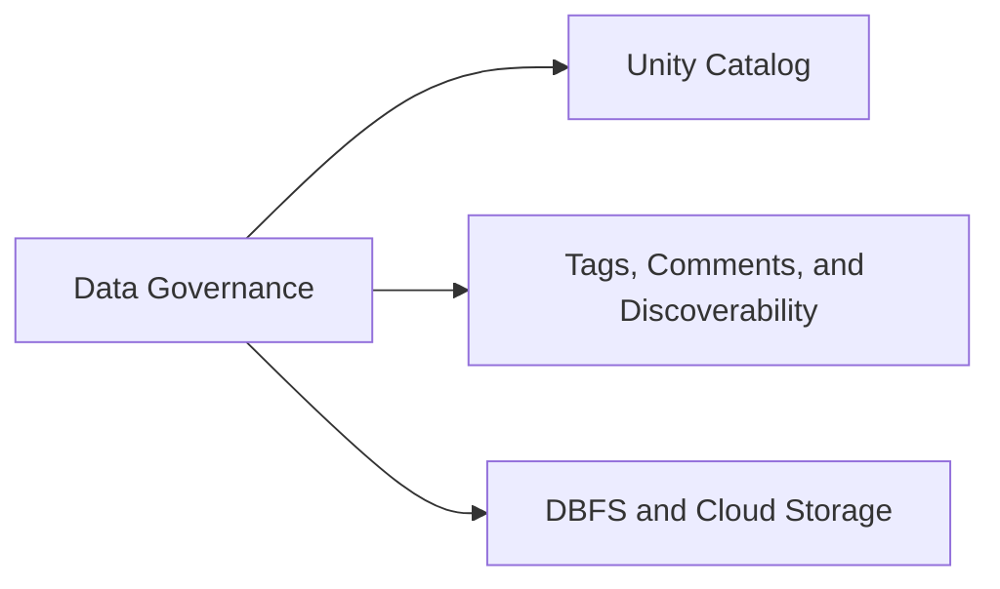

# Section 7: Data Governance (5 % of Exam)

Organising and describing data in Unity Catalog: the object hierarchy and permission inheritance model, tags and comments for discoverability, and Volumes vs legacy DBFS.

## Topics Overview

## Section Contents

| File | Topic | Priority |
| :--- | :--- | :--- |
| [01-unity-catalog.md](./01-unity-catalog.md) | UC hierarchy, securables, permission inheritance, ownership | High |
| [02-tags-comments-and-discoverability.md](./02-tags-comments-and-discoverability.md) | Tags and comments on securables; search and discovery | High |
| [03-dbfs-and-uc-volumes.md](./03-dbfs-and-uc-volumes.md) | UC Volumes vs DBFS and mounts | Medium |

## Exam Skill Coverage

Every skill bullet in Section 7 of the Oct 9, 2026 exam guide, with the files that cover it.

| Exam guide skill | Where it is covered |
| :--- | :--- |
| Demonstrate understanding of Unity Catalog tags and comments as mechanisms for adding metadata to securable objects to improve data discoverability. | [02-tags-comments-and-discoverability.md](./02-tags-comments-and-discoverability.md) |
| Demonstrate understanding of the Unity Catalog permission inheritance model as a mechanism for managing access control across catalogs, schemas, and objects. | [01-unity-catalog.md](./01-unity-catalog.md) |

## Key Concepts to Master

| Concept | Why it matters |
| :--- | :--- |
| **Permission inheritance** | A privilege granted on a catalog or schema applies to every current and future object below it |
| **`USE CATALOG` / `USE SCHEMA`** | Required on each parent before a child privilege such as `SELECT` can be used |
| **Tags and comments** | Metadata on securables that drives search, discovery and (with governed tags) policy |

## Related Resources

- [Unity Catalog cheat sheet](../resources/cheat-sheets/unity-catalog-quick-ref.md)
- [Unity Catalog Basics (shared)](../../../shared/fundamentals/unity-catalog-basics.md)

---

**[← Previous: Ensuring Data Security and Compliance](../06-ensuring-data-security-and-compliance/README.md) | [↑ Back to DE Professional](../README.md) | [Next: Debugging and Deploying →](../08-debugging-and-deploying/README.md)**
