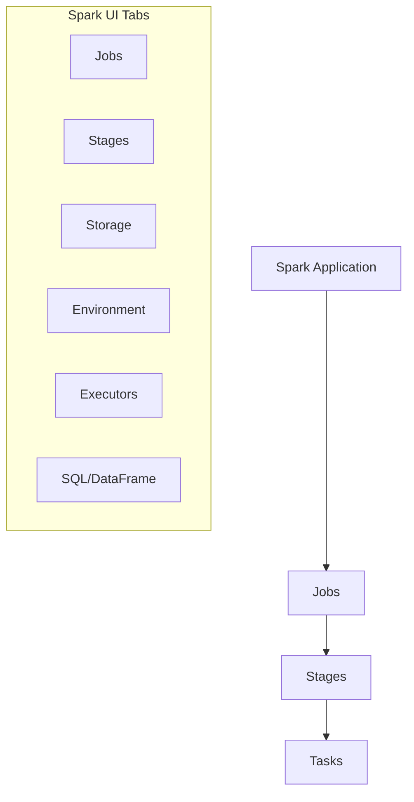
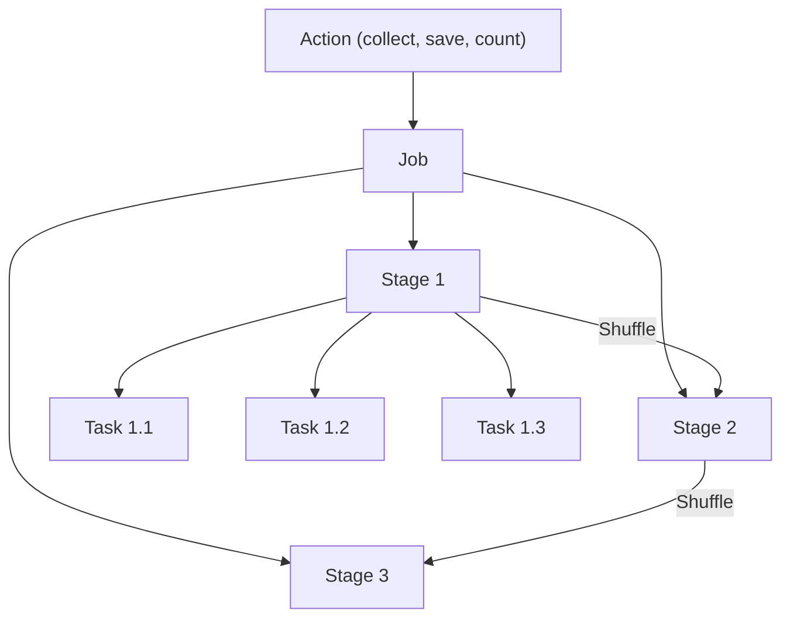
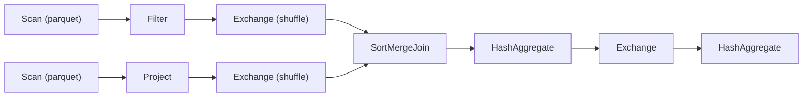

# Spark UI Debugging

## Overview

The Spark UI shows how a Spark application executed: jobs, stages, tasks, executors, and SQL plans. That makes it the main tool for finding skew, spill, and resource problems on classic compute. It is one of four diagnostic sources the exam names, alongside **cluster (compute) logs**, **system tables**, and **query profiles**, and you need to know which one answers which question.

> [!abstract]
>
> - Spark execution hierarchy: an action creates a job, shuffle boundaries split it into stages, and each partition becomes a task
> - Spark UI tabs (Jobs, Stages, Executors, SQL/DataFrame) expose skew, spill, GC pressure, and join strategy
> - Compute logs: driver logs (stdout, stderr, Log4j), worker logs, the compute event log, and log delivery to a Unity Catalog volume
> - Serverless compute has no Spark UI or Spark logs: use the query profile, query history, and the job run timeline instead

> [!tip] What the Exam Tests
>
> - "Identify pertinent diagnostic information using Spark UI, cluster logs, system tables, and query profiles to troubleshoot errors."
> - Reading stage and task metrics to tell skew, spill, small files, and failed broadcasts apart
> - Picking the right diagnostic source for a symptom, including what is (and is not) available on serverless

---

## Spark UI Tabs at a Glance



## Spark Execution Hierarchy

### Jobs, Stages, and Tasks



| Level | Created By | Characteristics |
| :--- | :--- | :--- |
| Job | Each action (save, collect, count) | Contains multiple stages |
| Stage | Shuffle boundaries | Contains multiple tasks |
| Task | Partitions | Smallest unit of work |

### What Triggers Shuffles

| Operation | Causes Shuffle |
| :--- | :--- |
| `groupBy`, `reduceByKey` | Yes |
| `join` (most types) | Yes |
| `repartition` | Yes |
| `distinct` | Yes |
| `orderBy`, `sort` | Yes |
| `map`, `filter` | No |
| `coalesce` (reduce only) | No |
| `broadcast` join | No (small table) |

## Jobs Tab

### Job List View

The Jobs tab shows all jobs in the application:

| Column | Description |
| :--- | :--- |
| Job Id | Unique identifier |
| Description | Action that triggered job |
| Submitted | Start timestamp |
| Duration | Total execution time |
| Stages | Succeeded/Total stages |
| Tasks | Succeeded/Total tasks |

### Identifying Issues from Jobs

```text
Signs of Problems:
- Long duration compared to similar jobs
- Failed stages/tasks
- Many retried tasks
- Significant time spent in specific stages
```

## Stages Tab

### Stage Details

Each stage shows:

| Metric | Description | What to Look For |
| :--- | :--- | :--- |
| Duration | Wall clock time | Compare to expected |
| Input | Data read | Size vs expected |
| Output | Data written | Compare to input |
| Shuffle Read | Data from previous stages | Large = potential bottleneck |
| Shuffle Write | Data for next stages | Large = expensive |

### DAG Visualization



### Stage Metrics to Monitor

```text
Key Metrics:
├── Duration
│   ├── Scheduler Delay (waiting for resources)
│   ├── Task Deserialization
│   ├── GC Time (garbage collection)
│   ├── Result Serialization
│   └── Getting Result Time
├── Shuffle Read
│   ├── Read Size
│   ├── Records Read
│   └── Fetch Wait Time
├── Shuffle Write
│   ├── Write Size
│   └── Records Written
└── Spill
    ├── Spill (Memory) - deserialized size of the spilled data in memory
    └── Spill (Disk) - serialized size of the spilled data on disk
```

## Tasks Tab

### Task-Level Analysis

Individual task view reveals:

| Column | Description | Issues Indicated |
| :--- | :--- | :--- |
| Duration | Task execution time | Variance indicates skew |
| GC Time | Garbage collection | High = memory pressure |
| Input Size | Data read by task | Uneven = skewed partitions |
| Shuffle Read | From other executors | High = shuffle-heavy |
| Shuffle Write | To other executors | High = expensive shuffle |
| Errors | Error messages | Failed tasks |

### Task Duration Distribution

```text
Normal Distribution:
Task 1: ████████░░ 8s
Task 2: ████████░░ 8s
Task 3: ████████░░ 9s
Task 4: ████████░░ 8s

Skewed Distribution (Problem!):
Task 1: ██░░░░░░░░ 2s
Task 2: ██░░░░░░░░ 2s
Task 3: ██░░░░░░░░ 2s
Task 4: ██████████████████████████████ 60s  ← Straggler
```

## Executors Tab

### Executor Metrics

| Metric | Description | Healthy Range |
| :--- | :--- | :--- |
| RDD Blocks | Cached data blocks | Based on caching strategy |
| Storage Memory | Memory for caching | < 60% typically |
| Disk Used | Spilled data on disk | Should be minimal |
| Active Tasks | Currently running | Even distribution |
| Failed Tasks | Task failures | Should be 0 or low |
| Total GC Time | Garbage collection | < 10% of total time |

### Executor Health Indicators

```text
Healthy Executor:
├── GC Time: 5% of total
├── Storage Memory: 40% used
├── Disk Used: 0 MB
├── Failed Tasks: 0
└── Active Tasks: 4 (= cores)

Unhealthy Executor:
├── GC Time: 40% of total ← Memory pressure
├── Storage Memory: 95% used ← Near limit
├── Disk Used: 10 GB ← Spilling to disk
├── Failed Tasks: 5 ← Task failures
└── Active Tasks: 1 ← Underutilized
```

## SQL/DataFrame Tab

### Query Execution Plans

The SQL tab shows:

- Executed SQL queries and DataFrame operations
- Query plans (logical and physical)
- Per-operator metrics

### Reading Query Plans

```text
== Physical Plan ==
*(5) HashAggregate(keys=[customer_id], functions=[sum(amount)])
+- Exchange hashpartitioning(customer_id, 200), ENSURE_REQUIREMENTS
   +- *(4) HashAggregate(keys=[customer_id], functions=[partial_sum(amount)])
      +- *(4) Project [customer_id, amount]
         +- *(4) BroadcastHashJoin [order_id], [order_id], Inner
            :- *(2) Filter isnotnull(order_id)
            :  +- *(2) Scan parquet [order_id, customer_id, amount]
            +- BroadcastExchange HashedRelationBroadcastMode
               +- *(3) Scan parquet [order_id]
```

### Plan Components

| Component | Symbol | Description |
| :--- | :--- | :--- |
| Scan | `Scan parquet` | Read from storage |
| Filter | `Filter` | Apply predicates |
| Project | `Project` | Select columns |
| Exchange | `Exchange` | Shuffle data |
| HashAggregate | `HashAggregate` | Aggregation |
| BroadcastHashJoin | `BroadcastHashJoin` | Broadcast join |
| SortMergeJoin | `SortMergeJoin` | Sort-merge join |
| Sort | `Sort` | Order data |

## Common Performance Issues

### Data Skew

**Symptoms:**

- One task much longer than others
- Straggler tasks in stage
- Uneven input sizes across tasks

**In Spark UI:**

```text
Stage 5 Task Summary:
Min Duration: 2s
25th percentile: 3s
Median: 4s
75th percentile: 5s
Max Duration: 180s  ← Significant skew!
```

**Solutions:**

```python
# Enable AQE skew handling

spark.conf.set("spark.sql.adaptive.enabled", "true")
spark.conf.set("spark.sql.adaptive.skewJoin.enabled", "true")

# Salting technique for severe skew

from pyspark.sql.functions import col, concat, lit, rand

# Add salt to skewed key

df_salted = df.withColumn(
    "salted_key",
    concat(col("skewed_key"), lit("_"), (rand() * 10).cast("int"))
)

# Join with salted keys
# Then remove salt after join

```

### Shuffle Spill

**Symptoms:**

- Spill (Disk) > 0 in stage details
- Slow shuffle operations
- High GC time

**In Spark UI:**

```text
Shuffle Spill (Memory): 10 GB
Shuffle Spill (Disk): 5 GB  ← Problem!
```

**Solutions:**

```python
# Increase memory fraction for execution

spark.conf.set("spark.memory.fraction", "0.8")

# Increase shuffle partitions

spark.conf.set("spark.sql.shuffle.partitions", "400")

# Use more/larger executors
# Cluster configuration change

```

### Small File Problem

**Symptoms:**

- Many small tasks
- High task overhead
- Slow stage startup

**In Spark UI:**

```text
Stage 1: 10000 tasks  ← Too many small tasks
Input: 1 GB
Average task input: 100 KB  ← Very small
```

**Solutions:**

```python
# Coalesce before writing

df.coalesce(100).write.format("delta").save("/path")

# Repartition for better distribution

df.repartition(100).write.format("delta").save("/path")

# Use OPTIMIZE on Delta tables

spark.sql("OPTIMIZE my_table")
```

### Broadcast Join Failure

**Symptoms:**

- Sort-merge join when broadcast expected
- Large shuffle read/write
- Long join stages

**In Spark UI:**

```text
Expected: BroadcastHashJoin
Actual: SortMergeJoin
Shuffle Read: 50 GB  ← Large shuffle
```

**Solutions:**

```python
from pyspark.sql.functions import broadcast

# Force broadcast

result = large_df.join(broadcast(small_df), "key")

# Increase broadcast threshold (default 10MB)

spark.conf.set("spark.sql.autoBroadcastJoinThreshold", "100MB")
```

### Excessive GC

**Symptoms:**

- High GC Time in executors
- Task duration variance
- Executor failures

**In Spark UI:**

```text
Executor 1 GC Time: 45% of total  ← Too high!
```

**Solutions:**

```python

# Increase executor memory
# --executor-memory 16g

# Tune G1GC
# --conf spark.executor.extraJavaOptions="-XX:+UseG1GC -XX:G1HeapRegionSize=16m"

# Reduce data cached in memory

df.unpersist()

# Use Kryo serialization

spark.conf.set("spark.serializer", "org.apache.spark.serializer.KryoSerializer")
```

### OOM (Out of Memory)

**Symptoms:**

- Executor lost errors
- Task failures with OOM
- Out-of-memory stack traces in the driver logs or worker logs (see [Compute Logs](#compute-logs-cluster-logs))

**Solutions:**

```python

# Increase driver/executor memory
# --driver-memory 8g
# --executor-memory 16g

# Increase memory overhead

spark.conf.set("spark.executor.memoryOverhead", "2g")

# Avoid collecting large results to driver
# Bad: df.collect()
# Good: df.write.save() or df.take(100)

# Increase partitions to reduce per-partition memory

spark.conf.set("spark.sql.shuffle.partitions", "400")
```

## Interpreting Metrics

### Healthy vs Unhealthy Indicators

| Metric | Healthy | Concerning | Critical |
| :--- | :--- | :--- | :--- |
| GC Time | <5% | 10-20% | >20% |
| Spill (Disk) | 0 | >0 | Large |
| Task Duration CV | <0.5 | 0.5-1.0 | >1.0 |
| Failed Tasks | 0 | 1-5 | >5 |
| Shuffle Read Wait | <10% | 10-30% | >30% |

### Performance Checklist

```text
□ Check job duration against baseline
□ Look for failed stages/tasks
□ Check task duration distribution for skew
□ Verify shuffle sizes are reasonable
□ Check for spill (memory/disk)
□ Review executor GC times
□ Examine query plan for unexpected operations
□ Verify broadcast joins are working
□ Check partition counts and sizes
```

## Accessing Spark UI

```text
All-purpose or jobs compute (classic):
1. Compute → select the compute → Spark UI tab
2. For a job run: open the task run details page and follow the
   link to the compute that ran the task
3. Worker (executor) logs are reached from the Spark UI tab

Serverless compute:
   No Spark UI → use the query profile (see "Diagnostics on Serverless")
```

- The Jobs API `spark_context_id` field notes that the Spark UI "continues to be available after the run has completed."
- After a **terminated compute is restarted**, the Spark UI shows the restarted compute only, not the history from before termination.
- A **Streaming** tab appears only while a streaming query runs on the compute. Ideally each micro-batch finishes within 80 % of the batch interval.

## Compute Logs (Cluster Logs)

The exam calls these "cluster logs". Current docs call them **compute logs**.

| Log | What it contains | Where to find it |
| :--- | :--- | :--- |
| **Driver logs** | `print` and log statements from notebooks, jobs, and libraries, in three outputs: **standard output**, **standard error**, and **Log4j** | Compute details page → **Driver logs** tab (click a file name to download) |
| **Worker (executor) logs** | Executor-side `stdout`, `stderr`, and Log4j output | Spark UI tab → Executors, or the log delivery location |
| **Compute event log** | Lifecycle events such as creation, termination, and configuration edits, triggered by a user or automatically by Databricks | Compute details page → **Event log** tab (click a row, then **JSON**) |
| **Metrics** | Compute metrics, collected every minute, with a date picker for history | Compute details page → **Metrics** tab (classic all-purpose and jobs compute only) |

### Driver Logs

- Start here for driver-side exceptions and for your own `print` and logging output.
- By default only users with **CAN MANAGE** on the compute can view driver logs. Setting `spark.databricks.acl.needAdminPermissionToViewLogs` to `false` in the compute's Spark config lets CAN ATTACH TO and CAN RESTART users view them.
- **Secrets are not redacted** from driver stdout and stderr, so never print credentials.
- Executor logs are not supported on **Standard** access mode compute. On **Dedicated** access mode, the dedicated user or group and workspace admins can read them.

### Compute Event Log

- Shows what happened to the compute itself, not to your code: use it for "the cluster terminated", "the cluster could not start", or resize questions.
- Events are kept for **60 days**. **Download** exports the filtered rows to CSV or Excel, capped at 10,000 rows.

### Compute Log Delivery

Driver, worker, and event logs can be delivered to long-term storage:

| Destination | Notes |
| :--- | :--- |
| **Unity Catalog volume** (recommended) | Most secure option on Unity Catalog-enabled compute. Needs **Standard** access mode, or **Dedicated** access mode assigned to a user (not a group). The compute owner or assigned user needs `READ VOLUME` and `WRITE VOLUME` |
| **Amazon S3** | Needs an instance profile with `PutObject` and `PutObjectAcl` |
| **DBFS** (legacy) | Only if DBFS root and mounts are not disabled for the workspace |

- Logs are delivered **every five minutes** and archived hourly, until the compute terminates.
- Databricks creates a subfolder named after the `cluster_id`. The Clusters API places driver logs under `$destination/$clusterId/driver` and executor logs under `$destination/$clusterId/executor`.
- Only one destination per compute. For job clusters, set it in the job's compute settings or in `new_cluster.cluster_log_conf`.

```json
{
  "new_cluster": {
    "spark_version": "<runtime-version>",
    "node_type_id": "<node-type>",
    "num_workers": 4,
    "cluster_log_conf": {
      "volumes": {
        "destination": "/Volumes/main/ops/compute_logs"
      }
    }
  }
}
```

## Diagnostics on Serverless

Serverless compute removes most compute-level tools. Know what replaces each one.

| Classic tool | Serverless | Use instead |
| :--- | :--- | :--- |
| Spark UI | **Not available** | **Query profile** for each statement |
| Spark driver and worker logs | **Not available**: only client-side application logs | Task output and error on the task run details page |
| Per-task log isolation (jobs) | Task logs are **not isolated per task run** | Read each task's output and error separately |
| Compute event log | Not supported | Job run timeline; `system.lakeflow` tables |
| Most Spark configurations | Not supported (only a documented subset) | Fix the code or the data layout |
| Compute-scoped init scripts | Not supported | Base environment or notebook dependencies |
| Query history | **Available**: includes all SQL and Python queries run on serverless notebooks and jobs | Query History page or `system.query.history` |

- In a serverless job run, the **Timeline** view lists each query statement under its task. Click a statement for its insights or query profile. A lightbulb marks tasks and queries with **performance insights**.
- In a notebook on serverless or a SQL warehouse, click **See performance** under a cell, then a statement, to open its query profile.
- The query profile shows each operator's **time spent**, **memory peak**, and **rows**, plus pruning, I/O, and ranked performance insights. Viewing it requires owning the query or at least **CAN MONITOR** on the SQL warehouse; a profile can be downloaded as JSON and imported elsewhere.
- Queries served from the **query cache** have no profile. Change the query slightly to get one.

## Which Diagnostic Source for Which Symptom

| Symptom or question | Go to first | Then |
| :--- | :--- | :--- |
| One task much slower than its peers (straggler) | Spark UI → Stages → task summary | Check input size skew; AQE skew join |
| `Spill (Disk)` > 0, high GC | Spark UI → Stages / Executors | Raise partitions or memory, fix skew |
| Join did not broadcast | Spark UI → SQL/DataFrame plan, or the **query profile** | Broadcast hint or threshold |
| Slow SQL on a warehouse or serverless | **Query profile** (from query history) | Pruning, file layout, performance insights |
| Python exception, `print` output, driver OOM | **Driver logs** (stderr, Log4j) | Fix code; avoid `collect()` |
| Executor failures, executor-side exceptions | **Worker logs** via Spark UI → Executors | Memory overhead, partition size |
| Cluster failed to start or terminated unexpectedly | **Compute event log** | Event JSON details; cloud quotas |
| Logs needed after the compute is gone | **Log delivery** location (UC volume) | Search the `driver/` and `executor/` folders |
| Which jobs failed this week, and why | **System tables**: `system.lakeflow.job_task_run_timeline` (`result_state`, `termination_code`) | Open the failed run; repair it |
| What did this workload cost | **System tables**: `system.billing.usage` | Join to the `system.lakeflow` job tables |
| Which queries were slow or failed across warehouses and serverless | **System tables**: `system.query.history` | Open the query profile |
| A failed task inside a job run | Task run details: output and error | [Job repair](./02-job-repair-and-parameter-overrides.md) |

```sql
-- Most common failure reasons for job tasks in the last 7 days
SELECT termination_code, result_state, count(*) AS task_runs
FROM system.lakeflow.job_task_run_timeline
WHERE result_state IN ('FAILED', 'ERROR', 'TIMED_OUT')
  AND period_start_time > current_timestamp() - INTERVAL 7 DAYS
GROUP BY termination_code, result_state
ORDER BY task_runs DESC;
```

> [!note] Platform update (Oct 2026)
> The Lakeflow pipelines system tables `system.lakeflow.pipelines` and `system.lakeflow.pipeline_update_timeline` became generally available on Oct 21, 2026, so pipeline update failures can be queried the same way. Source: [October 2026 release notes](https://docs.databricks.com/aws/en/release-notes/product/2026/october)

## Use Cases

### Debugging Slow Job

```text
1. Open Spark UI for job
2. Identify slowest stage
3. Check stage metrics:
   - Large shuffle read/write?
   - Spill to disk?
   - Skewed task durations?
4. Drill into tasks:
   - Find straggler tasks
   - Check input sizes
   - Review error messages
5. Apply appropriate fix
```

### Optimizing Joins

```text
1. Find join stage in SQL tab
2. Check join type:
   - BroadcastHashJoin (ideal for small table)
   - SortMergeJoin (large tables)
   - ShuffledHashJoin
3. If SortMergeJoin with small table:
   - Force broadcast
   - Increase threshold
4. Check shuffle metrics
5. Look for skew in join keys
```

## Common Issues & Errors

| Symptom | Likely cause | Where to confirm |
| :--- | :--- | :--- |
| Spark UI tab missing for a notebook or job | The workload ran on **serverless** compute | Use the query profile and the job run timeline |
| Spark UI shows nothing from before an incident | The compute was **restarted** after termination | Compute event log; delivered logs |
| Cannot open driver logs | Default log ACL is CAN MANAGE | Ask for CAN MANAGE, or set `spark.databricks.acl.needAdminPermissionToViewLogs` to `false` |
| No executor logs on shared compute | **Standard** access mode does not support executor logs | Use Dedicated access mode for deep executor debugging |
| Log delivery to a volume is ignored | Dedicated access mode assigned to a **group**, or missing `WRITE VOLUME` | Compute access mode and volume grants |
| Query profile not available for a query | Result served from the **query cache** | Re-run with a trivial change |
| `result_state` is `NULL` in job timeline tables | Long run split into hourly slices; only the last slice has a state | Filter on the final slice |

## Exam Tips

> [!tip]
>
> - **Job-Stage-Task hierarchy**: actions create jobs, shuffles create stages, partitions create tasks; `Exchange` = shuffle.
> - **Skew** = one straggler task with much larger input; **spill** = `Spill (Disk)` > 0; high GC time = memory pressure.
> - **Broadcast vs SortMerge**: a `SortMergeJoin` on a small table means the broadcast did not happen.
> - **Driver logs** (stdout, stderr, Log4j) for driver-side errors and `print` output; **worker logs** through the Spark UI; **event log** for compute lifecycle (60-day retention).
> - **Log delivery**: a Unity Catalog volume is the recommended destination; logs arrive every five minutes under a `cluster_id` folder.
> - **Serverless**: no Spark UI, no Spark logs. Use the **query profile**, query history, and the job run timeline.
> - **System tables** answer fleet-wide questions: failed tasks (`system.lakeflow.job_task_run_timeline`), cost (`system.billing.usage`), slow queries (`system.query.history`).

## Key Takeaways

- **Job-Stage-Task hierarchy**: Each Spark action creates a Job; shuffle boundaries create Stage splits; each partition creates one Task.
- **Exchange = Shuffle**: Every `Exchange` node in a physical plan represents a full network shuffle and is a primary performance cost.
- **Skew detection**: A straggler task with a much longer duration than its peers and a much larger input size indicates data skew in that partition.
- **Spill is a red flag**: Any non-zero `Spill (Disk)` in stage details indicates memory pressure and usually requires increasing partitions or executor memory.
- **GC overhead threshold**: GC time above 10% of total executor time indicates memory pressure; above 20% is critical and likely causes instability.
- **AQE helps at runtime**: Adaptive Query Execution can automatically handle skew joins, coalesce small shuffle partitions, and switch join strategies based on actual data sizes.
- **Broadcast vs SortMergeJoin**: `BroadcastHashJoin` eliminates the shuffle for the small side; `SortMergeJoin` requires a shuffle on both sides — always prefer broadcast for small tables.
- **OOM types differ**: Driver OOM is caused by collecting too much data (avoid `df.collect()`); Executor OOM requires increasing `spark.executor.memoryOverhead` or reducing per-partition data.
- **Compute logs**: driver logs, worker logs, and the compute event log cover code errors, executor errors, and compute lifecycle; deliver them to a UC volume to keep them after the compute terminates.
- **Pick the source by symptom**: Spark UI for classic execution detail, query profile for SQL and serverless statements, system tables for cross-job history and cost.

## Related Topics

- [Job Repair and Parameter Overrides](./02-job-repair-and-parameter-overrides.md) - Remediating the failed runs you diagnose here
- [Query Profiler](../05-cost-and-performance-optimization/05-query-profiler.md) - Query profile operators and metrics
- [System Tables](../04-monitoring-and-alerting/01-system-tables.md) - `system.lakeflow`, `system.billing`, and `system.query` tables
- [Performance Optimization](../05-cost-and-performance-optimization/06-spark-tuning.md) - Tuning strategies
- [Databricks Compute](../01-developing-code-for-data-processing/09-databricks-compute-part1.md) - Access modes and serverless
- [Structured Streaming](../01-developing-code-for-data-processing/04-structured-streaming-part1.md) - Streaming UI

## Official Documentation

- [Debugging with the Spark UI](https://docs.databricks.com/aws/en/compute/troubleshooting/debugging-spark-ui)
- [Diagnose cost and performance issues using the Spark UI](https://docs.databricks.com/aws/en/optimizations/spark-ui-guide/)
- [Manage compute (event log, driver and worker logs, metrics)](https://docs.databricks.com/aws/en/compute/clusters-manage)
- [Compute configuration reference (compute log delivery)](https://docs.databricks.com/aws/en/compute/configure)
- [Serverless compute limitations](https://docs.databricks.com/aws/en/compute/serverless/limitations)
- [Query profile](https://docs.databricks.com/aws/en/sql/user/queries/query-profile)
- [Query history](https://docs.databricks.com/aws/en/sql/user/queries/query-history)
- [Monitoring and observability for Lakeflow Jobs](https://docs.databricks.com/aws/en/jobs/monitor)
- [Jobs system table reference](https://docs.databricks.com/aws/en/admin/system-tables/jobs)
- [Apache Spark Web UI](https://spark.apache.org/docs/latest/web-ui.html)
- [Spark SQL performance tuning](https://spark.apache.org/docs/latest/sql-performance-tuning.html)

---

**[← Previous: DBFS and Cloud Storage](../07-data-governance/03-dbfs-and-uc-volumes.md) | [↑ Back to Section](./README.md) | [Next: Job Repair and Parameter Overrides →](./02-job-repair-and-parameter-overrides.md)**
