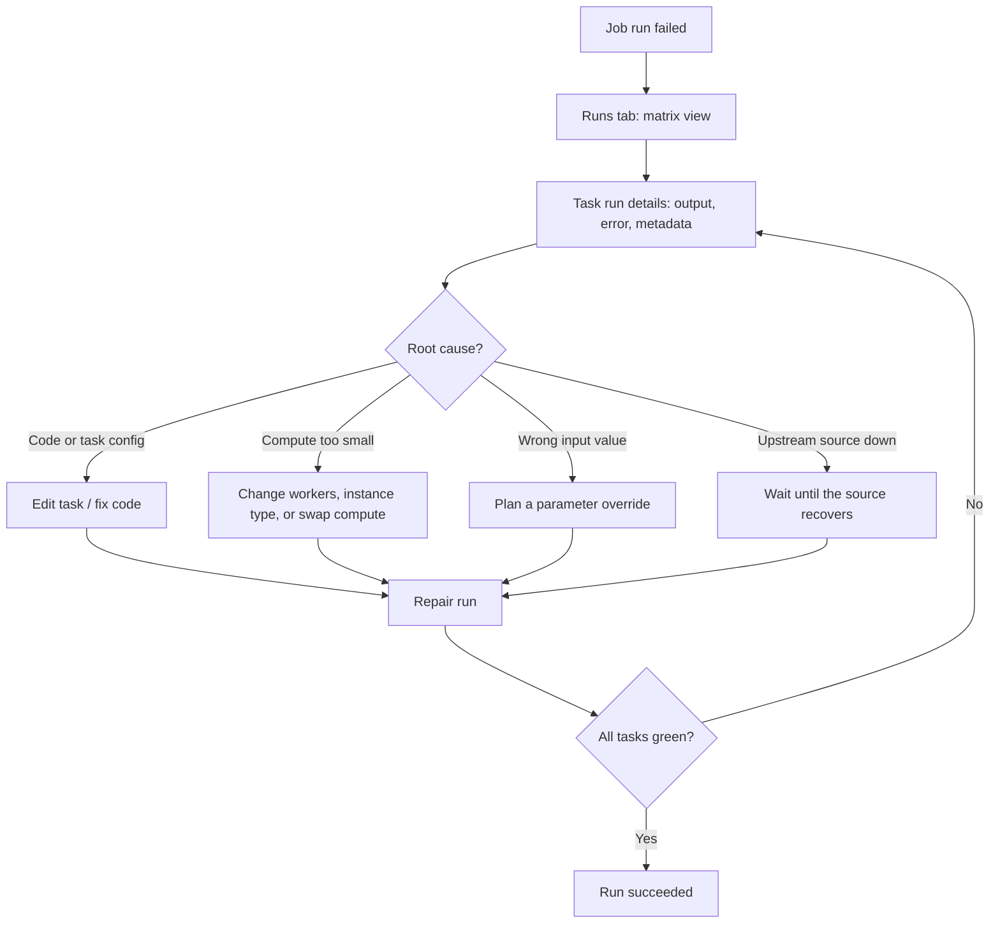
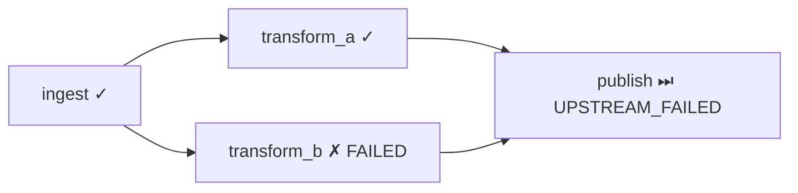
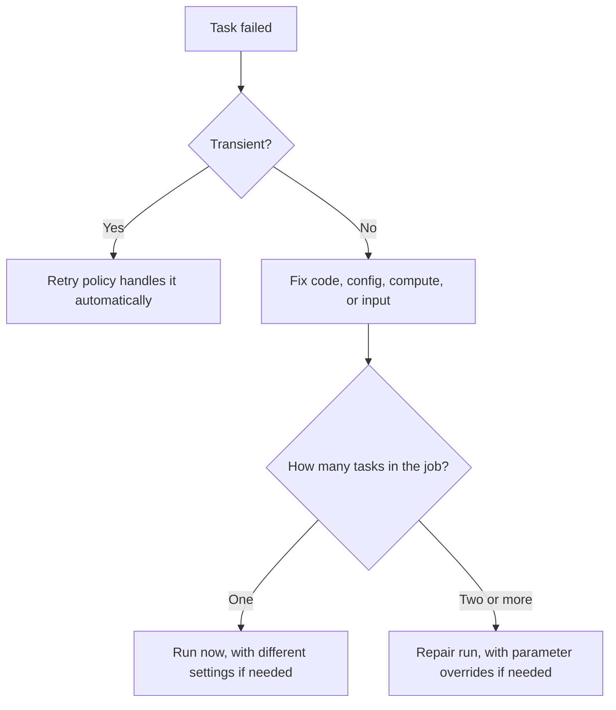

# Job Repair and Parameter Overrides

## Overview

When a multi-task Lakeflow Jobs run fails, you rarely want to start the whole run again. You read the failed task's output and error, fix the cause, and then **repair** the run. A repair re-runs only the unsuccessful tasks and the tasks that depend on them, inside the original run. Parameter overrides let that repair, or a fresh **Run now with different settings**, use different values without editing the job.

> [!abstract]
>
> - Triage starts on the job **Runs** tab (matrix view), then the **Task run details** page (output, error message, metadata, links to compute logs and query history)
> - **Repair run** re-runs unsuccessful tasks plus their dependents as part of the *original* run, using the *current* job and task settings; successful tasks are not re-run
> - **Job parameters** are pushed down to key-value tasks and win over task parameters with the same key; you can override them at trigger time and at repair time
> - Automation: `POST /api/2.2/jobs/runs/repair`, `databricks jobs repair-run`, and `w.jobs.repair_run()` in the Python SDK

> [!tip] What the Exam Tests
>
> - "Analyze the errors and remediate the failed job runs with job repairs and parameter overrides."
> - Choosing repair vs. **Run now** vs. automatic retries for a given failure
> - Knowing which tasks a repair re-runs, which settings it uses, and why idempotent writes matter
> - Overriding job parameters on a repair or a manual run, and referencing them with `{{job.parameters.<name>}}`

---

## Failure-to-Fix Workflow



---

## Reading a Failed Run

### Where to Look in the UI

| Location | What it shows | Use it to |
| :--- | :--- | :--- |
| **Jobs & Pipelines** > job > **Runs** tab, matrix view | One row per run, one cell per task. Green = success, red = failure, pink = skipped, yellow = waiting on retry, grey = pending, canceled, or timed out | Spot which task failed first and which were skipped |
| Hover a failed cell | Start/end time, status, duration, cluster details, sometimes the error message | Fast first look |
| **Runs** tab, list view | Start time, run ID, trigger type, duration, status, **error code**, **parameters** | Compare a failed run's parameters with a good run |
| **Job run details** page | Graph, Timeline, and List views of the run | Find the failing node and long-running tasks |
| **Task run details** page | Task **output**, **error message**, metadata, source code, the cluster that ran it with links to its **query history and logs**, task metrics, and task run history | Read the actual exception |
| Serverless task, Timeline view | Each query statement and its duration; click a statement for its insights or **query profile** | Debug serverless work, where there is no Spark UI |

> [!note]
> A task can be unsuccessful because it **failed** or because it was **skipped** after an upstream task failed. Fix the first red task in the dependency chain; the pink (skipped) tasks downstream are symptoms. For a failed job, the Jobs UI also offers **Diagnose Error**, which uses Genie Code to analyze the failure.

### Result States You Will See

The Jobs API reports task and run outcomes in `status` (the older `state.result_state` field is deprecated). The values below come from the Jobs API Run object.

| `result_state` | Meaning for triage |
| :--- | :--- |
| `FAILED` | The task completed with an error: read its output and error |
| `TIMEDOUT` | The task hit its timeout (duration threshold) |
| `CANCELED` | Canceled by a user or the platform |
| `UPSTREAM_FAILED` | Not run because a dependency failed: fix the upstream task |
| `UPSTREAM_CANCELED` | Not run because a dependency was canceled |
| `MAXIMUM_CONCURRENT_RUNS_REACHED` | The job was already at its concurrent-run limit |

The full enum also includes values such as `SUCCESS`, `SUCCESS_WITH_FAILURES`, `EXCLUDED`, and `DISABLED`.

### Reading a Run Programmatically

```bash
# Run metadata, including every repair attempt (repair_history)
databricks jobs get-run 455644833 --include-history --include-resolved-values -o json

# Output and metadata of ONE task run: error, error_trace, dbutils.notebook.exit() value
# (output is capped at the first 5 MB)
databricks jobs get-run-output 455644834 -o json
```

- `get-run --include-history` adds `repair_history`: one `ORIGINAL` item and one `REPAIR` item per repair, each with an `id` and the `task_run_ids` that ran in it.
- `get-run-output` takes a **task** run ID, not the parent job run ID.
- Runs are removed automatically after **60 days**, so export anything you need to keep (the run details page offers **Export to HTML** for notebook results).

### Finding Failures Across Many Jobs (System Tables)

The `system.lakeflow` schema keeps job and task run history for **365 days**. Note that system tables use their own value spellings (`SUCCEEDED`, `FAILED`, `TIMED_OUT`, `CANCELLED`, `SKIPPED`, `ERROR`, `BLOCKED`).

```sql
-- Failed or timed-out task runs in the last 7 days, newest first
SELECT
  job_id,
  job_run_id,
  run_id AS task_run_id,
  task_key,
  result_state,
  termination_code,
  compute_ids,
  period_start_time,
  period_end_time
FROM system.lakeflow.job_task_run_timeline
WHERE result_state IN ('FAILED', 'ERROR', 'TIMED_OUT')
  AND period_start_time > current_timestamp() - INTERVAL 7 DAYS
ORDER BY period_start_time DESC;
```

| `termination_code` | Typical next step |
| :--- | :--- |
| `RUN_EXECUTION_ERROR` | Task code failed: read the task error, fix code or input, repair |
| `CLUSTER_ERROR`, `DRIVER_ERROR` | Compute problem: check the compute event log and driver logs |
| `LIBRARY_INSTALLATION_ERROR` | Fix the library or environment spec, then repair |
| `UNAUTHORIZED_ERROR` | Grant the run-as identity the missing permission |
| `STORAGE_ACCESS_ERROR` | Fix the storage credential or external location |
| `REPOSITORY_CHECKOUT_FAILED` | Git source unreachable: fix the Git credential or URL |
| `WORKSPACE_RUN_LIMIT_EXCEEDED` | Too many concurrent active runs: spread the schedule |

> [!important]
> For runs longer than one hour, the timeline tables split the run into hourly slices, and `result_state` and `termination_code` are filled in only on the final slice. Filter on non-null values when you count failures.

---

## Remediating the Cause Before You Repair

Repaired tasks run with the **current** job and task settings. Fix first, repair second.

| Root cause | Remediation |
| :--- | :--- |
| Wrong task configuration (path, parameters, dependencies) | **Edit task**, change the settings, **Save task** |
| Bug in the notebook or script | Fix the code the task points at, then repair |
| Not enough compute | Under **Job details** > **Compute** > **Configure**, change workers or instance type, or click **Swap** to use other compute; ask an admin about cloud quotas |
| Run blocked by **Maximum concurrent runs** | Wait for other runs to finish, or raise the limit |
| External source was unavailable | Repair after the source recovers |
| Wrong runtime value (date, catalog, flag) | Repair with an overridden job parameter |

---

## Repair Run Semantics

### What a Repair Does

| Aspect | Behavior |
| :--- | :--- |
| Tasks re-run | Only the **unsuccessful** tasks and their **dependent** tasks |
| Successful tasks | **Not** re-run |
| Settings used | The **current** job and task settings, so edits made before the repair apply |
| Where it is recorded | Inside the **original run**: the matrix view gets a new column for the repair, and `repair_history` gets a `REPAIR` entry |
| Task restart point | Each re-run task starts **from the beginning** |
| Shared job cluster | The repair creates a new job cluster with a `_v1` suffix (for example `my_job_cluster_v1`) from the cluster's current settings |
| Minimum job size | Two or more tasks. For a failed **single-task** job, use **Run now** |
| Run duration | Measured from the first run's start to the latest repair's finish |
| Disabled tasks | Chosen by run state, not disabled state. To force a disabled task to run, name it in `rerun_tasks` |
| Run state | The run must **not** be in progress when you repair it |

> [!warning] Repairs are not idempotent by themselves
> Lakeflow Jobs does not make tasks idempotent. If a task wrote part of its output before failing, a repair can **duplicate** that data. Write with `MERGE`, overwrite, or other idempotent patterns wherever duplicates matter.

### Example: Which Tasks a Repair Re-runs



| Task | Original run | Re-run by default repair? | Why |
| :--- | :--- | :---: | :--- |
| `ingest` | Succeeded | No | Successful tasks are kept |
| `transform_a` | Succeeded | No | Successful tasks are kept |
| `transform_b` | Failed | **Yes** | Unsuccessful |
| `publish` | Skipped (upstream failed) | **Yes** | Unsuccessful dependent of `transform_b` |

### Repair in the UI

1. Open the **Job run details** page (from the **Start time** column or the matrix view).
2. Click **Repair run**. The **Repair job run** dialog lists the tasks that will re-run.
3. Optionally add or edit **parameters**. These override the existing values for this repair.
4. Click **Repair run** to confirm.
5. Check the new matrix column. Repaired tasks that were red should turn green.

To restore an original value in a later repair, clear that parameter's key and value in the dialog.

### Continuous Jobs

Continuous jobs do not use repair. After consecutive failures pass a threshold, Lakeflow Jobs retries them with exponential backoff. **Restart run** cancels the active run, resets the retry period, and starts a new run.

---

## Parameter Overrides

### Job Parameters vs. Task Parameters vs. Bundle Variables

| | Job parameters | Task parameters | Bundle variables (`${var.x}`) |
| :--- | :--- | :--- | :--- |
| Defined on | The job | One task | `databricks.yml` |
| Resolved | At **run time** | At run time | At **deployment** time |
| Overridable per run | Yes: **Run now with different settings**, **Repair run**, API `job_parameters` | Only through job parameters with the same key, or legacy parameters | No: redeploy with another value |
| Precedence | **Wins** over a task parameter with the same key | Loses to a same-key job parameter | n/a |
| Reaching tasks | Pushed down automatically to key-value tasks; JSON-array tasks need `{{job.parameters.<name>}}` | Only to its own task | Substituted into the deployed config |

- Job parameter keys may contain only alphanumeric characters, `_`, `-`, and `.`. Values can be strings or dynamic value references, and any valid JSON, including arrays.
- Bundle variables are deployment-time values. Use **job parameters** for values that change from run to run.
- If a job has only task parameters, the run dialog offers **Switch to legacy parameters**. Databricks no longer recommends this.

### Reading Parameters Inside a Task

| Task type | How the code reads parameters |
| :--- | :--- |
| Notebook (Python) | `dbutils.widgets.get("run_date")` |
| Notebook (SQL) | Named parameter marker `:run_date` |
| Python script | Command-line arguments (`sys.argv` or `argparse`) |
| Python wheel | Keyword arguments to the entry point |
| JAR / Spark Submit | Arguments to the main class's `main` method |
| SQL task | `:param_name` in the SQL; use `{{job.parameters.<name>}}` in the task configuration |
| Pipeline | Pipeline task **Parameters** box, read with named parameters |

```python
# Notebook task: read a job parameter that is pushed down by name
dbutils.widgets.text("run_date", "")  # default for interactive runs only
run_date = dbutils.widgets.get("run_date")

if not run_date:
    raise ValueError("run_date job parameter is required")

df = spark.table("main.silver.orders").where(f"order_date = '{run_date}'")
```

> [!note]
> A standalone notebook run does not receive job parameters, so a widget default keeps interactive runs working. The docs warn that a default can also **mask** a misconfigured parameter in a job, so validate required values explicitly.

### Dynamic Value References Useful in Repairs

| Reference | Value |
| :--- | :--- |
| `{{job.parameters.<name>}}` | Current value of job parameter `<name>`, including an override |
| `{{job.run_id}}` | ID of the job run (unchanged across repairs) |
| `{{job.repair_count}}` | Number of repair attempts on the current run |
| `{{task.execution_count}}` | Times this task has run, counting retries **and** repairs |
| `{{tasks.<task_name>.result_state}}` | Upstream task outcome, such as `success` or `failed` |
| `{{tasks.<task_name>.error_code}}` | Upstream error code, such as `RunExecutionError` (empty on success) |
| `{{tasks.<task_name>.values.<value_name>}}` | Task value set by an upstream task |

Old forms such as `{{run_id}}`, `{{task_retry_count}}`, and `{{parent_run_id}}` are deprecated. Use `{{task.run_id}}`, `{{task.execution_count}}`, and `{{job.run_id}}`. A malformed reference is treated as a literal string, which is an easy silent bug.

### Run Now with Different Settings

Use this for a **new** run, for example a backfill for one date or a re-run of a single-task job.

1. Click the caret next to **Run now** and select **Run now with different settings**.
2. Optionally select or clear tasks in the graph (affects only this run).
3. Optionally enter job parameters as key-value pairs. These override the configured values or add new ones.
4. Optionally change **Performance optimized** (serverless).
5. Click **Run**.

Subsets of tasks use the `only` field with `+` expansion: `my_task` (only this task), `+my_task` (plus upstream), `my_task+` (plus downstream), `+my_task+` (both). The `+` expansion skips disabled tasks unless you name them.

```bash
# Jobs CLI: new run with an overridden job parameter.
# With --json, job_id goes in the body and no positional argument is allowed.
databricks jobs run-now --json '{
  "job_id": 11223344,
  "job_parameters": {"run_date": "2026-10-25"},
  "only": ["+publish"]
}'
```

```bash
# Bundle-deployed job: --params takes comma-separated key=value pairs
databricks bundle run nightly_etl -t prod --params run_date=2026-10-25 --only +publish
```

---

## Retries, Timeouts, and Repair

| Mechanism | Triggered by | Scope | Best for |
| :--- | :--- | :--- | :--- |
| **Retry policy** (`max_retries`, `min_retry_interval_millis`, `retry_on_timeout`) | Automatic, when a task fails | The same task, new attempt (`attempt_number` increments) | Transient errors: throttling, spot loss, flaky network |
| **Timeout** (`timeout_seconds`, or a **Run duration** metric threshold) | Automatic, when time runs out | Marks the task **Timed Out** | Stopping hung tasks; set a warning threshold to get notified first |
| **Repair run** | You (UI, CLI, API, SDK) after fixing the cause | Unsuccessful tasks + dependents, same run | Deterministic failures you have fixed |
| **Run now** (optionally different settings) | You | A brand-new run (all tasks or an `only` subset) | Single-task jobs, backfills, fresh runs |
| **Restart run** | You | Continuous jobs | Resetting a continuous job's backoff |

Retry facts from the Jobs API and task docs:

- `max_retries`: `0` = never retry (the default), `-1` = retry indefinitely. A run counts as unsuccessful if it ends `FAILED` or `INTERNAL_ERROR`.
- `min_retry_interval_millis`: time from the **start** of the failed run to the retry. By default, unsuccessful runs are retried immediately.
- `retry_on_timeout`: default `false`, so timeouts are not retried unless you enable it.
- With both a timeout and retries, the timeout applies to **each** retry.
- `timeout_seconds`: `0` means no timeout.
- Serverless jobs auto-optimize retries by default. Continuous jobs use exponential backoff.



---

## Jobs API: `runs/repair`

`POST /api/2.2/jobs/runs/repair` re-runs one or more tasks as part of the original job run. The tasks use the current job and task settings, and the repair appears in the original run's history.

| Field | Type | Meaning |
| :--- | :--- | :--- |
| `run_id` | int64, **required** | Job run to repair. Must not be in progress |
| `latest_repair_id` | int64 | ID of the latest repair. Not needed for the first repair; **required** on later repairs of the same run |
| `rerun_tasks` | array of string | Task keys to repair |
| `rerun_all_failed_tasks` | boolean (default `false`) | Repair all failed tasks. Use **either** this **or** `rerun_tasks` |
| `rerun_dependent_tasks` | boolean (default `false`) | Also repair every task that depends on the tasks being repaired, **even if it previously succeeded**. Works with `rerun_tasks` or `rerun_all_failed_tasks` |
| `job_parameters` | object | Job-level parameter overrides for the repair, for example `{"run_date": "2026-10-25"}` |
| `pipeline_params` | object | For pipeline tasks: `full_refresh`, `refresh_selection`, `full_refresh_selection`, `reset_checkpoint_selection`, `refresh_flow_selection` |
| `performance_target` | string | Serverless performance mode for this repair (`PERFORMANCE_OPTIMIZED` or `STANDARD`), overriding the job-level setting |

The response is `{"repair_id": <int64>}`. Pass it as `latest_repair_id` in the next repair so repairs stay sequential.

```json
{
  "run_id": 455644833,
  "latest_repair_id": 734650698524280,
  "rerun_tasks": ["transform_b"],
  "rerun_dependent_tasks": true,
  "job_parameters": {"run_date": "2026-10-25"}
}
```

> [!note]
> The Python SDK's `repair_run` still accepts the legacy per-task-type fields (`notebook_params`, `python_params`, `jar_params`, `sql_params`, `spark_submit_params`, `python_named_params`, `dbt_commands`). The 2.2 REST reference documents `job_parameters` for repairs. Use job parameters for new jobs.

### CLI: `databricks jobs repair-run`

```bash
# 1. Inspect the run and its repair history
databricks jobs get-run 455644833 --include-history -o json

# 2. First repair: re-run every failed task and wait (default --timeout 20m)
databricks jobs repair-run 455644833 --rerun-all-failed-tasks

# 3. Later repair with specific tasks and a parameter override.
#    With --json, run_id goes in the body and no positional argument is allowed.
databricks jobs repair-run --json '{
  "run_id": 455644833,
  "latest_repair_id": 734650698524280,
  "rerun_tasks": ["transform_b"],
  "rerun_dependent_tasks": true,
  "job_parameters": {"run_date": "2026-10-25"}
}' --no-wait
```

| Flag | Purpose |
| :--- | :--- |
| `--rerun-all-failed-tasks` | Repair all failed tasks |
| `--rerun-dependent-tasks` | Also repair tasks that depend on the repaired ones |
| `--latest-repair-id` | Required on second and later repairs |
| `--performance-target` | `PERFORMANCE_OPTIMIZED` or `STANDARD` (serverless) |
| `--json` | Full request body: the only way to pass `rerun_tasks` and `job_parameters` |
| `--no-wait` / `--timeout` | Return immediately, or wait up to the timeout for `TERMINATED` or `SKIPPED` |

### Python SDK

```python
from databricks.sdk import WorkspaceClient

w = WorkspaceClient()
run_id = 455644833

# Find the latest repair ID (None if the run was never repaired)
run = w.jobs.get_run(run_id=run_id, include_history=True)
repair_ids = [
    item.id
    for item in (run.repair_history or [])
    if item.type is not None and item.type.value == "REPAIR"
]
latest_repair_id = repair_ids[-1] if repair_ids else None

# Repair failed tasks with a parameter override, then block until it finishes
repaired = w.jobs.repair_run(
    run_id=run_id,
    latest_repair_id=latest_repair_id,
    rerun_all_failed_tasks=True,
    job_parameters={"run_date": "2026-10-25"},
).result()

print(repaired.status)
```

`repair_run` returns a waiter (`Wait[Run]`). `.result()` blocks until the run reaches `TERMINATED` or `SKIPPED`. The SDK also offers `repair_run_and_wait(..., timeout=...)`.

---

## Use Cases

- **Bad input partition**: A nightly job fails in `transform_b` because one day's file was late. After the file lands, a **repair** re-runs `transform_b` and `publish` without re-ingesting or re-transforming the successful branches.
- **Wrong date in a scheduled run**: The run used yesterday's default `run_date`. Repair with a `run_date` job parameter override instead of editing the job.
- **Undersized compute**: A task fails with out-of-memory errors. Increase workers or swap compute in the job, then repair. The shared job cluster comes back as `<key>_v1` with the new settings.
- **Automated remediation**: An orchestrator watches `system.lakeflow.job_task_run_timeline` (or a failure notification) and calls `runs/repair` with `rerun_all_failed_tasks` once the upstream system reports healthy.

## Common Issues & Errors

| Symptom | Cause | Fix |
| :--- | :--- | :--- |
| No **Repair run** button for a failed job | Job has a single task | Use **Run now** |
| Repair API call rejected on the second attempt | Missing or stale `latest_repair_id` | Read `repair_history` (`get-run --include-history`) and pass the latest repair ID |
| Repair rejected immediately | Run is still in progress | Wait for it to finish or cancel it first |
| Duplicate rows after a repair | Failed task had appended partial output | Make writes idempotent (`MERGE`, overwrite, dedupe on keys) |
| Override "did not apply" in a script task | Script takes a JSON array of args, so job params are not pushed down | Reference `{{job.parameters.<name>}}` in the task's parameters |
| Task parameter value ignored | A job parameter with the same key wins | Rename one of them or set the job parameter |
| `rerun_tasks` and `rerun_all_failed_tasks` together fails | They are mutually exclusive | Send one; add `rerun_dependent_tasks` if needed |
| A disabled task is not picked up by the repair | Repair selects tasks by run state, not disabled state | Add the disabled task to `rerun_tasks` explicitly |
| Notebook works interactively, fails in the job | Widget default masked a missing parameter | Validate required parameters and fail loudly |

## Best Practices

- Make every task safe to re-run (idempotent writes), because repair restarts tasks from the beginning.
- Use retry policies for transient failures and repairs for deterministic ones; do not retry indefinitely (`-1`) on code bugs.
- Prefer job parameters over legacy task parameters, and give required parameters explicit validation.
- Set a **Run duration** warning threshold so you are notified before a task times out.
- Use system tables for fleet-wide failure analysis and the run details page for a single run.

## Exam Tips

> [!tip]
>
> - **Repair = unsuccessful tasks + their dependents, same run ID, current settings.** Successful tasks are not re-run.
> - **Fix first, then repair**: edits to task settings, compute, or code are picked up by the repair.
> - **Single-task job?** No repair. Use **Run now** (with different settings if you need overrides).
> - **Overrides**: job parameters can be overridden on **Run now with different settings** and on **Repair run**; a job parameter beats a task parameter with the same key.
> - **API fields**: `rerun_tasks` *or* `rerun_all_failed_tasks`; `rerun_dependent_tasks` adds downstream tasks even if they succeeded; `latest_repair_id` is required after the first repair; `job_parameters` carries overrides.
> - **Retries vs repair**: retries are automatic and for transient errors (`max_retries` default `0`; `retry_on_timeout` default `false`); repair is a deliberate re-run after a fix.
> - **Duplicates after repair** point to non-idempotent writes, not to a platform bug.

## Key Takeaways

- **Triage path**: matrix view, then the first red task's **Task run details** (output, error, metadata, compute logs), and `get-run-output` for programmatic access.
- **Repair scope**: only unsuccessful tasks and their dependents re-run, inside the original run, using the current job and task settings.
- **Repair history**: each repair adds a matrix column and a `REPAIR` entry in `repair_history`; the next API repair must send `latest_repair_id`.
- **Idempotency**: each repaired task restarts from scratch, so partial writes can duplicate unless the task uses idempotent operations.
- **Parameter overrides**: job parameters are run-time values, pushed down to key-value tasks, overridable at run and repair time; bundle variables are deployment-time values.
- **Right tool**: retries for transient errors, repair for fixed deterministic errors in multi-task jobs, Run now for single-task jobs and fresh runs, Restart run for continuous jobs.
- **Automation**: `POST /api/2.2/jobs/runs/repair`, `databricks jobs repair-run`, or `w.jobs.repair_run(...).result()`.

## Related Topics

- [Spark UI Debugging](./01-spark-ui-debugging.md) - Diagnostic sources for the errors you find here
- [Lakeflow Jobs — Part 2](../01-developing-code-for-data-processing/08-lakeflow-jobs-part2.md) - Job parameters, retries, and notifications
- [System Tables](../04-monitoring-and-alerting/01-system-tables.md) - Querying `system.lakeflow` run history
- [Databricks CLI — Part 1](../04-monitoring-and-alerting/04-databricks-cli-part1.md) - CLI setup and command groups
- [REST API — Part 1](../04-monitoring-and-alerting/05-rest-api-part1.md) - Calling the Jobs API
- [Declarative Automation Bundles — Part 1](./03-declarative-automation-bundles-part1.md) - `databricks bundle run --params`

## Official Documentation

- [Troubleshoot and repair job failures](https://docs.databricks.com/aws/en/jobs/repair-job-failures)
- [Jobs API: Repair a job run](https://docs.databricks.com/api/workspace/jobs/repairrun)
- [Configure job parameters](https://docs.databricks.com/aws/en/jobs/job-parameters)
- [Access parameter values from a task](https://docs.databricks.com/aws/en/jobs/parameter-use)
- [What is a dynamic value reference?](https://docs.databricks.com/aws/en/jobs/dynamic-value-references)
- [Trigger a single job run](https://docs.databricks.com/aws/en/jobs/run-now)
- [Configure and edit tasks (retries, duration thresholds)](https://docs.databricks.com/aws/en/jobs/configure-task)
- [Monitoring and observability for Lakeflow Jobs](https://docs.databricks.com/aws/en/jobs/monitor)
- [Jobs system table reference](https://docs.databricks.com/aws/en/admin/system-tables/jobs)
- [`jobs` command group (CLI)](https://docs.databricks.com/aws/en/dev-tools/cli/reference/jobs-commands)
- [Databricks SDK for Python: `w.jobs`](https://databricks-sdk-py.readthedocs.io/en/latest/workspace/jobs/jobs.html)

---

**[← Previous: Spark UI Debugging](./01-spark-ui-debugging.md) | [↑ Back to Section](./README.md) | [Next: Declarative Automation Bundles — Part 1 →](./03-declarative-automation-bundles-part1.md)**
