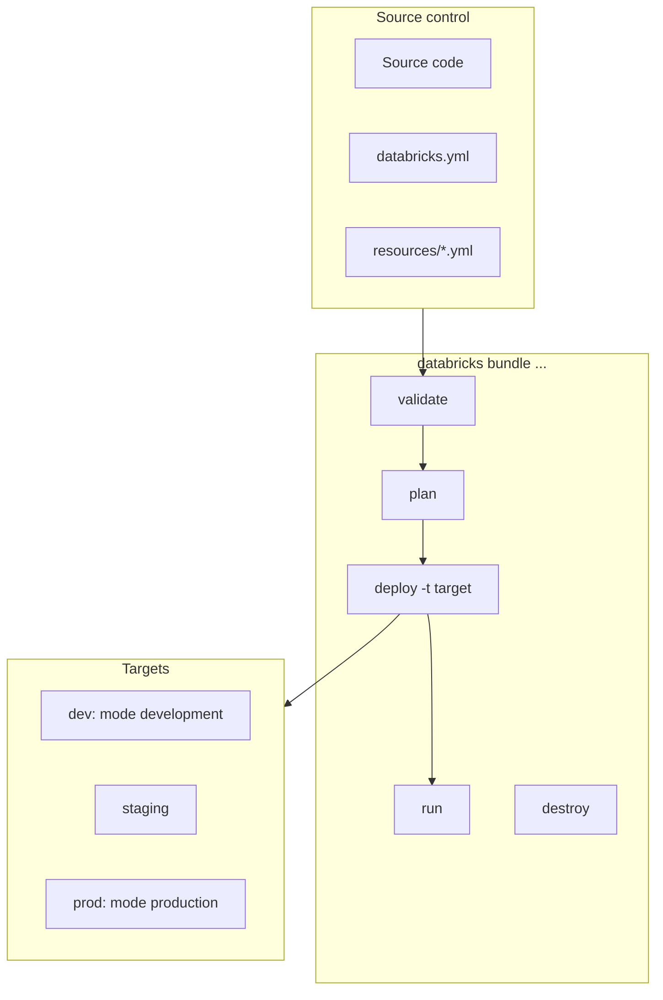

# Declarative Automation Bundles — Part 1

## Overview

Declarative Automation Bundles (formerly Databricks Asset Bundles) describe Databricks resources such as jobs, pipelines, and clusters as code in a `databricks.yml` project, then validate and deploy them with the Databricks CLI. One bundle can target dev, staging, and prod with per-target overrides. This part covers bundle structure, resource definitions, variables, commands, targets, deployment modes, presets, permissions, `run_as`, and artifacts.

> [!abstract]
>
> - A bundle = `databricks.yml` (plus `include`d YAML files) + source code, deployed with `databricks bundle deploy -t <target>`
> - `targets` hold per-environment overrides; `mode: development` and `mode: production` apply opinionated defaults, and `presets` customize them
> - `variables` (`${var.name}`) and substitutions (`${bundle.target}`, `${workspace.current_user.short_name}`) are resolved at **deployment** time
> - `run_as` and `permissions` separate the identity that runs a job from the one that deployed it

> [!tip] What the Exam Tests
>
> - "Deploy Databricks resources using Declarative Automation Bundles (formerly Databricks Asset Bundles)."
> - Deploying the same job and pipeline definitions identically to dev, staging, and prod from source control with per-target overrides
> - Knowing the core commands (`init`, `validate`, `deploy`, `run`, `destroy`, `summary`) and what development vs. production mode change
> - Choosing `run_as` (service principal) and `permissions` for production targets

> [!note] Platform update (Oct 2026)
> Databricks Asset Bundles was renamed **Declarative Automation Bundles** on March 16, 2026. The CLI command group is unchanged: `databricks bundle ...`. Source: [Declarative Automation Bundles feature release notes](https://docs.databricks.com/aws/en/release-notes/dev-tools/bundles)

---

## Bundle Lifecycle



## Bundle Structure

### Standard Project Layout

```text
my-databricks-project/
├── databricks.yml              # Main bundle configuration (bundle root)
├── resources/
│   ├── jobs.yml               # Job definitions
│   ├── pipelines.yml          # Lakeflow pipeline definitions
│   └── clusters.yml           # Cluster definitions
├── src/
│   ├── notebooks/             # Notebook source files
│   │   ├── bronze/
│   │   ├── silver/
│   │   └── gold/
│   ├── pipelines/             # Pipeline source files
│   └── python/                # Python package built as a wheel
├── tests/
│   ├── unit/
│   └── integration/
└── .databricks/               # Local CLI working files: keep out of Git
```

### Top-Level Mappings

| Mapping | Purpose |
| :--- | :--- |
| `bundle` | Bundle `name` (required), optional `git`, `databricks_cli_version`, deployment settings |
| `include` | Globs of extra YAML files, relative to the file that lists them |
| `variables` | Custom variables, referenced as `${var.<name>}` |
| `workspace` | `host`, `profile`, `root_path`, `artifact_path`, `file_path`, `state_path` |
| `artifacts` | Local builds to run and upload on deploy (`whl`, `jar`, `tgz`) |
| `resources` | Jobs, pipelines, clusters, schemas, volumes, dashboards, apps, and more |
| `permissions` | Permissions applied to every resource in the bundle |
| `run_as` | Identity that jobs and pipelines run as |
| `sync` | `include` / `exclude` / `paths` for files uploaded to the workspace |
| `scripts` | Commands you can run with `bundle run` |
| `python` | Load resources defined in Python (`databricks-bundles` package) |
| `targets` | Per-environment overrides; exactly one may set `default: true` |

Default workspace paths: `root_path` is `/Workspace/Users/${workspace.current_user.userName}/.bundle/${bundle.name}/${bundle.target}`. Under it, `artifact_path` defaults to `${workspace.root}/artifacts`, `file_path` to `${workspace.root}/files`, and `state_path` to `${workspace.root}/state`.

### Core Configuration File

```yaml
# databricks.yml

bundle:
  name: my-etl-project

include:
  - resources/*.yml

variables:
  environment:
    description: "Deployment environment"
    default: dev
  catalog:
    description: "Unity Catalog name"
    default: dev_catalog

workspace:
  host: https://adb-1234567890.1.azuredatabricks.net

artifacts:
  etl_package:
    type: whl
    path: ./src/python
    build: poetry build

# Applied to every resource in the bundle
permissions:
  - level: CAN_VIEW
    group_name: data-analysts
  - level: CAN_MANAGE
    group_name: data-engineers

targets:
  dev:
    mode: development
    default: true
    variables:
      environment: dev
      catalog: dev_catalog

  staging:
    variables:
      environment: staging
      catalog: staging_catalog
    workspace:
      root_path: /Workspace/Shared/.bundle/${bundle.name}/${bundle.target}
    presets:
      name_prefix: "staging_"
      trigger_pause_status: PAUSED

  prod:
    mode: production
    variables:
      environment: prod
      catalog: prod_catalog
    workspace:
      root_path: /Workspace/Shared/.bundle/${bundle.name}/${bundle.target}
    run_as:
      # Service principal application ID
      service_principal_name: "00000000-0000-0000-0000-000000000000"
```

## Resource Definitions

### Job Configuration

```yaml
# resources/jobs.yml

resources:
  jobs:
    etl_daily_job:
      name: "ETL Daily Pipeline - ${var.environment}"
      schedule:
        quartz_cron_expression: "0 0 6 * * ?"
        timezone_id: "UTC"

      email_notifications:
        on_failure:
          - data-team@company.com

      tags:
        environment: ${var.environment}
        team: data-engineering

      # Job parameters: pushed down to every notebook task, and
      # overridable on Run now and Repair run without redeploying
      parameters:
        - name: catalog
          default: ${var.catalog}            # deploy-time default
        - name: run_date
          default: "{{job.start_time.iso_date}}"

      tasks:
        - task_key: bronze_ingestion
          notebook_task:
            # Relative to THIS file (resources/jobs.yml)
            notebook_path: ../src/notebooks/bronze/ingest.py
          job_cluster_key: etl_cluster

        - task_key: silver_transform
          depends_on:
            - task_key: bronze_ingestion
          notebook_task:
            notebook_path: ../src/notebooks/silver/transform.py
          job_cluster_key: etl_cluster

        - task_key: gold_aggregate
          depends_on:
            - task_key: silver_transform
          notebook_task:
            notebook_path: ../src/notebooks/gold/aggregate.py
          job_cluster_key: etl_cluster

      job_clusters:
        - job_cluster_key: etl_cluster
          new_cluster:
            spark_version: "15.4.x-scala2.12"
            node_type_id: "Standard_DS3_v2"
            num_workers: 2
```

> [!important] Relative paths and parameters
> Paths in a resource file resolve relative to the configuration file **that declares them**, not the bundle root. The old fallback lookup was removed in CLI 0.266.0, so a wrong relative path is now an error. Bundle validation does not allow job-level `parameters` and task `base_parameters` in the same job: once a job has job parameters, move task values up to the job level.

### Lakeflow Pipeline Configuration

```yaml
# resources/pipelines.yml

resources:
  pipelines:
    streaming_pipeline:
      name: "Streaming ETL - ${var.environment}"
      catalog: ${var.catalog}
      schema: ${var.environment}_streaming   # `target` is the deprecated legacy field
      serverless: true                        # recommended for new pipelines; omit `clusters`

      configuration:
        environment: ${var.environment}

      libraries:
        - glob:
            include: ../src/pipelines/streaming/**

      continuous: false

      notifications:
        - email_recipients:
            - data-team@company.com
          alerts:
            - on-update-failure
            - on-flow-failure
```

You do not set `development:` per environment yourself. `mode: development` marks pipelines as development pipelines, and `mode: production` checks that they are not.

### Cluster Configuration

```yaml
# resources/clusters.yml

resources:
  clusters:
    shared_analytics:
      cluster_name: "Analytics Cluster - ${var.environment}"
      spark_version: "15.4.x-scala2.12"
      node_type_id: "Standard_DS4_v2"
      autoscale:
        min_workers: 1
        max_workers: 8
      autotermination_minutes: 30
      custom_tags:
        environment: ${var.environment}
```

Other resource types include `schemas`, `volumes`, `dashboards`, `apps`, `model_serving_endpoints`, `registered_models`, `quality_monitors`, `sql_warehouses`, and more (see the resources reference). A resource-level `lifecycle.prevent_destroy: true` protects it from `bundle destroy`.

## Variables and Substitutions

### Custom Variables

```yaml
# databricks.yml

variables:
  # Simple variable with default
  environment:
    default: dev

  # No default: must be supplied at deploy time
  notification_email:
    description: "Alert recipient"

  # Lookup: resolve an object's ID from its name
  etl_pool_id:
    lookup:
      instance_pool: etl-pool

  # Complex variable (maps or lists)
  default_cluster:
    type: complex
    default:
      spark_version: "15.4.x-scala2.12"
      node_type_id: "Standard_DS3_v2"
      num_workers: 2
```

Lookup types include `alert`, `cluster_policy`, `cluster`, `dashboard`, `instance_pool`, `job`, `metastore`, `notification_destination`, `pipeline`, `query`, `service_principal`, and `warehouse`. A lookup fails if the name matches no object or more than one.

### Where a Variable's Value Comes From (first match wins)

1. `--var="<name>=<value>"` on the `bundle` command
2. An environment variable `BUNDLE_VAR_<name>`
3. `.databricks/bundle/<target>/variable-overrides.json`
4. The `variables` mapping inside the selected target
5. The variable's top-level `default`

> [!note]
> Bundle variables are **deployment-time** values. For values that change per run, use **job parameters**, which can be overridden on **Run now** and **Repair run**.

### Built-in Substitutions

| Substitution | Value |
| :--- | :--- |
| `${bundle.name}` | Bundle name |
| `${bundle.target}` | Selected target (`dev`, `prod`, ...) |
| `${workspace.current_user.userName}` | Deploying user's user name (email) |
| `${workspace.current_user.short_name}` | Short form of the user name (used in the dev-mode prefix) |
| `${workspace.root_path}` | Bundle root folder in the workspace |
| `${workspace.file_path}` | Where synced source files are deployed |
| `${resources.jobs.<job-name>.id}` | ID of a job defined in the bundle |
| `${resources.pipelines.<name>.<field>}` | Any field of a bundle resource, e.g. `.schema` |

### Variable Substitution Example

```yaml
resources:
  jobs:
    my_job:
      name: "Job - ${var.environment}"
      tasks:
        - task_key: main
          notebook_task:
            notebook_path: ../src/notebooks/main.py
            base_parameters:
              catalog: ${var.catalog}
              config_path: ${workspace.file_path}/config/${bundle.target}.yml
              bundle_name: ${bundle.name}
```

## Bundle Commands

### Core Commands

```bash
# Initialize a new bundle from a template (prompts if no template given)
databricks bundle init default-python

# Check the configuration is syntactically valid (-o json for JSON output)
databricks bundle validate -t prod -o json

# Preview what deploy would create, update, or delete
databricks bundle plan -t prod

# Deploy to the default target, or to a named one
databricks bundle deploy
databricks bundle deploy -t prod

# Run a job (or pipeline, app, or script) defined in the bundle
databricks bundle run -t prod etl_daily_job

# Run with job parameters: comma-separated key=value pairs
databricks bundle run -t prod etl_daily_job --params run_date=2026-10-25

# Show deployed resources and their workspace URLs
databricks bundle summary -t prod

# Delete everything this bundle deployed (cannot be undone)
databricks bundle destroy -t dev
```

| Command | Notes |
| :--- | :--- |
| `init [TEMPLATE]` | Default templates: `default-python`, `default-minimal`, `default-sql`, `default-scala`, `dbt-sql`, `mlops-stacks`, `pydabs`; or a Git URL / local path |
| `validate` | Syntax check; warns on properties not in the resource schema |
| `plan` | Shows planned changes; `deploy --plan` replays a saved plan (direct engine) |
| `deploy` | Builds artifacts, uploads files, creates or updates resources. Flags: `--force`, `--force-lock`, `--auto-approve`, `--fail-on-active-runs`, `-c/--cluster-id` |
| `run [KEY]` | Jobs: `--params`, `--only`, `--restart`, `--no-wait`. Pipelines: `--full-refresh`, `--refresh`, `--validate-only` |
| `destroy` | `--auto-approve`, `--force-lock`; skips resources with `lifecycle.prevent_destroy` |
| `summary` | Lists deployed resources for the target |
| `deployment bind KEY RESOURCE_ID` | Attach an existing workspace resource (for example a job) to a bundle resource key |
| `generate job --existing-job-id <id>` | Write bundle YAML for an existing job (`pipeline`, `dashboard`, `app` also supported) |

### Validation and Debugging

```bash
# Supply a variable without a default
databricks bundle validate -t prod --var="notification_email=ops@company.com"

# Verbose logs for a failing deploy (global flag)
databricks bundle deploy -t prod --debug
```

## Target Configuration

### Development vs. Production Modes

| Behavior | `mode: development` | `mode: production` |
| :--- | :--- | :--- |
| Resource names | Prefixed with `[dev ${workspace.current_user.short_name}]` | Unchanged |
| Tags | Adds a `dev` tag to jobs and pipelines | None added |
| Schedules and triggers | **Paused** (set `pause_status: UNPAUSED` to override) | As configured |
| Pipelines | Marked `development: true` | Deploy checks they are `development: false` |
| Concurrent job runs | Enabled | As configured |
| Cluster override (`--cluster-id`) | Allowed | **Not allowed** |
| Deployment lock | Disabled (enable with `bundle.deployment.lock.enabled: true`) | Enabled |
| Git branch check | None | Current branch must match the target's `git.branch` if set (`--force` overrides) |
| Identity | Deploying user | Service principal via `run_as` recommended; without one, user-specific paths are rejected and `run_as` plus `permissions` are required |

### Presets

`presets` in a target customize behavior with or without a `mode`. Presets override mode defaults, and settings on an individual resource override presets.

| Preset | Effect |
| :--- | :--- |
| `name_prefix` | Prefix for resource names |
| `pipelines_development` | Lock pipeline deployments in development mode |
| `trigger_pause_status` | Pause status for all triggers and schedules (always `PAUSED` in development mode) |
| `jobs_max_concurrent_runs` | Max concurrent runs for all jobs |
| `tags` | Tags applied to all resources that support tags |
| `source_linked_deployment` | Resources point at workspace source files instead of deployed copies |
| `artifacts_dynamic_version` | Patch `whl` versions dynamically on each deploy |

### Environment-Specific Overrides

```yaml
targets:
  dev:
    resources:
      jobs:
        etl_daily_job:
          job_clusters:
            - job_cluster_key: etl_cluster
              new_cluster:
                num_workers: 1

  prod:
    resources:
      jobs:
        etl_daily_job:
          job_clusters:
            - job_cluster_key: etl_cluster
              new_cluster:
                num_workers: 8
                driver_node_type_id: "Standard_DS5_v2"
```

Target-level `resources` merge into the top-level definitions by join key (`job_cluster_key` for job clusters, `label` for pipeline clusters, `task_key` for tasks). Conflicting settings take the target's value; everything else is kept, so you restate only what changes.

### `run_as` and `permissions`

```yaml
targets:
  prod:
    mode: production
    run_as:
      service_principal_name: "00000000-0000-0000-0000-000000000000"  # application ID
    permissions:
      - level: CAN_MANAGE
        group_name: data-engineers
      - level: CAN_RUN
        service_principal_name: "00000000-0000-0000-0000-000000000000"
```

- `run_as` takes `user_name` or `service_principal_name`. Non-admins can set only their own user name.
- If the deployer differs from the `run_as` identity, only **jobs and pipelines** are supported in the bundle. `run_as` is not supported with model serving endpoints.
- To deploy with a service principal as `run_as`, deploy as that service principal or hold **CAN_USE** on it.
- Top-level and target `permissions` allow `CAN_VIEW`, `CAN_MANAGE`, and `CAN_RUN`, each with `user_name`, `group_name`, or `service_principal_name`.

## Artifacts and Libraries

### Python Wheel Artifacts

```yaml
# databricks.yml
artifacts:
  etl_package:
    type: whl
    path: ./src/python       # relative to databricks.yml
    build: poetry build      # default when omitted: python setup.py bdist_wheel
```

```yaml
# resources/jobs.yml
resources:
  jobs:
    wheel_job:
      tasks:
        - task_key: main
          job_cluster_key: etl_cluster
          python_wheel_task:
            package_name: etl_package
            entry_point: main
          libraries:
            - whl: ../src/python/dist/*.whl   # relative to this file
```

On serverless compute, Python wheel tasks need an `environment_key` that points at a job `environments` entry instead of `libraries`.

### JAR Artifacts

```yaml
artifacts:
  spark_extensions:
    type: jar
    path: ./libs
    build: mvn package -DskipTests
    files:
      - source: ./libs/target/spark-extensions-1.0.jar

resources:
  jobs:
    jar_job:
      tasks:
        - task_key: main
          job_cluster_key: etl_cluster
          spark_jar_task:
            main_class_name: com.company.Main
          libraries:
            - jar: ../libs/target/spark-extensions-1.0.jar
```

> **Continue reading:** [Part 2 — Sync, State, CI/CD, Templates, Common Patterns & Exam Tips](./03-declarative-automation-bundles-part2.md)

---

**[Next: Declarative Automation Bundles — Part 2 →](./03-declarative-automation-bundles-part2.md)**
