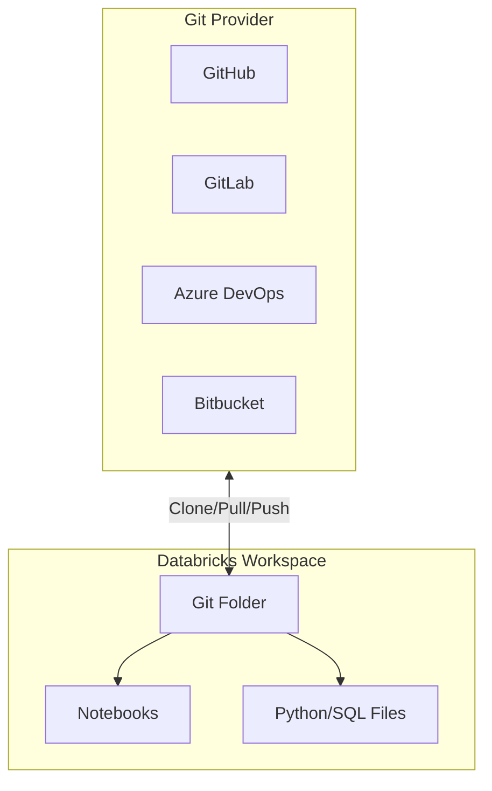
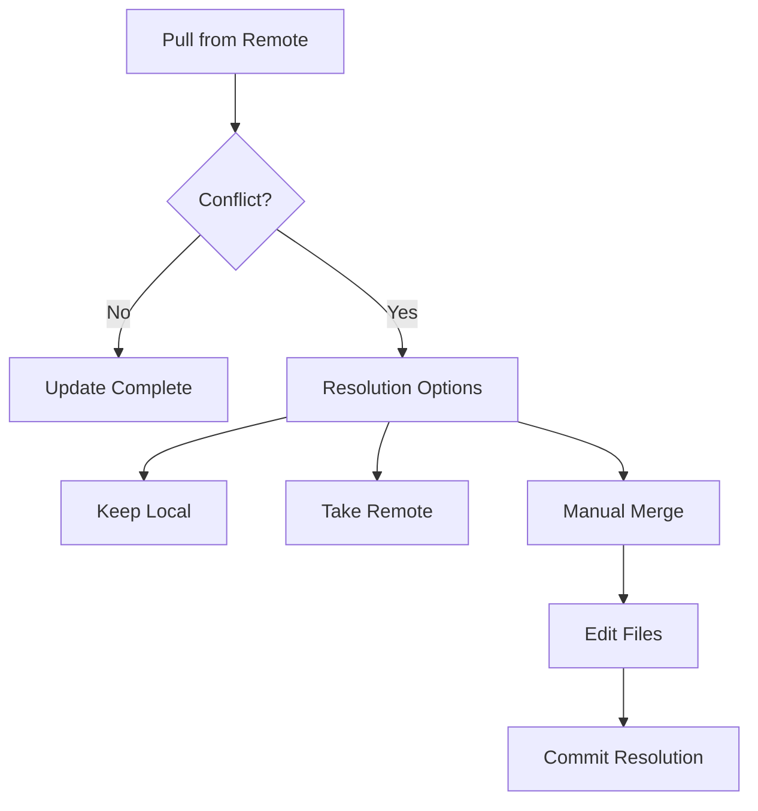
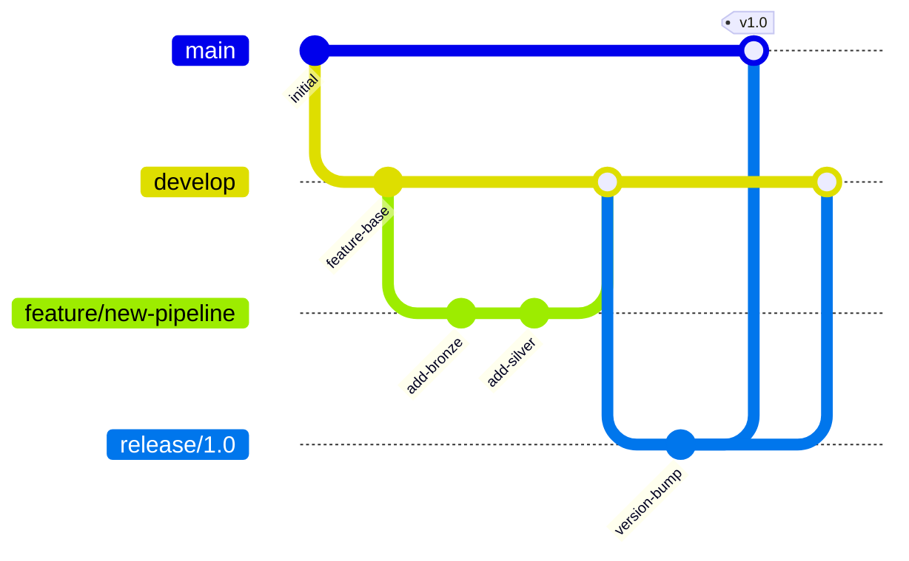
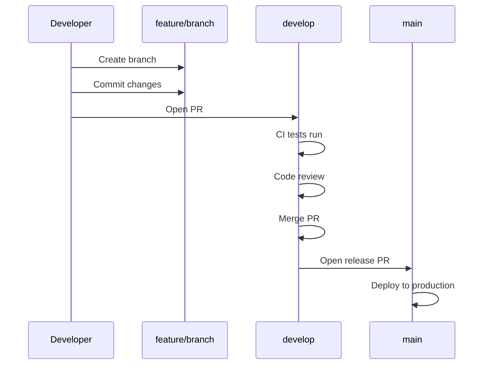
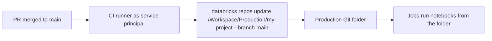
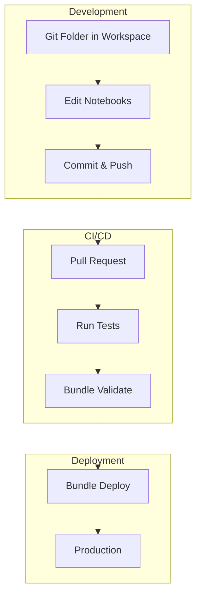

# Git Folders

## Overview

Databricks Git folders (formerly Repos) are a visual Git client and API inside the workspace: you clone a remote repository, branch, commit, push, pull, merge, and rebase notebooks and files. For CI/CD, automation can update a production Git folder to a branch or tag through the Repos API or `databricks repos update`, while Declarative Automation Bundles deploy jobs and pipelines as code.

> [!abstract]
>
> - Git folders = Repos renamed: same functionality, can live anywhere in the workspace, and support more asset types
> - UI operations: clone, branch, commit & push, pull, merge, rebase, reset, resolve conflicts
> - CI/CD: a **production Git folder** updated only by automation (`PATCH /api/2.0/repos/{id}` or `databricks repos update <id> --branch|--tag`)
> - Databricks recommends bundles to deploy jobs and pipelines; Git folders hold the code

> [!tip] What the Exam Tests
>
> - "Configure Git-based CI/CD workflows using Databricks Git folders (formerly Repos) to deploy notebooks and code."
> - Updating a production Git folder from CI to a branch or tag, with a service principal's Git credential
> - Choosing Git folders vs. bundles vs. a job's remote Git source (`git_source`)

---

## Architecture



## Git Folders vs Legacy Repos

| Feature | Git folders | Repos (before the rename) |
| :--- | :--- | :--- |
| Location | Any workspace folder, at any depth under your user folder, several per user | Only under `/Repos` |
| Asset types | Files, notebooks, folders, plus DBSQL queries, AI/BI dashboard drafts, and alerts (Public Preview) | Fewer asset types |
| Remote URL | **Required** | Not required |
| Existing `/Repos` paths | Still work: `/Repos` and `/Workspace/Repos` are the same folder, so job, `dbutils.notebook.run`, and `%run` paths need no change | n/a |
| Recommendation | Create new Git folders | Keep working; no deprecation announced |

> [!note] Platform update (Oct 2026)
> Repos are now called **Git folders**: "The core functionality hasn't changed, only the terminology." The API and CLI still use the `repos` name. Source: [What happened to Databricks Repos?](https://docs.databricks.com/aws/en/repos/what-happened-repos)

## Setting Up Git Folders

### Creating a Git Folder

```text
UI Steps:
1. Navigate to Workspace (you need CAN MANAGE on the parent folder)
2. New → Git folder
3. Enter repository URL
4. Select Git provider
5. Optionally enable sparse checkout mode
6. Click Create
```

### Git Provider Configuration

```text
Cloud providers:
- GitHub, GitHub Advanced Enterprise, GitHub Enterprise Cloud
- Atlassian Bitbucket Cloud
- GitLab and GitLab Enterprise Edition
- Microsoft Azure DevOps (Azure Repos)
- AWS CodeCommit

Self-hosted (must be internet-accessible, or use the Git server proxy):
- GitHub Enterprise Server, Bitbucket Server / Data Center,
  GitLab Self-Managed, Azure DevOps Server
```

### Git Credential Setup

```text
In Databricks: user icon → Settings → Linked accounts → Add Git credential

For GitHub:
- Recommended: the Databricks GitHub app (OAuth 2.0, tokens renewed
  automatically, can be limited to specific repositories)
- Or a fine-grained PAT (Contents: Read and write), or a classic PAT
  with the repo scope (plus workflow to edit GitHub Actions files)

For Azure DevOps:
1. Go to Azure DevOps → User Settings → Personal Access Tokens
2. Create token with:
   - Code (Read & Write)
3. In Databricks: User Settings → Git Integration
4. Select Azure DevOps Services, enter token

For jobs and CI/CD: configure a Git credential for a service principal
```

## Working with Git Folders

### Basic Git Operations

```text
Pull:
- Git dialog → Pull
- Updates the folder with remote changes
- Conflicts with local changes are resolved as merge conflicts

Commit & Push:
- Right-click folder → Git → Commit & Push
- Enter commit message
- Select files to include
- Pushes directly to remote branch

Create Branch:
- Right-click folder → Git → Create Branch
- Enter branch name
- Optionally checkout new branch

Switch Branch:
- Select from available branches
- Discard changes you do not want to carry over first

Merge / Rebase / Reset:
- Merge another branch, rebase onto one, or reset
- Reset = hard reset plus force push of the branch
```

With the **Git CLI in Git folders** preview, standard `git` commands also run from the web terminal (serverless environment version 5+ or Databricks Runtime 17.0+).

### Resolving Conflicts



```text
Conflict Resolution (merge, rebase, or pull):
1. The Git folders UI lists the conflicting files
2. Choose per file:
   - Keep all current changes
   - Take all incoming changes
   - Edit the file manually
3. Or abort the operation to discard the conflicting changes
4. Commit and push the resolution
```

## File Organization

### Supported File Types

New notebooks default to **IPYNB** format. Git folders recognize a notebook by the `.ipynb` extension or by a marker such as `# Databricks notebook source` at the top of a source file. Outputs of `.ipynb` notebooks are committed only if a workspace admin allows it (controlled per repo by `.databricks/commit_outputs`). MLflow experiments, legacy alerts, and Genie Agents cannot be committed.

| File Type | Extension | Notes |
| :--- | :--- | :--- |
| Jupyter Notebook (default) | .ipynb | Keeps dashboards and visualizations |
| Python Notebook | .py | With # Databricks notebook source header |
| SQL Notebook | .sql | With -- Databricks notebook source header |
| Scala Notebook | .scala | With // Databricks notebook source header |
| R Notebook | .r | With # Databricks notebook source header |
| Python File | .py | Regular Python module |
| SQL File | .sql | SQL scripts |
| YAML | .yml, .yaml | Configuration files |
| JSON | .json | Configuration files |
| Markdown | .md | Documentation |

### Project Structure Best Practices

```text
my-data-project/
├── databricks.yml              # Bundle configuration
├── README.md                   # Project documentation
├── src/
│   ├── notebooks/
│   │   ├── bronze/
│   │   │   └── ingest.py      # Databricks notebook
│   │   ├── silver/
│   │   │   └── transform.py
│   │   └── gold/
│   │       └── aggregate.py
│   └── python/
│       ├── __init__.py
│       ├── utils.py           # Regular Python module
│       └── transformations.py
├── tests/
│   ├── unit/
│   │   └── test_utils.py
│   └── integration/
│       └── test_pipeline.py
├── config/
│   ├── dev.yml
│   └── prod.yml
└── resources/
    ├── jobs.yml
    └── pipelines.yml
```

### Notebook Source Format

```python

# Databricks notebook source
# MAGIC %md
# MAGIC # Bronze Ingestion Notebook
# MAGIC This notebook ingests raw data from source systems.

# COMMAND ----------

# MAGIC %md
# MAGIC ## Configuration

# COMMAND ----------

dbutils.widgets.text("source_path", "")
dbutils.widgets.text("target_table", "")

source_path = dbutils.widgets.get("source_path")
target_table = dbutils.widgets.get("target_table")

# COMMAND ----------

# MAGIC %md
# MAGIC ## Read Source Data

# COMMAND ----------

df = spark.read.format("json").load(source_path)

# COMMAND ----------

# MAGIC %md
# MAGIC ## Write to Bronze Table

# COMMAND ----------

df.write.format("delta").mode("append").saveAsTable(target_table)
```

## Branching Strategies

### GitFlow for Data Projects



### Environment Branches

```text
Branch Strategy:
├── main (production)
│   └── Protected, requires PR approval
├── staging
│   └── Pre-production testing
├── develop
│   └── Integration branch
└── feature/*
    └── Individual feature branches
```

### PR Workflow



## Integration with Workflows

### Running Notebooks from Git Folders

```python
# In a job task configuration

{
    "notebook_task": {
        "notebook_path": "/Workspace/Users/user@company.com/my-project/src/notebooks/bronze/ingest",
        "base_parameters": {
            "source_path": "/mnt/raw/events",
            "target_table": "bronze.events"
        }
    }
}
```

### %run with Git Folders

```python

# Databricks notebook source

# Run a notebook from the same Git folder
# COMMAND ----------

# Relative path from current notebook

%run ./utils/common_functions

# COMMAND ----------

# Or absolute workspace path

%run /Workspace/Users/user@company.com/my-project/src/notebooks/utils/common_functions
```

### Importing Python Modules

On Databricks Runtime 11.3 LTS and above, the notebook's working directory and the **Git folder root** are added to `sys.path` automatically, so modules at the repo root import directly. Use `sys.path.append` only for other directories (on serverless the working directory is not guaranteed, so use absolute paths).

```python

# Databricks notebook source

# Only needed because src/python is not the Git folder root

import sys
sys.path.append("/Workspace/Users/user@company.com/my-project/src/python")

# COMMAND ----------

# Import project modules

from utils import data_validation
from transformations import clean_data

# COMMAND ----------

# Use imported functions

df = spark.table("bronze.events")
df_cleaned = clean_data(df)
data_validation.check_nulls(df_cleaned)
```

## Automating Git Operations

### Production Git Folder (CI/CD for Code)

Databricks recommends **Declarative Automation Bundles** for CI/CD. If you deploy only code, use a **production Git folder**:

1. Choose the repository and deployment branch.
2. Give a service principal a Git credential for that repository.
3. Create the Git folder for that repo and branch in a subfolder under `/Workspace` (not under a user folder).
4. Share it: **Can Run** for project users and automation service principals; optionally **Can View** for everyone. Only admins and service principals get edit rights.
5. Keep it in sync with automation only: external CI/CD after a PR merges into the deployment branch, or a scheduled job that calls the API. Never edit it by hand.



### Repos API for Git Folders

| Operation | Endpoint |
| :--- | :--- |
| Create (clone) | `POST /api/2.0/repos` with `url`, `provider`, `path` |
| Get | `GET /api/2.0/repos/{id}` |
| Update: checkout a branch or tag, or pull the latest commit | `PATCH /api/2.0/repos/{id}` with `branch` **or** `tag` (optional `sparse_checkout`) |
| Delete | `DELETE /api/2.0/repos/{id}` |
| List | `GET /api/2.0/repos` (deprecated: omits repos with the Git CLI enabled) |

Updating to a **tag** leaves the Git folder in a **detached HEAD** state, which suits release deployments.

```python
from databricks.sdk import WorkspaceClient

w = WorkspaceClient()  # authenticates as the CI service principal

# Pull the latest commit of main into the production Git folder
w.repos.update(repo_id=12345, branch="main")

# Or pin a release tag (detached HEAD)
w.repos.update(repo_id=12345, tag="v1.4.0")
```

### CLI Operations

```bash
# Get a Git folder by ID or workspace path
databricks repos get 12345

# Checkout + pull the latest commit of a branch (ID or path)
databricks repos update 12345 --branch main
databricks repos update /Workspace/Production/my-project --branch main

# Checkout a release tag
databricks repos update 12345 --tag v1.4.0

# Create (clone) a Git folder
databricks repos create https://github.com/company/project.git gitHub \
    --path /Workspace/Production/my-project
```

### Remote Git Source in Jobs (Alternative)

A job can skip the workspace copy entirely: set `git_source` (`git_url`, `git_provider`, and one of `git_branch`, `git_tag`, `git_commit`). Notebook, Python script, dbt, and SQL file tasks then read files from the remote repository at run time.

## Security and Permissions

### Git Folder Permissions

```text
Permission Levels (Git folder ACLs):
- CAN READ: View contents
- CAN RUN: Run notebooks
- CAN EDIT: Edit and rename assets
- CAN MANAGE: Create/switch branches, pull and push, create/import/
  delete/move assets, change permissions

Most Git operations require CAN MANAGE.
```

### Credential Management

```text
Git Credentials Storage:
1. Personal: User Settings → Git Integration
   - Stored per user
   - Used for that user's operations

2. Service principal:
   - Configure a Git credential for the service principal
   - Recommended for jobs and CI/CD automation
   - No shared "workspace" Git credential: each identity has its own
```

### Branch Protection

```text
Enforce in Git Provider:
1. Require PR reviews before merge
2. Require status checks (CI)
3. Require signed commits
4. Restrict who can push to protected branches

Databricks follows Git provider rules
```

## Comparison: Git Folders vs Declarative Automation Bundles

| Aspect | Git Folders | Declarative Automation Bundles |
| :--- | :--- | :--- |
| Purpose | Version control UI | Deployment automation |
| Workflow | Interactive development | CI/CD deployment |
| Configuration | Git provider settings | databricks.yml |
| Deployment | Production Git folder updated by `repos update` / Repos API | `databricks bundle deploy -t <target>` |
| What is deployed | Code only (notebooks, files) | Code **plus** jobs, pipelines, and other resources |
| Best for | Development; code-only deployments | Production deployment (Databricks recommendation) |

### When to Use Each

```text
Git Folders:
- Interactive notebook development
- Collaborative editing
- Quick prototyping
- Viewing version history

Declarative Automation Bundles:
- Automated deployments
- Environment promotion
- Resource configuration as code
- CI/CD pipelines
```

### Combined Workflow



## Use Cases

- **Collaborative Notebook Development**: Multiple data scientists working in their own personal Git Folders, cloning a shared GitHub repository, developing in isolated branches, and using the Databricks UI to commit and push changes.
- **Lightweight Code Execution**: Using `%run` or Python `import` statements to execute modular utility scripts stored in the Git Folder repository without the overhead of building and deploying a Python wheel.

## Common Issues & Errors

### Authentication Failed

**Scenario:** Cannot clone or push to repository.

**Fix:**

```text
1. Verify Git credentials in User Settings
2. Check token permissions (repo scope for GitHub)
3. Ensure token hasn't expired
4. For SSO: Re-authenticate with Git provider
```

### Merge Conflicts

**Scenario:** Pull fails due to conflicts.

**Fix:**

```text
1. Save local changes externally if needed
2. Discard local changes: Right-click → Git → Discard Changes
3. Pull again
4. Reapply changes manually
5. Commit and push
```

### Notebook Format Issues

**Scenario:** Notebook doesn't render correctly.

**Fix:**

```python

# Ensure notebook has correct header
# For Python:
# Databricks notebook source

# For SQL:

-- Databricks notebook source

# For Scala:

// Databricks notebook source
```

### Missing Files After Pull

**Scenario:** Files missing after Git operation.

**Fix:**

```text
1. Check branch: Ensure correct branch selected
2. Check .gitignore: File might be ignored
3. Refresh workspace: Close and reopen folder
4. Check permissions: Ensure read access to files
```

### Large Repository Performance

**Scenario:** Operations slow on large repos.

**Fix:**

```text
1. Use sparse checkout mode (cone patterns) for large repos
2. Keep total workspace assets and files under 20,000; avoid monorepos
3. Remember the limits: working branches up to 1 GB, each Git operation
   up to 2 GB memory and 4 GB disk writes, files over 10 MB not viewable in the UI
4. Split into smaller repositories
```

## Best Practices

### Development Workflow

```text
1. Create feature branch for each change
2. Make small, focused commits
3. Write descriptive commit messages
4. Pull frequently to stay updated
5. Use PR reviews for quality control
6. Delete merged branches
```

### Repository Organization

```text
1. One repository per project/domain
2. Clear folder structure (src/, tests/, config/)
3. Include README with setup instructions
4. Use .gitignore for generated files
5. Keep notebooks focused and modular
6. Separate code from configuration
```

### Collaboration

```text
1. Establish branching conventions
2. Document code review process
3. Use consistent naming conventions
4. Communicate before major changes
5. Keep main branch always deployable
```

## Exam Tips

> [!tip]
>
> - **Git folders = Repos renamed**. Exam text says "Databricks Git folders (formerly Repos)"; API and CLI still say `repos`.
> - **CI/CD with Git folders**: a production Git folder, updated only by automation with `databricks repos update <id-or-path> --branch <b>` or `--tag <t>` (`PATCH /api/2.0/repos/{id}`), authenticated as a service principal with a Git credential.
> - **Tag = detached HEAD**: pinning a release tag is the safe way to deploy a fixed version.
> - **Bundles vs Git folders**: bundles deploy code plus jobs and pipelines and are Databricks' recommended CI/CD path; Git folders alone deploy code only.
> - **Permissions**: pulling, pushing, and switching branches need **CAN MANAGE**; production folders give most users **Can Run**.
> - **Imports**: the Git folder root is on `sys.path` automatically (DBR 11.3+).
> - **Credentials** are per identity (user or service principal); the Databricks GitHub app is recommended for GitHub.

## Key Takeaways

- **Git folders supersede the Repos name**: same functionality, can live anywhere in the workspace, require a remote URL; existing `/Repos` paths keep working.
- **Supported providers**: GitHub, Bitbucket Cloud, GitLab, Azure DevOps, and AWS CodeCommit in the cloud, plus self-hosted servers that are internet-accessible or reached through the Git server proxy.
- **Notebook formats**: new notebooks default to IPYNB; source-format notebooks are recognized by the `# Databricks notebook source` header.
- **Permission levels**: CAN READ, CAN RUN, CAN EDIT, CAN MANAGE; most Git operations need CAN MANAGE.
- **Conflict resolution**: keep current changes, take incoming changes, edit manually, or abort.
- **Production Git folder**: admin-created, run-only for users, updated only by automation after merges.
- **CLI/API**: `databricks repos update <id-or-path> --branch main` checks out and pulls the latest commit; `--tag v1.0.0` pins a release.
- **Combined workflow**: develop in personal Git folders, review through PRs, deploy with bundles (or a production Git folder for code-only deployments).

## Related Topics

- [Declarative Automation Bundles — Part 1](./03-declarative-automation-bundles-part1.md) - Deployment automation
- [CI/CD Integration — Part 1](./05-cicd-integration-part1.md) - Pipeline workflows
- [Workspace and Notebooks](../01-developing-code-for-data-processing/10-workspace-and-notebooks.md) - Notebook features

## Official Documentation

- [Databricks Git folders](https://docs.databricks.com/aws/en/repos/)
- [What happened to Databricks Repos?](https://docs.databricks.com/aws/en/repos/what-happened-repos)
- [Git folders concepts](https://docs.databricks.com/aws/en/repos/git-folders-concepts)
- [Create and manage Git folders](https://docs.databricks.com/aws/en/repos/git-operations-with-repos)
- [CI/CD with Databricks Git folders](https://docs.databricks.com/aws/en/repos/ci-cd-techniques-with-repos)
- [Connect your Git provider to Databricks](https://docs.databricks.com/aws/en/repos/get-access-tokens-from-git-provider)
- [Git folder limits and reference](https://docs.databricks.com/aws/en/repos/limits)
- [Supported asset types in Git folders](https://docs.databricks.com/aws/en/repos/supported-artifact-types)
- [Notebook formats](https://docs.databricks.com/aws/en/notebooks/notebook-format)
- [Work with Python modules](https://docs.databricks.com/aws/en/files/workspace-modules)
- [Access control lists (Git folder ACLs)](https://docs.databricks.com/aws/en/security/auth/access-control/)
- [Repos API](https://docs.databricks.com/api/workspace/repos/update)
- [`repos` command group (CLI)](https://docs.databricks.com/aws/en/dev-tools/cli/reference/repos-commands)

---

**[← Previous: CI/CD Integration — Part 2: Testing, Secrets & Monitoring](./05-cicd-integration-part2.md) | [↑ Back to Section](./README.md) | [Next: Medallion Architecture →](../09-data-modeling/01-medallion-architecture.md)**
