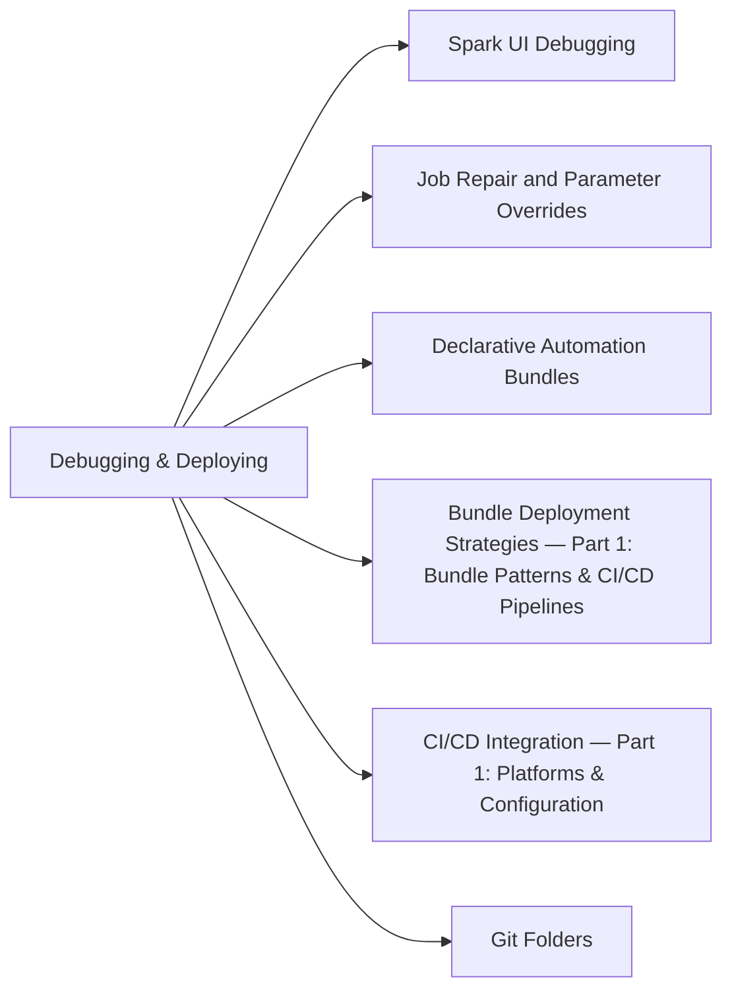

# Section 8: Debugging and Deploying (10 % of Exam)

Finding and fixing failures, then shipping code: diagnostics from the Spark UI, compute logs, system tables and query profiles; job repair with parameter overrides; deploying with Declarative Automation Bundles; and Git-based CI/CD with Databricks Git folders.

## Topics Overview

## Section Contents

| File | Topic | Priority |
| :--- | :--- | :--- |
| [01-spark-ui-debugging.md](./01-spark-ui-debugging.md) | Spark UI, compute logs, and choosing a diagnostic source | High |
| [02-job-repair-and-parameter-overrides.md](./02-job-repair-and-parameter-overrides.md) | Repair runs, re-running failed tasks, parameter overrides | High |
| [03-declarative-automation-bundles-part1.md](./03-declarative-automation-bundles-part1.md) | Bundle structure, resources, variables, commands, targets | High |
| [03-declarative-automation-bundles-part2.md](./03-declarative-automation-bundles-part2.md) | State, CI/CD integration, templates, patterns | High |
| [04-bundle-deployment-strategies-part1.md](./04-bundle-deployment-strategies-part1.md) | Advanced bundle and CI/CD pipeline patterns | Medium |
| [04-bundle-deployment-strategies-part2.md](./04-bundle-deployment-strategies-part2.md) | Rollback strategies, OIDC federation | Medium |
| [05-cicd-integration-part1.md](./05-cicd-integration-part1.md) | Authentication; GitHub Actions, Azure DevOps, GitLab, Jenkins | Medium |
| [05-cicd-integration-part2.md](./05-cicd-integration-part2.md) | Testing and deployment strategies in CI/CD | Medium |
| [06-git-folders.md](./06-git-folders.md) | Databricks Git folders (formerly Repos) for Git-based workflows | High |

## Exam Skill Coverage

Every skill bullet in Section 8 of the Oct 9, 2026 exam guide, with the files that cover it.

| Exam guide skill | Where it is covered |
| :--- | :--- |
| Identify pertinent diagnostic information using Spark UI, cluster logs, system tables, and query profiles to troubleshoot errors. | [01-spark-ui-debugging.md](./01-spark-ui-debugging.md), [05-query-profiler.md](../05-cost-and-performance-optimization/05-query-profiler.md), [01-system-tables.md](../04-monitoring-and-alerting/01-system-tables.md) |
| Analyze the errors and remediate the failed job runs with job repairs and parameter overrides. | [02-job-repair-and-parameter-overrides.md](./02-job-repair-and-parameter-overrides.md) |
| Deploy Databricks resources using Declarative Automation Bundles (formerly Databricks Asset Bundles). | [03-declarative-automation-bundles-part1.md](./03-declarative-automation-bundles-part1.md), [03-declarative-automation-bundles-part2.md](./03-declarative-automation-bundles-part2.md), [04-bundle-deployment-strategies-part1.md](./04-bundle-deployment-strategies-part1.md) |
| Configure Git-based CI/CD workflows using Databricks Git folders (formerly Repos) to deploy notebooks and code. | [06-git-folders.md](./06-git-folders.md), [05-cicd-integration-part1.md](./05-cicd-integration-part1.md) |

## Key Concepts to Master

| Concept | Why it matters |
| :--- | :--- |
| **Repair run** | Re-runs only the failed tasks (and their dependents) of a job run, optionally with new parameter values |
| **Bundle targets** | Per-environment overrides in `databricks.yml`; `databricks bundle deploy -t <target>` |
| **`mode: development` vs `production`** | Development prefixes and pauses resources for safe iteration; production enforces stricter checks |
| **Git folders** | Workspace folders backed by a Git repo; CI updates a production folder to a branch or tag |

## Related Resources

- [Spark configurations cheat sheet (shared)](../../../shared/cheat-sheets/spark-configurations.md)
- [Error messages appendix (shared)](../../../shared/appendix/error-messages.md)

---

**[← Previous: Data Governance](../07-data-governance/README.md) | [↑ Back to DE Professional](../README.md) | [Next: Data Modeling →](../09-data-modeling/README.md)**
