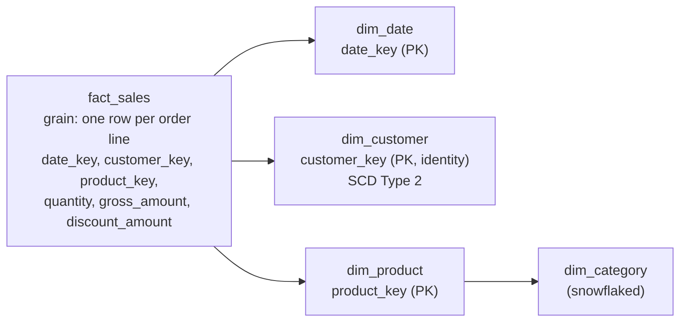

# Dimensional Modeling and Metric Views

## Overview

Analytical (Gold) layers on Databricks are usually modeled as star or snowflake schemas: fact tables at a declared grain, joined to dimension tables through surrogate keys. On top of that model, **materialized views** pre-compute expensive joins and aggregations, and **Unity Catalog metric views** define each business metric once as governed, reusable logic that any tool can query at any grouping.

> [!abstract]
>
> - Star and snowflake schemas fit Databricks better than heavily normalized (3NF) models. They need fewer joins, and wider tables give file-level data skipping more to work with
> - Surrogate keys come from identity columns. Primary key and foreign key constraints are informational, and with `RELY` they let the optimizer eliminate joins and aggregations
> - Materialized views store query results and refresh incrementally when possible (manually, on a schedule, or `TRIGGER ON UPDATE`)
> - Metric views (`CREATE VIEW ... WITH METRICS LANGUAGE YAML`) declare source, joins, fields (dimensions), and measures in YAML. Consumers query them with `MEASURE()`. Window measures are GA (Oct 6, 2026)

> [!tip] What the Exam Tests
>
> - "Design dimensional models for analytical workloads, leveraging Materialized Views for pre-computed aggregation and Unity Catalog Metric Views for governed, reusable metric definitions, to ensure efficient querying and aggregation"
> - Recognizing that inconsistent metric SQL across dashboards calls for a metric view, and that slow dashboards recomputing big joins call for materialized views
> - Picking between a metric view, a materialized view, and a standard view for a given requirement
> - Knowing how keys, informational constraints, and clustering support star-schema queries

> [!note] Platform update (Oct 2026)
> Metric view docs moved under **Unity Catalog semantics** and now use the keyword `fields`. `dimensions` is still accepted as a synonym for backward compatibility. Window measures in metric views became GA on October 6, 2026. Sources: [Metric view YAML syntax reference](https://docs.databricks.com/aws/en/uc-semantics/metric-views/yaml-reference), [Databricks platform release notes, October 2026](https://docs.databricks.com/aws/en/release-notes/product/2026/october)

---

## Star Schema on Databricks

Databricks recommends against heavily normalized models such as third normal form for new lakehouse datasets. Star and snowflake schemas "perform well on Databricks, as there are fewer joins present in standard queries and fewer keys to keep in sync". More fields in a single table also let the optimizer skip more data using file-level statistics.



| Concept | Fact table | Dimension table |
| :--- | :--- | :--- |
| Holds | Measurable events (amounts, quantities) at a declared grain | Descriptive attributes used to filter and group |
| Keys | Foreign keys to each dimension, plus degenerate keys such as `order_id` | Surrogate primary key, plus the natural (business) key |
| Size and change | Large, append-heavy | Smaller. Changes are tracked with SCD Type 1 or 2 |
| Typical layout | Liquid clustering on frequently filtered or joined keys (date, customer) | Liquid clustering on columns used in filters, if needed |
| Built with | Streaming tables or `MERGE`; aggregates as materialized views | AUTO CDC (SCD 1/2) or `MERGE` into Delta tables |

**Declare the grain first.** Every measure in a fact table must be valid at that grain, for example "one row per order line". Mixed grains in one table cause double counting when the table is joined.

## Keys: Surrogate Keys and Informational Constraints

### Identity columns for surrogate keys

```sql
CREATE TABLE main.gold.dim_customer (
  customer_key   BIGINT NOT NULL GENERATED ALWAYS AS IDENTITY,
  customer_id    STRING NOT NULL,          -- natural / business key
  customer_name  STRING,
  segment        STRING,
  valid_from     TIMESTAMP,
  valid_to       TIMESTAMP,
  is_current     BOOLEAN,
  CONSTRAINT dim_customer_pk PRIMARY KEY (customer_key)
);
```

Identity column rules from the `CREATE TABLE` reference:

- The column must be `BIGINT`. `START WITH` and `INCREMENT BY` default to 1, and `step` can't be 0.
- Values are unique and statistically increasing, but **not guaranteed contiguous**.
- With `GENERATED ALWAYS`, you can't supply your own values. `GENERATED BY DEFAULT` allows explicit values.
- You can't `PARTITIONED BY` or `UPDATE` an identity column.
- **Declaring an identity column disables concurrent transactions** on that table. Use it only where concurrent writes to the table aren't needed.
- **Materialized views don't support identity columns or surrogate keys.** Generate keys in a Delta table (or the pipeline target) and keep materialized views for aggregates.

### Primary and foreign keys are informational

Primary key, foreign key, and unique constraints aren't enforced. Primary and foreign keys are GA in Databricks Runtime 15.2+. Unique constraints are Public Preview in Databricks Runtime 18.2+. Validate key integrity in the pipeline, for example with expectations. With `RELY`, the optimizer can use a constraint to rewrite queries.

```sql
CREATE TABLE main.gold.fact_sales (
  order_id        STRING,
  date_key        INT,
  customer_key    BIGINT,
  product_key     BIGINT,
  quantity        INT,
  gross_amount    DECIMAL(18,2),
  discount_amount DECIMAL(18,2),
  CONSTRAINT fact_sales_customer_fk FOREIGN KEY (customer_key)
    REFERENCES main.gold.dim_customer
)
CLUSTER BY (date_key, customer_key);

-- Mark a verified primary key as reliable so the optimizer can use it
ALTER TABLE main.gold.dim_customer DROP PRIMARY KEY;
ALTER TABLE main.gold.dim_customer ADD PRIMARY KEY (customer_key) RELY;
```

| Optimization with a `RELY` primary key or unique constraint | Effect |
| :--- | :--- |
| Eliminate unnecessary aggregations | `SELECT DISTINCT pk` skips the `DISTINCT` |
| Eliminate unnecessary joins | A `LEFT JOIN` to a dimension on its key is removed when no dimension columns are selected |

- `RELY` optimizations require Photon-enabled compute.
- Relying on a constraint that isn't actually true can return incorrect results.
- CTAS doesn't support the constraint clause. Add constraints with `ALTER TABLE ... ADD CONSTRAINT`.
- Catalog Explorer can show an Entity Relationship Diagram from declared primary and foreign keys.

### Layout for star-schema joins

Dynamic file pruning pushes filter results from a filtered dimension down to the fact table scan at runtime. Its effectiveness depends on clustering. The docs recommend liquid clustering on the columns you frequently join on, so matching rows sit in fewer files. By default, dynamic file pruning triggers when the large table is at least 10 GB with at least 10 files. See [Partitioning Strategies](./03-partitioning-strategies.md) for layout design.

## Materialized Views for Pre-Computed Aggregation

A materialized view is a Unity Catalog managed table that physically stores a query's results and updates them as the sources change. Typical uses are serving pre-computed results to dashboards and building layered Gold transformations.

| Where defined | Syntax | Refresh engine |
| :--- | :--- | :--- |
| Standalone (Databricks SQL warehouse or serverless notebook) | `CREATE [OR REPLACE] MATERIALIZED VIEW` | A serverless pipeline is created automatically. It's billed as serverless Lakeflow pipelines DBUs, not warehouse compute |
| Lakeflow pipeline | `CREATE OR REFRESH MATERIALIZED VIEW` or `@dp.materialized_view()` | The pipeline. Must be serverless for incremental refresh |

```sql
-- Daily revenue by region, refreshed on a schedule
CREATE OR REPLACE MATERIALIZED VIEW main.gold.daily_revenue_by_region
  SCHEDULE CRON '0 30 3 * * ?' AT TIME ZONE 'UTC'
AS SELECT
  d.calendar_date,
  c.region,
  SUM(f.gross_amount - f.discount_amount) AS net_revenue,
  COUNT(*)                                AS order_lines
FROM main.gold.fact_sales f
JOIN main.gold.dim_date d     ON f.date_key = d.date_key
JOIN main.gold.dim_customer c ON f.customer_key = c.customer_key
GROUP BY d.calendar_date, c.region;
```

```python
from pyspark import pipelines as dp
from pyspark.sql.functions import col, sum as sum_

@dp.materialized_view(comment="Net revenue by region and day")
def daily_revenue_by_region():
    f = spark.read.table("main.gold.fact_sales")
    c = spark.read.table("main.gold.dim_customer")
    return (f.join(c, "customer_key")
        .groupBy("date_key", "region")
        .agg(sum_(col("gross_amount") - col("discount_amount")).alias("net_revenue")))
```

### Refresh options

| Option | Syntax | Use when |
| :--- | :--- | :--- |
| Manual | `REFRESH MATERIALIZED VIEW mv [FULL]`, add `ASYNC` to return immediately | Ad hoc, development, or after a fix that needs a full recompute |
| Schedule | `SCHEDULE EVERY 1 HOUR` or `SCHEDULE CRON '...' AT TIME ZONE '...'` | Predictable cadence. `EVERY` supports hour, day, and week |
| Trigger on update | `TRIGGER ON UPDATE [AT MOST EVERY INTERVAL 5 MINUTES]` | Production with unpredictable upstream timing. Limits: 10 upstream tables, 30 views, 1-minute minimum |
| Job SQL task | Lakeflow Jobs SQL task running `REFRESH` | Cross-system dependencies and job-level alerting |

The owner, and any user granted `REFRESH` on the view, can refresh it.

### Incremental vs full refresh

- **Incremental refresh** processes only changes since the last update. **Full refresh** reruns the query. Results are identical. By default a cost model picks the cheaper method.
- Incremental refresh **requires serverless** and works best with sources that have **row tracking** enabled. Deletion vectors and change data feed are also recommended.
- Supported incrementally: deterministic `SELECT` expressions, `GROUP BY`, `WITH`, `UNION ALL`, `WHERE` / `HAVING`, inner and outer joins, window functions with `PARTITION BY`, `QUALIFY`, and expectations.
- Forces a full recompute: recursive CTEs, non-deterministic functions (except time functions in `WHERE`), and `SUM` / `AVG` over `FLOAT` / `DOUBLE`. Cast those columns to `DECIMAL` to keep incremental refresh.
- Control the behavior with `REFRESH POLICY AUTO | INCREMENTAL | INCREMENTAL STRICT | FULL`. `INCREMENTAL STRICT` fails rather than fall back to a full refresh.
- Check eligibility with `EXPLAIN CREATE MATERIALIZED VIEW`, and check the technique used (`ROW_BASED`, `GROUP_AGGREGATE`, `FULL_RECOMPUTE`, and so on) in the event log, `event_type = 'planning_information'`.

```sql
ALTER TABLE main.gold.fact_sales SET TBLPROPERTIES (
  delta.enableDeletionVectors = true,
  delta.enableRowTracking = true,
  delta.enableChangeDataFeed = true);

CREATE MATERIALIZED VIEW main.gold.revenue_by_product
REFRESH POLICY INCREMENTAL
AS SELECT product_key, SUM(gross_amount) AS gross_revenue
FROM main.gold.fact_sales GROUP BY product_key;
```

Other materialized view limitations: no time travel, and the change data feed can't be read unless enabled on the view (Beta). Underlying files can contain upstream values that aren't in the view's schema, so don't share the storage with untrusted consumers.

## Unity Catalog Metric Views

A metric view separates **measure definitions** from the **fields** (dimensions) used to group and filter them. A standard view locks in its groupings when you create it. A metric view lets consumers group by any available field, and the engine generates the correct aggregation. Metric views are Unity Catalog securables, so one definition serves SQL, AI/BI dashboards, Genie Agents, alerts, JDBC/ODBC, and external BI tools.

### YAML structure

| Top-level key | Required | Purpose |
| :--- | :--- | :--- |
| `version` | Yes | YAML specification version, for example `1.1` |
| `source` | Yes | Table, view, metric view, or SQL query, usually the fact table |
| `joins` | No | Star joins (`name`, `source`, `'on'` or `using`). Nest `joins` for snowflake schemas |
| `filter` | No | SQL boolean expression applied to every query |
| `fields` (alias `dimensions`) | One of fields or measures | Scalar expressions used in `SELECT`, `WHERE`, and `GROUP BY` |
| `measures` | One of fields or measures | Aggregate expressions, queried with `MEASURE()`. They can compose earlier measures |
| `parameters` | No | Named values passed when the view is queried as a table-valued function |
| `materialization` | No | Pre-computed materialized views with automatic query rewrite |
| `comment` | No | Description. Fields and measures can also carry `display_name`, `synonyms`, and `format` (spec 1.1) |

### Example: one governed "net revenue"

This is the scenario from the exam's sample question 10: one authoritative definition replaces SQL copied into each dashboard.

```sql
CREATE OR REPLACE VIEW main.gold.sales_metrics
WITH METRICS
LANGUAGE YAML
AS $$
version: 1.1
comment: "Governed sales KPIs"
source: main.gold.fact_sales
joins:
  - name: customer
    source: main.gold.dim_customer
    'on': source.customer_key = customer.customer_key
    rely:
      at_most_one_match: true
  - name: dt
    source: main.gold.dim_date
    'on': source.date_key = dt.date_key
fields:
  - name: order_month
    expr: DATE_TRUNC('MONTH', dt.calendar_date)
  - name: region
    expr: customer.region
  - name: segment
    expr: customer.segment
measures:
  - name: gross_revenue
    expr: SUM(source.gross_amount)
  - name: discounts
    expr: SUM(source.discount_amount)
  - name: net_revenue
    expr: MEASURE(gross_revenue) - MEASURE(discounts)
    comment: "Gross revenue minus discounts - the single company definition"
  - name: order_count
    expr: COUNT(DISTINCT source.order_id)
  - name: avg_order_value
    expr: MEASURE(net_revenue) / MEASURE(order_count)
$$;
```

Modeling notes from the docs:

- **Star joins** are `LEFT OUTER JOIN`s from the source (fact) to dimensions and must be many-to-one. In a many-to-many case, the first matching row is selected. Only the joins a query needs are performed.
- **`rely: at_most_one_match: true`** (DBR 18.1+) lets the planner optimize many-to-one joins. It isn't validated, so a fan-out returns wrong `SUM` / `COUNT` results.
- **Snowflake schemas** nest `joins` inside a join (DBR 17.3+). Reference columns by path, such as `customer.nation.n_name`.
- **`cardinality: one_to_many`** (DBR 18.1+, spec 1.1) treats a joined table as a separate fact source aggregated at the source grain.
- **Composed measures** reference earlier measures with `MEASURE(name)`, so a change to an atomic measure flows through to everything built on it.
- When a SQL query with a `JOIN` is the `source`, declare primary and foreign key constraints with `RELY` on the underlying tables.

### Querying a metric view

```sql
SELECT
  order_month,
  region,
  MEASURE(net_revenue)     AS net_revenue,
  MEASURE(avg_order_value) AS aov
FROM main.gold.sales_metrics
WHERE segment = 'Enterprise'
GROUP BY ALL
ORDER BY order_month;
```

- Every measure must be wrapped in `MEASURE()`. `agg()` is a synonym in DBR 18.1+. `SELECT *` doesn't work, so list fields and wrap measures explicitly.
- `MEASURE()` can't be used as a window function with `OVER`. In DBR 18.1+, `MEASURE(m) FILTER (WHERE ...)` is allowed.
- A metric view can't be joined directly at query time. Aggregate it in a CTE, then join the CTE.
- `DESCRIBE TABLE EXTENDED <metric_view> AS JSON` returns the YAML definition in the **View Text** field.

### Window measures (GA Oct 6, 2026)

Window measures define rolling, cumulative, period-over-period, and semiadditive aggregations.

| Key | Required | Values |
| :--- | :--- | :--- |
| `order` | Yes | Field that orders the window. It must be deterministic |
| `range` | Yes | `current`, `cumulative`, `trailing <n> <unit>`, `leading <n> <unit>`, or `all`. The `inclusive` / `exclusive` modifiers need DBR 18.1+. The default is `exclusive` |
| `semiadditive` | Yes | `first` or `last`: how to collapse when `order` isn't in the `GROUP BY` |
| `offset` | No | Shift the frame, for example `-12 month` (dated, DBR 18.1+) or `-1` (numeric index, DBR 19+) |

```yaml
measures:
  - name: monthly_sales
    expr: SUM(sales)
    window:
      - order: month
        range: current
        semiadditive: last
  - name: monthly_sales_py
    expr: SUM(sales)
    window:
      - order: month
        range: current
        semiadditive: last
        offset: -12 month
  - name: yoy_growth_pct
    expr: (MEASURE(monthly_sales) - MEASURE(monthly_sales_py))
      / NULLIF(MEASURE(monthly_sales_py), 0)
  - name: t7d_customers
    expr: COUNT(DISTINCT customer_key)
    window:
      - order: order_date
        range: trailing 7 day
        semiadditive: last
```

### Materialization for metric views

Metric views can pre-compute aggregations themselves. A `materialization` block makes Databricks create a managed Lakeflow pipeline that maintains materialized views. The optimizer then **rewrites queries automatically**: exact match first, then rollup match, then unaggregated match, and finally the source tables.

```yaml
materialization:
  schedule: every 6 hours
  mode: relaxed
  materialized_views:
    - name: baseline
      type: unaggregated
    - name: revenue_by_month_region
      type: aggregated
      dimensions:
        - order_month
        - region
      measures:
        - gross_revenue
        - discounts
```

- Requirements: serverless compute enabled, and DBR 17.3+ for the querying compute.
- `mode` must be `relaxed`. Freshness isn't verified, so matched queries return the last refresh while unmatched queries read live data. Align the schedule with the upstream pipeline.
- The block lists fields under `dimensions:` even when the top level uses `fields:`.
- Non-additive measures such as `COUNT(DISTINCT)` and percentiles need an **exact** match. They can't be rolled up.
- You can't materialize a metric view whose source tables use row filters, column masks, or ABAC policies, or one with invoker-dependent expressions (`current_user()`) or parameters.

### Governance and lifecycle

- **Privileges:** `GRANT SELECT ON <metric_view> TO <group>`. Standard Unity Catalog inheritance applies.
- **Editing:** only the owner can edit. `ALTER VIEW ... AS $$ <complete YAML> $$` replaces the whole definition. For collaborative editing, transfer ownership to a group that has `SELECT` on all sources. That isn't supported for materialized metric views.
- **Runtime:** metric views need DBR 16.4+. Joins with snowflake schemas, materialization, and agent metadata need 17.3+.
- **Sharing:** metric views can be added to an OpenSharing share (Beta).

## Choosing: Metric View vs Materialized View vs Standard View

| Requirement | Metric view | Materialized view | Standard view |
| :--- | :--- | :--- | :--- |
| One governed definition of a KPI reused by every tool | **Best fit** | No. Logic is fixed per view | Partial. The grouping is fixed |
| Consumers choose grouping and filters at query time | **Yes** (any field) | No. Fixed grain | No. Fixed query |
| Pre-computed results, so dashboards don't recompute joins | Yes, with `materialization` | **Best fit** | No. Computed on every query |
| Stores data / incremental refresh | Only through materialization | **Yes** | No |
| Ratio and non-additive metrics stay correct at any grain | **Yes**. Measures re-aggregate from base rows | Only at the stored grain | Only for the defined query |
| Simple reusable `SELECT` logic or column-level abstraction | Overkill | Overkill | **Best fit** |
| Query syntax | `MEASURE(m)` with `GROUP BY` | Plain `SELECT` | Plain `SELECT` |

**Sample question 10 pattern:** "net revenue" is computed differently in each dashboard, and the dashboards are slow because they recompute large joins and aggregations. The answer is to define net revenue once in a Unity Catalog metric view, and use materialized views (standalone, or the metric view's own `materialization`) for the pre-computed aggregates the dashboards read.

## Use Cases

- **Enterprise KPI layer:** finance, sales, and operations metrics defined once as metric views and consumed by AI/BI dashboards, Genie Agents, alerts, and Power BI or Tableau.
- **Dashboard acceleration:** Gold materialized views at the dashboard grain, with `TRIGGER ON UPDATE` or a schedule aligned to upstream pipelines.
- **Period-over-period reporting:** window measures for trailing 7-day users, month-to-date, or year-over-year growth, without hand-written window SQL in every report.
- **Retail star schema:** a `fact_sales` table clustered on date and customer keys, an SCD Type 2 customer dimension with identity surrogate keys, and `RELY` primary keys for join elimination.

## Common Issues & Errors

| Symptom | Cause | Fix |
| :--- | :--- | :--- |
| `SELECT *` on a metric view fails or omits measures | Measures must be evaluated with `MEASURE()` | List fields and wrap each measure in `MEASURE()` |
| Measures inflated after adding a join | Dimension join fans out (not many-to-one), or `at_most_one_match` set incorrectly | Fix the dimension key's uniqueness, or model the table as `cardinality: one_to_many` |
| Joining a metric view to another table fails | Direct joins aren't supported | Aggregate in a CTE first, then join |
| Materialized view refresh is always a full recompute | Classic compute, row tracking missing on sources, or unsupported expressions | Use serverless, enable row tracking, check `EXPLAIN CREATE MATERIALIZED VIEW`, consider `REFRESH POLICY INCREMENTAL STRICT` |
| Identity column rejected in a materialized view | Materialized views don't support identity columns or surrogate keys | Generate keys in the dimension Delta table |
| Concurrent writers fail on a dimension table | An identity column disables concurrent transactions | Serialize writes, or generate keys differently |
| Metric view materialization creation fails | Source uses row filters, column masks, or ABAC, or uses `current_user()` | Remove the per-user logic from the materialized path, or skip materialization |
| Dashboards show stale numbers for some queries | `relaxed` mode serves the last refresh when a query matches | Schedule materialization refresh after the upstream load |

## Exam Tips

> [!tip]
>
> - **"Inconsistent metric definitions across dashboards"** means a Unity Catalog metric view. **"Slow dashboards recomputing joins and aggregations"** means materialized views. When both appear, combine them (sample question 10).
> - **Metric view syntax:** `CREATE VIEW ... WITH METRICS LANGUAGE YAML AS $$ ... $$`. Query with `MEASURE()` and `GROUP BY`.
> - **YAML keys:** `version`, `source`, `joins`, `filter`, `fields` / `dimensions`, `measures`, optional `materialization`. Window measures need `order`, `range`, and `semiadditive`.
> - **Primary and foreign keys aren't enforced.** `RELY` enables join and aggregation elimination on Photon.
> - **Identity columns** provide surrogate keys (`BIGINT GENERATED ALWAYS AS IDENTITY`). They're not contiguous, they disable concurrent transactions, and they aren't supported in materialized views.
> - **Materialized view incremental refresh** needs serverless and works best with row tracking. `REFRESH POLICY INCREMENTAL STRICT` fails instead of doing a full recompute.
> - **Star or snowflake over 3NF** on Databricks: fewer joins and better data skipping.

## Key Takeaways

- **Dimensional model:** declare the fact grain, connect facts to dimensions with surrogate keys, and track dimension history with SCD Type 2 (AUTO CDC).
- **Keys:** identity columns generate surrogate keys. Primary and foreign keys are informational, and `RELY` unlocks optimizer rewrites.
- **Materialized views:** store results, refresh manually, on a schedule, or on upstream change, and refresh incrementally on serverless when the query and sources allow it.
- **Metric views:** YAML-defined, governed, reusable measures over a fact table and its joins. Consumers pick any grouping and call `MEASURE()`.
- **Window measures** (GA Oct 6, 2026) cover rolling, cumulative, and period-over-period metrics with `order`, `range`, `semiadditive`, and optional `offset`.
- **Metric view materialization** combines both ideas: governed definitions plus pre-computed aggregates, with automatic query rewrite.

## Related Topics

- [Medallion Architecture](./01-medallion-architecture.md) - where the Gold dimensional layer sits
- [SCD Patterns](./05-scd-patterns.md) - Type 1 and Type 2 dimensions
- [AUTO CDC API](../01-developing-code-for-data-processing/07-auto-cdc-api.md) - declarative SCD in Lakeflow Pipelines
- [Partitioning Strategies](./03-partitioning-strategies.md) - clustering facts on join and filter keys
- [Lakeflow Spark Declarative Pipelines](../01-developing-code-for-data-processing/06-declarative-pipelines.md) - materialized views and streaming tables in pipelines
- [Expectations and Data Quality](../03-data-manipulation/06-expectations-data-quality.md) - validating key integrity

## Official Documentation

- [Data modeling](https://docs.databricks.com/aws/en/transform/data-modeling)
- [Constraints on Databricks](https://docs.databricks.com/aws/en/tables/constraints)
- [Query optimization using primary key and unique constraints](https://docs.databricks.com/aws/en/sql/user/queries/query-optimization-constraints)
- [CREATE TABLE \[USING\] (identity columns)](https://docs.databricks.com/aws/en/sql/language-manual/sql-ref-syntax-ddl-create-table-using)
- [Dynamic file pruning](https://docs.databricks.com/aws/en/optimizations/dynamic-file-pruning)
- [Use standalone materialized views](https://docs.databricks.com/aws/en/sql/mv-st/materialized)
- [Incremental refresh for materialized views](https://docs.databricks.com/aws/en/ldp/incremental-refresh)
- [Schedule refreshes](https://docs.databricks.com/aws/en/sql/mv-st/schedule-refreshes)
- [Unity Catalog metric views](https://docs.databricks.com/aws/en/uc-semantics/metric-views/)
- [Create a metric view](https://docs.databricks.com/aws/en/uc-semantics/metric-views/create)
- [Metric view YAML syntax reference](https://docs.databricks.com/aws/en/uc-semantics/metric-views/yaml-reference)
- [Query metric views](https://docs.databricks.com/aws/en/uc-semantics/metric-views/query)
- [Advanced techniques for metric views](https://docs.databricks.com/aws/en/uc-semantics/metric-views/advanced-techniques)
- [Materialization for metric views](https://docs.databricks.com/aws/en/uc-semantics/metric-views/materialization)
- [Manage metric views](https://docs.databricks.com/aws/en/uc-semantics/metric-views/manage)
- [Metric view feature availability](https://docs.databricks.com/aws/en/uc-semantics/metric-views/feature-availability)
- [measure aggregate function](https://docs.databricks.com/aws/en/sql/language-manual/functions/measure)
- [Databricks platform release notes, October 2026](https://docs.databricks.com/aws/en/release-notes/product/2026/october)

---

**[← Previous: Slowly Changing Dimension (SCD) Patterns](./05-scd-patterns.md) | [↑ Back to Section](./README.md)**
