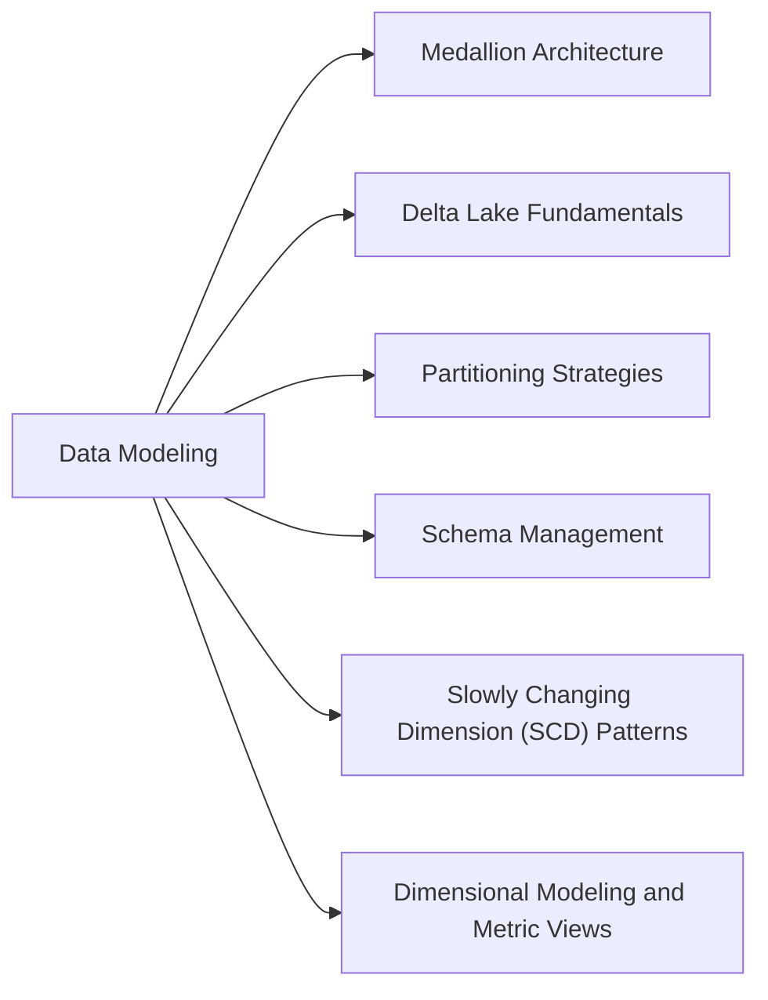

# Section 9: Data Modeling (5 % of Exam)

Designing tables that stay fast at scale: the medallion architecture, Delta fundamentals, table layouts (partitioning by grain, clustering by access pattern, compaction), schema management, SCD patterns, and dimensional models that use materialized views and Unity Catalog metric views.

## Topics Overview

## Section Contents

| File | Topic | Priority |
| :--- | :--- | :--- |
| [01-medallion-architecture.md](./01-medallion-architecture.md) | Bronze / silver / gold layers and multi-hop processing | Medium |
| [02-delta-lake-fundamentals.md](./02-delta-lake-fundamentals.md) | Delta architecture, ACID, constraints, generated and identity columns | Medium |
| [03-partitioning-strategies.md](./03-partitioning-strategies.md) | Table layouts for large Delta / Iceberg tables: partitioning, clustering, compaction | High |
| [04-schema-management.md](./04-schema-management.md) | Schema enforcement and evolution, column mapping | Medium |
| [05-scd-patterns.md](./05-scd-patterns.md) | SCD Types 1, 2, 3, 4, 6 and AUTO CDC for SCD Type 2 | High |
| [06-dimensional-modeling-and-metric-views.md](./06-dimensional-modeling-and-metric-views.md) | Star schemas, materialized views, Unity Catalog metric views | High |

## Exam Skill Coverage

Every skill bullet in Section 9 of the Oct 9, 2026 exam guide, with the files that cover it.

| Exam guide skill | Where it is covered |
| :--- | :--- |
| Design scalable Delta/Iceberg table layouts for large data assets by mapping partitioning to data grain, aligning clustering to relationship access patterns, and maintaining balanced file sizes through compaction. | [03-partitioning-strategies.md](./03-partitioning-strategies.md), [02-file-sizing.md](../05-cost-and-performance-optimization/02-file-sizing.md) |
| Design dimensional models for analytical workloads, leveraging Materialized Views for pre-computed aggregation and Unity Catalog Metric Views for governed, reusable metric definitions, to ensure efficient querying and aggregation. | [06-dimensional-modeling-and-metric-views.md](./06-dimensional-modeling-and-metric-views.md) |

## Key Concepts to Master

| Concept | Why it matters |
| :--- | :--- |
| **Partition by grain** | Partition only large tables, on a low-cardinality column such as date; otherwise cluster |
| **Clustering by access pattern** | Choose clustering keys from the columns used in filters and joins |
| **Metric view** | A governed, reusable metric definition (dimensions + measures) queried with `MEASURE()` |
| **Materialized view** | Pre-computed aggregate that dashboards read directly, refreshed incrementally where possible |

## Related Resources

- [Medallion Architecture (shared)](../../../shared/fundamentals/medallion-architecture.md)
- [Delta Lake cheat sheet](../resources/cheat-sheets/delta-lake-quick-ref.md)

---

**[← Previous: Debugging and Deploying](../08-debugging-and-deploying/README.md) | [↑ Back to DE Professional](../README.md)**
