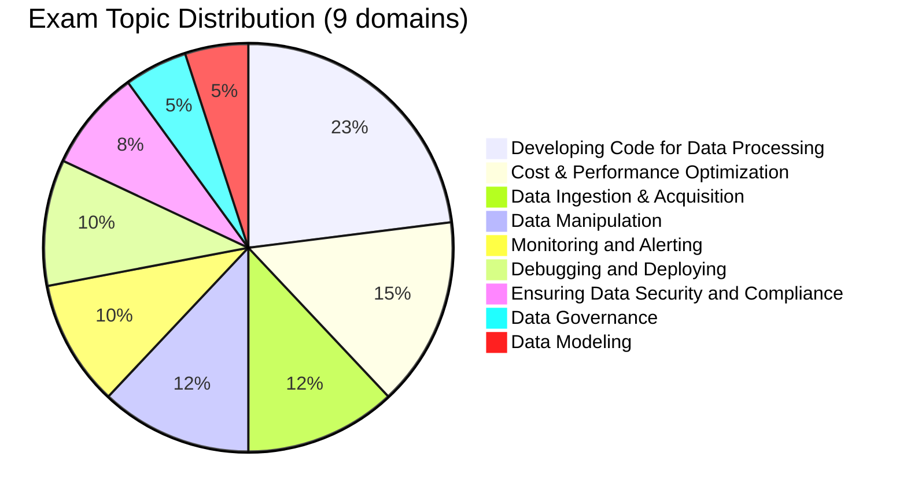

# Databricks Data Engineer Professional

> [!important]
> **What changed in the Oct 9, 2026 exam guide** (new exam version, published and effective Oct 9, 2026)
>
> - **9 domains instead of 10.** *Data Sharing and Federation* is no longer its own domain — OpenSharing, Clean Rooms and Lakehouse Federation now sit under **Data Ingestion & Acquisition**, which rises from 7 % to **12 %**
> - **Data Manipulation** (12 %) replaces *Data Transformation, Cleansing, and Quality* (10 %) and adds the **VARIANT** type and **AI functions (`ai_query`)**
> - Weights changed: Developing Code 22 → **23 %**, Cost & Performance 13 → **15 %**, Security & Compliance 10 → **8 %**, Data Governance 7 → **5 %**, Data Modeling 6 → **5 %** (Monitoring and Debugging stay at 10 %)
> - **New skills:** AUTO CDC APIs (formerly APPLY CHANGES), Lakeflow Connect CDC from SQL Server / MySQL / PostgreSQL, OpenSharing (D2D and Databricks-to-Open), Clean Rooms, ABAC with governed tags, `CLUSTER BY AUTO`, Unity Catalog metric views, Lakehouse alerts (including AI agent quality), Python project structure and dependency troubleshooting for **Declarative Automation Bundles** (formerly Databricks Asset Bundles / DABs)
> - **60 scored questions** (was 59), 120 minutes, USD 200; the guide lists **English** only. No numeric passing score is published
>
> Source of truth: the [Oct 9, 2026 exam guide PDF](https://www.databricks.com/sites/default/files/2026-10/Databricks-Certified-Data-Engineer-Professional-Exam-Guide-9-Oct-2026.pdf). The folder structure below matches its 9 sections 1 : 1, in the same order.

> [!note] Databricks-side discrepancy (checked Oct 26, 2026)
> The [certification page](https://www.databricks.com/learn/certification/data-engineer-professional) links the Oct 9, 2026 PDF but still lists the previous 10 domains, 59 questions and four languages (English, Japanese, Portuguese BR, Korean). This guide follows the PDF. Check the page again two weeks before your exam, as the PDF itself advises.

## Exam Overview

| Detail              | Information                                     |
| ------------------- | ----------------------------------------------- |
| **Certification**   | Databricks Certified Data Engineer Professional |
| **Exam guide**      | Oct 9, 2026 (exam published Oct 9, 2026)        |
| **Scored questions**| 60 multiple-choice (unscored items may be added; extra time is built in) |
| **Duration**        | 120 minutes                                     |
| **Result**          | Pass / fail (no numeric threshold in the Oct 9, 2026 exam guide) |
| **Languages**       | English (per the Oct 9, 2026 PDF)               |
| **Code in stems**   | Python and SQL                                  |
| **Experience**      | One year of hands-on data engineering on Databricks (recommended) |
| **Recertification** | Every 2 years — see [Renewal Guide](../../shared/appendix/renewal-guide.md) |
| **Cost**            | USD 200, plus applicable taxes                  |
| **Delivery**        | Online proctored or test center                 |

## Exam Domain Weights (official — Oct 9, 2026)

## Study Topics

The folders below match the 9 sections of the Oct 9, 2026 exam guide, in the guide's order. Each folder's `README.md` lists its files and maps every exam-guide skill bullet to the file that covers it.

| Section | Weight | Focus |
| :--- | :---: | :--- |
| [01 — Developing Code for Data Processing using Python and SQL](./01-developing-code-for-data-processing/README.md) | 23 % | Bundle project structure and dependencies, UDFs, Lakeflow Pipelines (streaming tables vs materialized views, AUTO CDC), Structured Streaming state, Lakeflow Jobs control flow, compute, testing |
| [02 — Data Ingestion & Acquisition](./02-data-ingestion-and-acquisition/README.md) | 12 % | Auto Loader, message buses, CDC into Delta / Iceberg, Lakeflow Connect, OpenSharing, Clean Rooms, Lakehouse Federation |
| [03 — Data Manipulation](./03-data-manipulation/README.md) | 12 % | Window functions, joins, aggregations, MERGE, deduplication, VARIANT, AI functions, expectations |
| [04 — Monitoring and Alerting](./04-monitoring-and-alerting/README.md) | 10 % | System tables, pipeline event log, Lakehouse alerts, REST API / CLI / SDK |
| [05 — Cost & Performance Optimization](./05-cost-and-performance-optimization/README.md) | 15 % | Managed tables, Predictive Optimization, Liquid Clustering / `CLUSTER BY AUTO`, deletion vectors, disk cache, query profile |
| [06 — Ensuring Data Security and Compliance](./06-ensuring-data-security-and-compliance/README.md) | 8 % | Least-privilege ACLs, ABAC, anonymization, PII controls, GDPR purging |
| [07 — Data Governance](./07-data-governance/README.md) | 5 % | Permission inheritance, tags and comments |
| [08 — Debugging and Deploying](./08-debugging-and-deploying/README.md) | 10 % | Spark UI, logs, job repair, Declarative Automation Bundles, Git folders |
| [09 — Data Modeling](./09-data-modeling/README.md) | 5 % | Table layout, SCD, dimensional models, metric views |

> [!note] Product names used in this guide
> This guide uses the exam guide's names. Current docs names, where different: **Lakeflow Pipelines** → Lakeflow Spark Declarative Pipelines ([renamed Nov 12, 2025](https://docs.databricks.com/aws/en/release-notes/product/2025/november)); **Declarative Automation Bundles** were Databricks Asset Bundles until [Mar 16, 2026](https://docs.databricks.com/aws/en/release-notes/dev-tools/bundles); **OpenSharing** was Delta Sharing until [Jun 10, 2026](https://docs.databricks.com/aws/en/release-notes/product/2026/june); the "Delta cache" is the **disk cache** in the docs. For hands-on practice use [Free Edition](https://docs.databricks.com/aws/en/getting-started/free-edition) — Community Edition was retired on Jan 1, 2026.

### Practice Exams

| Resource                                                        | Description                              |
| --------------------------------------------------------------- | ---------------------------------------- |
| [Mock Exam](./resources/mock-exam/README.md)                    | 63-question full-length practice exam, labelled by 2026 section |
| [Mock Exam 2](./resources/mock-exam-2/README.md)                | 60-question advanced practice exam, labelled by 2026 section |
| [Practice Questions](./resources/practice-questions/README.md)  | 155 questions across the 9 sections, including new 2026-blueprint questions |

### Quick Reference

| Resource                                            | Purpose                                       |
| --------------------------------------------------- | --------------------------------------------- |
| [Cheat Sheets](./resources/cheat-sheets/README.md)  | Quick reference cards for key topics          |
| [Exam Tips](./resources/exam-tips.md)               | Exam strategies and common traps              |
| [Final Review](./resources/final-review.md)         | Exam-morning cram scan                        |
| [Official Links](./resources/official-links.md)     | Databricks documentation references           |

## Interview Preparation

After completing this certification, explore advanced architecture and design questions:

- [Interview Prep Resource](../../shared/interview-prep/README.md) - System design, Delta Lake internals, pipeline architecture, performance optimization, and more

## Prerequisites

Before starting this certification, review:

- [Delta Lake Basics](../../shared/fundamentals/delta-lake-basics.md)
- [Spark Fundamentals](../../shared/fundamentals/spark-fundamentals.md)
- [Medallion Architecture](../../shared/fundamentals/medallion-architecture.md)
- [Unity Catalog Basics](../../shared/fundamentals/unity-catalog-basics.md)

## Study Progress Tracker

### Phase 1: Foundations (weeks 1–2)

- [ ] Delta Lake fundamentals
- [ ] Medallion architecture
- [ ] Unity Catalog basics
- [ ] Spark fundamentals

### Phase 2: Core Processing (weeks 3–4)

- [ ] Section 01 — Developing Code for Data Processing using Python and SQL
- [ ] Section 02 — Data Ingestion & Acquisition
- [ ] Section 03 — Data Manipulation

### Phase 3: Operations & Optimization (weeks 5–6)

- [ ] Section 05 — Cost & Performance Optimization
- [ ] Section 04 — Monitoring and Alerting
- [ ] Section 08 — Debugging and Deploying

### Phase 4: Security, Governance & Modeling (week 7)

- [ ] Section 06 — Ensuring Data Security and Compliance
- [ ] Section 07 — Data Governance
- [ ] Section 09 — Data Modeling

### Phase 5: Exam Prep (week 8)

- [ ] Review cheat sheets
- [ ] Complete practice questions (target 70 %+ per section)
- [ ] Work the 10 sample questions in the official exam guide PDF
- [ ] Mock Exam 1 (timed)
- [ ] Mock Exam 2 (timed)

## Official Resources

- [Databricks Certification Page](https://www.databricks.com/learn/certification/data-engineer-professional)
- [Oct 9, 2026 exam guide (PDF)](https://www.databricks.com/sites/default/files/2026-10/Databricks-Certified-Data-Engineer-Professional-Exam-Guide-9-Oct-2026.pdf)
- [Databricks Documentation](https://docs.databricks.com/)
- [Databricks Academy](https://www.databricks.com/learn/training)

## Recommended Courses

From the Oct 9, 2026 exam guide:

1. **Advanced Data Engineering with Databricks** — instructor-led
2. **Advanced Techniques with Apache Spark™ Declarative Pipeline** — self-paced
3. **Databricks Data Privacy** — self-paced
4. **Databricks Performance Optimization** — self-paced
5. **Automated Deployment with Declarative Automation Bundles** — self-paced
