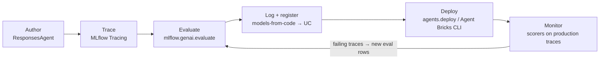
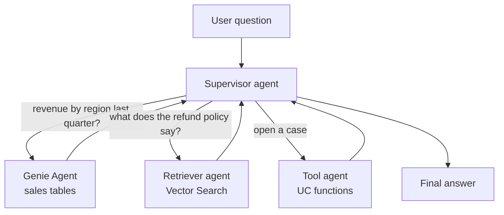

# Agentic Systems with MLflow, Agent Framework, and Genie

## Overview

Three Application Development bullets in the 2026 exam guide cover code-first agents: *"Utilize MLflow and Agent Framework for developing agentic systems"*, *"Enable multi-agent systems to leverage Genie Spaces or conversational API to retrieve data"*, and *"Compare the evaluation and monitoring phases of the Gen AI application life cycle."* This file shows how an agent is authored with the MLflow `ResponsesAgent` interface, instrumented with MLflow Tracing, combined with Genie for structured data, and then carried from evaluation into monitoring.

> [!abstract]
>
> - **Agent Framework + MLflow** — author the agent in any framework, wrap it in `mlflow.pyfunc.ResponsesAgent`, trace it with MLflow Tracing, log it with *models-from-code*, and register it in Unity Catalog
> - **Genie for structured data** — a Genie Agent (formerly *Genie Space*) turns natural-language questions into SQL over curated tables; agents reach it through the **Genie Conversation API**, a LangChain `GenieAgent`, or a **Genie MCP server**
> - **Multi-agent pattern** — a supervisor delegates to specialised workers (Genie for tables, a retriever agent for documents, tool-calling agents for actions)
> - **Evaluate, then monitor** — the same MLflow scorers run offline on an evaluation dataset and online on sampled production traces

> [!tip] What the Exam Tests
>
> - Which MLflow interface to subclass for a new agent (`ResponsesAgent`) and why (signature inference, tracing, tool-call output items)
> - How MLflow Tracing captures each LLM, retriever, and tool step, and where traces land
> - How a multi-agent system gets **structured data** from Genie (Genie Agent as a sub-agent or tool, or the Conversation API) instead of an LLM writing raw SQL
> - The difference between the **evaluation** phase (pre-deployment, curated dataset, ground truth) and the **monitoring** phase (post-deployment, live traffic, sampling)

---

> [!note] Platform update (Oct 2026)
> **Authoring interface:** Databricks calls `ChatAgent` and `ChatModel` *legacy* authoring interfaces and recommends migrating to **`ResponsesAgent`** ([legacy agent schema](https://learn.microsoft.com/en-us/azure/databricks/generative-ai/agent-framework/agent-legacy-schema)); MLflow has recommended `ResponsesAgent` over `ChatModel` since MLflow 3.0 ([MLflow ChatModel guide](https://mlflow.org/docs/latest/genai/flavors/chat-model-intro/)).
> **Deployment target:** on **2026-10-05** agents deployed to **Model Serving** and the **MLflow AgentServer** moved to the *Legacy* section of the docs. New code-first agents are scaffolded and deployed with the **Agent Bricks CLI** (Beta), which serves them with `DurableAgentServer` on **Agent Runtime** (Databricks Apps) ([Agent Bricks CLI](https://docs.databricks.com/aws/en/agents/custom-agents/agent-bricks-cli), [Deploy agents on Databricks](https://docs.databricks.com/aws/en/agents/deploy/)).
> **Naming:** *Genie Spaces* were renamed **Genie Agents** on 2026-07-08 with unchanged capabilities ([July 2026 release notes](https://docs.databricks.com/aws/en/release-notes/product/2026/july)).
> The exam guide (March 18, 2026) still uses *Agent Framework*, *Model Serving*, and *Genie Spaces*; the code below uses the interfaces the exam expects and notes where the current product differs.

## The agent development loop



## Authoring an agent with `ResponsesAgent`

`ResponsesAgent` is an MLflow PyFunc interface for agents. You can keep your agent in LangGraph, the OpenAI Agents SDK, or plain Python and wrap it; MLflow then **infers a signature** that matches `ResponsesAgentRequest` / `ResponsesAgentResponse` and tags the model with the `agent/v1/responses` task ([ResponsesAgent introduction](https://mlflow.org/docs/latest/genai/flavors/responses-agent-intro/)).

```python
# agent.py — models-from-code file
import mlflow
from mlflow.pyfunc import ResponsesAgent
from mlflow.types.responses import ResponsesAgentRequest, ResponsesAgentResponse

mlflow.openai.autolog()  # trace every LLM call made through the OpenAI client


class SupportAgent(ResponsesAgent):
    def __init__(self, llm_client, tools):
        self.llm = llm_client
        self.tools = tools

    def predict(self, request: ResponsesAgentRequest) -> ResponsesAgentResponse:
        answer = self._run_loop(request.input)  # your own tool-calling loop
        return ResponsesAgentResponse(
            output=[self.create_text_output_item(text=answer, id="msg_1")]
        )


mlflow.models.set_model(SupportAgent(llm_client=..., tools=...))
```

Key features of the interface:

| Feature | How |
| :--- | :--- |
| Non-streaming responses | Implement `predict(request) -> ResponsesAgentResponse` |
| Streaming | Implement `predict_stream(request)` yielding `ResponsesAgentStreamEvent` (text deltas, then `response.output_item.done`) |
| Tool calls in the output | `create_function_call_item(...)` and `create_function_call_output_item(...)` helpers |
| Extra inputs / outputs | `custom_inputs` and `custom_outputs` fields (for example `session_id`, source links) |
| Framework-agnostic | Wrap an existing LangGraph or OpenAI Agents SDK agent inside `predict` |

### Logging and registering the agent

Use **models-from-code**: pass the *file path* of the agent, and declare every Databricks resource the agent calls so deployment can provision credentials (see [Access Control and Batch Inference](../02-assembling-and-deploying-apps/05-access-control-and-batch-inference.md)).

```python
import mlflow
from mlflow.models.resources import DatabricksServingEndpoint, DatabricksGenieSpace

mlflow.set_registry_uri("databricks-uc")

with mlflow.start_run():
    info = mlflow.pyfunc.log_model(
        name="agent",
        python_model="agent.py",  # models-from-code
        resources=[
            DatabricksServingEndpoint(endpoint_name="databricks-claude-sonnet-4-5"),
            DatabricksGenieSpace(genie_space_id="<space-id>"),
        ],
        registered_model_name="main.agents.support_agent",
    )
```

## Tracing agentic systems with MLflow

MLflow Tracing records each step an agent takes — LLM calls, retrievals, tool calls — as a tree of **spans** inside a **trace**. Traces are what evaluation scorers and production monitoring read ([scorers concept page](https://docs.databricks.com/aws/en/mlflow3/genai/eval-monitor/concepts/scorers)).

| Instrumentation | Use |
| :--- | :--- |
| **Autologging** — `mlflow.langchain.autolog()`, `mlflow.openai.autolog()` | One line traces every call made through a supported library |
| **`@mlflow.trace` decorator** | Wrap your own functions (custom tools, routing logic) |
| **`mlflow.start_span()` context manager** | Fine-grained spans inside a function |

```python
import mlflow

@mlflow.trace(span_type="TOOL")
def lookup_order(order_id: str) -> dict:
    ...

@mlflow.trace(span_type="RETRIEVER")
def search_docs(query: str) -> list[dict]:
    ...
```

Reading a trace answers the debugging questions the exam likes: *which step was slow*, *which tool returned the wrong data*, *did the retriever return the right chunks*, and *how many tokens did each LLM call use*.

## Multi-agent systems with Genie

A **Genie Agent** (called a *Genie Space* in the exam guide) is a curated set of up to 50 Unity Catalog tables, views, or metric views plus instructions and example queries. Genie writes and runs SQL for natural-language questions, with Unity Catalog permissions enforced on every request ([Genie Agent MCP server](https://docs.databricks.com/aws/en/agents/mcp-tools/genie-agent)). In a multi-agent system, Genie is the **structured-data specialist**: it is more reliable than an LLM writing raw SQL against tables it has never seen.



### Three ways for an agent to reach Genie

| Option | How it works | Choose when |
| :--- | :--- | :--- |
| **Genie Conversation API** (REST) | `POST /api/2.0/genie/spaces/{space_id}/start-conversation`, then follow-ups at `.../conversations/{conversation_id}/messages`; poll the message until `COMPLETED`, then fetch the SQL result from the attachment's `query-result` | Your own app, bot, or agent needs stateful conversations with follow-up questions |
| **`GenieAgent` in a LangGraph supervisor** | `from databricks_langchain.genie import GenieAgent` wraps a Genie Agent as a worker node; declare `DatabricksGenieSpace(genie_space_id=...)` as a logged resource | Code-first multi-agent system with LangGraph |
| **Genie MCP server** | Genie Agent MCP: `https://<host>/api/2.0/mcp/genie/{genie_space_id}`; workspace-wide Genie One MCP: `system.ai.genie_one_mcp` through Unity Gateway | MCP-native agents and coding assistants — see [MCP Servers](../02-assembling-and-deploying-apps/04-mcp-servers.md) |

API paths verified against the [Genie API reference](https://docs.databricks.com/api/workspace/genie/startconversation) and [Use the Genie Agents API](https://docs.databricks.com/aws/en/genie-agents/conversation-api).

```python
from databricks_langchain.genie import GenieAgent

sales_genie = GenieAgent(
    genie_space_id="<space-id>",
    genie_agent_name="sales_analyst",
    description="Answers questions about bookings, revenue, and pipeline from the sales tables.",
)
# Add sales_genie as a worker node in a LangGraph supervisor graph,
# then wrap the compiled graph in a ResponsesAgent for logging and deployment.
```

The [Databricks multi-agent Genie notebook](https://docs.databricks.com/aws/en/notebooks/source/generative-ai/langgraph-multiagent-genie.html) follows exactly this pattern: `langgraph-supervisor` for routing, `GenieAgent` workers, and a `ResponsesAgent` wrapper.

### Conversation API best practices (from the docs)

- Requires at least **CAN VIEW** on the Genie Agent
- **Poll** every 1–5 seconds with exponential backoff; stop after about 10 minutes
- **Start a new conversation per user session** — reusing threads across sessions reduces accuracy
- Stay under the **200 000 conversations** per Genie Agent limit by deleting old ones
- Implement retries with exponential backoff — the API does not retry for you

### Permissions: whose data does Genie return?

Use **on-behalf-of-user (OBO)** authorization when each user must see only the rows they are entitled to; Genie then runs with the end user's permissions ([multi-agent Genie, Model Serving](https://docs.databricks.com/aws/en/agents/custom-agents/model-serving/multi-agent-genie)). With app or service-principal authorization, every user sees what the service principal can see.

## Evaluation phase vs monitoring phase

Exam guide bullet: *"Compare the evaluation and monitoring phases of the Gen AI application life cycle."*

| Dimension | Evaluation (pre-deployment) | Monitoring (post-deployment) |
| :--- | :--- | :--- |
| **Question answered** | Is this version good enough to ship? Is v2 better than v1? | Is the live app still good? What is failing now? |
| **Data** | Curated **evaluation dataset**, often with ground-truth **expectations** | **Live production traces** — no ground truth for most requests |
| **Coverage** | Every row in the dataset | A **sample** of traffic (`sample_rate`), 100 % for critical safety checks |
| **Scorers** | Any judge, including ground-truth judges (`Correctness`, `RetrievalSufficiency`) | Judges that do not need ground truth (`Safety`, `RelevanceToQuery`, `RetrievalGroundedness`, `Guidelines`) plus code-based scorers |
| **API** | `mlflow.genai.evaluate(data=..., predict_fn=..., scorers=[...])` | `scorer.register(...)` then `.start(sampling_config=...)` on the experiment |
| **Also tracked** | Quality vs. baseline, regression gates in CI | Latency, errors, token usage, cost (inference tables, usage system tables) |
| **Human input** | SMEs label the dataset and calibrate judges | User feedback and SME review of flagged traces |

The two phases form a loop: problems found in monitoring become new evaluation rows, and the **same scorers** are reused in both so results stay comparable ([production monitoring](https://docs.databricks.com/aws/en/mlflow3/genai/eval-monitor/production-monitoring)). Details are in [MLflow Scorers, Judges, and SME Feedback](../05-evaluation-and-monitoring/03-mlflow-scorers-judges-and-feedback.md).

## Use Cases

- **Analytics + policy assistant** — a supervisor routes metric questions to a Genie Agent and policy questions to a Vector Search retriever, then merges the answers
- **Teams or Slack bot over Genie** — a bot backend calls the Genie Conversation API, starting a new conversation per chat session and polling for results
- **Debugging a slow agent** — the trace shows a tool call taking 6 s; the team caches the lookup and the P95 drops
- **Promotion gate** — `mlflow.genai.evaluate()` runs in CI on every agent change; deployment proceeds only if correctness and groundedness beat the current production version

## Common Issues & Errors

### Agent Writes Wrong SQL Against Raw Tables

**Scenario:** A tool-calling agent generates SQL directly and joins the wrong tables.
**Fix:** Delegate structured questions to a curated **Genie Agent** (instructions, example SQL, metric views), reached as a sub-agent, a `GenieAgent` worker, or the Genie MCP server.

### Genie Results Ignore Row-Level Security

**Scenario:** Every user sees all regions' revenue through the agent.
**Fix:** The agent is calling Genie with a shared service principal. Switch to **on-behalf-of-user** authorization so Genie runs with each end user's permissions.

### Traces Missing After Deployment

**Scenario:** Traces appear in development but not for the deployed agent.
**Fix:** Confirm autologging or `@mlflow.trace` is in the models-from-code file itself (not only in the notebook), and that the deployment points at an MLflow experiment the agent's identity can write to.

## Exam Tips

> [!tip] Exam Tips
>
> - New agent → **`ResponsesAgent`**. `ChatAgent` and `ChatModel` are legacy interfaces you may still see in stems.
> - **Models-from-code**: `mlflow.pyfunc.log_model(python_model="agent.py", resources=[...])`, then register to `catalog.schema.model`.
> - **Structured data in a multi-agent system → Genie** (as a sub-agent, `GenieAgent`, Conversation API, or MCP). Unstructured documents → a retriever.
> - Conversation API: `start-conversation` → poll message → fetch query result; **new conversation per session**.
> - **Evaluation** = curated dataset + ground truth before release; **monitoring** = sampled live traces after release; same scorers in both.

## Key Takeaways

- `ResponsesAgent` is the recommended MLflow interface for agents; MLflow infers its signature and supports streaming and tool-call output items
- MLflow Tracing (autolog, `@mlflow.trace`, spans) is the foundation for debugging, evaluation, and monitoring
- Genie Agents (formerly Genie Spaces) give agents governed natural-language access to structured data via the Conversation API, `GenieAgent`, or MCP
- Multi-agent systems use a supervisor to route to specialised workers
- Evaluation and monitoring differ in data, coverage, and ground truth, but share scorers and form a feedback loop

## Related Topics

- [LLM Chains & Agents](./02-chains-agents.md)
- [Agent Bricks](../03-design-applications/03-agent-bricks.md)
- [MLflow for GenAI](../02-assembling-and-deploying-apps/02-mlflow-for-genai.md)
- [MCP Servers](../02-assembling-and-deploying-apps/04-mcp-servers.md)
- [MLflow Scorers, Judges, and SME Feedback](../05-evaluation-and-monitoring/03-mlflow-scorers-judges-and-feedback.md)

## Official Documentation

- [ResponsesAgent introduction (MLflow)](https://mlflow.org/docs/latest/genai/flavors/responses-agent-intro/)
- [Legacy input and output agent schema](https://learn.microsoft.com/en-us/azure/databricks/generative-ai/agent-framework/agent-legacy-schema)
- [Use the Genie Agents API](https://docs.databricks.com/aws/en/genie-agents/conversation-api)
- [Use Genie in multi-agent systems (Model Serving, legacy)](https://docs.databricks.com/aws/en/agents/custom-agents/model-serving/multi-agent-genie)
- [Deploy agents on Databricks](https://docs.databricks.com/aws/en/agents/deploy/)
- [Set up production monitoring](https://docs.databricks.com/aws/en/mlflow3/genai/eval-monitor/production-monitoring)

---

**[← Previous: Vector Search in Production](./04-vector-search-runtime.md) | [↑ Back to Application Development](./README.md) | [Next: Model Selection and Response Quality](./06-model-selection-and-response-quality.md) →**
