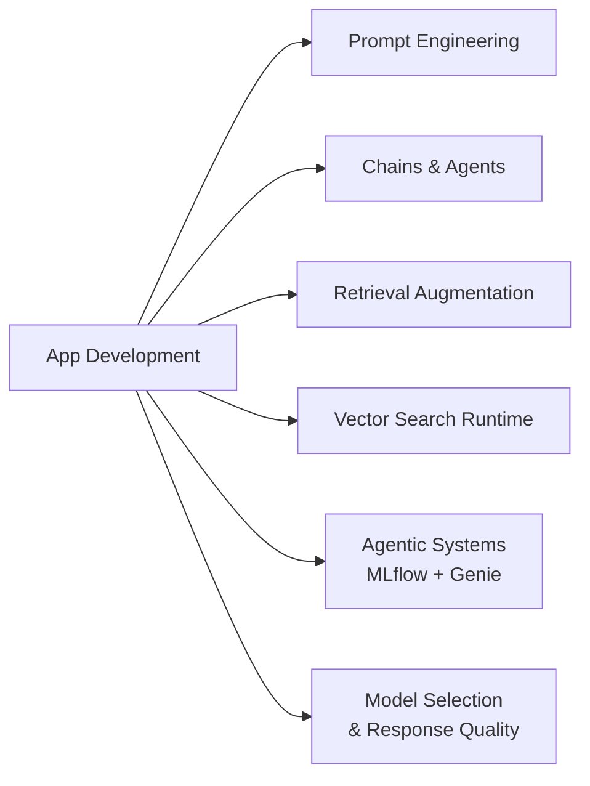

# Application Development (30 % of Exam)

The largest domain in the exam guide (Section 3). Covers how to actually **write** GenAI applications on Databricks — prompt engineering, chains and agents, retrieval augmentation, runtime vector search, code-first agentic systems with MLflow and the Agent Framework, multi-agent access to Genie, and choosing models from evidence.

## Topics Overview

## Section Contents

| File | Topic | Priority |
| :--- | :--- | :--- |
| [01-prompt-engineering.md](./01-prompt-engineering.md) | Prompt patterns, few-shot, structured output, prompt injection, Prompt Registry basics | High |
| [02-chains-agents.md](./02-chains-agents.md) | LangChain / LCEL chains, agents, tool calling, ReAct | High |
| [03-retrieval-augmentation-strategies.md](./03-retrieval-augmentation-strategies.md) | Hybrid search, query rewriting, metadata filters, prompt augmentation from user intent | High |
| [04-vector-search-runtime.md](./04-vector-search-runtime.md) | Production retrieval: HNSW, endpoint sizing, re-indexing, latency, cost | High |
| [05-agentic-systems-mlflow-and-genie.md](./05-agentic-systems-mlflow-and-genie.md) | `ResponsesAgent`, MLflow Tracing, multi-agent systems with Genie (Conversation API, `GenieAgent`, MCP), evaluation vs monitoring phases *(2026 guide)* | High |
| [06-model-selection-and-response-quality.md](./06-model-selection-and-response-quality.md) | Choosing LLMs, embedding context length, model cards, metric-based selection, chunking from evaluation, qualitative review *(2026 guide)* | High |

## Exam Guide Coverage

| Exam guide bullet (Section 3) | Where it is covered |
| :--- | :--- |
| Select LangChain/similar tools for use in a Generative AI application | [02](./02-chains-agents.md) |
| Qualitatively assess responses to identify common issues such as quality and safety | [06](./06-model-selection-and-response-quality.md#qualitatively-assessing-responses) |
| Select chunking strategy based on model & retrieval evaluation | [06](./06-model-selection-and-response-quality.md#selecting-a-chunking-strategy-from-evaluation-results) |
| Augment a prompt with additional context from a user's input based on key fields, terms, and intents | [03](./03-retrieval-augmentation-strategies.md) |
| Create a prompt that adjusts an LLM's response from a baseline to a desired output | [01](./01-prompt-engineering.md) |
| Implement LLM guardrails to prevent negative outcomes | [01](./01-prompt-engineering.md), [Governance](../06-governance/01-governance-overview.md) |
| Select the best LLM based on the attributes of the application to be developed | [06](./06-model-selection-and-response-quality.md#selecting-the-best-llm-for-the-application) |
| Select an embedding model context length based on source documents, expected queries, and optimization strategy | [06](./06-model-selection-and-response-quality.md#selecting-an-embedding-models-context-length) |
| Select a model from a model hub or marketplace for a task based on model metadata/model cards | [06](./06-model-selection-and-response-quality.md#selecting-a-model-from-a-hub-or-marketplace-using-model-cards) |
| Select the best model for a given task based on common metrics generated in experiments | [06](./06-model-selection-and-response-quality.md#selecting-the-best-model-from-experiment-metrics) |
| Utilize MLflow and Agent Framework for developing agentic systems | [05](./05-agentic-systems-mlflow-and-genie.md) |
| Compare the evaluation and monitoring phases of the Gen AI application life cycle | [05](./05-agentic-systems-mlflow-and-genie.md#evaluation-phase-vs-monitoring-phase) |
| Enable multi-agent systems to leverage Genie Spaces or conversational API to retrieve data | [05](./05-agentic-systems-mlflow-and-genie.md#multi-agent-systems-with-genie) |

## Key Concepts

| Concept | Why it matters |
| :--- | :--- |
| **Prompt engineering** | Structured prompts (system / user / assistant turns) + few-shot examples shape model behaviour |
| **Tool calling / function calling** | Lets the LLM choose which tool to call (function, API, retriever) — foundation of agents |
| **Chain vs Agent** | Chains are fixed pipelines; agents are LLM-driven loops that decide the next step |
| **`ResponsesAgent`** | The recommended MLflow interface for agents; `ChatAgent` / `ChatModel` are legacy |
| **Genie for structured data** | Multi-agent systems delegate table questions to a Genie Agent (formerly Genie Space) |
| **Hybrid search and re-ranking** | Keyword + vector recall, then a re-ranker for precision at the top |
| **Evidence-based model choice** | Same dataset + same scorers for every candidate; choose the cheapest model that passes |

## Related Resources

- [RAG / Vector Search Basics (shared)](../../../shared/fundamentals/rag-vector-search-basics.md)
- [Mosaic AI Foundation Model APIs documentation](https://docs.databricks.com/en/machine-learning/foundation-models/index.html)
- [Databricks AI Search (formerly Vector Search) documentation](https://docs.databricks.com/aws/en/ai-search/ai-search)
- [Develop agents on Databricks](https://docs.databricks.com/aws/en/agents/)

---

**[↑ Back to GenAI Engineer Associate](../README.md) | [Next: Assembling and Deploying Applications](../02-assembling-and-deploying-apps/README.md) →**
