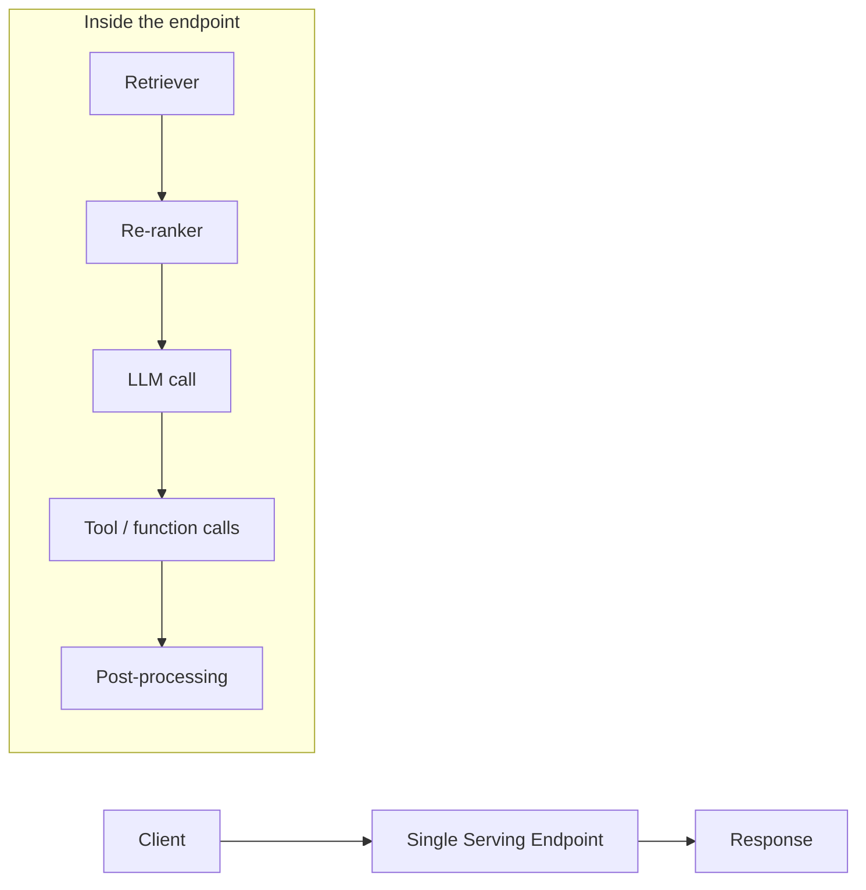

# Compound AI Apps

## Overview

A **compound AI app** is a single served endpoint that orchestrates multiple components — a retriever, an optional re-ranker, an LLM, optional tool / function calls, and post-processing — into one logical service. On Databricks, the canonical path is **MLflow + Mosaic AI Agent Framework + Model Serving**: you log the compound app as an MLflow model, register it in Unity Catalog, and serve it behind one Model Serving endpoint that consumers call like any other LLM endpoint.

> [!abstract]
>
> - **Compound AI app** = retriever + (re-ranker) + LLM + (tools) + post-processing, behind one endpoint
> - Logged as an MLflow model by subclassing `mlflow.pyfunc.ResponsesAgent` (current recommendation) or `ChatAgent`
> - Registered in **Unity Catalog** (catalog.schema.model_name), versioned, and **deployed via `databricks.agents.deploy(uc_model, version)`** which provisions a Model Serving endpoint
> - **Inference Tables** capture every request/response — same audit story as a single-LLM endpoint
> - The Agent Framework adds streaming, tool calling, and tracing on top of standard MLflow PyFunc

> [!tip] What the Exam Tests
>
> - That the served artifact is **one endpoint**, not N microservices — packaging matters
> - The MLflow flavours for compound apps (`ChatAgent` / `ResponsesAgent` for chat-shaped, Agent Framework for tool-using agents)
> - That the Agent Framework gives you **streaming + tracing + Inference Tables** out of the box
> - How retrieval + LLM + tool calls compose inside a single `predict` call

---

## The compound-app pattern



Everything inside `EP_internal` runs in one Model Serving replica per request. Auto-scaling, GPU/CPU choice, and traffic splitting apply to the whole compound, not to individual steps.

## Logging a compound app with MLflow + the Agent Framework

```python
# agent.py — models-from-code file
import mlflow
from mlflow.pyfunc import ResponsesAgent
from mlflow.types.responses import ResponsesAgentRequest, ResponsesAgentResponse


class CustomerSupportRAG(ResponsesAgent):
    def predict(self, request: ResponsesAgentRequest) -> ResponsesAgentResponse:
        question = request.input[-1].content          # latest user turn
        docs = retriever.invoke(question)             # Vector Search retriever (pre-processing)
        context = "\n".join(d.page_content for d in docs)
        answer = llm.invoke(f"Context: {context}\n\nQuestion: {question}").content
        return ResponsesAgentResponse(                # post-processing into the Responses schema
            output=[self.create_text_output_item(text=answer, id="msg_1")]
        )


mlflow.models.set_model(CustomerSupportRAG())
```

```python
# driver notebook — log, register in UC, deploy
import mlflow
from databricks import agents
from mlflow.models.resources import DatabricksServingEndpoint, DatabricksVectorSearchIndex

mlflow.set_registry_uri("databricks-uc")
with mlflow.start_run():
    info = mlflow.pyfunc.log_model(
        name="agent",
        python_model="agent.py",
        resources=[
            DatabricksServingEndpoint(endpoint_name="databricks-claude-sonnet-4-5"),
            DatabricksVectorSearchIndex(index_name="main.genai.docs_index"),
        ],
        registered_model_name="main.genai.customer_support_rag",
    )

# Creates (or updates) a Model Serving endpoint with inference tables, tracing, and the Review App
agents.deploy("main.genai.customer_support_rag", info.registered_model_version)
```

> [!note]
> `databricks.agents.deploy()` is the one-step Model Serving path the exam tests: it creates a serving endpoint, provisions credentials for declared resources, enables inference tables, turns on real-time MLflow tracing, and sets up the Review App ([Deploy an agent, Model Serving](https://docs.databricks.com/aws/en/agents/custom-agents/model-serving/deploy-agent)).

> [!note] Platform update (Oct 2026)
> Since **2026-10-05** the docs list agents deployed to **Model Serving** as *legacy*. New code-first agents are scaffolded and deployed with the **Agent Bricks CLI** (Beta) — `agentbricks init`, `agentbricks dev`, `agentbricks deploy` — which serves them with `DurableAgentServer` on **Agent Runtime** (Databricks Apps) ([Agent Bricks CLI](https://docs.databricks.com/aws/en/agents/custom-agents/agent-bricks-cli), [October 2026 release notes](https://docs.databricks.com/aws/en/release-notes/product/2026/october)). The "one governed endpoint, many steps" pattern is unchanged; only the hosting layer differs.

## Calling the served compound app

Once `agents.deploy(...)` finishes provisioning, the endpoint is callable like any single LLM endpoint (a `ResponsesAgent` takes an `input` list of messages):

```bash
curl https://<workspace>/serving-endpoints/customer-support-rag/invocations \
  -H "Authorization: Bearer $DATABRICKS_TOKEN" \
  -d '{"input":[{"role":"user","content":"How do I reset my password?"}]}'
```

## Use Cases

- **RAG over UC tables** — retriever pulls top-k chunks from a Mosaic AI Vector Search index, LLM grounds the answer
- **Tool-using agent** — the LLM decides which tool to call (lookup, calculator, SQL query) and the framework dispatches
- **Multi-model orchestration** — small classifier routes between cheap and expensive models behind one endpoint
- **Re-ranking pipelines** — cheap recall (vector search) + small cross-encoder re-ranker + LLM generation

## Common Issues & Errors

- **Cold start latency** — `scale_to_zero_enabled = true` saves cost but the first request can take 30s+. For latency-sensitive serving, keep one replica warm
- **Streaming not enabled** — without the Agent Framework wrapper, custom PyFunc compounds don't stream by default; client times out on long generations
- **Tool calls missing tracing** — make sure the Agent Framework wraps tool dispatch so calls appear in Inference Tables and MLflow traces
- **Tight coupling to a specific LLM provider** — keep the LLM call abstracted (route through Foundation Model APIs or the AI Gateway / Unity Gateway) so you can swap models without re-logging the agent

## Exam Tips

> [!tip]
>
> - "One endpoint, many steps" is the canonical pattern. If a question proposes 3 separate endpoints chained over the network, it's almost always wrong.
> - **`ResponsesAgent` (subclass) + `databricks.agents.deploy()`** is the exam's path for compound + tool-using apps. Databricks treats `ChatAgent` and `ChatModel` as *legacy* authoring interfaces and recommends migrating to `ResponsesAgent`; MLflow has recommended `ResponsesAgent` over `ChatModel` since MLflow 3.0.
> - Inference Tables + MLflow tracing are the audit-of-record. They cover the *whole* compound, not just the LLM call.
> - Unity Catalog registration is required for prod — Model Serving needs a UC-registered model.

## Key Takeaways

- Compound AI apps = retriever + re-ranker + LLM + tools + post-processing, served as one endpoint
- Log via the Mosaic AI Agent Framework with `mlflow.pyfunc.ResponsesAgent` (legacy: `ChatAgent`); register in UC; serve via Model Serving (new agents: Agent Bricks CLI → Agent Runtime)
- Streaming, tracing, and Inference Tables come from the framework
- Auto-scaling and traffic splitting apply to the whole compound

## Related Topics

- [Mosaic AI and Foundation Models](./01-mosaic-ai-and-foundation-models.md)
- [MLflow for GenAI](./02-mlflow-for-genai.md)
- [MCP Servers](./04-mcp-servers.md)
- [Agentic Systems with MLflow, Agent Framework, and Genie](../01-application-development/05-agentic-systems-mlflow-and-genie.md)
- [Online Monitoring (eval & monitoring domain)](../05-evaluation-and-monitoring/02-online-monitoring.md)
- [AI Gateway: Usage Tracking and Cost Control](../05-evaluation-and-monitoring/04-ai-gateway-usage-and-cost-control.md)

## Official Documentation

- [Deploy an agent (Model Serving, legacy)](https://docs.databricks.com/aws/en/agents/custom-agents/model-serving/deploy-agent)
- [Deploy agents on Databricks (Agent Bricks CLI → Agent Runtime)](https://docs.databricks.com/aws/en/agents/deploy/)
- [MLflow `ChatAgent` / `ResponsesAgent`](https://mlflow.org/docs/latest/python_api/mlflow.pyfunc.html)
- [Mosaic AI Model Serving](https://docs.databricks.com/en/machine-learning/model-serving/index.html)
- [Inference Tables](https://docs.databricks.com/en/machine-learning/model-serving/inference-tables.html)

---

**[← Previous: MLflow for GenAI](./02-mlflow-for-genai.md) | [↑ Back to Assembling and Deploying Applications](./README.md) | [Next: MCP Servers — Managed, External, and Custom](./04-mcp-servers.md) →**
