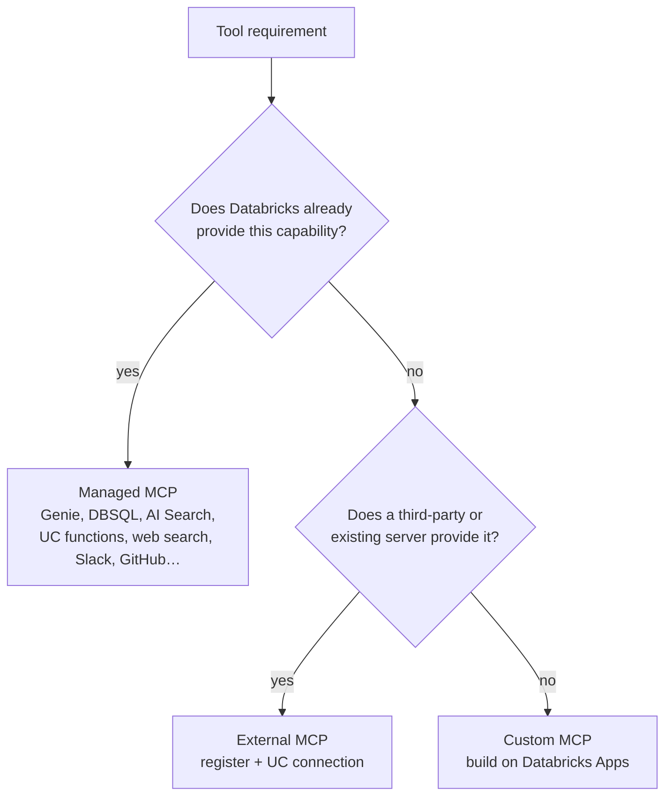

# MCP Servers — Managed, External, and Custom

## Overview

The **Model Context Protocol (MCP)** is an open standard that lets an agent discover and call tools — query data, search documents, call external services — through one interface. The exam guide bullet is *"Integrate managed, external, and custom MCP servers based on a given application requirements."* On Databricks there are three kinds of server: **managed** (Databricks provides and hosts it), **external** (a third-party or self-hosted server you register), and **custom** (a server you build and host on Databricks Apps). The exam tests choosing the right kind with the least maintenance, and governing it.

> [!abstract]
>
> - **Managed MCP servers** — Databricks-provided tools for Genie, Databricks SQL, Vector Search (AI Search), Unity Catalog functions, web search, and connected apps (Slack, GitHub, Microsoft 365, …); no hosting or registration
> - **External MCP servers** — register a third-party or self-hosted server once; its credentials live in a Unity Catalog **HTTP connection**, and access is granted with `EXECUTE`
> - **Custom MCP servers** — your own tools, served from a **Databricks App** at `https://<app-host>/mcp`
> - **Governance** — MCPs are Unity Catalog securables invoked through the gateway, with tool selection, rate limits, policies, and usage tracking

> [!tip] What the Exam Tests
>
> - Picking **managed** when Databricks already provides the capability (lowest maintenance), **external** for an existing third-party server, **custom** only for logic nobody provides
> - That API keys for external servers are **never hard-coded** — they are stored as secrets / connection credentials and referenced by configuration (the official sample question answers *D and E*)
> - That access is governed with Unity Catalog permissions, and that tool calls can run **on behalf of the user**
> - How an agent connects: by server URL, through `databricks-mcp` / `databricks-langchain` / `databricks-openai` clients

---

> [!note] Platform update (Oct 2026)
> **Built-in MCP services now run through Unity Gateway.** Databricks-provided MCPs live in the `system.ai` schema and are called at `https://<workspace-host>/ai-gateway/mcp-services/<mcp-name>`, for example `system.ai.genie_one_mcp` (generally available), `system.ai.dbsql`, `system.ai.web_search`, and `system.ai.sandbox` (the last three need the Unity Gateway Beta) ([Databricks-provided MCPs](https://docs.databricks.com/aws/en/agents/mcp-tools/built-in-mcp-services)).
> **Genie endpoint change:** the earlier Beta endpoint `https://<host>/api/2.0/mcp/genie` (no space ID) is deprecated and **sunsets on 2026-10-31** — move to `system.ai.genie_one_mcp`. To query one curated Genie Agent, use `https://<host>/api/2.0/mcp/genie/{genie_space_id}` ([Genie One MCP](https://docs.databricks.com/aws/en/agents/mcp-tools/genie-mcp), [Genie Agent MCP](https://docs.databricks.com/aws/en/agents/mcp-tools/genie-agent)).
> **Legacy workspace endpoints** (`/api/2.0/mcp/ai-search/{catalog}/{schema}/{index}`, `/api/2.0/mcp/sql`, `/api/2.0/mcp/functions/{catalog}/{schema}/{function}`) still work but **bypass Unity Gateway** — no gateway tracing, MCP-level grants, policies, or guardrails.
> **New guardrail:** since 2026-10-21 (Beta) MCP tool calls and results can be screened for jailbreak and prompt-injection attempts ([October 2026 release notes](https://docs.databricks.com/aws/en/release-notes/product/2026/october)).

## Choosing the server type



| Requirement | Server type | Why |
| :--- | :--- | :--- |
| Natural-language questions over governed tables | **Managed** — Genie One MCP or a Genie Agent MCP | Grounded in curated semantics; UC permissions enforced |
| Run a specific SQL statement | **Managed** — Databricks SQL MCP | Uses the caller's UC and warehouse permissions |
| Search an unstructured index | **Managed** — AI Search (Vector Search) | No server to build |
| Call a governed business function | **Managed** — Unity Catalog functions | Reuse UC functions as tools |
| Search the public web | **Managed** — `system.ai.web_search` | Returns a synthesised answer with citations |
| A SaaS vendor's API that already ships an MCP server | **External** | Register once; credentials stored in a UC connection |
| Your own internal REST API | **Custom** — MCP Server (OpenAPI) template on Databricks Apps | Exposes existing endpoints as MCP tools |
| New proprietary logic | **Custom** — MCP Server (Starter) template on Databricks Apps | Write Python tools; Apps hosts them |

> [!warning] Common Mistake
> Building one **custom wrapper server** around a capability that Databricks already provides as a managed MCP, plus a third-party API that already has an MCP server, adds code and maintenance with no benefit. The official sample question rejects that option: use the **managed** server for the first and register the **external** server for the second.

## Managed MCP servers

Databricks-provided MCPs need no hosting or registration ([Databricks-provided MCPs](https://docs.databricks.com/aws/en/agents/mcp-tools/built-in-mcp-services)).

| MCP | Purpose |
| :--- | :--- |
| `system.ai.genie_one_mcp` | Natural-language analytics across the workspace, grounded in Genie Ontology (GA) |
| Genie Agent MCP (`/api/2.0/mcp/genie/{space_id}`) | Questions scoped to one curated Genie Agent; read-only; no conversation history |
| `system.ai.dbsql` | Run specific SQL on a SQL warehouse with the caller's permissions |
| `system.ai.web_search` | Public web search with citations |
| `system.ai.sandbox` | Run Python, SQL, or shell in an isolated environment (no network egress) |
| `system.ai.slack`, `system.ai.github`, `system.ai.atlassian`, `system.ai.google_drive`, `system.ai.gmail`, `system.ai.google_calendar`, `system.ai.microsoft_365` | Connected third-party services; users sign in through managed OAuth |
| AI Search, Unity Catalog functions | Legacy workspace endpoints; Python agents are pointed to AI Bridge retriever tools and `UCFunctionToolkit` |

## External MCP servers

Register a third-party or self-hosted server so the whole team can use it through the gateway ([External MCP servers](https://docs.databricks.com/aws/en/ai-gateway/register-mcp-service)).

1. Open **Unity Gateway → MCPs → + MCP → Connect an existing MCP server**
2. Choose a catalog and schema and name the MCP (requires `CREATE SERVICE` on the schema)
3. Select or **create an HTTP connection** — server URL plus credentials (bearer token, OAuth, or managed OAuth for supported providers). Credentials stay in the connection, not in agent code
4. Load and **select the tools** to expose (manual list or prefixes such as `get_*`)
5. Create the MCP service; agents reach it as `<catalog>.<schema>.<service>` or at `https://<host>/ai-gateway/mcp-services/<catalog>.<schema>.<service>`

Requirements: the server must support **Streamable HTTP**, and the workspace must be able to reach it over the network. You can also install MCP servers from **Databricks Marketplace**.

> [!note]
> The exam's sample answer describes the external server's API key as *stored in Databricks Secrets and referenced in the MCP server configuration*. In the current product the credential is held by the Unity Catalog **HTTP connection** created during registration. The principle tested is the same: **secrets are stored in a governed secret store and referenced, never embedded in code or prompts.**

## Custom MCP servers on Databricks Apps

Build a server when no managed or external server fits ([Custom MCP servers](https://docs.databricks.com/aws/en/agents/mcp-tools/custom-mcp)):

| Path | Use when |
| :--- | :--- |
| **MCP Server (Starter) template** | Write your own Python tools |
| **MCP Server (OpenAPI) template** | Expose an existing HTTP API (OpenAPI 3.x spec in a volume + an HTTP connection) |
| **Deploy an existing server** | You already have MCP server code |

Name the app with an `mcp-` prefix so AI Playground recognises it. The server URL is the app URL plus `/mcp`. Adding a tool to the Starter template looks like this:

```python
@mcp_server.tool
def uppercase(text: str) -> str:
    """Convert a string to uppercase."""
    return text.upper()
```

Callers need `CAN USE` on the app.

## Connecting an agent to an MCP server

```python
from databricks.sdk import WorkspaceClient
from databricks_mcp import DatabricksMCPClient

workspace_client = WorkspaceClient()
mcp_client = DatabricksMCPClient(
    server_url="https://<workspace-host>/ai-gateway/mcp-services/system.ai.genie_one_mcp",
    workspace_client=workspace_client,
)

for tool in mcp_client.list_tools():
    print(tool.name, tool.description, tool.inputSchema)

# Call a tool by name with arguments that match its inputSchema
result = mcp_client.call_tool(tool_name, arguments)
```

For LangGraph agents, `databricks_langchain` provides `DatabricksMCPServer` and `DatabricksMultiServerMCPClient` to turn one or more MCP servers into LangChain tools; for the OpenAI client, `databricks_openai.McpServerToolkit` does the same ([Use MCP tools in a Python agent](https://docs.databricks.com/aws/en/agents/custom-agents/use-mcp-tools)). Agents built with the Agent Bricks CLI add a managed MCP with `agentbricks tools add mcp system.ai.<name>` and need no connection code.

## Governing MCP access

| Control | How |
| :--- | :--- |
| **Who can call** | `EXECUTE` on the MCP service plus `USE CATALOG` / `USE SCHEMA`; end users do **not** need `USE CONNECTION` |
| **Which tools** | Tool selection at registration (`include_tool_selectors`); unselected tools are hidden and calls are rejected |
| **Whose identity** | On-behalf-of-user OAuth (recommended for Genie) so UC permissions apply per user; service principal for automation |
| **What content** | Service policies (Beta) evaluate a call before it runs and its result after — allow, block, or require approval; built-in *Sensitive Data Detection* and jailbreak guardrails |
| **How much** | Rate limits per service, user, group, or service principal (requests per minute for MCP) |
| **What happened** | Usage tracking in `system.ai_gateway.usage` and the gateway usage dashboard |

Sources: [Govern an MCP](https://docs.databricks.com/aws/en/ai-gateway/govern-mcp-service), [Rate limits](https://docs.databricks.com/aws/en/ai-gateway/rate-limits), [Usage tracking](https://docs.databricks.com/aws/en/ai-gateway/usage-tracking).

## Use Cases

- **Research assistant (official sample question)** — managed web/data MCP for the internet source, plus an external MCP for a keyed third-party search API whose credential sits in a governed store
- **Analytics copilot** — `system.ai.genie_one_mcp` answers business questions with UC permissions applied per user
- **Internal CRM API** — the OpenAPI template on Databricks Apps exposes the existing REST endpoints as MCP tools
- **Ticketing integration** — `system.ai.atlassian` lets an agent read and create Jira issues after each user signs in

## Common Issues & Errors

### Genie MCP Calls Start Failing After 2026-10-31

**Scenario:** An agent configured with `https://<host>/api/2.0/mcp/genie` stops working.
**Fix:** That Beta endpoint sunsets on 2026-10-31. Switch to `system.ai.genie_one_mcp` (through the gateway URL and the `ai-gateway` OAuth scope) or to the space-specific `.../api/2.0/mcp/genie/{genie_space_id}`.

### "Tool not allowed by MCP service configuration"

**Scenario:** The agent calls a tool the server advertises upstream but the call is rejected.
**Fix:** The tool was not selected when the MCP service was registered. Update the tool selection (`include_tool_selectors`).

### Calls Missing From Gateway Usage and Traces

**Scenario:** MCP traffic does not appear in `system.ai_gateway.usage`.
**Fix:** The agent uses a legacy workspace endpoint (`/api/2.0/mcp/...`), which bypasses Unity Gateway. Use the `system.ai` MCP or a registered MCP service URL.

## Exam Tips

> [!tip] Exam Tips
>
> - **Least maintenance:** managed first, external second, custom last.
> - **Never embed API keys** in agent code or the frontend — store them in a secret store / connection and reference them.
> - **Custom MCP servers run on Databricks Apps** (URL ends in `/mcp`); callers need `CAN USE` on the app.
> - **External / registered MCPs:** callers need `EXECUTE` on the MCP service, not `USE CONNECTION`.
> - Genie over MCP: Genie One for workspace-wide questions; Genie Agent MCP (`/mcp/genie/{space_id}`) for one curated agent.

## Key Takeaways

- MCP standardises how agents discover and call tools; Databricks supports managed, external, and custom servers
- Managed servers cover Genie, SQL, search, UC functions, web search, sandboxed code, and popular SaaS apps with no hosting
- External servers are registered once through Unity Gateway with credentials in a UC HTTP connection
- Custom servers are built from templates and hosted on Databricks Apps
- Govern with UC grants, tool selection, OBO identity, service policies, rate limits, and usage tracking

## Related Topics

- [Agentic Systems with MLflow, Agent Framework, and Genie](../01-application-development/05-agentic-systems-mlflow-and-genie.md)
- [Compound AI Apps](./03-compound-ai-apps.md)
- [Access Control and Batch Inference](./05-access-control-and-batch-inference.md)
- [AI Gateway: Usage Tracking and Cost Control](../05-evaluation-and-monitoring/04-ai-gateway-usage-and-cost-control.md)

## Official Documentation

- [MCPs on Databricks](https://docs.databricks.com/aws/en/agents/mcp-tools/)
- [Databricks-provided MCPs](https://docs.databricks.com/aws/en/agents/mcp-tools/built-in-mcp-services)
- [External MCP servers](https://docs.databricks.com/aws/en/ai-gateway/register-mcp-service)
- [Custom MCP servers](https://docs.databricks.com/aws/en/agents/mcp-tools/custom-mcp)
- [Use MCP tools in a Python agent](https://docs.databricks.com/aws/en/agents/custom-agents/use-mcp-tools)
- [Govern an MCP](https://docs.databricks.com/aws/en/ai-gateway/govern-mcp-service)

---

**[← Previous: Compound AI Apps](./03-compound-ai-apps.md) | [↑ Back to Assembling and Deploying Applications](./README.md) | [Next: Access Control and Batch Inference](./05-access-control-and-batch-inference.md) →**
