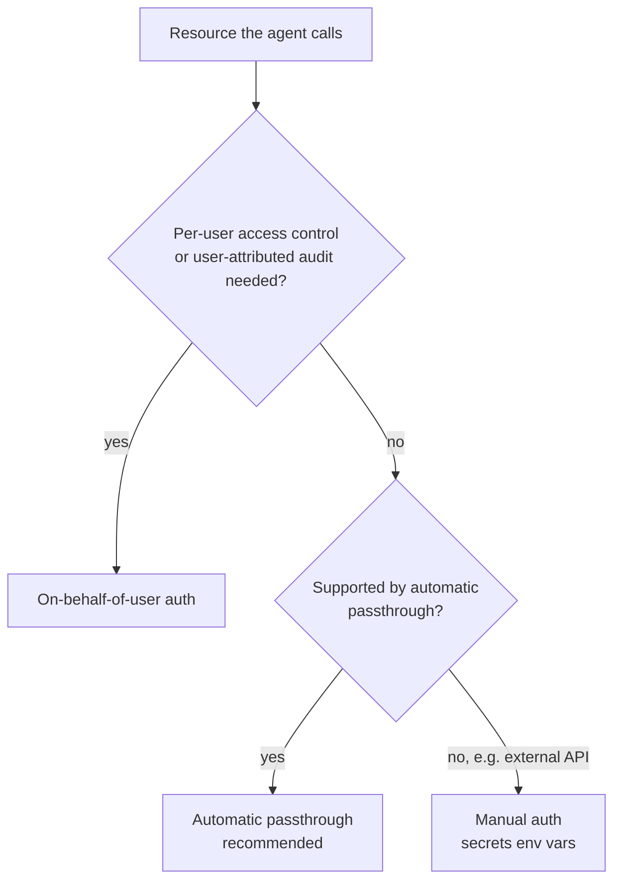

# Access Control and Batch Inference

## Overview

Two Assembling and Deploying Applications bullets are about *how a deployed app reaches other things*: *"Control access to resources from model serving endpoints"* and *"Identify batch inference workloads and apply ai_query() appropriately."* The first is about credentials — whose identity the endpoint uses when it calls a Vector Search index, an LLM, Genie, or an external API. The second is about workload shape — when to skip a live endpoint and run the model over a table with SQL.

> [!abstract]
>
> - **Automatic authentication passthrough** — declare the Databricks resources the agent uses when you log it; deployment provisions short-lived, least-privilege credentials
> - **On-behalf-of-user (OBO) authentication** — the agent acts with the *end user's* permissions, limited to declared API scopes
> - **Manual authentication** — secrets-based environment variables (`{{secrets/scope/key}}`) for external APIs and anything automatic auth does not cover
> - **Endpoint permissions** — `CAN QUERY` for consumers, `CAN MANAGE` for owners; never ship tokens to the browser
> - **`ai_query()`** — the general-purpose AI Function for applying a model to many rows from SQL or a pipeline; task-specific AI Functions come first when one fits

> [!tip] What the Exam Tests
>
> - Choosing passthrough vs OBO vs manual auth from the requirement (per-user row-level access → OBO; shared resources → passthrough; third-party API key → secrets)
> - That the `resources` list in `log_model()` is what enables automatic credentials at deployment
> - Recognising **batch** workloads (large table, no user waiting, scheduled) and writing the `ai_query()` call
> - `ai_query()` options: `returnType`, `failOnError`, `modelParameters`, `responseFormat`

---

> [!note] Platform update (Oct 2026)
> Agents deployed to **Model Serving** (via `databricks.agents.deploy()`) are now documented as *legacy*; new agents are deployed with the **Agent Bricks CLI** to **Agent Runtime** on Databricks Apps ([Deploy agents on Databricks](https://docs.databricks.com/aws/en/agents/deploy/)). The access-control ideas carry over with new names: on Databricks Apps, **app authorization** (formerly *service principal* auth) and **user authorization** (formerly *on-behalf-of-user* auth) ([Authentication for agents on Apps](https://docs.databricks.com/aws/en/agents/custom-agents/agent-authentication)). The Model Serving mechanisms below are what the March 2026 exam guide tests.

## Controlling access to resources from Model Serving endpoints

A deployed agent typically needs to call a Vector Search index, an LLM endpoint, Unity Catalog functions, Genie, a SQL warehouse, or an external API. Databricks documents three methods; you can mix them per resource ([Authentication for agents (Model Serving)](https://docs.databricks.com/aws/en/agents/custom-agents/model-serving/agent-authentication-model-serving)).

| Method | Runs as | Credential lifecycle | Setup |
| :--- | :--- | :--- | :--- |
| **Automatic authentication passthrough** | A service principal created for the agent version, with least-privilege access to declared resources | Short-lived, automatically rotated | Low — declare resources at logging time |
| **On-behalf-of-user (OBO)** | The end user who sends the request | User credentials restricted to declared API scopes | Medium — declare scopes, create the client inside `predict` |
| **Manual authentication** | Whatever credential you supply | Long-lived; you manage rotation | High — secrets and environment variables |



### Automatic authentication passthrough

Declare every Databricks resource in `resources` when logging. At deployment Databricks (1) verifies that the **endpoint creator** can access each declared resource, (2) creates a service principal for the model version and grants it read access to those resources, and (3) issues short-lived credentials to the endpoint. The behaviour is similar to *run as owner*.

```python
import mlflow
from mlflow.models.resources import (
    DatabricksServingEndpoint,
    DatabricksVectorSearchIndex,
    DatabricksFunction,
    DatabricksGenieSpace,
    DatabricksSQLWarehouse,
    DatabricksTable,
)

with mlflow.start_run():
    mlflow.pyfunc.log_model(
        name="agent",
        python_model="agent.py",
        resources=[
            DatabricksServingEndpoint(endpoint_name="databricks-claude-sonnet-4-5"),
            DatabricksVectorSearchIndex(index_name="main.rag.docs_index"),
            DatabricksFunction(function_name="main.tools.lookup_order"),
            DatabricksGenieSpace(genie_space_id="<space-id>"),
        ],
    )
```

If a resource is missing from the list, the deployed endpoint gets a permission error when it calls that resource — the most common deployment failure for agents.

### On-behalf-of-user (OBO) authentication

Use OBO when users must only see data they are entitled to (row filters, column masks, Genie with per-user permissions) or when audits must show the real user. Declare the REST API scopes the agent may use on the user's behalf, and create the user-scoped client **inside** `predict` (user credentials exist only while a request is being handled).

```python
from mlflow.models.auth_policy import AuthPolicy, SystemAuthPolicy, UserAuthPolicy
from mlflow.models.resources import DatabricksServingEndpoint

system_policy = SystemAuthPolicy(
    resources=[DatabricksServingEndpoint(endpoint_name="databricks-claude-sonnet-4-5")]
)
user_policy = UserAuthPolicy(api_scopes=["model-serving", "ai-search"])

mlflow.pyfunc.log_model(
    name="agent",
    python_model="agent.py",
    auth_policy=AuthPolicy(system_auth_policy=system_policy, user_auth_policy=user_policy),
)
```

```python
# inside the agent's predict()
from databricks.sdk import WorkspaceClient
from databricks_ai_bridge import ModelServingUserCredentials

user_client = WorkspaceClient(credentials_strategy=ModelServingUserCredentials())
```

The scopes restrict the token to just the APIs the agent needs — least privilege for user credentials.

### Manual authentication with secrets

For external services (an OpenAI key, a SaaS API token) store the credential as a **Databricks secret** and reference it in the endpoint's `environment_vars` with `{{secrets/<scope>/<key>}}`. The endpoint creator needs `READ` on the secret; the plain value never appears in code or the endpoint configuration ([Configure access to resources from model serving endpoints](https://docs.databricks.com/aws/en/machine-learning/model-serving/store-env-variable-model-serving)).

```bash
databricks secrets create-scope my_secret_scope
databricks secrets put-secret my_secret_scope openai_api_key
```

```json
{
  "served_entities": [
    {
      "entity_name": "main.agents.support_agent",
      "entity_version": "3",
      "workload_size": "Small",
      "scale_to_zero_enabled": true,
      "environment_vars": {
        "OPENAI_API_KEY": "{{secrets/my_secret_scope/openai_api_key}}"
      }
    }
  ]
}
```

Without the `{{secrets/...}}` syntax the value is treated as a **plain-text** environment variable.

### Who can call the endpoint

| Permission on a serving endpoint | Grants |
| :--- | :--- |
| `CAN VIEW` | See the endpoint and its configuration |
| `CAN QUERY` | Send requests (give this to applications and users) |
| `CAN MANAGE` | Edit configuration, permissions, and the gateway settings |

Restrict endpoint creation and `CAN MANAGE` to administrators so that guardrails and rate limits cannot be bypassed, and grant everyone else query access to approved endpoints ([Configure governance on model serving endpoints](https://docs.databricks.com/aws/en/ai-gateway/configure-ai-gateway-endpoints)).

> [!important]
> Front ends **never** hold long-lived tokens. A browser calls your **app backend** (for example a Databricks App), and the backend calls the endpoint with the app's credentials or the signed-in user's credentials. This is the answer to the official sample question on a Databricks App over internal PDFs.

## Batch inference with `ai_query()`

### Is it a batch workload?

| Signal | Batch (`ai_query`, AI Functions) | Real-time (serving endpoint / agent) |
| :--- | :--- | :--- |
| Who is waiting? | Nobody — results land in a table | A user or application, per request |
| Volume | Thousands to millions of rows | One request at a time |
| Trigger | Schedule, pipeline, or ad-hoc SQL | User action or API call |
| Typical tasks | Classify a ticket backlog, summarise call transcripts, extract fields from contracts, enrich a product catalogue, embed a corpus | Chat, copilots, interactive agents |

### Task-specific function or `ai_query()`?

Databricks recommends the **task-specific AI Functions** (`ai_classify`, `ai_extract`, `ai_summarize`, `ai_translate`, `ai_analyze_sentiment`, `ai_parse_document`, `ai_mask`, …) when one fits, and `ai_query()` when you need a custom prompt or a specific model ([AI Functions on Databricks](https://docs.databricks.com/aws/en/large-language-models/ai-functions)).

### `ai_query()` syntax

```sql
ai_query(endpoint, request [, returnType] [, failOnError] [, modelParameters] [, responseFormat])
```

| Argument | Purpose |
| :--- | :--- |
| `endpoint` | Foundation model, external model, or custom model serving endpoint name |
| `request` | The prompt (chat/completion models) or input (custom models) — usually built from columns |
| `returnType` | Expected return type; optional on Databricks Runtime 15.2+ where it is inferred |
| `failOnError` | Default `true`. With `false`, returns a STRUCT of the parsed result and an error message, so one bad row does not fail the job (DBR 15.3+) |
| `modelParameters` | Constant parameters such as `max_tokens` and `temperature` |
| `responseFormat` | `text`, `json_object`, or `json_schema` structured output for chat models |

```sql
CREATE OR REPLACE TABLE main.support.ticket_summaries AS
SELECT
  ticket_id,
  ai_query(
    'databricks-meta-llama-3-1-8b-instruct',
    CONCAT('Summarise this support ticket in one sentence: ', body),
    modelParameters => named_struct('max_tokens', 100, 'temperature', 0.0),
    failOnError => false
  ) AS summary
FROM main.support.tickets
WHERE created_date >= current_date() - INTERVAL 1 DAY;
```

Practical notes from the docs:

- AI Functions run on **Databricks SQL (not Classic SQL warehouses)**, notebooks, Lakeflow pipelines, and jobs; Databricks Runtime **15.4 LTS+** is required
- Gateway usage tracking also captures `ai_query` requests to Databricks-provided model services, so batch cost appears next to online cost ([Usage tracking](https://docs.databricks.com/aws/en/ai-gateway/usage-tracking))
- Pick a **small model** and set `max_tokens` for large backlogs; cost scales with rows × tokens

## Use Cases

- **Per-user HR assistant** — OBO auth so each employee's queries respect row filters on the HR tables
- **Shared knowledge bot** — automatic passthrough to a Vector Search index and an LLM endpoint; every user sees the same corpus
- **Third-party enrichment** — manual auth with `{{secrets/...}}` to call a vendor API from the agent
- **Nightly ticket triage** — a scheduled job uses `ai_classify` for routing and `ai_query` with a custom prompt for summaries, writing results to Delta

## Common Issues & Errors

### Deployed Agent Gets 403 on Vector Search

**Scenario:** The agent works in the notebook but fails after deployment with a permission error.
**Fix:** The index was not declared in `resources` when logging, so no credential was provisioned. Re-log with `DatabricksVectorSearchIndex(...)` and redeploy. Also confirm the endpoint creator can access the index.

### OBO Client Created at Startup

**Scenario:** User-scoped calls fail or use the wrong identity.
**Fix:** Create the `ModelServingUserCredentials` client inside `predict` — user credentials exist only during a request.

### One Malformed Row Fails the Batch

**Scenario:** A nightly `ai_query` job fails on a single row.
**Fix:** Set `failOnError => false` and handle the error column downstream.

## Exam Tips

> [!tip] Exam Tips
>
> - **Shared resources → automatic passthrough** (declare `resources`). **Per-user data → OBO** (declare scopes). **External API key → secrets** (`{{secrets/scope/key}}`).
> - **Never** put PATs or API keys in a browser, prompt, or notebook cell.
> - No user waiting + many rows = **batch** → `ai_query()` or a task-specific AI Function.
> - `failOnError => false` returns result + error per row; `responseFormat` enforces JSON output.

## Key Takeaways

- Model Serving agents authenticate to resources by automatic passthrough, OBO, or manual secrets — mix per resource
- Declaring `resources` at logging time is what makes passthrough credentials possible
- OBO enforces the end user's Unity Catalog permissions and limits tokens to declared scopes
- Endpoint permissions (`CAN QUERY`, `CAN MANAGE`) control who can call the app; front ends call through a backend
- Batch workloads use `ai_query()` or task-specific AI Functions instead of a real-time endpoint

## Related Topics

- [Compound AI Apps](./03-compound-ai-apps.md)
- [MCP Servers](./04-mcp-servers.md)
- [Memory, CI/CD, Prompts, and User Interfaces](./06-memory-cicd-prompts-and-interfaces.md)
- [Governance Overview](../06-governance/01-governance-overview.md)

## Official Documentation

- [Authentication for agents (Model Serving)](https://docs.databricks.com/aws/en/agents/custom-agents/model-serving/agent-authentication-model-serving)
- [Configure access to resources from model serving endpoints](https://docs.databricks.com/aws/en/machine-learning/model-serving/store-env-variable-model-serving)
- [Deploy an agent (Model Serving, legacy)](https://docs.databricks.com/aws/en/agents/custom-agents/model-serving/deploy-agent)
- [`ai_query` function](https://docs.databricks.com/aws/en/sql/language-manual/functions/ai_query)
- [AI Functions on Databricks](https://docs.databricks.com/aws/en/large-language-models/ai-functions)

---

**[← Previous: MCP Servers — Managed, External, and Custom](./04-mcp-servers.md) | [↑ Back to Assembling and Deploying Applications](./README.md) | [Next: Memory, CI/CD, Prompts, and User Interfaces](./06-memory-cicd-prompts-and-interfaces.md) →**
