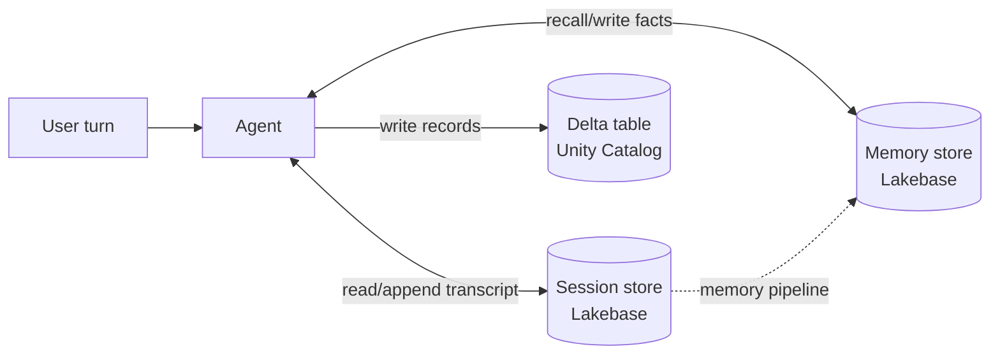
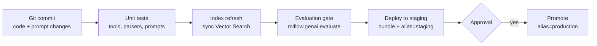

# Memory, CI/CD, Prompts, and User Interfaces

## Overview

Four Assembling and Deploying Applications bullets turn a working agent into a production application: *"Configure a persistent datastore to store and retrieve intermediate memory or structured information"*, *"Apply CI/CD best practices such as updating a Vector Search index, promoting prompts across environments, and testing individual components of an agent"*, *"Apply prompt version control and manage prompt lifecycle"*, and *"Develop an appropriate interactive user facing interface for an agent usage scenario (Apps, Slack, Teams, etc.)"*.

> [!abstract]
>
> - **Memory** — short-term *session* state (the conversation, framework checkpoints) and long-term *memory* (facts and preferences across conversations) belong in a durable store such as **Lakebase** (managed Postgres); structured facts the agent writes belong in **Delta tables**
> - **CI/CD** — version code, prompts, and models; test tools and retrievers in isolation; evaluate the whole agent as a gate; refresh the Vector Search index as a pipeline step; deploy with bundles
> - **Prompt lifecycle** — the **MLflow Prompt Registry** stores prompts in Unity Catalog with immutable **versions** and mutable **aliases** (`staging`, `production`) for promotion and rollback
> - **User interfaces** — **Databricks Apps** for a governed web UI, the Genie app for **Microsoft Teams**, and bot backends for chat tools — always calling the agent server-side

> [!tip] What the Exam Tests
>
> - Where to keep conversation state so it survives restarts and scales across replicas (not in process memory)
> - The prompt-promotion pattern from the official sample question: **MLflow prompt versions + aliases** — not branch merges, JSON overwrites, or Delta overwrites
> - What "testing individual components" means for an agent (tools, retriever, prompt, end-to-end evaluation)
> - Picking the UI for the scenario and keeping credentials out of the browser

---

> [!note] Platform update (Oct 2026)
> **Memory:** Databricks now offers fully managed **agent sessions** and **agent memory** stores, both backed by Lakebase, plus **agent memory pipelines** (Beta, 2026-10-12) that distill durable facts from sessions into memory ([Agent memory and sessions](https://docs.databricks.com/aws/en/agents/custom-agents/stateful-agents)). The earlier self-managed Lakebase memory pattern and the earlier managed memory stores are listed as *legacy* ([Legacy agent offerings](https://docs.databricks.com/aws/en/agents/legacy/)).
> **Deploy and UI:** projects created with the **Agent Bricks CLI** (Beta) include a chat UI and deploy to Agent Runtime on Databricks Apps; `agentbricks sessions bind` and `agentbricks memory bind` attach the stores ([Agent Bricks CLI](https://docs.databricks.com/aws/en/agents/custom-agents/agent-bricks-cli)).
> **Bundles:** Databricks Asset Bundles were renamed **Declarative Automation Bundles** on 2026-03-16 ([March 2026 release notes](https://docs.databricks.com/aws/en/release-notes/product/2026/march)).

## Persistent datastores for memory and structured information

An agent replica can restart or scale out at any time, so **state must live outside the process**.

| State | Example | Store |
| :--- | :--- | :--- |
| **Session (short-term) state** | Conversation transcript, tool calls and results, a LangGraph checkpoint | Lakebase-backed session store (or a Postgres checkpointer on Lakebase) |
| **Long-term memory** | "This user prefers answers in Japanese", "Project X uses the EU workspace" | Memory store with semantic search (Lakebase-backed) |
| **Structured information the agent produces** | Extracted fields, decisions, case records | Delta table in Unity Catalog (`MERGE` on a key) |
| **Low-latency lookups the agent reads** | Customer profile by ID during a chat | Lakebase table or an online/feature table keyed by ID |



Design rules:

- Key sessions by a **session or thread ID** and memories by **subject** (user, account, project)
- Pass the session ID through `custom_inputs` (or the invocation API) so every turn reloads the same state
- Keep secrets and raw PII out of memory; apply the same governance you apply to tables
- Sessions and memory are independent: deleting a session does not delete the memories distilled from it

## CI/CD for GenAI applications



### Test individual components

| Component | Test |
| :--- | :--- |
| **Tools** (UC functions, Python tools) | Unit tests with fixed inputs and expected outputs; error handling |
| **Retriever** | Retrieval metrics on a labelled query set (recall@k, MRR, `RetrievalSufficiency`) |
| **Prompt + parser** | Format tests: does the output parse and validate against the schema? |
| **Routing / tool selection** | `ToolCallCorrectness` and `ToolCallEfficiency` judges on representative requests |
| **Whole agent** | `mlflow.genai.evaluate()` on a versioned evaluation dataset, compared with the current production version |

### Updating a Vector Search index in the pipeline

- **Delta Sync index, triggered mode** — after the chunk table is updated, call `index.sync()` as a job task, then wait for the sync before running retrieval tests
- **Continuous mode** — no explicit step, but tests must allow for propagation delay
- **Embedding-model change** — build a new index and cut over (blue-green), because vectors from different models are not comparable (see [Vector Search in Production](../01-application-development/04-vector-search-runtime.md))

### Promote models and prompts with aliases

- Register agent versions in Unity Catalog and point environments at **aliases** (`models:/main.agents.support_agent@champion`) rather than version numbers
- Promote prompts the same way with prompt aliases (next section)
- Deploy jobs, endpoints, and apps from **Declarative Automation Bundles** so dev, staging, and prod are defined in code

## Prompt version control and lifecycle

The **MLflow Prompt Registry** (Beta) stores prompts as Unity Catalog objects ([Prompt Registry](https://docs.databricks.com/aws/en/mlflow3/genai/prompt-version-mgmt/prompt-registry/)):

| Concept | Meaning |
| :--- | :--- |
| **Prompt** | Named entity in Unity Catalog (`catalog.schema.prompt_name`) |
| **Version** | Immutable snapshot with an auto-incrementing number and a commit message |
| **Alias** | Mutable pointer to a version (`staging`, `production`) — move it to promote or roll back |
| **Tags** | Version-specific key-value metadata |

Permissions: `CREATE FUNCTION`, `EXECUTE`, and `MANAGE` on the Unity Catalog schema that stores the prompts.

```python
import mlflow

# Register (creates version 1, or the next version if the prompt exists)
prompt = mlflow.genai.register_prompt(
    name="main.prompts.customer_support",
    template="You are a helpful assistant. Answer this question: {{question}}",
    commit_message="Initial customer support prompt",
)

# Promote: point the production alias at a validated version
mlflow.genai.set_prompt_alias(
    name="main.prompts.customer_support",
    alias="production",
    version=prompt.version,
)

# Load by alias in the application — no code change when the alias moves
prod_prompt = mlflow.genai.load_prompt("prompts:/main.prompts.customer_support@production")
text = prod_prompt.format(question="How do I reset my password?")
```

| Lifecycle step | Function |
| :--- | :--- |
| Create / add a version | `register_prompt()` |
| Retrieve a version or alias | `load_prompt()` |
| Find prompts | `search_prompts()` |
| Promote / roll back | `set_prompt_alias()` |
| Remove an alias (versions remain) | `delete_prompt_alias()` |
| Remove a prompt or version | `delete_prompt()` |

Templates use double-brace variables (`{{question}}`). Rolling back is moving the alias to an earlier version — the version history is never lost.

## User interfaces for agents

| Scenario | Interface | Notes |
| :--- | :--- | :--- |
| Internal web app with corporate SSO and per-user permissions | **Databricks Apps** (Streamlit, Dash, Gradio, Flask, Node.js/React) | The app backend calls the agent with app authorization or user authorization; no tokens in the browser |
| Code-first agent that needs a chat UI quickly | Agent template / Agent Bricks CLI chat UI on Databricks Apps | Built in to the scaffolded project |
| Analysts already working in Microsoft Teams | **Databricks Genie app in Microsoft Teams** (Public Preview) | Ask Genie in a direct message or channel; channel owners can pin a specific Genie Agent ([docs](https://docs.databricks.com/aws/en/integrations/msft-teams)) |
| Slack-based support team | A Slack bot backend that calls the agent endpoint or Genie Conversation API server-side | Keep the Databricks credential in the backend; map Slack users to identities for permissions |
| Developers testing an agent | Local `agentbricks dev`, AI Playground, MLflow Review App | Testing surfaces, not production UIs |
| Programmatic consumers | REST / invocation API, OpenAI-compatible clients, `ai_query()` from SQL | Service principal with `CAN QUERY` |

The decision usually comes down to **where users already work** and **whose identity must be enforced**. In every option, the front end talks to a backend, and the backend holds credentials.

## Use Cases

- **Restart-safe support bot** — conversation state lives in a Lakebase-backed session store, so a scaled-out replica can continue any conversation
- **Gated prompt release** — a prompt change is registered as version 7, evaluated in staging under alias `staging`, approved, and promoted by moving `production` to 7; rollback moves it back to 6
- **Nightly index refresh** — a job updates the chunk table, triggers `index.sync()`, runs retrieval tests, and only then updates the agent's alias
- **Finance team in Teams** — the Genie app is pinned to a finance Genie Agent in the team's channel

## Common Issues & Errors

### Conversation Context Lost Between Turns

**Scenario:** The agent forgets earlier turns after scaling to multiple replicas.
**Fix:** State is held in process memory. Persist sessions in an external store keyed by session ID and pass the ID with every request.

### Prompt Changes Require a Redeploy

**Scenario:** Every prompt tweak means rebuilding and redeploying the agent.
**Fix:** Load prompts from the Prompt Registry by **alias** at runtime; promotion becomes an alias move.

### Tests Pass but Production Answers Are Stale

**Scenario:** CI evaluates against an index that has not finished syncing.
**Fix:** Make the index sync an explicit pipeline step and wait for it to finish before running retrieval and evaluation tests.

## Exam Tips

> [!tip] Exam Tips
>
> - **Prompt promotion with history and rollback → MLflow prompt versions + aliases** (the official sample answer).
> - Conversation memory → **external durable store** (Lakebase / session store), never process memory.
> - "Test individual components" = tools, retriever, prompt/parser, routing — then evaluate the whole agent.
> - Index changes are a **pipeline step** (`sync()` for triggered Delta Sync indexes); a new embedding model means a new index.
> - UI: **Databricks Apps** for governed web UIs; **Teams** has a Genie app; any UI calls the agent **server-side**.

## Key Takeaways

- Keep session state and long-term memory in durable stores (Lakebase-backed); write structured outputs to Delta tables
- CI/CD for agents versions code, prompts, and models; tests components individually; gates releases on evaluation
- The Prompt Registry gives prompts immutable versions and movable aliases for promotion and rollback
- Choose the UI where users already work, and always keep credentials in the backend

## Related Topics

- [MLflow for GenAI](./02-mlflow-for-genai.md)
- [Access Control and Batch Inference](./05-access-control-and-batch-inference.md)
- [Prompt Engineering](../01-application-development/01-prompt-engineering.md)
- [Databricks Vector Search](../04-data-preparation/03-databricks-vector-search.md)

## Official Documentation

- [Agent memory and sessions](https://docs.databricks.com/aws/en/agents/custom-agents/stateful-agents)
- [Prompt Registry](https://docs.databricks.com/aws/en/mlflow3/genai/prompt-version-mgmt/prompt-registry/)
- [Agent Bricks CLI (Beta)](https://docs.databricks.com/aws/en/agents/custom-agents/agent-bricks-cli)
- [Authentication for agents on Databricks Apps](https://docs.databricks.com/aws/en/agents/custom-agents/agent-authentication)
- [Databricks Genie app in Microsoft Teams](https://docs.databricks.com/aws/en/integrations/msft-teams)

---

**[← Previous: Access Control and Batch Inference](./05-access-control-and-batch-inference.md) | [↑ Back to Assembling and Deploying Applications](./README.md)**
