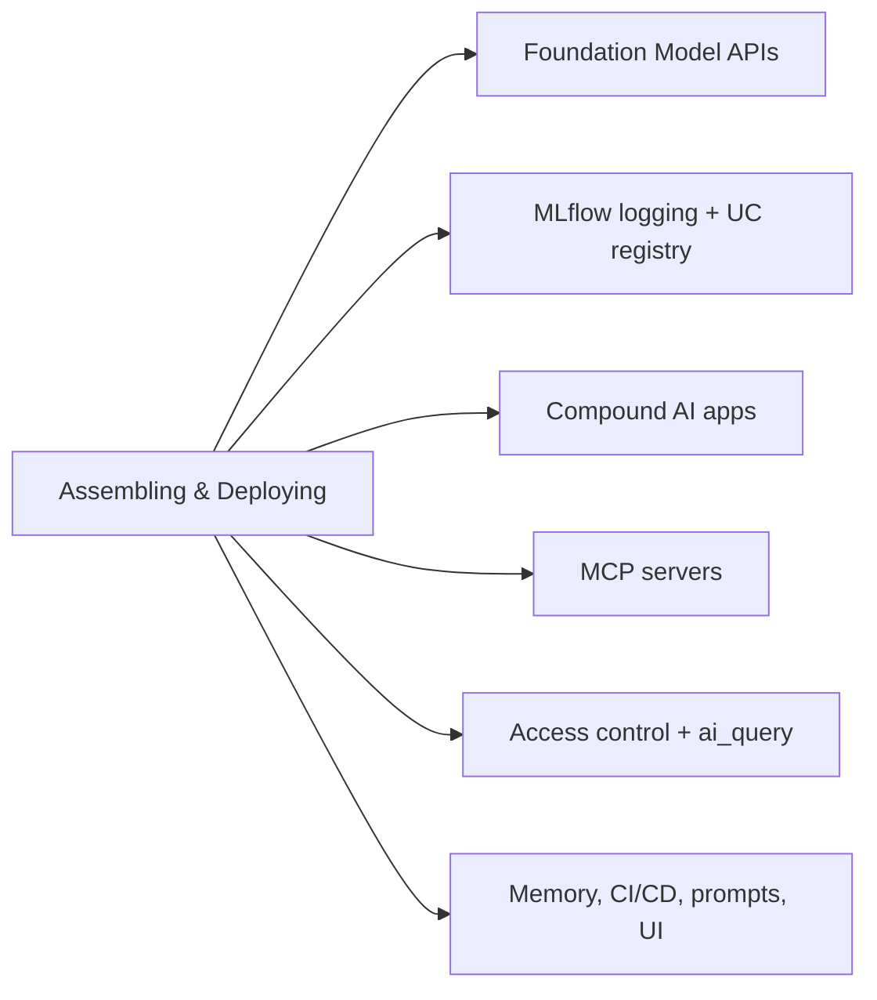

# Assembling and Deploying Applications (22 % of Exam)

Section 4 of the exam guide: how to package, secure, deploy, and operate GenAI applications on Databricks. Covers Foundation Model APIs, MLflow logging and Unity Catalog registration, the compound-app pattern, MCP servers, access control from serving endpoints, batch inference with `ai_query()`, persistent memory, CI/CD, prompt lifecycle, and user interfaces. (AI Gateway monitoring moved to [Evaluation and Monitoring](../05-evaluation-and-monitoring/README.md), where the exam guide places it.)

> [!note] Platform update (Oct 2026)
> The exam tests agents deployed to **Model Serving** with `agents.deploy()`. Since 2026-10-05 the docs list that path as *legacy* and recommend the **Agent Bricks CLI** (Beta), which deploys to **Agent Runtime** on Databricks Apps. Learn the exam path; know the new one exists ([Deploy agents on Databricks](https://docs.databricks.com/aws/en/agents/deploy/)).

## Topics Overview

## Section Contents

| File | Topic | Priority |
| :--- | :--- | :--- |
| [01-mosaic-ai-and-foundation-models.md](./01-mosaic-ai-and-foundation-models.md) | Foundation Model APIs, pay-per-token vs provisioned throughput, external models, custom model serving | High |
| [02-mlflow-for-genai.md](./02-mlflow-for-genai.md) | MLflow Tracing, pyfunc with pre/post-processing, `log_model` with resources, `agents.deploy()`, Review App | High |
| [03-compound-ai-apps.md](./03-compound-ai-apps.md) | One endpoint for retriever + LLM + tools; `ResponsesAgent`; register in UC; deploy | High |
| [04-mcp-servers.md](./04-mcp-servers.md) | Managed, external, and custom MCP servers; endpoint changes; governance *(2026 guide)* | High |
| [05-access-control-and-batch-inference.md](./05-access-control-and-batch-inference.md) | Automatic passthrough, OBO, secrets; endpoint permissions; `ai_query()` batch inference *(2026 guide)* | High |
| [06-memory-cicd-prompts-and-interfaces.md](./06-memory-cicd-prompts-and-interfaces.md) | Persistent memory stores, CI/CD, Prompt Registry, Apps / Teams / Slack interfaces *(2026 guide)* | High |

## Exam Guide Coverage

| Exam guide bullet (Section 4) | Where it is covered |
| :--- | :--- |
| Code a chain using a pyfunc model with pre- and post-processing | [02](./02-mlflow-for-genai.md), [03](./03-compound-ai-apps.md) |
| Control access to resources from model serving endpoints | [05](./05-access-control-and-batch-inference.md#controlling-access-to-resources-from-model-serving-endpoints) |
| Code a simple chain according to requirements | [Chains & Agents](../01-application-development/02-chains-agents.md) |
| Choose the basic elements needed to create a RAG application: model flavor, embedding model, retriever, dependencies, input examples, model signature | [02](./02-mlflow-for-genai.md), [03](./03-compound-ai-apps.md) |
| Register the model to Unity Catalog using MLflow | [02](./02-mlflow-for-genai.md), [03](./03-compound-ai-apps.md) |
| Create and query a Vector Search index | [Databricks Vector Search](../04-data-preparation/03-databricks-vector-search.md) |
| Identify how to serve an LLM application that leverages Foundation Model APIs | [01](./01-mosaic-ai-and-foundation-models.md) |
| Explain the key concepts and components of Mosaic AI Vector Search | [Databricks Vector Search](../04-data-preparation/03-databricks-vector-search.md), [Vector Search in Production](../01-application-development/04-vector-search-runtime.md) |
| Identify batch inference workloads and apply ai_query() appropriately | [05](./05-access-control-and-batch-inference.md#batch-inference-with-ai_query) |
| Configure vector search for a particular solution based on number of embeddings, update frequency, latency, and cost requirements | [Vector Search in Production](../01-application-development/04-vector-search-runtime.md#scaling-guidelines) |
| Configure a persistent datastore to store and retrieve intermediate memory or structured information | [06](./06-memory-cicd-prompts-and-interfaces.md#persistent-datastores-for-memory-and-structured-information) |
| Apply CI/CD best practices such as updating a Vector Search index, promoting prompts across environments, and testing individual components of an agent | [06](./06-memory-cicd-prompts-and-interfaces.md#cicd-for-genai-applications) |
| Integrate managed, external, and custom MCP servers based on a given application requirements | [04](./04-mcp-servers.md) |
| Apply prompt version control and manage prompt lifecycle | [06](./06-memory-cicd-prompts-and-interfaces.md#prompt-version-control-and-lifecycle) |
| Develop an appropriate interactive user facing interface for an agent usage scenario (Apps, Slack, Teams, etc.) | [06](./06-memory-cicd-prompts-and-interfaces.md#user-interfaces-for-agents) |

## Key Concepts

| Concept | Why it matters |
| :--- | :--- |
| **Foundation Model APIs (FMAPI)** | Databricks-hosted LLMs and embedding models — no infrastructure to manage |
| **Pay-per-token vs provisioned throughput** | Pay per request vs reserved capacity with predictable latency |
| **`ResponsesAgent` + `agents.deploy()`** | The exam's agent packaging and deployment path (`ChatAgent` / `ChatModel` are legacy) |
| **`resources` in `log_model()`** | Declaring dependencies is what lets deployment provision credentials |
| **MCP servers** | Managed first, external second, custom (on Databricks Apps) last |
| **`ai_query()`** | Apply a model to a whole table when nobody is waiting for the answer |
| **Prompt Registry aliases** | Promote and roll back prompts without redeploying |

## Related Resources

- [MLflow Basics (shared)](../../../shared/fundamentals/mlflow-basics.md)
- [Model Serving documentation](https://docs.databricks.com/en/machine-learning/model-serving/index.html)
- [Foundation Model APIs documentation](https://docs.databricks.com/en/machine-learning/foundation-models/index.html)
- [MCPs on Databricks](https://docs.databricks.com/aws/en/agents/mcp-tools/)
- [Agent Bricks CLI (Beta)](https://docs.databricks.com/aws/en/agents/custom-agents/agent-bricks-cli)

---

**[← Previous: Application Development](../01-application-development/README.md) | [↑ Back to GenAI Engineer Associate](../README.md) | [Next: Design Applications](../03-design-applications/README.md) →**
