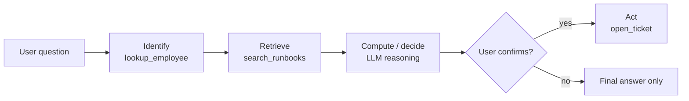

# Solution Design and Tool Planning

## Overview

Before a single prompt is written, the Design Applications domain expects you to turn a business request into a precise pipeline specification: what goes in, what must come out, which model *task* produces it, which chain components connect the two, and — for agents — which tools exist and in what order they run. This file covers the five non-Agent-Bricks bullets of Section 1 of the exam guide; Agent Bricks has its own file.

> [!abstract]
>
> - **Business goal → I/O spec** — name the user, the input fields, the output format, the knowledge sources, and the quality / latency / cost constraints before choosing any technology
> - **Model task selection** — map the requirement to an NLP task category (summarization, classification, extraction, generation, translation, embedding) and evaluate models *within* that category
> - **Chain components** — prompt template, retriever, re-ranker, LLM, output parser, guardrail, memory, tools — each exists to transform one input shape into the next
> - **Tool planning** — define each tool's contract (name, description, typed parameters), then order tools by data dependency: identify → retrieve → compute → act

> [!tip] What the Exam Tests
>
> - Picking the **task category** a business requirement maps to (the official sample question on memo "gists" is answered by *Summarization*, not text2text or classification)
> - Choosing the **minimum set of chain components** that turns a given input into a given output format
> - Deciding when a **fixed chain** is enough and when the problem needs **multi-stage reasoning** with tools
> - Ordering tools so each step has the data it needs, and putting irreversible actions last

---

## From business goal to pipeline specification

The exam guide bullet is *"Translate business use case goals into a description of the desired inputs and outputs for the AI pipeline."* A good specification answers six questions before any design choice is made.

| Question | Example answer (internal IT help desk assistant) |
| :--- | :--- |
| **Who is the user and where do they ask?** | Employees, in a Databricks App and in Microsoft Teams |
| **What are the inputs?** | Free-text question + employee ID (from the authenticated session) + optional ticket ID |
| **What is the output format?** | Short answer (≤ 120 words), cited source links, and a JSON `action` field (`none` / `open_ticket`) |
| **Where does the knowledge live?** | IT runbooks (PDF in a UC volume), ticket history (Delta table), asset inventory (Delta table) |
| **What are the constraints?** | P95 latency < 5 s; no PII in responses; cost ceiling per month |
| **How is success measured?** | Correctness vs. an SME-labelled eval set, groundedness, deflection rate |

The specification immediately drives the design:

- **Unstructured knowledge** (runbooks) → chunk + embed + vector index → retriever
- **Structured, per-entity facts** (ticket status, asset owner) → a lookup tool or a table keyed by ID, *not* a vector store
- **A structured output field** (`action`) → structured-output prompting plus an output parser or schema validation
- **A side effect** (`open_ticket`) → a tool with an explicit confirmation step

> [!note]
> The official sample question on shipping dates makes the same point: per-transaction facts such as an expected delivery date belong in a **table keyed on `transaction_id`** (the PDF answer is a feature store table), not in a vector store of policy documents and not in fine-tuned model weights.

### Input and output contracts

Write the contract down as types — it becomes the model signature you log with MLflow later (see [MLflow for GenAI](../02-assembling-and-deploying-apps/02-mlflow-for-genai.md)).

```python
from pydantic import BaseModel, Field
from typing import Literal

class HelpDeskRequest(BaseModel):
    question: str
    employee_id: str
    ticket_id: str | None = None

class HelpDeskResponse(BaseModel):
    answer: str = Field(max_length=900)
    sources: list[str]
    action: Literal["none", "open_ticket"]
```

## Selecting the model task

Exam guide bullet: *"Select model tasks to accomplish a given business requirement."* LLM catalogues (model hubs, model cards, Databricks AI Functions) are organised by **task**, so the first step is naming the task correctly.

| Business requirement | Task category | Databricks shortcut (if any) |
| :--- | :--- | :--- |
| Condense a paragraph-long memo into a one-sentence gist | **Summarization** | `ai_summarize` |
| Route support emails to one of 8 queues | **Text classification** | `ai_classify` |
| Pull invoice number, total, and due date from documents | **Information / entity extraction** | `ai_extract`, Agent Bricks Information Extraction |
| Detect positive / negative tone in reviews | **Sentiment analysis** (a classification task) | `ai_analyze_sentiment` |
| Translate product descriptions into Japanese | **Translation** | `ai_translate` |
| Answer questions grounded in internal documents | **Question answering / chat with retrieval (RAG)** | Vector Search + chat model, Knowledge Assistant |
| Find the most similar previous ticket | **Embedding + similarity search** | `ai_similarity`, Vector Search |
| Rewrite text to fix grammar or change register | **Text-to-text generation** | `ai_fix_grammar`, `ai_query` |
| Redact names and emails before storage | **Masking / PII detection** | `ai_mask` |

Function names verified against [AI Functions on Databricks](https://docs.databricks.com/aws/en/large-language-models/ai-functions). Use the task-specific function when it fits; fall back to `ai_query()` with a general chat model when you need a custom prompt.

> [!warning] Common Mistake
> "Text2text generation" can technically produce a summary, but when the requirement is *condense this text to its gist*, the exam expects the most specific task category — **Summarization**. Pick the narrowest task that matches the requirement, then compare models within it.

## Selecting chain components

Exam guide bullet: *"Select chain components for a desired model input and output."* Each component exists to convert one shape into the next. Work backwards from the required output.

| Component | Converts | Add it when… |
| :--- | :--- | :--- |
| **Prompt template** | Raw variables → formatted messages | Always — every chain has one |
| **Retriever** | Question → relevant chunks | Answers depend on documents the model was not trained on |
| **Re-ranker** | Top-k candidates → best-n chunks | Recall is good but the best chunk is not ranked first |
| **LLM (chat model)** | Messages → text / tool calls | Always |
| **Output parser / schema** | Model text → `str`, JSON, Pydantic object | Downstream code needs a typed value |
| **Guardrail** | Input or output → allowed / blocked | Untrusted input, regulated output |
| **Memory / session store** | Conversation history → context | Multi-turn conversations |
| **Tools** | Model tool call → external result | The model must look up live data or take an action |

### Worked mapping

| Required input → output | Minimal chain |
| :--- | :--- |
| Question → plain-text answer from policy PDFs | prompt → retriever → LLM → `StrOutputParser` |
| Support email → queue label (one of 8) | prompt (few-shot) → LLM → enum parser (or `ai_classify`) |
| Contract PDF → JSON of parties + dates | parser (`ai_parse_document`) → prompt with JSON schema → LLM → JSON parser |
| Chat turn → answer that remembers earlier turns | memory → prompt → retriever → LLM |
| Question → answer that may need a live order status | prompt → LLM with tools (`get_order_status`, `search_docs`) → final answer |

## Designing prompts for formatted responses

Exam guide bullet: *"Design a prompt that elicits a specifically formatted response."* The full technique catalogue lives in [Prompt Engineering](../01-application-development/01-prompt-engineering.md); at design time, decide **how strictly** the format must be enforced.

| Enforcement level | Technique | When |
| :--- | :--- | :--- |
| Soft | Explicit format instructions + one or two few-shot examples | Human-read output, minor variation acceptable |
| Medium | JSON mode (`response_format={"type": "json_object"}`) + parser with retry | Machine-read output, schema small |
| Strict | JSON Schema structured output (`json_schema`) + Pydantic validation | Output feeds another system; every field required |

`ai_query()` accepts a `responseFormat` argument with the same three levels — `text`, `json_object`, `json_schema` — for batch workloads ([`ai_query` reference](https://docs.databricks.com/aws/en/sql/language-manual/functions/ai_query)).

## Defining and ordering tools for multi-stage reasoning

Exam guide bullet: *"Define and order tools that gather knowledge or take actions for multi-stage reasoning."*

### 1. Define each tool as a contract

The model chooses tools from their **name, description, and parameter schema** — those three strings are the tool's entire interface.

```python
from langchain_core.tools import tool

@tool
def lookup_employee(employee_id: str) -> dict:
    """Return department, laptop asset tag, and manager for an employee ID.
    Use this before any tool that needs an asset tag."""
    ...

@tool
def search_runbooks(query: str) -> str:
    """Search IT runbooks for troubleshooting steps. Use for how-to questions."""
    ...

@tool
def open_ticket(employee_id: str, asset_tag: str, summary: str) -> str:
    """Open a help-desk ticket. Only call after the user confirms."""
    ...
```

Good tool definitions:

- Do **one thing** each — `lookup_employee` and `open_ticket` are separate tools, not one `helpdesk(action=...)` tool
- State **when to use** the tool and what must happen first, inside the description
- Use **typed, minimal parameters** — the model fills them from the conversation
- Separate **read** tools (gather knowledge) from **write** tools (take actions)

### 2. Order tools by data dependency



| Ordering rule | Why |
| :--- | :--- |
| **Identify before retrieve** | IDs resolved first make later lookups precise (and filterable) |
| **Read before write** | Gather all facts before any side effect |
| **Cheap and deterministic before expensive and generative** | A table lookup can answer what an LLM call would guess |
| **Irreversible actions last, behind confirmation** | Prevents an agent from acting on a wrong intermediate conclusion |
| **Parallelise independent lookups** | Two unrelated lookups can run at once (`RunnableParallel`) |

### 3. Pick the control pattern

| Pattern | Who decides the order | Use when |
| :--- | :--- | :--- |
| **Fixed chain** | You, at design time | The steps are always the same (classic RAG) |
| **Router** | One LLM call picks a branch | A few well-known request types |
| **Plan-and-execute** | LLM writes a plan, then executes steps | Multi-step tasks with a predictable plan |
| **ReAct loop** | LLM decides after each observation | Open-ended tasks; cap with `max_iterations` |
| **Supervisor (multi-agent)** | A supervisor delegates to specialised agents | Several domains, each with its own tools — see [Agent Bricks](./03-agent-bricks.md) |

## Use Cases

- **Requirement triage** — a product manager asks for "an AI that handles invoices"; the I/O spec reveals two tasks (extraction to JSON, then classification for approval routing) and no need for chat
- **Avoiding a vector store for structured facts** — order status and delivery dates come from a keyed table lookup tool, while policy questions go to the retriever
- **Safe action agents** — read tools gather context, the agent proposes an action, and a confirmation step gates the only write tool
- **Cost-aware design** — classification and summarisation run as batch `ai_classify` / `ai_summarize` jobs instead of a chat endpoint

## Common Issues & Errors

### Agent Calls the Write Tool Too Early

**Scenario:** An agent opens duplicate tickets because it calls `open_ticket` before checking whether the user already has one open.
**Fix:** Add a read tool (`list_open_tickets`), state the ordering in both tool descriptions ("call `list_open_tickets` first"), and require explicit user confirmation before the write tool runs.

### Wrong Task Category Chosen

**Scenario:** A team evaluates general text-generation models for a routing problem and gets inconsistent free-text labels.
**Fix:** Reframe as **classification** with a closed label set — use few-shot prompting with an enum parser, or `ai_classify` with the label list.

### Overloaded Tool

**Scenario:** A single `database(action, table, filters)` tool leads to malformed arguments and wrong tables.
**Fix:** Split into narrow, well-described tools with typed parameters; the model selects tools far more reliably than it composes free-form arguments.

## Exam Tips

> [!tip] Exam Tips
>
> - Read the **output** requirement first — it tells you the task category and whether you need an output parser.
> - **Structured per-entity facts → keyed table or tool**; **unstructured knowledge → retriever**. Fine-tuning is rarely the answer for facts that change.
> - Paragraph → one-sentence gist = **Summarization**. Closed label set = **Classification**. Fields from documents = **Extraction**.
> - Tool order: **identify → retrieve → compute → act**, with irreversible actions last and gated.

## Key Takeaways

- Write the I/O specification (user, inputs, output format, knowledge sources, constraints, success metric) before choosing components
- Map each requirement to the narrowest task category, then compare models within that category
- Every chain component converts one shape into another — add only the components the output requires
- Tools are contracts: name + description + typed parameters; keep them narrow and separate reads from writes
- Order tools by data dependency and put irreversible actions last, behind confirmation

## Related Topics

- [RAG Design Patterns](./01-rag-design-patterns.md)
- [Agent Bricks](./03-agent-bricks.md)
- [Prompt Engineering](../01-application-development/01-prompt-engineering.md)
- [LLM Chains & Agents](../01-application-development/02-chains-agents.md)

## Official Documentation

- [AI Functions on Databricks](https://docs.databricks.com/aws/en/large-language-models/ai-functions)
- [`ai_query` function](https://docs.databricks.com/aws/en/sql/language-manual/functions/ai_query)
- [Develop agents on Databricks](https://docs.databricks.com/aws/en/agents/)
- [Databricks Certified Generative AI Engineer Associate exam guide (PDF)](https://www.databricks.com/sites/default/files/2026-10/databricks-certified-gen-ai-associate-exam-guide-august-2026.pdf)

---

**[← Previous: RAG Design Patterns](./01-rag-design-patterns.md) | [↑ Back to Design Applications](./README.md) | [Next: Agent Bricks — Knowledge Assistant, Multi-Agent Supervisor, Information Extraction](./03-agent-bricks.md) →**
