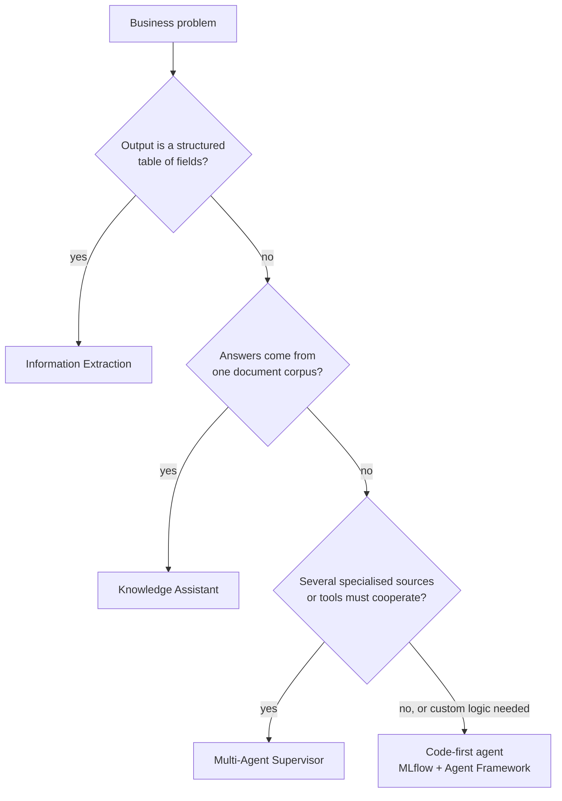
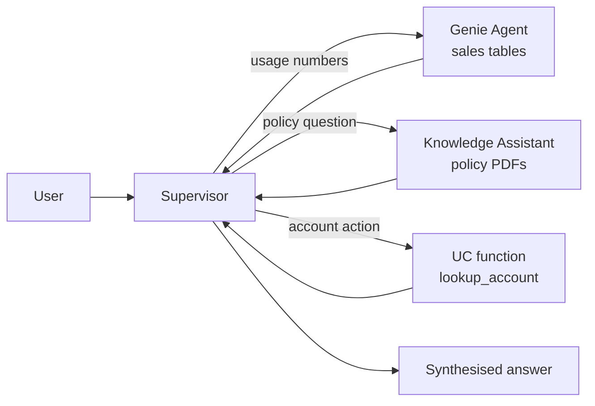

# Agent Bricks — Knowledge Assistant, Multi-Agent Supervisor, Information Extraction

## Overview

The 2026 exam guide adds a Design Applications bullet: *"Determine how and when to use Agent Bricks (Knowledge Assistant, Multiagent Supervisor, Information Extraction) to solve problems."* These are the declarative, low-code agent builders in Databricks. You give each one data and instructions, it builds and hosts the agent, and subject-matter experts improve it with natural-language feedback. The exam tests **which brick fits which problem**, and when a hand-coded agent is the better choice.

> [!abstract]
>
> - **Knowledge Assistant** — a question-answering chatbot over *documents*, with citations, improved by SME questions and guidelines
> - **Multi-Agent Supervisor** (current docs name: **Supervisor Agent**) — coordinates up to 50 sub-agents and tools (Genie Agents, Knowledge Assistant endpoints, UC functions, MCP servers, custom agents) across domains
> - **Information Extraction** — turns unstructured documents into a structured table that follows a schema you define (powered by `ai_extract` in the current version)
> - All three need **Unity Catalog, serverless compute, and a serverless usage policy with a nonzero budget**

> [!tip] What the Exam Tests
>
> - Matching a scenario to the right brick: document Q&A → Knowledge Assistant; many specialised sources → Supervisor; documents → structured fields → Information Extraction
> - That bricks are **improved with SME feedback** (questions, guidelines, labels), not by retraining a model yourself
> - That a Supervisor **respects each end user's permissions** on every sub-agent
> - When to drop down to a code-first agent (custom logic, custom tools, full control over the loop)

---

> [!note] Platform update (Oct 2026)
> On **2026-10-12** Databricks moved **Knowledge Assistant** and **Supervisor Agent** to *legacy* status. For new low-code agents the docs now point to **Genie Agents** (the July 8, 2026 rename of Genie Spaces), and for new agents written in code to the **Agent Bricks CLI** (Beta). The programmatic **Supervisor API** (Beta) is deprecated and reached **end of life on 2026-09-30**. The **Information Extraction** brick was rebuilt on `ai_extract` and is not on the legacy list; only its older version is. The exam guide (published March 18, 2026) still names all three bricks, so learn them as described below. Sources: [October 2026 release notes](https://docs.databricks.com/aws/en/release-notes/product/2026/october), [Legacy agent offerings](https://docs.databricks.com/aws/en/agents/legacy/), [Supervisor API (deprecated)](https://docs.databricks.com/aws/en/agents/agent-bricks/supervisor-api).

## Where the bricks fit

| Brick | Input | Output | Typical problem |
| :--- | :--- | :--- | :--- |
| **Knowledge Assistant** | Files in a UC volume, a UC table with a file column, or a Vector Search index | Chat answers with citations, served from an agent endpoint | HR policy Q&A, product documentation assistant, support knowledge base |
| **Multi-Agent Supervisor** | Sub-agents and tools you select (Genie Agents, agent endpoints, UC functions, MCP servers, tables, volumes, indexes) | One endpoint that delegates, then synthesises an answer | "Answer policy questions *and* account questions *and* usage analytics in one chat" |
| **Information Extraction** | Documents or text in a UC volume or table | A structured table that follows your JSON schema | Contracts → parties and terms; invoices → line items; clinical notes → key details |

## Knowledge Assistant

Knowledge Assistant builds a document Q&A chatbot that answers *with citations*. Databricks describes it as following an **"Instructed Retriever"** approach that goes beyond plain RAG ([Knowledge Assistant docs](https://docs.databricks.com/aws/en/agents/agent-bricks/knowledge-assistant)).

### Knowledge sources

| Source type | Requirements (per current docs) |
| :--- | :--- |
| **Files in a UC volume** | `txt`, `pdf`, `md`, `ppt`/`pptx`, `doc`/`docx`; files over 100 MB and PDF/Office files over 500 pages are skipped |
| **Files in a UC table** | Streaming table or table with Change Data Feed; a `content` column (BINARY or STRING) and a `metadata` struct (`file_path`, `file_name`, …). Tables ingested from SharePoint or Google Drive connectors match automatically |
| **Existing Vector Search index** | Must use `databricks-gte-large-en`, `databricks-bge-large-en`, or `databricks-qwen3-embedding-0-6b` |

### Build and improve loop

1. **Configure** — name, description, knowledge source(s), and a *description of each source's content* so the agent knows when to use it
2. **Test** — chat in the configuration page or AI Playground
3. **Improve** — add questions in the *Examples* tab and share the agent with SMEs, who attach natural-language **guidelines** to answers; guidelines take effect as soon as they are saved
4. **Use** — the brick exposes an **agent endpoint**; call it from Playground, the API, or a Databricks App; grant **Can Query** to consumers

### When to choose it

- The knowledge is a **document corpus** and users ask **natural-language questions** about it
- You want **citations** and **minimal code**
- Domain experts, not engineers, will tune quality

When *not* to choose it: answers need live structured data (use Genie or a tool), you need custom retrieval logic or custom tools, or output must be a structured table (use Information Extraction).

> [!note]
> Databricks Free Edition does **not** support Knowledge Assistant ([Free Edition limitations](https://docs.databricks.com/aws/en/getting-started/free-edition-limitations)). Practise the other bricks and the code-first path there instead.

## Multi-Agent Supervisor (Supervisor Agent)

The exam guide calls it **Multiagent Supervisor**; the product docs call it **Supervisor Agent**. It creates a supervisor system that delegates tasks to specialised sub-agents and tools, then synthesises the result ([Supervisor Agent docs](https://docs.databricks.com/aws/en/agents/agent-bricks/multi-agent-supervisor)).

### Supported sub-agents and tools

| Sub-agent / tool | End user needs |
| :--- | :--- |
| **Genie Agent** (formerly Genie Space) — structured data via natural language | Access to the Genie Agent and its underlying UC objects |
| **Knowledge Assistant endpoint** — document Q&A | `CAN QUERY` on the agent endpoint |
| **Model Serving endpoint** / **custom agent** | `CAN QUERY` on the endpoint (custom agents on Apps: `CAN USE` on the app) |
| **Unity Catalog function** | `EXECUTE` on the function |
| **UC table / volume / Vector Search index** | `SELECT` / `READ VOLUME` plus `USE CATALOG` and `USE SCHEMA` |
| **MCP server** (registered or custom) | `EXECUTE` on the registered MCP service, or `CAN USE` on the hosting app |
| **Published dashboard**, **web search** | `CAN VIEW` on the dashboard; web search asks the user to approve each call |

Key behaviours:

- **Up to 50** agents and tools per supervisor
- **Per-user access control** — if an end user lacks access to a sub-agent, the supervisor steers the conversation away from it; with no access to any sub-agent it ends the conversation
- **Descriptions drive delegation** — write a detailed description for every sub-agent; the supervisor routes on them
- **Code execution** is built in: a sandboxed serverless session with no network egress and read-only access to the tables and volumes you add
- **SME improvement** — add example questions, share the configuration page with experts (they need `CAN MANAGE` plus access to the sub-agents), and let them add guidelines
- Vector Search index sub-agents support **Delta Sync indexes only**

### When to choose it

- One conversational entry point must answer questions that span **structured data** (Genie) and **unstructured documents** (Knowledge Assistant), or call several tools
- Each domain already has, or should have, its **own specialised agent**
- You want routing and synthesis handled for you, tuned by SMEs

## Information Extraction

Information Extraction transforms unstructured documents and text into structured insights using a defined schema ([Information Extraction docs](https://docs.databricks.com/aws/en/agents/agent-bricks/info-extraction)).

- **Input**: files in a UC volume, uploaded files, or a text column (`STRING` / `VARIANT`) in a UC table
- **Schema**: the brick proposes an extraction schema from your data; you refine the fields
- **Interfaces**: Agent Bricks UI, **SQL** (`ai_extract`), and REST API
- **Scale**: designed for batch transformation of large document volumes into a Delta table for analytics or downstream agents

The earlier (now *legacy*) version accepted an **unlabeled** dataset (the brick infers a sample JSON output) or a **labeled** dataset (a ground-truth JSON column used for evaluation), and used MLflow-based evaluation to compare cost and quality ([legacy page](https://docs.databricks.com/aws/en/agents/agent-bricks/key-info-extraction)). Exam stems written against the March 2026 guide may describe either version; the core idea is the same: **documents in, schema-shaped rows out**.

### When to choose it

- The deliverable is a **table**, not a conversation
- Thousands of contracts, invoices, or notes need the same fields extracted
- You want SQL-level integration (`ai_extract`) into a pipeline

## Bricks vs code-first agents

| Need | Choose |
| :--- | :--- |
| Fastest path to a cited document chatbot | Knowledge Assistant (legacy; new builds → Genie Agents) |
| Coordinate existing agents and tools with SME tuning | Multi-Agent Supervisor (legacy; new builds → Genie Agents or Agent Bricks CLI) |
| Structured fields from documents at scale | Information Extraction / `ai_extract` |
| Custom loop, custom tools, custom memory, full control | Code-first agent with MLflow + Agent Framework — see [Agentic Systems with MLflow and Genie](../01-application-development/05-agentic-systems-mlflow-and-genie.md) |

## Use Cases

- **HR policy assistant** — Knowledge Assistant over a volume of policy PDFs; HR SMEs add guidelines such as "always cite the policy section number"
- **Customer 360 chat** — Supervisor routes billing questions to a Genie Agent over billing tables, policy questions to a Knowledge Assistant, and account changes to a UC function
- **Contract analytics** — Information Extraction pulls parties, effective dates, and renewal terms from 40 000 contracts into a Delta table for a dashboard
- **Graduating to code** — a Knowledge Assistant prototype proves value; the team rebuilds it as a code-first agent when it needs custom tools and memory

## Common Issues & Errors

### Supervisor Gives Unhelpful Answers for Some Users

**Scenario:** Analysts get full answers but sales reps get vague replies from the same supervisor.
**Fix:** The supervisor enforces each user's permissions on every sub-agent. Grant the sales group access to the Genie Agent (and its underlying tables) and `CAN QUERY` on the Knowledge Assistant endpoint.

### Knowledge Assistant Ignores Some Documents

**Scenario:** Large slide decks never appear in citations.
**Fix:** Files over 100 MB, and PDF/Office files over 500 pages (each slide counts as a page), are skipped during ingestion. Split the files or pre-parse them into a UC table.

### Wrong Brick for the Output Shape

**Scenario:** A team builds a Knowledge Assistant to "get the renewal date from every contract" and then scrapes chat answers into a table.
**Fix:** The output is a table of fields — use Information Extraction (`ai_extract`) instead.

## Exam Tips

> [!tip] Exam Tips
>
> - **Document Q&A with citations → Knowledge Assistant.** **Many specialised agents/tools behind one chat → Multi-Agent Supervisor.** **Documents → structured table → Information Extraction.**
> - A Supervisor commonly pairs a **Genie Agent (structured data)** with a **Knowledge Assistant (unstructured data)**.
> - Bricks are improved by **SME questions and natural-language guidelines**, not by you fine-tuning a model.
> - Permissions flow through: the **end user** needs access to each sub-agent and its data.
> - Product note for the real world: KA and Supervisor are legacy since 2026-10-12, and the Supervisor API reached end of life on 2026-09-30. On the exam, answer with the brick that matches the scenario.

## Key Takeaways

- Agent Bricks provides declarative agents: Knowledge Assistant, Multi-Agent Supervisor (Supervisor Agent), and Information Extraction
- Choose by output shape and source count: one document corpus → KA; many cooperating sources → Supervisor; schema-shaped rows → IE
- All bricks need Unity Catalog, serverless compute, and a serverless usage policy with a nonzero budget
- SMEs improve quality through examples and guidelines; consumers need `CAN QUERY` on the endpoint
- Code-first agents remain the answer when you need custom logic, tools, or memory

## Related Topics

- [Solution Design and Tool Planning](./02-solution-design-and-tool-planning.md)
- [Agentic Systems with MLflow and Genie](../01-application-development/05-agentic-systems-mlflow-and-genie.md)
- [MCP Servers](../02-assembling-and-deploying-apps/04-mcp-servers.md)
- [MLflow Scorers, Judges, and SME Feedback](../05-evaluation-and-monitoring/03-mlflow-scorers-judges-and-feedback.md)

## Official Documentation

- [Develop agents on Databricks (Agent Bricks)](https://docs.databricks.com/aws/en/agents/)
- [Knowledge Assistant (legacy)](https://docs.databricks.com/aws/en/agents/agent-bricks/knowledge-assistant)
- [Supervisor Agent (legacy)](https://docs.databricks.com/aws/en/agents/agent-bricks/multi-agent-supervisor)
- [Information Extraction](https://docs.databricks.com/aws/en/agents/agent-bricks/info-extraction)
- [Legacy agent offerings](https://docs.databricks.com/aws/en/agents/legacy/)
- [Agent Bricks CLI (Beta)](https://docs.databricks.com/aws/en/agents/custom-agents/agent-bricks-cli)

---

**[← Previous: Solution Design and Tool Planning](./02-solution-design-and-tool-planning.md) | [↑ Back to Design Applications](./README.md)**
