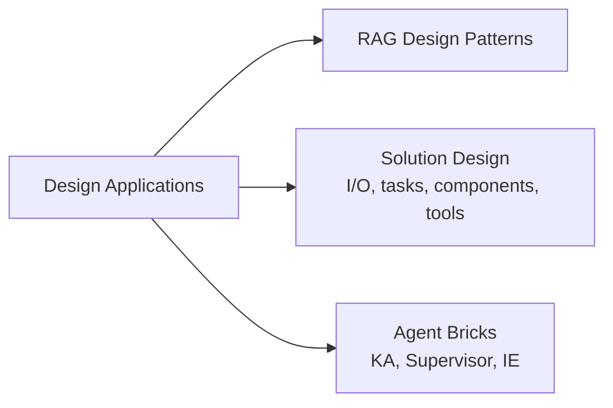

# Design Applications (14 % of Exam)

Section 1 of the exam guide: turning a business requirement into a GenAI design — the inputs and outputs of the pipeline, the model task, the chain components, the tools and their order, the retrieval architecture, and when a declarative **Agent Bricks** agent is the right tool.

## Topics Overview

## Section Contents

| File | Topic | Priority |
| :--- | :--- | :--- |
| [01-rag-design-patterns.md](./01-rag-design-patterns.md) | RAG vs fine-tuning, HyDE, multi-query, re-ranking, parent-child chunking, agentic RAG | High |
| [02-solution-design-and-tool-planning.md](./02-solution-design-and-tool-planning.md) | Business goal → I/O spec, model task selection, chain components, formatted-output prompts, tool definition and ordering *(2026 guide)* | High |
| [03-agent-bricks.md](./03-agent-bricks.md) | Knowledge Assistant, Multi-Agent Supervisor, Information Extraction — how and when to use each *(2026 guide)* | High |

## Exam Guide Coverage

| Exam guide bullet (Section 1) | Where it is covered |
| :--- | :--- |
| Design a prompt that elicits a specifically formatted response | [02](./02-solution-design-and-tool-planning.md#designing-prompts-for-formatted-responses), [Prompt Engineering](../01-application-development/01-prompt-engineering.md) |
| Select model tasks to accomplish a given business requirement | [02](./02-solution-design-and-tool-planning.md#selecting-the-model-task) |
| Select chain components for a desired model input and output | [02](./02-solution-design-and-tool-planning.md#selecting-chain-components) |
| Translate business use case goals into a description of the desired inputs and outputs for the AI pipeline | [02](./02-solution-design-and-tool-planning.md#from-business-goal-to-pipeline-specification) |
| Define and order tools that gather knowledge or take actions for multi-stage reasoning | [02](./02-solution-design-and-tool-planning.md#defining-and-ordering-tools-for-multi-stage-reasoning), [RAG Design Patterns](./01-rag-design-patterns.md) |
| Determine how and when to use Agent Bricks (Knowledge Assistant, Multiagent Supervisor, Information Extraction) to solve problems | [03](./03-agent-bricks.md) |

## Key Concepts

| Concept | Why it matters |
| :--- | :--- |
| **RAG = open-book exam, fine-tuning = studying** | RAG injects fresh context at query time; fine-tuning bakes knowledge into weights. RAG wins for facts that change; fine-tuning wins for style/format/persona |
| **I/O specification first** | User, inputs, output format, knowledge sources, constraints, and success metric drive every later choice |
| **Narrowest task category** | Summarization, classification, extraction, translation — pick the most specific task, then compare models |
| **Tool ordering** | Identify → retrieve → compute → act, with irreversible actions last and gated |
| **Agent Bricks** | Document Q&A → Knowledge Assistant; many cooperating agents → Supervisor; documents → structured rows → Information Extraction |
| **Context window budget** | System prompt + retrieved chunks + history + answer share one budget |

## Related Resources

- [RAG / Vector Search Basics (shared)](../../../shared/fundamentals/rag-vector-search-basics.md)
- [Application Development (runtime patterns)](../01-application-development/README.md)
- [Data Preparation (chunking, embeddings, indexing)](../04-data-preparation/README.md)
- [Develop agents on Databricks (Agent Bricks)](https://docs.databricks.com/aws/en/agents/)

---

**[← Previous: Assembling and Deploying Applications](../02-assembling-and-deploying-apps/README.md) | [↑ Back to GenAI Engineer Associate](../README.md) | [Next: Data Preparation](../04-data-preparation/README.md) →**
