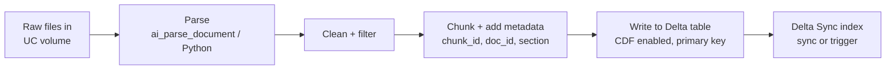
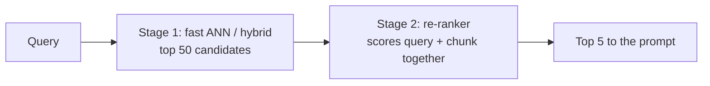

# Source Documents, Extraction, and Retrieval Evaluation

## Overview

A RAG application is only as good as the documents it retrieves from. This file covers the Data Preparation bullets that come *before* and *after* chunking: identifying which source documents the application actually needs, extracting their content with the right Python package, filtering out content that degrades retrieval, writing the result to Unity Catalog in the right sequence, and measuring retrieval quality — including the role of re-ranking and advanced chunking.

> [!abstract]
>
> - **Source selection** — start from the questions users will ask; per-entity structured facts belong in tables, explanatory knowledge in documents
> - **Extraction packages** — OCR (`pytesseract`) for scanned images, `pypdf` / PyMuPDF for digital PDFs, BeautifulSoup for HTML, `unstructured` for mixed formats, or `ai_parse_document` in SQL
> - **Filtering** — strip headers, footers, navigation, boilerplate, duplicates, and OCR noise before chunking
> - **Retrieval evaluation** — precision@k, recall@k, MRR, NDCG, and MLflow retrieval judges (`RetrievalRelevance`, `RetrievalSufficiency`, `RetrievalGroundedness`)
> - **Re-ranking** — a second-stage model reorders a larger candidate set so the best chunks reach the prompt

> [!tip] What the Exam Tests
>
> - Picking the extraction package from the **file format** (the official sample question: scanned `.jpeg` / `.png` → `pytesseract`, because OCR is required)
> - Recognising when the fix is **different source data** rather than a different model (the official sample question on shipping dates)
> - Which retrieval metric answers which question, and which MLflow judges need ground truth
> - Where re-ranking sits in the pipeline and its latency trade-off

---

## Identifying the source documents a RAG application needs

Exam guide bullet: *"Identify needed source documents that provide necessary knowledge and quality for a given RAG application."*

Work backwards from the questions:

1. **List representative questions** (from users, support tickets, search logs)
2. **For each question, name the fact that answers it** and where that fact lives today
3. **Classify the fact**:
   - *Explanatory, slowly changing knowledge* (policies, manuals, FAQs) → documents → chunk + embed → retriever
   - *Per-entity, frequently changing facts* (order status, delivery date, account balance) → structured table keyed by an ID → lookup tool or feature/online table
4. **Check quality** of each candidate source

| Quality criterion | Question to ask | Risk if ignored |
| :--- | :--- | :--- |
| **Coverage** | Does the corpus contain the answer to each representative question? | "I don't know" or hallucination |
| **Authority** | Is this the system of record or a stale copy? | Conflicting answers |
| **Freshness** | How often does it change, and will the index keep up? | Outdated answers |
| **Cleanliness** | Is it mostly content, or boilerplate and noise? | Irrelevant retrieval |
| **Rights and sensitivity** | May we use it (licence, terms) and does it contain PII? | Legal and privacy exposure — see [Governance](../06-governance/01-governance-overview.md) |

> [!note]
> In the official sample question, an automotive-parts assistant answers billing questions well but fails on shipping and arrival dates. Expected delivery dates are **structured, per-transaction facts**, so the fix is a **feature store table keyed on `transaction_id`** populated with invoice data and expected delivery date — not a vector store of shipping policies, not fine-tuning, and not a hard-coded "+14 days" prompt rule.

## Choosing a Python package to extract document content

Exam guide bullet: *"Choose the appropriate Python package to extract document content from provided source data and format."*

| Source format | Package / tool | Why |
| :--- | :--- | :--- |
| **Scanned images** (`.jpeg`, `.png`, image-only PDFs) | `pytesseract` (Tesseract OCR) | Text exists only as pixels — OCR is required |
| **Digital PDFs** (text layer present) | `pypdf` (`PyPDF`), PyMuPDF (`fitz`) | Fast text extraction per page; PyMuPDF also gives layout and images |
| **PDFs with tables** | `pdfplumber`, `unstructured` with table inference, `ai_parse_document` | Preserves table structure rather than flattening it |
| **HTML / web pages** | `beautifulsoup4`, `lxml` | Parse the DOM and keep only main content |
| **Word / PowerPoint** | `python-docx`, `python-pptx` | Native access to paragraphs, headings, slides |
| **Mixed formats at scale** | `unstructured` (`partition` functions) | One API for many formats; returns typed elements (Title, NarrativeText, Table, …) |
| **Any document, in SQL, governed** | `ai_parse_document` (Databricks AI Function) | Returns text, tables, figure descriptions, and layout; since Oct 2026 also chart data as JSON |

Web-scraping libraries such as `scrapy` or `pyquery` *fetch or query HTML*; they do not perform OCR, which is why they are wrong answers for scanned images.

```python
import pytesseract
from PIL import Image

text = pytesseract.image_to_string(Image.open("/Volumes/main/docs/raw/invoice_0001.png"))
```

```sql
-- Parse every file in a volume with the Databricks AI Function
CREATE OR REPLACE TABLE main.rag.parsed_docs AS
SELECT
  path,
  ai_parse_document(content) AS parsed
FROM READ_FILES('/Volumes/main/docs/raw/', format => 'binaryFile');
```

Sources: [AI Functions on Databricks](https://docs.databricks.com/aws/en/large-language-models/ai-functions) (lists `ai_parse_document` and the Beta `ai_prep_search` chunking function) and the [October 2026 release notes](https://docs.databricks.com/aws/en/release-notes/product/2026/october) (chart extraction).

## Filtering extraneous content

Exam guide bullet: *"Filter extraneous content in source documents that degrades quality of a RAG application."* Noise in chunks becomes noise in embeddings: a chunk that is half page-footer will match queries about page footers.

| Extraneous content | How to remove it |
| :--- | :--- |
| Repeated headers, footers, page numbers | Detect lines repeated across pages; drop layout regions labelled header/footer by the parser |
| Navigation menus, cookie banners, sidebars (HTML) | Keep only `<main>` / `<article>`; drop `<nav>`, `<footer>`, `<script>`, `<style>` |
| Tables of contents, indexes, legal boilerplate | Drop by element type or heading; keep one canonical copy of disclaimers |
| Duplicate and near-duplicate documents | Hash normalised text; keep the most recent or authoritative version |
| OCR garbage | Drop chunks with a low ratio of dictionary words or very short length |
| Off-topic or out-of-scope documents | Filter by metadata (department, product, language) before indexing |

```python
from bs4 import BeautifulSoup

def main_text(html: str) -> str:
    soup = BeautifulSoup(html, "html.parser")
    for tag in soup(["nav", "header", "footer", "script", "style", "aside"]):
        tag.decompose()
    body = soup.find("main") or soup.find("article") or soup.body
    return body.get_text(separator="\n", strip=True)
```

Keep useful metadata (title, section heading, URL, last-updated date) as columns — it powers filtering and citations later.

## Writing chunked text to Delta Lake in Unity Catalog

Exam guide bullet: *"Define operations and sequence to write given chunked text into Delta Lake tables in Unity Catalog."* The order matters because the Vector Search Delta Sync index reads the table's change feed.



1. Land raw files in a **Unity Catalog volume**
2. **Parse** and **clean**
3. **Chunk** and attach a stable `chunk_id` (primary key) plus metadata columns
4. **Create the Delta table** in `catalog.schema` with **Change Data Feed** enabled (standard endpoints require it; tables with row tracking get it automatically) and write the chunks (`MERGE` on `chunk_id` for updates)
5. **Create or sync** the Delta Sync index (triggered or continuous)

Code for steps 3–5 is in [Document Processing & Chunking](./01-document-processing-chunking.md) and [Databricks Vector Search](./03-databricks-vector-search.md). Requirement source: [Databricks AI Search](https://docs.databricks.com/aws/en/ai-search/ai-search).

## Evaluating retrieval performance

Exam guide bullet: *"Use tools and metrics to evaluate retrieval performance."* Evaluate the retriever **separately** from the generator so you know which half to fix.

### Ranking metrics (need labelled relevant chunks)

| Metric | Measures | Read it as |
| :--- | :--- | :--- |
| **Precision@k** | Fraction of the top-k results that are relevant | Is the context noisy? |
| **Recall@k** | Fraction of all relevant chunks found in the top-k | Did we find everything needed? |
| **Hit rate@k** | Fraction of queries with at least one relevant chunk in the top-k | Does retrieval work at all? |
| **MRR** (mean reciprocal rank) | Average of 1 / rank of the first relevant result | Is the best chunk near the top? |
| **NDCG@k** | Rank-weighted relevance, normalised to the ideal ordering | Is the whole ranking good, with graded relevance? |

### MLflow retrieval judges

MLflow 3 provides LLM judges that score retrieval from the trace's retriever spans ([Built-in LLM judges](https://docs.databricks.com/aws/en/mlflow3/genai/eval-monitor/concepts/judges/)):

| Judge | Question | Needs ground truth? |
| :--- | :--- | :---: |
| `RetrievalRelevance` | Is the retrieved context relevant to the request? | No |
| `RetrievalSufficiency` | Does the context contain everything needed to produce the expected facts? | **Yes** (`expectations`) |
| `RetrievalGroundedness` | Is the response grounded in the retrieved context (no hallucination)? | No |

```python
import mlflow
from mlflow.genai.scorers import RetrievalRelevance, RetrievalSufficiency, RetrievalGroundedness

eval_data = [
    {
        "inputs": {"question": "What is the return window for opened items?"},
        "expectations": {"expected_facts": ["Opened items can be returned within 15 days."]},
    },
]

mlflow.genai.evaluate(
    data=eval_data,
    predict_fn=rag_app,  # traced app with a RETRIEVER span
    scorers=[RetrievalRelevance(), RetrievalSufficiency(), RetrievalGroundedness()],
)
```

### Diagnose with the metrics

| Pattern | Diagnosis | Fix |
| :--- | :--- | :--- |
| Low recall / sufficiency | Needed facts are not retrieved | Re-chunk, add sources, hybrid search, query rewriting, larger k |
| Good recall, low precision / relevance | Too much noise in the context | Re-ranking, metadata filters, smaller chunks |
| Good retrieval, low groundedness | Generator ignores the context | Stronger grounding instructions, different LLM |
| Low MRR, good recall@k | Best chunk is present but ranked low | Re-ranking |

## Designing retrieval with advanced chunking and re-ranking

Exam guide bullets: *"Design retrieval systems using advanced chunking strategies"* and *"Explain the role of re-ranking in the information retrieval process."*

| Technique | What it does | Covered in detail |
| :--- | :--- | :--- |
| **Structure-aware chunking** | Splits on headings and sections; keeps section titles as metadata | [Document Processing & Chunking](./01-document-processing-chunking.md) |
| **Semantic chunking** | Splits where embedding similarity between sentences drops | [Document Processing & Chunking](./01-document-processing-chunking.md) |
| **Parent-child (small-to-big)** | Embed small child chunks for precise matching, return the larger parent for context | [RAG Design Patterns](../03-design-applications/01-rag-design-patterns.md) |
| **Contextual compression** | Keep only the relevant sentences of each retrieved chunk | [RAG Design Patterns](../03-design-applications/01-rag-design-patterns.md) |
| **Hybrid search** | Combine vector similarity with keyword (BM25-style) matching for IDs and rare terms | [Retrieval & Augmentation Strategies](../01-application-development/03-retrieval-augmentation-strategies.md) |

### The role of re-ranking



- **Stage 1** (bi-encoder vector search) is fast and optimised for **recall**
- **Stage 2** (a cross-encoder or reranker model) reads the query and each candidate *together*, which is slower but more accurate, so it optimises **precision at the top of the list**
- Use it when recall@50 is good but the best chunk is not in the top few; skip it when latency is the dominant constraint (the official sample question on an 80-QPS, latency-critical search keeps hybrid search and re-ranking **off**)
- Databricks AI Search (formerly Vector Search) supports reranking natively ([Databricks AI Search](https://docs.databricks.com/aws/en/ai-search/ai-search))

## Use Cases

- **Scanned invoice archive** — `pytesseract` (or `ai_parse_document`) extracts text from images before chunking; OCR-noise filtering removes garbage chunks
- **Wiki-based assistant** — BeautifulSoup strips navigation and footers; recall@5 rises because chunks now contain only article content
- **Delivery-date questions** — a keyed table lookup replaces vector retrieval for per-order facts
- **Precision tuning** — MRR is low despite good recall@20; adding a re-ranker moves the best chunk to position 1

## Common Issues & Errors

### Empty Text From Image Files

**Scenario:** A PDF loader returns empty strings for a folder of `.png` scans.
**Fix:** Images have no text layer. Use OCR (`pytesseract`) or `ai_parse_document`, then validate a sample of extracted text.

### Boilerplate Dominates Retrieval

**Scenario:** Many queries retrieve chunks that are mostly copyright footers.
**Fix:** Remove repeated headers and footers before chunking, and re-embed. Add a minimum-content-length filter.

### Delta Sync Index Fails on a New Table

**Scenario:** Index creation fails on the chunk table.
**Fix:** Enable Change Data Feed on the source table (`delta.enableChangeDataFeed = true`) for standard endpoints, and make sure the table has a primary-key column.

## Exam Tips

> [!tip] Exam Tips
>
> - **Images → OCR → `pytesseract`.** HTML → BeautifulSoup. Digital PDF → `pypdf` / PyMuPDF. Many formats → `unstructured`. SQL-native → `ai_parse_document`.
> - **Per-entity facts → structured table keyed by ID**, not a vector store.
> - **Recall** = did we find it; **precision** = is the context clean; **MRR** = is the best one first.
> - `RetrievalSufficiency` needs **ground truth**; `RetrievalRelevance` and `RetrievalGroundedness` do not.
> - Re-ranking improves **precision at the top** and costs **latency**.

## Key Takeaways

- Choose sources from the questions users ask, and check coverage, authority, freshness, cleanliness, and rights
- Match the extraction package to the file format; OCR is required for scanned images
- Filter boilerplate and duplicates before chunking so embeddings represent real content
- Write chunks to a CDF-enabled Delta table with a primary key, then sync the Vector Search index
- Evaluate the retriever on its own with ranking metrics and MLflow retrieval judges; use re-ranking when the right chunk is found but ranked too low

## Related Topics

- [Document Processing & Chunking](./01-document-processing-chunking.md)
- [Databricks Vector Search](./03-databricks-vector-search.md)
- [Retrieval & Augmentation Strategies](../01-application-development/03-retrieval-augmentation-strategies.md)
- [MLflow Scorers, Judges, and SME Feedback](../05-evaluation-and-monitoring/03-mlflow-scorers-judges-and-feedback.md)

## Official Documentation

- [AI Functions on Databricks](https://docs.databricks.com/aws/en/large-language-models/ai-functions)
- [Databricks AI Search (formerly Vector Search)](https://docs.databricks.com/aws/en/ai-search/ai-search)
- [Built-in LLM judges](https://docs.databricks.com/aws/en/mlflow3/genai/eval-monitor/concepts/judges/)
- [Databricks Certified Generative AI Engineer Associate exam guide (PDF)](https://www.databricks.com/sites/default/files/2026-10/databricks-certified-gen-ai-associate-exam-guide-august-2026.pdf)

---

**[← Previous: Databricks Vector Search](./03-databricks-vector-search.md) | [↑ Back to Data Preparation](./README.md)**
