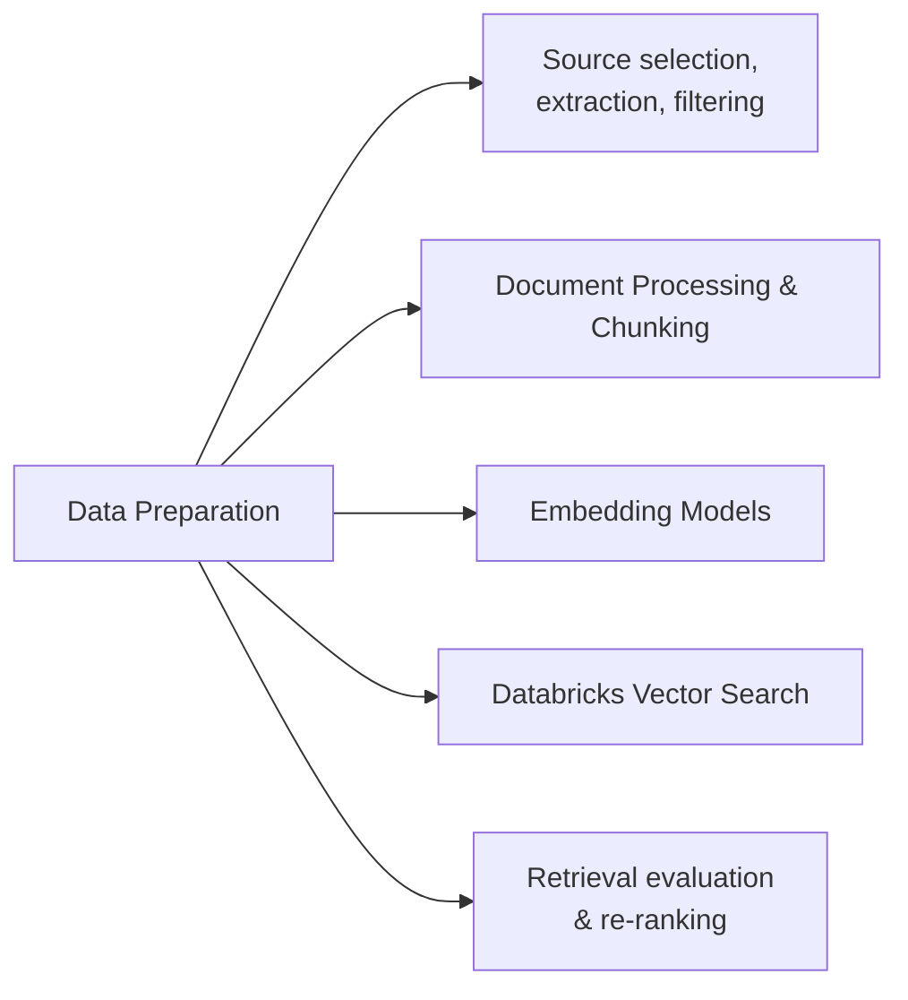

# Data Preparation (14 % of Exam)

Section 2 of the exam guide: the build-time half of RAG — choosing the right source documents, extracting and cleaning their content, **chunking**, **embedding**, writing chunks to Delta Lake in Unity Catalog, building **Vector Search** indexes, and measuring retrieval quality (including re-ranking).

## Topics Overview

## Section Contents

| File | Topic | Priority |
| :--- | :--- | :--- |
| [01-document-processing-chunking.md](./01-document-processing-chunking.md) | Parsing, chunk size, overlap, structure-aware and semantic chunking, writing chunks to Delta | High |
| [02-embeddings-models.md](./02-embeddings-models.md) | Choosing embedding models, dimensionality, FMAPI embedding endpoints, consistency | High |
| [03-databricks-vector-search.md](./03-databricks-vector-search.md) | Endpoints, Delta Sync vs Direct Vector Access indexes, sync modes, `similarity_search` | High |
| [04-source-documents-extraction-and-retrieval-eval.md](./04-source-documents-extraction-and-retrieval-eval.md) | Source selection, extraction packages (OCR, PDF, HTML, `ai_parse_document`), filtering, write sequence, retrieval metrics, re-ranking *(2026 guide)* | High |

## Exam Guide Coverage

| Exam guide bullet (Section 2) | Where it is covered |
| :--- | :--- |
| Apply a chunking strategy for a given document structure and model constraints | [01](./01-document-processing-chunking.md) |
| Filter extraneous content in source documents that degrades quality of a RAG application | [04](./04-source-documents-extraction-and-retrieval-eval.md#filtering-extraneous-content) |
| Choose the appropriate Python package to extract document content from provided source data and format | [04](./04-source-documents-extraction-and-retrieval-eval.md#choosing-a-python-package-to-extract-document-content) |
| Define operations and sequence to write given chunked text into Delta Lake tables in Unity Catalog | [01](./01-document-processing-chunking.md), [04](./04-source-documents-extraction-and-retrieval-eval.md#writing-chunked-text-to-delta-lake-in-unity-catalog) |
| Identify needed source documents that provide necessary knowledge and quality for a given RAG application | [04](./04-source-documents-extraction-and-retrieval-eval.md#identifying-the-source-documents-a-rag-application-needs) |
| Use tools and metrics to evaluate retrieval performance | [04](./04-source-documents-extraction-and-retrieval-eval.md#evaluating-retrieval-performance) |
| Design retrieval systems using advanced chunking strategies | [04](./04-source-documents-extraction-and-retrieval-eval.md#designing-retrieval-with-advanced-chunking-and-re-ranking), [RAG Design Patterns](../03-design-applications/01-rag-design-patterns.md) |
| Explain the role of re-ranking in the information retrieval process | [04](./04-source-documents-extraction-and-retrieval-eval.md#the-role-of-re-ranking), [RAG Design Patterns](../03-design-applications/01-rag-design-patterns.md) |

## Key Concepts

| Concept | Why it matters |
| :--- | :--- |
| **Chunk size & overlap** | Smaller chunks → more precise matches but more vectors; overlap preserves context across boundaries; larger chunks + less overlap → fewer embeddings |
| **Structure-aware / semantic chunking** | Split on headings or topic shifts rather than fixed counts |
| **Extraction package by format** | Images → OCR (`pytesseract`); HTML → BeautifulSoup; PDFs → `pypdf` / PyMuPDF; SQL → `ai_parse_document` |
| **Delta Sync Index vs Direct Vector Access** | Sync = auto-updated from a CDF-enabled Delta table; Direct = you push vectors via API |
| **Retrieval metrics** | Recall@k, precision@k, MRR, NDCG; MLflow `RetrievalSufficiency` needs ground truth |
| **Re-ranking** | Second-stage model improves precision at the top of the list at a latency cost |

## Related Resources

- [RAG / Vector Search Basics (shared)](../../../shared/fundamentals/rag-vector-search-basics.md)
- [Application Development (retrieval at runtime)](../01-application-development/README.md)
- [Databricks AI Search (formerly Vector Search) documentation](https://docs.databricks.com/aws/en/ai-search/ai-search)
- [Vector Search runtime (Application Development domain)](../01-application-development/04-vector-search-runtime.md) — the query-time half of vector search; this file covers index *creation*, that file covers retrieval *at runtime*

---

**[← Previous: Design Applications](../03-design-applications/README.md) | [↑ Back to GenAI Engineer Associate](../README.md) | [Next: Evaluation and Monitoring](../05-evaluation-and-monitoring/README.md) →**
